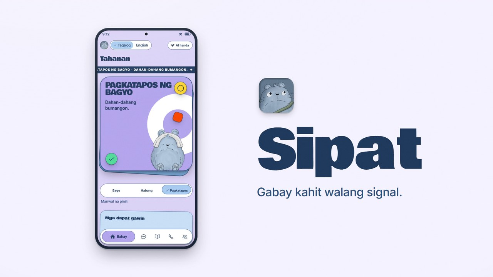
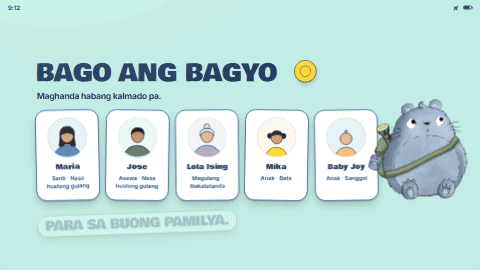

<p align="center">
  
</p>

<h1 align="center">Sipat</h1>

<p align="center">
  
  
  
  
  <br>
  
  
  
  <br>
  
  <br>
  
  
  
  
  <br>
  
  
</p>

> Offline typhoon companion for Filipino households on budget Android phones. Sourced answers in Taglish, fitted to your family, with no signal.

Product and design docs: [AGENTS.md](AGENTS.md) · [docs/](docs/README.md)

## Product film

<p align="center">
  <a href="https://youtube.com/shorts/iQ4W9_A_QU0"></a>
</p>

**[Watch on YouTube](https://youtube.com/shorts/iQ4W9_A_QU0)** (30 s, with sound). The signal drops, the family is set up before the storm, one tap on the warning heard on the radio switches the app to Habang may bagyo, the checklist fits the household, answers come only from the official guides, and "Wala ito sa gabay." when they don't. Built with Remotion from the app's own colours, components and copy: [motion/](motion/README.md).

## Problem

When a typhoon cuts power and signal, Filipino households lose access to preparedness guidance at the moment they need it most. Official guidance exists, but most of it lives online, is written for a general reader, and rarely says what a family with an infant, a senior on maintenance medicine and a house by a river should do at Signal No. 2 with an orange rainfall warning. Once the towers go down, the household has a battery radio and whatever it remembers.

Root causes ([docs/problem.md](docs/problem.md)):

1. **Online-only at the worst time.** Apps, websites and chatbots need data, the first thing to go and the last to come back.
2. **Generic, not household-fitted.** Checklists rarely say what changes with an infant, a pregnancy, a senior's medicines, pets, or a house by a river.
3. **Long and static.** Nobody searches a long PDF in the dark while the roof rattles.
4. **Wind-only thinking.** Signals describe wind. Floods come from rain and storm surge from the sea, each with its own PAGASA warning.
5. **Language.** Guides use English or formal Filipino. People ask in Taglish.
6. **No offline channel for LGUs.** A DRRMO knows its evacuation centers and hotlines but cannot put them in every household's pocket without signal.

## Data backing the problem and data metrics

| Metric | Figure | Source |
| :-- | :-- | :-- |
| Tropical cyclones entering the Philippine area each year | About 20, of which 8 or 9 cross the country | [Tropical Cyclone Research and Review, citing PAGASA](https://doaj.org/article/6d8b8bfa82c54a63a72f9c9adaa08c66) |
| PAGASA wind signal lead times (Signals 1 to 5) | 36, 24, 18, 12 and 12 hours | [PAGASA](https://bagong.pagasa.dost.gov.ph/learning-tools/tropical-cyclone-wind-signal) |
| Typhoon Odette (Dec 2021): mobile service disruption on day one | 369 areas across six regions | [New Straits Times, NDRRMC figure](https://www.nst.com.my/amp/world/region/2021/12/755494/least-12-killed-typhoon-odette) |
| Odette: cities and towns that lost electricity | 281; only 150 had power back ten days later, many only partly | [DZRH, NDRRMC spokesperson](https://www.dzrh.com.ph/post/power-restored-in-150-cities-ndrrmc) |
| Odette: people affected as of 19 Dec 2021 | About 780,800 people in 2,322 barangays across eight regions | [SunStar, NDRRMC figure](https://weekend.sunstar.com.ph/blog/2021/12/20/editorial-lets-help-those-affected-by-odette/) |
| Odette: communications down in Siargao | OCD had to set up satellite links | [PIA](https://mirror.pia.gov.ph/press-releases/2021/12/19/ocd-provides-emergency-comms-between-siargao-and-ndrrmc-after-disruption-due-to-ty-odette) |
| Severe Tropical Storm Kristine (Oct 2024): rainfall in Naga City | Over 700 mm in 24 hours, about 2.5 months' worth | [GMA](https://www.gmanetwork.com/news/topstories/regions/924744/rain-naga-24-hours/story) |
| Budget phone market | Transsion alone held 35% of shipments in Q3 2025 | [Omdia via NoypiGeeks](https://www.noypigeeks.com/?p=260620) |
| LGU preparedness budget | At least 5% of an LGU's regular revenue goes to the Local DRRM Fund | [RA 10121, Sec. 21](https://lawphil.net/statutes/repacts/ra2010/ra_10121_2010.html) |
| Share of Filipinos living in flood, landslide or storm surge prone areas | 74% (**Unverified**, secondary source attributed to the World Bank) | [iACADEMY](https://iacademy.edu.ph/story_details?id=1343) |

Why these two storms matter: Odette is the offline case (signal down in hundreds of areas on day one, power out for over a week in many towns), so the app must work fully offline. Kristine is the wind-only trap (a storm below typhoon strength whose danger was rain), so the app must handle rainfall and storm surge warnings, not just wind signals. Full evidence table and strength ratings: [docs/problem.md](docs/problem.md#4-evidence-and-how-strong-it-is).

## Solution

Sipat runs in three bagyo phases (**Bago**, **Habang may bagyo**, **Pagkatapos**). The phase changes the whole UI theme, the checklist and the answers.

- **Household profile, once.** The family sets up each member with a face photo. Photos and names never leave the phone.
- **Tap the warning you heard on the radio.** PAGASA wind signal 1 to 5, rainfall, storm surge or gale. You get a checklist fitted to your household.
- **Ask in Taglish.** Answers come only from official guides bundled in the app (PAGASA, NDRRMC and OCD, DOH, PHIVOLCS, BFP), with the source one tap away. When nothing matches, the app says "Wala ito sa gabay."
- **Useful without AI.** A vetted summary always shows first. Llama 3.2 1B, running on the phone, puts the matched passage in plain words second. Low battery, no model or AI switched off all fall back to the summary.
- **Safety lives in code.** Intent router, answer verifier, critical-passage pinning and phase switching are enforced in code, not prompts. Hotlines, evacuation centers and PAGASA bulletin data are rendered from data, never from the model.
- **Hybrid when there is signal.** A signed feed from our own server (scraped PAGASA bulletins, evacuation centers, hotlines, guide updates) is cached for offline use. Households never pay; LGUs pay for a localized pack.

## Demo video

<!-- TODO: replace with the real link once the demo is recorded -->
[Watch the demo video](#) (link coming soon)

## Demo GIF

<p align="center">
  
</p>

## Tools used

| Area | Tools |
| :-- | :-- |
| App | Expo development build, React Native (New Architecture), TypeScript (strict), Hermes, React Navigation |
| On-device AI | [llama.rn](https://github.com/mybigday/llama.rn) running `Llama-3.2-1B-Instruct-Q4_K_M.gguf` (about 0.81 GB) |
| Retrieval | [MiniSearch](https://github.com/lucaong/MiniSearch) (BM25+) with Taglish synonyms and tag boosts |
| Storage | react-native-mmkv |
| Photos | expo-image-picker, expo-image-manipulator, Google ML Kit face detection (bundled, detection only, no recognition) |
| Device and location | expo-battery, expo-device, expo-location (optional, one coarse reading), expo-sharing |
| Feed security | `@noble/ed25519`, `@noble/hashes`, react-native-quick-crypto (signed feed and packs) |
| Tooling | Node scripts (`tsx`) for content validation, pack and feed builds, scraper and evaluation; Vitest; ESLint; Playwright |

## How to set up locally

**Requirements**

- Node.js 22 or newer, and npm
- Git
- For Android: Android Studio (SDK and platform tools), JDK 17, and either a phone with USB debugging or an emulator

**Steps**

```bash
git clone https://github.com/Jimuelle07/Sipat.git
cd Sipat
npm install
npm run validate:content   # checks content/*.json (sources, reviewers, dates)
npm run typecheck
npm test
```

**Demo for judges, no device needed**

```bash
npm install
npm run demo
```

Then open <http://localhost:8081> in Chrome or Edge. The demo starts with a seeded household, a DEMO bulletin, the storm track and three DEMO evacuation centers ([docs/seed_data.md](docs/seed_data.md)). `npm run demo` works the same in PowerShell, cmd, macOS and Linux. If port 8081 is taken, run `npm run demo -- --port 8082` and open that port instead.

The web preview saves to the browser's `localStorage` and has no AI model, so answers show the vetted summary. To start over from the seed, clear the site data for the page (DevTools, Application, Clear site data) and reload.

"Kunan ng litrato" opens the computer's webcam in the browser (allow camera access when asked); on a phone browser it opens the live camera, or the phone's camera app when the page is not on `localhost` or `https`. Photos are cropped by hand on web (face detection is native-only), re-encoded without EXIF and kept in the browser on that device.

**Quickest preview without the demo data:** `npm run web`

**Optional environment flags**

| Flag | Effect |
| :-- | :-- |
| `EXPO_PUBLIC_ENGINE=mock` | Use the mock engine instead of the real one |
| `EXPO_PUBLIC_DEMO_SEED=1` | Seed a demo household; `npm run demo` sets it for you |

**Optional: enable the on-device model**

The app works fully without AI. To turn it on, open Settings and tap **I-download ang AI (0.81 GB)**: the app downloads `Llama-3.2-1B-Instruct-Q4_K_M.gguf` once from [Hugging Face](https://huggingface.co/bartowski/Llama-3.2-1B-Instruct-GGUF), checks its size and SHA-256, and lists the request in the on-screen network log. Nothing downloads in the background or automatically. Without a connection, tap **Mula sa file sa telepono** and pick a copy of the same file already on the phone. AI is skipped automatically (vetted summaries only) when the model is missing, the device tier is `none` (Settings then shows only the tier message), AI is switched off, the battery is below 15%, or battery saver is on. The web preview cannot run the model (llama.rn is native only).

## How to use Expo for Android

> **Expo Go will not work.** The app uses native modules (`react-native-mmkv`, `llama.rn`, ML Kit), so it needs an Expo **development build**.

1. **Prepare the phone or emulator.**
   - Phone: enable Developer options, then USB debugging, plug it in, and accept the prompt. Check with `adb devices`.
   - Emulator: create a virtual device in Android Studio and start it.
2. **Build and install the development build (first time only).**
   ```bash
   npx expo run:android
   ```
   This prebuilds `android/`, compiles the app, installs the debug build on the device and starts Metro.
3. **Day-to-day runs, with the dev build already installed.**
   ```bash
   npm start      # then press "a" to open on Android
   ```
   or `npm run android`.
4. **Connection tips.** Phone and computer should be on the same Wi-Fi, or use USB (`adb reverse tcp:8081 tcp:8081`).
5. **Release build** (keeps the INTERNET permission for the Settings model download; FLAG_SECURE is added by `plugins/withSecureScreen.js`):
   ```bash
   npx expo run:android --variant release
   ```

**Troubleshooting**

- `adb` not found: add Android SDK `platform-tools` to your PATH.
- Build errors after changing native modules: rebuild with `npx expo run:android`.
- Stale JS bundle: `npx expo start --clear`.

## Scripts

| Script | What it does |
| :-- | :-- |
| `npm start` | Start Metro |
| `npm run web` | Web preview |
| `npm run demo` | Web preview with the demo seed on (any OS) |
| `npm run android` | Start Metro and open Android |
| `npm test` | Vitest unit tests |
| `npm run typecheck` | `tsc --noEmit` |
| `npm run lint` | ESLint on `app/ui` |
| `npm run validate:content` | Validate bundled content |
| `npm run eval` | Run the question-set evaluation |

## Project layout

```text
app/        engine facade, core logic, services, UI
content/    bundled guide, checklist, warnings, hotlines, sources
plugins/    Expo config plugins
scripts/    content validation, feed and pack build, scraper, evaluation
eval/       question sets and results
docs/       product and system design (docs/media: the product film's poster)
motion/     the product film's source (Remotion)
```

## Team

| GitHub | Name | Role |
| :-- | :-- | :-- |
| [@Jimuelle07](https://github.com/Jimuelle07) | Jimuelle Patron | Dev |
| [@Mikael1206](https://github.com/Mikael1206) | An-joe Mikael Albino | Assets |
| [@Kao-Kao04](https://github.com/Kao-Kao04) | Emmanuel Mutas | Research |
