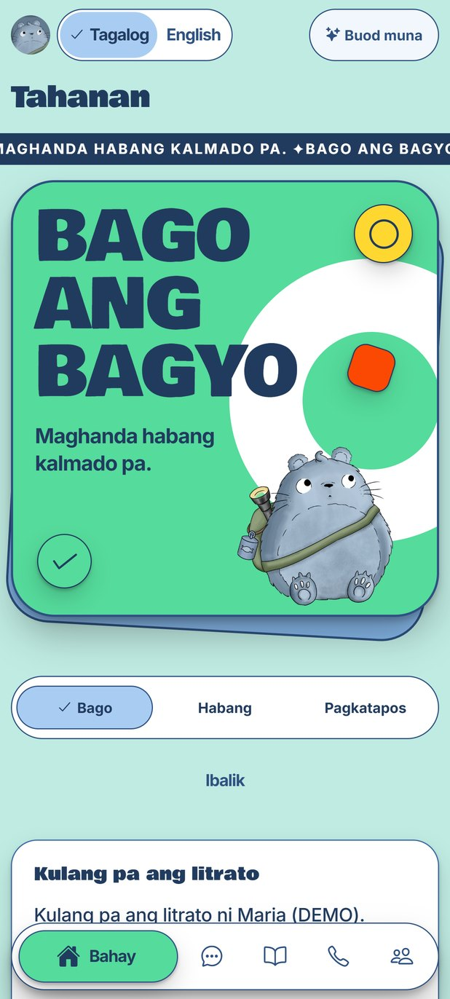
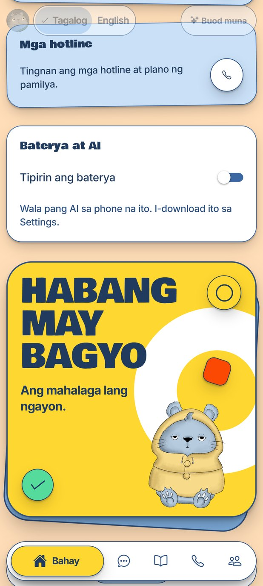
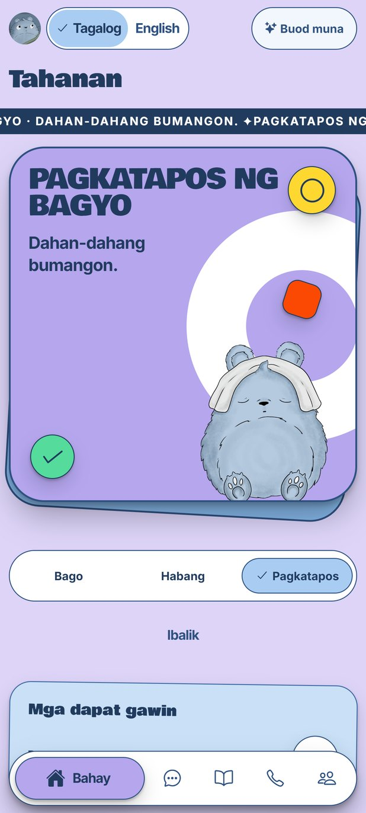
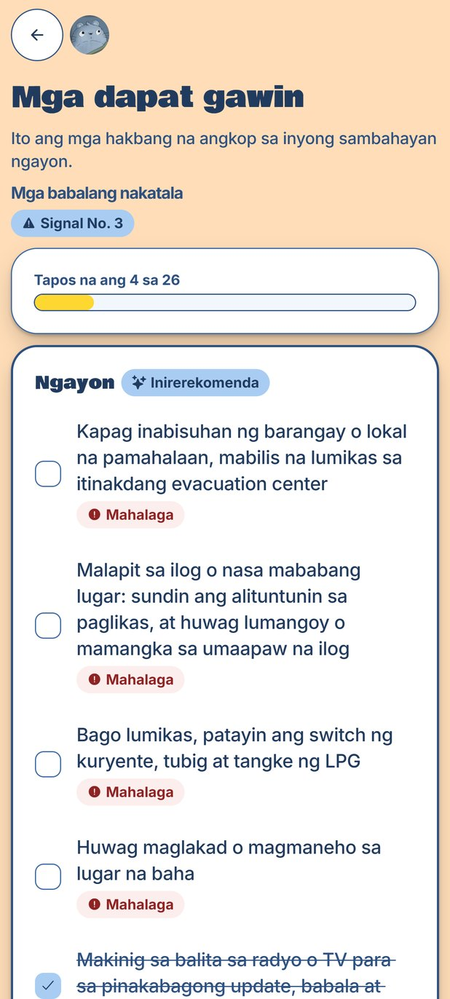
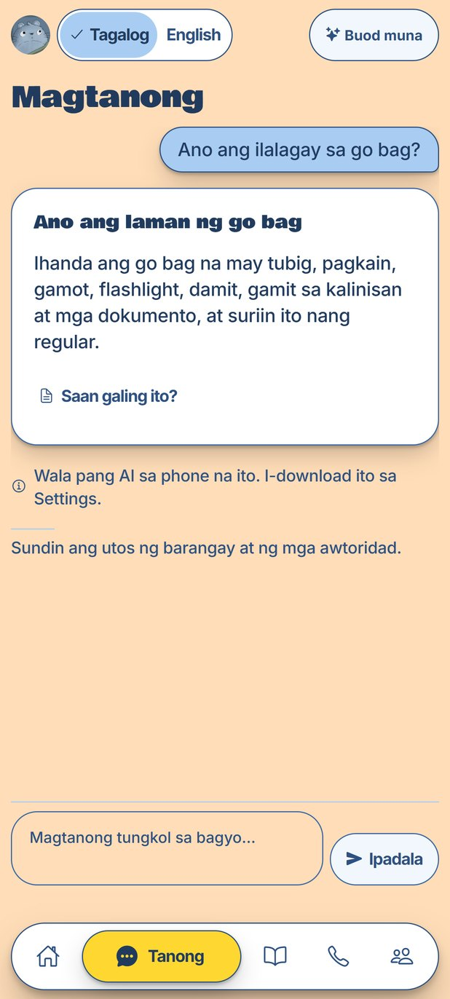
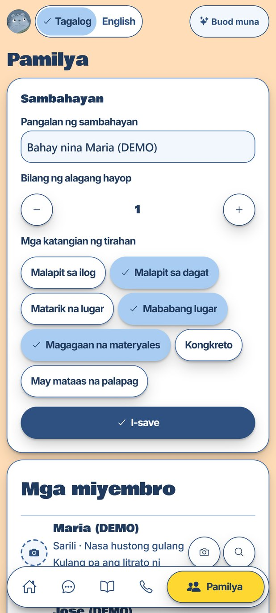
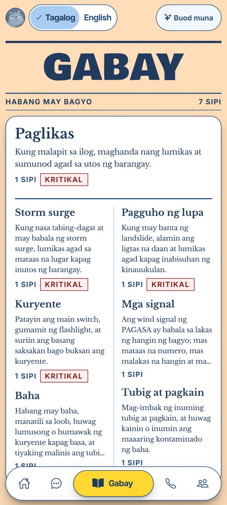

<p align="center">
  
</p>

<h1 align="center">Sipat</h1>

<p align="center"><b>Gabay kahit walang signal.</b><br>
An offline typhoon companion for Filipino households on budget Android phones: sourced answers in Taglish, fitted to your family, with no signal.</p>

<p align="center">
  
  
  
  <br>
  
  
  
  
</p>

<p align="center">
  <a href="https://youtube.com/shorts/iQ4W9_A_QU0">Product film</a> ·
  <a href="#quick-start">Quick start</a> ·
  <a href="docs/README.md">Docs</a> ·
  <a href="AGENTS.md">Product rules</a>
</p>

## See it

<table align="center">
  <tr>
    <td align="center" width="50%">
      <a href="https://youtube.com/shorts/iQ4W9_A_QU0"></a>
      <br><b><a href="https://youtube.com/shorts/iQ4W9_A_QU0">Watch the 30-second film</a></b>
    </td>
    <td align="center" width="50%">
      
      <br><b>Tap, switch, checklist, answer</b>
    </td>
  </tr>
</table>

### Three phases, one app

<p align="center">
  
  
  
</p>
<p align="center"><b>Bago ang bagyo</b> · <b>Habang may bagyo</b> · <b>Pagkatapos ng bagyo</b></p>

### Screens

<p align="center">
  
  
  
  
</p>
<p align="center">Checklist · Ask · Family · Guide</p>

## The problem

When a typhoon cuts power and signal, Filipino households lose preparedness guidance exactly when they need it. Official guidance exists, but it lives online, is written for a general reader, and rarely says what a family with an infant, a senior on maintenance medicine and a house by a river should do at Signal No. 2 with an orange rainfall warning.

- **Online-only at the worst time.** Data is the first thing to go and the last to come back.
- **Generic, not household-fitted.** Checklists ignore infants, pregnancy, seniors' medicines, pets and homes by a river.
- **Wind-only thinking.** Signals describe wind; floods come from rain and storm surge, each with its own PAGASA warning.
- **Language.** Guides use English or formal Filipino. People ask in Taglish.

| Evidence | Figure | Source |
| :-- | :-- | :-- |
| Tropical cyclones entering the Philippine area each year | About 20 | [TCRR, citing PAGASA](https://doaj.org/article/6d8b8bfa82c54a63a72f9c9adaa08c66) |
| Typhoon Odette (2021): mobile service down on day one | 369 areas across six regions | [New Straits Times, NDRRMC](https://www.nst.com.my/amp/world/region/2021/12/755494/least-12-killed-typhoon-odette) |
| Odette: cities and towns that lost electricity | 281 | [DZRH, NDRRMC](https://www.dzrh.com.ph/post/power-restored-in-150-cities-ndrrmc) |
| Severe Tropical Storm Kristine (2024): rain on Naga City | Over 700 mm in 24 hours | [GMA](https://www.gmanetwork.com/news/topstories/regions/924744/rain-naga-24-hours/story) |
| LGU preparedness budget | At least 5% of regular revenue goes to the Local DRRM Fund | [RA 10121, Sec. 21](https://lawphil.net/statutes/repacts/ra2010/ra_10121_2010.html) |

Full evidence and root causes: [docs/problem.md](docs/problem.md).

## How Sipat works

Sipat runs in three bagyo phases (**Bago**, **Habang may bagyo**, **Pagkatapos**); the phase changes the whole theme, the checklist and the answers.

- **Household profile, once.** Each member is set up with a face photo. Photos and names never leave the phone.
- **Tap the warning you heard on the radio.** Wind signal 1 to 5, rainfall, storm surge or gale, and get a checklist fitted to your household.
- **Ask in Taglish.** Answers come only from official guides bundled in the app (PAGASA, NDRRMC and OCD, DOH, PHIVOLCS, BFP), with the source one tap away. When nothing matches: "Wala ito sa gabay."
- **Useful without AI.** The vetted summary always shows first; Llama 3.2 1B on the phone puts it in plain words second.
- **Safety lives in code.** Routing, answer checks and phase switching are enforced in code; hotlines and bulletins are rendered from data, never from the model.
- **Hybrid when there is signal.** A signed feed from our server is cached for offline use. Households never pay; LGUs pay for a localized pack.

## Quick start

**Demo, no device needed** (Node.js 22+):

```bash
git clone https://github.com/Jimuelle07/Sipat.git
cd Sipat
npm install
npm run demo        # then open http://localhost:8081
```

The demo starts with a seeded household, a DEMO bulletin and DEMO evacuation centers ([docs/seed_data.md](docs/seed_data.md)). The web preview has no AI model, so answers show the vetted summary. Port taken? `npm run demo -- --port 8082`.

**Checks:**

```bash
npm run validate:content && npm run typecheck && npm test
```

### Run on Android

Expo Go will not work: the app uses native modules (`react-native-mmkv`, `llama.rn`, ML Kit), so it needs a **development build**. You need Android Studio (SDK, platform tools), JDK 17, and a phone with USB debugging or an emulator.

```bash
npx expo run:android                     # first time: builds and installs the dev build
npm start                                # afterwards: press "a" to open on Android
npx expo run:android --variant release   # release build
```

On a phone over USB, `adb reverse tcp:8081 tcp:8081` connects it to Metro. After changing native modules, run `npx expo run:android` again; for a stale bundle, `npx expo start --clear`.

### Turn on the on-device AI (optional)

In Settings, tap **I-download ang AI (0.81 GB)**. The app downloads `Llama-3.2-1B-Instruct-Q4_K_M.gguf` once from [Hugging Face](https://huggingface.co/bartowski/Llama-3.2-1B-Instruct-GGUF), checks its size and SHA-256, and logs the request on screen. Offline, **Mula sa file sa telepono** imports a copy already on the phone. Without the model, on low battery or with AI off, Sipat shows vetted summaries only.

## Scripts

| Script | What it does |
| :-- | :-- |
| `npm run demo` | Web preview with the demo seed |
| `npm run web` | Web preview |
| `npm start` / `npm run android` | Metro / open on Android |
| `npm test` | Vitest unit tests |
| `npm run typecheck` · `npm run lint` | TypeScript and ESLint |
| `npm run validate:content` | Validate bundled content |
| `npm run eval` | Question-set evaluation |

## Tech stack

| Area | Tools |
| :-- | :-- |
| App | Expo dev build, React Native (New Architecture), TypeScript, Hermes, React Navigation |
| On-device AI | [llama.rn](https://github.com/mybigday/llama.rn) with Llama 3.2 1B Instruct (Q4_K_M, about 0.81 GB) |
| Retrieval | [MiniSearch](https://github.com/lucaong/MiniSearch) (BM25+) with Taglish synonyms |
| Storage and photos | react-native-mmkv; expo-image-picker; ML Kit face detection (detection only, no recognition) |
| Feed security | `@noble/ed25519`, `@noble/hashes` (signed feed and packs) |
| Tooling | Node + `tsx` scripts, Vitest, ESLint, Playwright; the product film is made with Remotion |

## Project layout

```text
app/        engine facade, core logic, services, UI
content/    bundled guide, checklist, warnings, hotlines, sources
plugins/    Expo config plugins
scripts/    content validation, feed and pack build, scraper, evaluation
eval/       question sets and results
docs/       product and system design; docs/media holds the film poster and demo GIF
motion/     the product film's source (Remotion)
```

## Team

| GitHub | Name | Role |
| :-- | :-- | :-- |
| [@Jimuelle07](https://github.com/Jimuelle07) | Jimuelle Patron | Dev |
| [@Mikael1206](https://github.com/Mikael1206) | An-joe Mikael Albino | Assets |
| [@Kao-Kao04](https://github.com/Kao-Kao04) | Emmanuel Mutas | Research |
