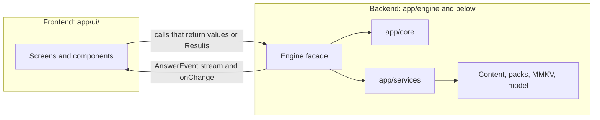

# API layer

The exact contracts between Bagyo Buddy's modules, its data files, its signed packs and its Pilot servers; the reasons behind them live in system-design.md.

Related: [README.md](README.md) · [system-design.md](system-design.md) · [solution.md](solution.md)

## 1. Overview

| Layer | What it covers | Release |
| :-- | :-- | :-- |
| A. On-device module API | TypeScript inside the app: the pure core (`src/core/`), the `ask()` orchestrator and the services (`src/services/`) | MVP |
| B. Data contracts | Bundled JSON in `content/`; signed packs and deltas | MVP (bundled), MVP stretch (offline pack import), Pilot (Smart Update) |
| C. Network API | Smart Update static CDN, Bantay LGU portal REST API, opt-in topic-report endpoint | Pilot |

Only two modules may ever open a network connection:

| Module | MVP | Pilot |
| :-- | :-- | :-- |
| `UpdateClient` | Not shipped. The APK has no INTERNET permission. | GET only, to one pinned CDN host. Downloads wait for a tap. Every request goes into `networkLog`. |
| `TopicReporter` | Not shipped | One POST per completed week, only after opt-in |
| Everything else: `src/core/*`, `ask()`, `ModelManager`, `PowerPolicy`, `Store`, `PackManager`, `ShareService` | Never | Never |

`ShareService` hands text and files to other apps (the SMS app, the share sheet). It opens no connection itself.

**Two-person handoff.** [Section 3](#3-frontendbackend-handoff) is the whole contract between the frontend person (the screens) and the backend person (the engine behind the screens and, from the Pilot on, the cloud). The frontend person needs only section 3 and the types it links to. Sections 5 to 12 are the backend's internals and wire formats.

## 2. Conventions

- TypeScript with `strict: true`. Modules in `src/core/` import nothing from React Native, so they run unchanged in Node for tests and evaluation.
- IDs are kebab-case strings, unique within their file, never reused: `during-flood-river-01`.
- Times are ISO 8601 with the Manila offset: `2026-10-09T14:15:00+08:00`. Dates are `YYYY-MM-DD`. Weeks are ISO weeks: `2026-W41`.
- Places are PSGC codes from the Philippine Statistics Authority, always stored as strings.
- Language codes: `tl` (Tagalog and Taglish), `ceb` (Cebuano and Bisaya), `en`.
- Every content file, pack payload and HTTP body carries an integer `schema_version`.
- Casing: on-device runtime and storage types use camelCase. JSON content files, packs and HTTP bodies use snake_case.
- Expected failures cross module boundaries as `Result` values, never as exceptions. Throwing is for bugs only.

```ts
export type Result<T, E extends string> =
  | { ok: true; value: T }
  | { ok: false; error: { code: E; message: string } };
```

- UI copy is referenced by key. The fixed Tagalog copy from [README.md](README.md#shared-names):

```ts
export type CopyKey =
  | 'closing'       // "Sundin ang utos ng barangay at ng mga awtoridad."
  | 'refusal'       // "Wala ito sa gabay."
  | 'source_link'   // "Saan galing ito?"
  | 'no_live_data'  // "Walang live na balita ang app tungkol sa bagyo. Makinig sa PAGASA sa radyo o magtanong sa barangay."
  | 'stale_warning' // "Makinig muli sa radyo. Baka nagbago na ang signal."
  | 'medical_dose'; // draft: "Hindi nagbibigay ng dosis ng gamot ang app. Magtanong sa Health Center o sa doktor."
```

English translations exist for display under the Tagalog original and are pending review.

## 3. Frontend–backend handoff

This section is the full contract between the two people who build the app. The frontend person needs only this section and the types it links to. The backend person implements it using sections 5 to 12.

In the MVP there is no server. Everything a server would normally do, such as search, the model, the safety rules and storage, runs on the phone behind one facade, the `Engine`. That facade is the boundary. From the Pilot on, the backend also includes the cloud, and the Bantay portal adds a second boundary ([section 3.9](#39-pilot-the-second-boundary)).

### 3.1 Who owns what

| | Frontend | Backend |
| :-- | :-- | :-- |
| Builds | Screens, navigation, components, theme (dark, large text), animations, accessibility, UI copy | The `Engine` facade and everything behind it: core logic, services, content files, the model, storage, packs, evaluation. Pilot: the cloud |
| Folders | `app/ui/` (screens, components, UI primitives) | `app/engine/`, `app/core/`, `app/services/` (the Engine facade, core logic, services, storage, content, evaluation, and cloud APIs) |
| May import | `app/engine` (types, `createEngine`, `createMockEngine`), UI primitives, navigation | Anything it needs |
| Must not import | `app/core/*`, `app/services/*`, native modules | `app/ui/` |
| Writes the text for | Labels, buttons, status lines and error messages ([section 3.5](#35-codes-the-ui-must-handle)) | Safety copy and guide content, delivered inside events or through `engine.copy()` |
| Pilot | The Bantay portal web UI | The portal REST API, the pack pipeline, the CDN and topic ingestion |

An ESLint `no-restricted-imports` rule in `app/ui/` enforces the import rows. The engine owns every native/system module, so the frontend never deals with the model, storage, battery, files, the camera, face detection, SMS or the dialer. The UI only shows the preview images and face boxes the engine hands it.



### 3.2 The Engine facade

```ts
// src/engine/types.ts mirrors this section. Change both in the same commit.
export const ENGINE_API_VERSION = 1;

export interface Engine {
  init(): Promise<Result<EngineInfo, 'content_invalid' | 'storage_failed'>>; // once, behind the splash screen
  info(): EngineInfo;
  status(): EngineStatus;
  copy(key: CopyKey, lang?: UiLanguage): string; // 'tl' default; 'en' is a translation shown under the Tagalog
  onChange(listener: (change: EngineChange) => void): () => void; // returns unsubscribe

  profiles: ProfilesApi;
  family: FamilyApi;   // members (MVP); photos, roll call and cards (MVP stretch)
  context: ContextApi;
  checklist: ChecklistApi;
  ask: AskApi;
  guide: GuideApi;
  emergency: EmergencyApi;
  plan: PlanApi;
  settings: SettingsApi;
  history: HistoryApi;
  evaluation: EvaluationApi;
  packs: PacksApi;     // MVP stretch
  updates: UpdatesApi; // Pilot
}

// The real engine. Tests pass overrides (fake model, in-memory store, fixed clock, fixture content); the app passes none.
export function createEngine(overrides?: EngineOverrides): Engine;
// The same interface with scripted data and answers (section 3.6).
export function createMockEngine(opts?: MockOptions): MockEngine;

export interface EngineOverrides { // tests and the Node evaluation only
  model?: ModelManager; // a fake that scripts generate()
  power?: PowerPolicy;  // a fixed battery state and tier
  store?: Store;        // in-memory instead of MMKV
  now?: () => Date;     // a fixed clock
  content?: Partial<Record<ContentFileName, unknown>>; // fixture files instead of the bundled ones
}
```

Rules for every method:

- Call `init()` once at startup and wait for it. Nothing else may be called before it resolves. On failure, show the fatal error screen ([section 3.5](#35-codes-the-ui-must-handle)).
- Getters are synchronous and cheap: content sits in memory and MMKV reads are synchronous. Call them while rendering or inside a hook.
- Mutations are synchronous and return the new value, except the ones that return a `Promise`.
- Expected failures return a `Result` ([section 2](#2-conventions)). The facade never throws on user input; a throw is a bug to report.
- After every change, whether the UI caused it or the engine did (battery drop, model unloaded, warning gone stale, update found), the engine calls each `onChange` listener with what changed. The UI re-reads the matching getter.

```ts
export type EngineChange =
  | 'profiles' | 'family' | 'context' | 'checklist' | 'settings' | 'status' | 'history' | 'packs' | 'updates';

export interface EngineInfo {
  appVersion: string;
  engineApiVersion: number;
  guideDate: string; // YYYY-MM-DD, shown on About
  passagesCount: number;
  sourcesCount: number;
  packs: InstalledPack[];
  model: { fileName: string; sizeBytes: number; present: boolean; attribution: 'Built with Llama' };
}

export interface EngineStatus {
  tier: DeviceTier;
  model: ModelState;
  ai: AiDecision; // allowed, or the reason it is not
  battery: { level: number; charging: boolean; saver: boolean } | null; // null until the first reading
  stale?: { kind: WarningKind; hoursSinceSet: number };
  updateAvailable?: { totalBytes: number; guideDate?: string }; // Pilot
}
```

The domain APIs, grouped by the screens that use them:

```ts
// Profiles: family setup, Profile and Plan screens.
// A household is created together with its main person; other members go through engine.family.
// There is no online account: the household exists only on this phone.
export interface NewHouseholdInput {
  name: string;       // "Bahay namin"
  owner: MemberInput; // the main person; relation is forced to 'self'
}
export interface ProfileInput { // household-level fields only
  id: string;
  name: string;
  petsCount: number;            // 0 to 20
  home: HomeTag[];
  livelihood?: LivelihoodTag[]; // Later
  area?: Profile['area'];       // Pilot
  plan: Profile['plan'];
}
export type ProfileErrorCode =
  | 'name_required' | 'too_long' | 'pets_range' | 'too_many_contacts' | 'contact_phone_invalid';
export type SaveProfileResult =
  | { ok: true; value: Profile }
  | { ok: false; errors: { code: ProfileErrorCode | MemberErrorCode; field: string }[] }; // field path, e.g. "owner.name"

export interface ProfilesApi {
  list(): Profile[];
  active(): Profile | null; // null before setup
  create(input: NewHouseholdInput): SaveProfileResult; // first step of setup; the new household becomes active
  save(input: ProfileInput): SaveProfileResult;
  setActive(id: string): Result<void, 'not_found'>;
  remove(id: string): Result<void, 'not_found' | 'last_profile'>; // deletes its members' photos too
}

// Family: member editor, photo screens, "Bilangan" and "Hinahanap". Always the active household.
export interface MemberInput {
  id?: string;      // omit to add
  name: string;     // name or nickname, 1 to 40 chars
  relation: Relation;
  ageGroup: AgeGroup;
  needs: NeedTag[];
  note?: string;    // ≤ 80 chars
  phone?: string;
}
export type MemberErrorCode =
  | 'name_required' | 'too_long' | 'phone_invalid' | 'too_many_members' | 'owner_relation';
export type SaveMemberResult =
  | { ok: true; value: Member }
  | { ok: false; errors: { code: MemberErrorCode; field: string }[] };

export interface MemberCardView { // "Hinahanap": shown full screen, offline
  member: Member;     // includes photo and note
  ownerName: string;
  ownerPhone?: string;
  evacuationCenter?: string;
  meetingPlace?: string;
}
export interface RollCallView { // "Bilangan"
  entries: { member: Member; present: boolean; at?: string }[]; // main person first
  presentCount: number;
  total: number;
}

export interface FamilyApi {
  members(): Member[]; // main person first
  saveMember(input: MemberInput): SaveMemberResult; // re-derives tags and headcount; fires 'family' and 'checklist'
  removeMember(memberId: string): Result<void, 'not_found' | 'owner_required'>; // also deletes the photo file
  photos: PhotosApi;   // MVP stretch
  card(memberId: string): MemberCardView | null;                                       // MVP stretch
  shareCard(memberId: string): Promise<Result<void, 'not_found' | 'cancelled' | 'failed'>>; // user tap only
  rollCall(): RollCallView;                                                            // MVP stretch
  markPresent(memberId: string, present: boolean): Result<RollCallView, 'not_found'>;
  resetRollCall(): RollCallView;
}

// Photos (MVP stretch). Face detection only finds boxes to crop; it never identifies anyone.
export interface FaceBox { x: number; y: number; width: number; height: number } // 0 to 1, relative to the preview
export type CropRect = FaceBox; // square crop the user approved
export interface PhotoDraft {
  draftId: string;
  previewUri: string;     // temp downscaled copy; deleted on discard, expiry or app restart
  faces: FaceBox[];       // left to right, at most 15; [] when none found or detection unavailable
  faceCheck: FaceCheck;
  suggestedCrop: CropRect; // around the face, or centered when there is none
  expiresAt: string;      // 30 minutes
}
export type PhotoError =
  | 'permission_denied' | 'no_camera' | 'unreadable' | 'draft_expired' | 'not_found' | 'io';

export interface PhotosApi {
  // Opens the system camera (asks CAMERA permission on first use) or the system photo picker.
  // 'group' takes one family photo whose faces the user assigns to members. null: the user backed out.
  start(target: { memberId: string } | 'group', source: 'camera' | 'gallery'):
    Promise<Result<PhotoDraft | null, PhotoError>>;
  // Crops to 512 × 512 JPEG without EXIF and attaches it to the member, replacing any old photo.
  // For a group draft, call once per assigned face with that face's crop.
  save(draftId: string, memberId: string, crop: CropRect): Promise<Result<MemberPhoto, PhotoError>>;
  discard(draftId: string): void; // call when the photo screen closes; deletes the preview and unused crops
  remove(memberId: string): Result<void, 'not_found'>;
  removeAll(): void;              // "Burahin ang lahat ng litrato"
}

// Context: the Home screen's phase buttons and the "Ano ang narinig mo?" picker
export type WarningInput =
  | { kind: 'tcws'; level: TcwsLevel }
  | { kind: 'rainfall' | 'surge'; level: ColorLevel }
  | { kind: 'gale' };

export interface ContextApi {
  get(): Context;
  options(): WarningEntry[];                    // every picker choice, in display order
  setPhase(phase: Phase): Context;              // 'after' clears all warnings
  setWarning(input: WarningInput): Context;     // replaces the same kind; setAt = now
  clearWarning(kind: WarningKind): Context;
  reconfirmWarning(kind: WarningKind): Context; // "Pareho pa rin": resets setAt and clears the stale banner
}

// Checklist screen
export interface ChecklistApi {
  view(): ChecklistView; // for the active profile and context
  tick(itemId: string, ticked: boolean): Result<ChecklistView, 'unknown_item'>;
  reset(): ChecklistView; // clears the active profile's ticks
}

// Ask screen
export interface AskApi {
  run(question: string, opts?: AskOptions): AsyncIterable<AnswerEvent>; // event order: section 6
  cancel(): void; // ends the current stream with done { outcome: 'cancelled' }
  warm(): void;   // call when the Ask screen gains focus; does nothing if AI is not allowed
  readonly maxLength: 200;
}

// Guide topics screen and "Saan galing ito?"
export interface PassageCard { id: string; title: string; summary: string; topic: TopicGroup; critical: boolean }
export interface PassageDetail extends PassageCard {
  text: string; source: SourceRef; reviewedBy: string; reviewedAt: string; version: number;
}
export interface GuideApi {
  topics(): { topic: TopicGroup; count: number }[]; // the UI maps each topic to its label
  byTopic(topic: TopicGroup): PassageCard[];
  passage(id: string): PassageDetail | null;
  sources(): Source[]; // About screen
}

// Emergency card: opened from Home, or delivered by an emergency_card event
export interface EmergencyCardView { id: string; title: string; steps: string[]; hotlines: Hotline[]; source: SourceRef }
export interface EmergencyApi {
  card(id?: string): EmergencyCardView; // the default card when id is omitted
}

// Plan and texts screen
export interface PlanApi {
  hotlines(): Hotline[];                   // national; the Pilot adds the LGU's
  evacuationCenters(): EvacuationCenter[]; // Pilot; [] in the MVP
  call(hotlineId: string): Promise<Result<void, 'not_found' | 'no_dialer'>>; // opens the dialer
  textPreview(kind: TextKind, opts: { where?: string }): string; // the body the SMS app will open with
  composeText(kind: TextKind, opts: { to: string[]; where?: string }):
    Promise<Result<void, 'no_recipients' | 'no_sms_app'>>; // MVP stretch
  exportPlan(): Promise<Result<void, 'cancelled' | 'failed'>>; // Pilot: printable plan
}

// Settings screen
export interface SettingsApi {
  get(): Settings;
  update(patch: Partial<Settings>): Result<Settings, 'out_of_range'>; // lowBatteryThreshold 5–50, staleWarningHours 1–12 (proposals)
}

// Question history, cleared from Settings
export interface HistoryApi {
  list(limit?: number): QuestionLogEntry[]; // newest first
  clear(): void;
}

// Evaluation screen
export interface EvalSummary {
  generatedAt: string;
  retrieval: { hitAt2: number; correctRefusal: number; emergencyTrigger: number; liveDataReply: number };
  answers: { faithfulness: number | null; numberCheckPass: number }; // faithfulness comes from the two-person review
  device: { summaryP50Ms?: number; firstWordsP50Ms?: number; fullAnswerP50Ms?: number; peakRamMb?: number };
}
export interface EvaluationApi {
  summary(): EvalSummary | null; // the laptop report bundled at build time, plus on-device timings
}

// Packs (MVP stretch): Settings and About
export interface PacksApi {
  installed(): InstalledPack[];
  importFromPicker(): Promise<Result<ImportPreview | null, PackError>>; // null when the user closes the picker
  importFile(uri: string): Promise<Result<ImportPreview, PackError>>;   // a file shared into the app
  apply(previewId: string): Promise<Result<ApplyResult, PackError | 'io'>>;
  rollback(packId: string): Promise<Result<void, 'io' | 'nothing_to_roll_back'>>;
  share(): Promise<Result<void, 'no_pack' | 'cancelled'>>;
}

// Updates (Pilot): Home banner, Settings and About
export interface UpdatesApi {
  pending(): UpdatePlan | null; // set by the auto-check; drives "May bagong gabay. I-download?"
  check(): Promise<Result<UpdatePlan | null, UpdateError>>; // user-triggered
  download(planId: string, onProgress: (bytes: number, total: number) => void, signal?: AbortSignal):
    Promise<Result<ImportPreview, UpdateError>>; // then packs.apply(previewId)
  networkLog(): NetworkLogEntry[];
}
```

### 3.3 Screen map

Every screen, what it reads, what it calls and which `onChange` values make it re-read.

| Screen | Reads | Calls | Re-reads on |
| :-- | :-- | :-- | :-- |
| Splash | — | `init()` | — |
| Family setup and Profile | `profiles.active()`, `profiles.list()`, `family.members()` | `profiles.create()` (main person first), `profiles.save()`, `profiles.setActive()`, `profiles.remove()` | `profiles`, `family` |
| Member editor | `family.members()` | `family.saveMember()`, `family.removeMember()`, `family.photos.remove()` | `family` |
| Photo and crop (MVP stretch) | the `PhotoDraft` (preview, face boxes, suggested crop) | `family.photos.start({ memberId }, source)`, `family.photos.save()`, `family.photos.discard()` | — |
| Group photo (MVP stretch) | the `PhotoDraft` with up to 15 faces | `family.photos.start('group', source)`, then `family.photos.save()` once per face the user names, then `family.photos.discard()` | `family` |
| "Bilangan" (MVP stretch) | `family.rollCall()` | `family.markPresent()`, `family.resetRollCall()` | `family` |
| "Hinahanap" card (MVP stretch) | `family.card()` | `family.shareCard()`, `plan.call()` | `family` |
| Home | `context.get()`, `context.options()`, `status()`, `updates.pending()` (Pilot banner) | `context.setPhase()`, `context.setWarning()`, `context.clearWarning()`, `context.reconfirmWarning()`, `emergency.card()` | `context`, `status`, `updates` (Pilot banner) |
| Checklist | `checklist.view()` | `checklist.tick()`, `checklist.reset()` | `checklist`, `context`, `profiles` |
| Ask | `status()` (AI badge) | `ask.warm()` on focus, `ask.run()`, `ask.cancel()`, `guide.passage()` for "Saan galing ito?", `plan.call()` on hotline buttons | `status` |
| Emergency card | the card from `emergency.card()` or from an `emergency_card` event | `plan.call()` | — |
| Plan and texts | `profiles.active()`, `plan.hotlines()`, `plan.evacuationCenters()` (Pilot), `plan.textPreview()` | `profiles.save()` for plan fields, `plan.composeText()` (MVP stretch), `plan.call()`, `plan.exportPlan()` (Pilot) | `profiles`, `packs` |
| Guide topics | `guide.topics()`, `guide.byTopic()`, `guide.passage()` | — | `packs` |
| About | `info()`, `guide.sources()`, `packs.installed()`, `updates.networkLog()` (Pilot) | `packs.share()` (MVP stretch) | `packs`, `updates` |
| Settings | `settings.get()`, `status()`, `packs.installed()` | `settings.update()`, `history.clear()`, `family.photos.removeAll()`, `packs.importFromPicker()`, `packs.apply()`, `packs.rollback()` (MVP stretch), `updates.check()`, `updates.download()` (Pilot) | `settings`, `status`, `packs`, `updates` |
| Evaluation | `evaluation.summary()`, `history.list()` | — | `history` |

App-wide elements read `status()`: the AI badge (`ai`, `model`), the low-battery badge (`battery`), the stale-warning banner (`stale`, text from `engine.copy('stale_warning')`) and, in the Pilot, the update banner (`updateAvailable`). An Android "share to Bagyo Buddy" intent passes its file URI to `packs.importFile()`.

### 3.4 Rendering the answer stream

`ask.run()` yields `AnswerEvent`s in the order fixed in [section 6](#6-orchestrator-ask-mvp). The Ask screen stacks them top to bottom: the emergency card if any, then one main card, then the AI block, then the closing line.

| Event | What the screen shows |
| :-- | :-- |
| `emergency_card` | The card at the top in the emergency style: `card.title`, `card.steps`, a call button per hotline (`plan.call(id)`). It stays while the rest arrives |
| `fixed_reply` | A plain card with `text`; no source link |
| `plan_answer` | The family's center, meeting place, contacts or hotlines as a card with call buttons. When `empty` is true, a prompt to fill in the plan and a button to the Plan screen |
| `refusal` | `text` plus up to three topic buttons from `suggestions`; each opens Guide topics at that topic |
| `summary` | `title` and `text` with a "Saan galing ito?" link that opens `guide.passage(passageId)`. When `pinned`, show it in bold with a "Mula sa gabay" label, and keep it above any AI text |
| `ai_status`: `loading_model`, `thinking` | A small progress line under the summary |
| `ai_status`: `skipped` | A muted note with the reason ([section 3.5](#35-codes-the-ui-must-handle)). The summary is the answer |
| `ai_partial` | Replace the AI block with `text` in the "being checked" style (lighter, no source links yet) |
| `ai_final` | The AI text in the normal style, with a "Saan galing ito?" link per ID in `used` |
| `ai_rejected` | Remove the AI text and show the rejected note. The summary stays |
| `closing` | `text` as the last line, always visible |
| `done` | Re-enable the input. Nothing visible |

Input rules: 1 to 200 characters (`ask.maxLength`); Send is disabled while the box is empty; a "Ihinto" (stop) button calls `ask.cancel()` while the AI block is streaming; sending a new question cancels the one in flight. If the UI meets an event type or a code it does not know, it shows nothing for the event and the generic message for the code, and never crashes. If the stream itself throws, which is a backend bug, the UI keeps whatever is already on screen, shows the generic message and re-enables the input.

### 3.5 Codes the UI must handle

Every code the frontend can receive, where it comes from, and draft Tagalog for the message. The messages are frontend copy; a native speaker on the team edits them. Safety copy is not in this table: it always comes from the engine.

| Code | Comes from | Draft message |
| :-- | :-- | :-- |
| `content_invalid`, `storage_failed` | `init()` | Fatal screen: "May problema sa app. Isara at buksan muli." |
| `low_battery` | `ai_status` skipped, `status().ai` | "Naka-off ang AI para makatipid sa baterya." |
| `battery_saver` | same | "Naka-on ang battery saver, kaya buod lang ang ipinapakita." |
| `ai_off` | same | "Naka-off ang AI sa Settings." |
| `tier` | same | "Hindi kaya ng phone na ito ang AI. Buod mula sa gabay ang ipinapakita." |
| `no_model` | same | "Wala pang AI model sa phone na ito." |
| `absent`, `unloaded`, `ready` | `status().model` | No message; the AI badge shows its idle state |
| `loading`, `generating`, `error` | `status().model`; `ai_status` loading_model, thinking | "Inihahanda ang AI…", "Sumusulat ng sagot…", "Hindi gumana ang AI. Buod lang muna." |
| `schema`, `not_in_guide`, `bad_citation`, `unknown_number`, `phone_number`, `too_long`, `wrong_language` (every `VerifierFailure`) | `ai_rejected` | One note for all codes: "Hindi ipinakita ang sagot ng AI dahil hindi ito tugma sa gabay." The code goes to the log, not the screen |
| `name_required` | `profiles.save()` | "Lagyan ng pangalan." |
| `too_long` | `profiles.save()` | "Masyadong mahaba." |
| `pets_range` | `profiles.save()` | "Ilagay ang bilang ng alaga (0 hanggang 20)." |
| `phone_invalid` | `family.saveMember()`, `profiles.create()` | "Tingnan muli ang numero." |
| `too_many_members` | `family.saveMember()` | "Hanggang 30 miyembro lang." |
| `owner_relation` | `family.saveMember()` | "Isa lang ang puwedeng maging pangunahing tao." |
| `owner_required` | `family.removeMember()` | "Hindi puwedeng burahin ang pangunahing tao." |
| `permission_denied` | `family.photos.start()` | "Walang pahintulot sa camera. Puwedeng pumili sa gallery o laktawan." |
| `no_camera` | `family.photos.start()` | "Walang camera ang phone na ito. Pumili sa gallery o laktawan." |
| `unreadable` | `family.photos.start()` | "Hindi mabuksan ang litrato. Pumili ng iba." |
| `draft_expired` | `family.photos.save()` | "Nag-expire na ang litrato. Kunan muli." |
| `one_face`, `no_face`, `many_faces`, `skipped` | `PhotoDraft.faceCheck` | No message for `one_face` or `skipped`; "Walang nakitang mukha. Ayusin ang crop o kunan muli." for `no_face`; "Maraming mukha. Piliin ang tamang tao." for `many_faces`. The photo can always be kept |
| `too_many_contacts` | `profiles.save()` | "Hanggang 5 contact lang." |
| `contact_phone_invalid` | `profiles.save()` | "Tingnan muli ang numero." |
| `not_found`, `last_profile` | `profiles.setActive()`, `profiles.remove()` | "Wala na ang profile na ito.", "Kailangan ng kahit isang profile." |
| `unknown_item` | `checklist.tick()` | Re-read the view; no message |
| `out_of_range` | `settings.update()` | "Wala sa pinapayagang saklaw." |
| `not_found` | `plan.call()` | Re-read `plan.hotlines()`; generic message |
| `not_found` | `family.*`, `family.photos.*` | Re-read `family.members()`; generic message |
| `io` | `family.photos.save()` | "Hindi na-save ang litrato. Tingnan kung may espasyo pa ang phone." |
| `no_dialer`, `no_sms_app`, `no_recipients` | `plan.call()`, `plan.composeText()` | "Hindi makatawag mula sa phone na ito.", "Walang SMS app sa phone na ito.", "Pumili ng padadalhan." |
| `cancelled`, `failed` | `plan.exportPlan()`, `packs.share()`, `updates.download()`, `family.shareCard()` | No message for `cancelled`; "Hindi nagawa. Subukan muli." for `failed` |
| `bad_archive` | `packs.import*()` | "Hindi mabasa ang file." |
| `unknown_key`, `bad_signature`, `key_expired` | `packs.import*()` | "Hindi galing sa Bagyo Buddy ang file na ito. Hindi ito ii-install." |
| `app_too_old` | `packs.import*()` | "I-update muna ang app." |
| `rollback` | `packs.import*()` | "Mas luma ang file na ito kaysa sa nasa phone." |
| `hash_mismatch`, `schema` | `packs.import*()` | "Sira ang file. Humingi ng bagong kopya." |
| `io`, `nothing_to_roll_back`, `no_pack` | `packs.apply()`, `packs.rollback()`, `packs.share()` | "Hindi na-save. Tingnan kung may espasyo pa ang phone.", "Walang naunang bersyon.", "Wala pang gabay na maibabahagi." |
| `offline`, `not_allowed`, `http` (Pilot) | `updates.check()`, `updates.download()` | "Walang internet.", "Wi-Fi lang ang nakatakda para sa update. Kumonekta sa Wi-Fi o baguhin ito sa Settings.", "Hindi maabot ang server. Subukan muli mamaya." |
| anything else | — | Generic: "May hindi gumana. Subukan muli." |

### 3.6 The mock engine

The backend person ships `createMockEngine()` in hour 1, before any real logic exists. It returns the full `Engine` with fixture data from `src/engine/fixtures/`: about 5 placeholder passages, 12 checklist items, every warning entry, 2 households of 4 members each (one with a placeholder photo) and 2 placeholder hotlines. `family.photos.start()` returns a fixture draft instead of opening the camera. The frontend builds every screen against it.

```ts
export type MockScenario =
  | 'guide_full' | 'guide_critical' | 'emergency_then_guide' | 'refusal' | 'live_data' | 'medical_dose'
  | 'plan_center' | 'plan_empty' | 'ai_rejected' | 'low_battery' | 'no_model';

export interface MockOptions {
  scenario?: MockScenario;      // force one scenario for every question
  speed?: 'realistic' | 'fast'; // 'fast' removes all delays, for tests
}

export interface MockEngine extends Engine {
  debug: {
    setScenario(s: MockScenario | null): void;     // null goes back to picking by keyword
    setStatus(patch: Partial<EngineStatus>): void; // e.g. battery 10%, tier 'lite'; fires onChange('status')
    emit(change: EngineChange): void;
    // the next family.photos.start() result: a draft with 1, 0, 2 or 3 faces, or an error
    setPhotoResult(r: 'one_face' | 'no_face' | 'many_faces' | 'group_3' | PhotoError): void;
    reset(): void;                                 // restore the fixtures
  };
}
```

Without a forced scenario, the mock picks one from a keyword in the question:

| Scenario | Keyword | Events |
| :-- | :-- | :-- |
| `emergency_then_guide` | lumulubog | `emergency_card`, then the `guide_full` sequence |
| `live_data` | nasaan, pasok | `fixed_reply` (`no_live_data`), `closing`, `done(fixed_reply)` |
| `medical_dose` | dosis | `fixed_reply` (`medical_dose`), `closing`, `done(fixed_reply)` |
| `plan_center` | evacuation center | `plan_answer` (`evacuation_center`), `closing`, `done(plan_answer)` |
| `plan_empty` | magkikita | `plan_answer` (`meeting_place`, `empty: true`), `closing`, `done(plan_answer)` |
| `refusal` | bigas | `refusal` with 3 suggestions, `closing`, `done(refused)` |
| `guide_critical` | lumikas | `summary` (`pinned: true`), then the AI events of `guide_full` |
| `ai_rejected` | litro | `summary`, `ai_status` ×2, `ai_partial` ×n, `ai_rejected` (`unknown_number`), `closing`, `done(answered_summary)` |
| `low_battery` | baterya | `summary`, `ai_status(skipped, low_battery)`, `closing`, `done(answered_summary)` |
| `no_model` | model | `summary`, `ai_status(skipped, no_model)`, `closing`, `done(answered_summary)` |
| `guide_full` | anything else | `summary`, `ai_status(loading_model)`, `ai_status(thinking)`, `ai_partial` ×n, `ai_final`, `closing`, `done(answered_ai)` |

With `speed: 'realistic'`, `summary` arrives at 0.3 s, `loading_model` at 0.4 s, `thinking` at 1.5 s, the first `ai_partial` at 3 s and one every 0.12 s after that, and `ai_final` at about 7 s. That is close to the README budgets, so loading states get exercised. `ask.cancel()` works in every scenario and ends the stream with `done(cancelled)`.

### 3.7 Contract tests, integration and changes

**Contract tests.** `src/engine/contract.test.ts` runs the same assertions in Node against `createMockEngine({ speed: 'fast' })` and against `createEngine()` with a fake model, an in-memory store and fixture content:

- every scenario's event sequence obeys the order rules in [section 6](#6-orchestrator-ask-mvp);
- every method returns the documented `Result` shape;
- `onChange` fires after each mutation with the right value;
- `setPhase('after')` clears the warnings;
- `profiles.save()`, `profiles.create()` and `family.saveMember()` return each documented error code for bad input;
- members derive the right household tags and headcount, and `buildChecklist` names them on matching items;
- `family.removeMember()` deletes the photo file, and the main person cannot be removed;
- no member name, note or photo path appears in a prompt, a text body, a pack or `questionLog`;
- `ask.cancel()` ends the stream with `done(cancelled)`.

When both engines pass, swapping the mock for the real engine cannot break the screens.

**Integration over the 10-hour build** (hours match [solution.md](solution.md)):

| When | Frontend | Backend |
| :-- | :-- | :-- |
| Hour 0 to 1 | Navigation shell, theme, splash | Commit `src/engine/types.ts` (this section in code) and `createMockEngine` with fixtures |
| Hour 1 to 4 | Every MVP screen against the mock; every scenario renders | The real engine in Node: content loading, `route`, `search`, `gate`, `buildChecklist`; the model running on the phone |
| Hour 4 sync | Switch with `EXPO_PUBLIC_ENGINE=real`; run the demo path end to end; list mismatches | Fix mismatches; contract tests green on both engines |
| Hour 4 to 7 | Emergency, Plan, About, Settings and Evaluation screens; polish | Verifier, critical pinning, `PowerPolicy`, tiers, performance |
| Hour 7 | The contract is frozen; bug fixes only | Same |
| Hour 9 | The release build uses the real engine; the mock stays for UI tests | The release build has no INTERNET permission |

**Changing the contract.**

- The backend person owns `src/engine/types.ts`, the code copy of this section. Any change needs the frontend person's OK, bumps `ENGINE_API_VERSION`, and updates this section in the same commit.
- After hour 4, changes are additive only: new optional fields and new methods. Renames and removals wait until after the demo.
- A new event type or code ships only with its row in [section 3.4](#34-rendering-the-answer-stream) or [section 3.5](#35-codes-the-ui-must-handle), so the UI never meets an unhandled case.

### 3.8 Definition of done

Frontend:

- [ ] Every screen in [section 3.3](#33-screen-map) works against the mock, and every scenario in [section 3.6](#36-the-mock-engine) renders as [section 3.4](#34-rendering-the-answer-stream) describes.
- [ ] Every code in [section 3.5](#35-codes-the-ui-must-handle) has a message.
- [ ] Lint passes the import rule; no native module is imported in `app/` or `src/ui/`.
- [ ] Large text and the dark theme are checked on the reference phone.

Backend:

- [ ] `createEngine()` implements every method in [section 3.2](#32-the-engine-facade); the contract tests pass on both engines.
- [ ] Core unit tests and the Node evaluation pass; `evaluation.summary()` returns the latest report.
- [ ] Performance budgets are measured on the reference phone ([system-design.md](system-design.md)).
- [ ] The MVP release build has no INTERNET permission.

### 3.9 Pilot: the second boundary

In the Pilot the frontend person also builds the Bantay portal web UI, and the backend person builds the cloud. The connections:

| Boundary | Frontend side | Backend side | Contract |
| :-- | :-- | :-- | :-- |
| Phone screens ↔ engine | Screens | `Engine` | This section; Pilot adds `updates` and the LGU parts of `plan` |
| Portal web UI ↔ portal API | The Bantay portal web app | REST API, database, auth | [Section 11.b](#b-bantay-lgu-portal-rest-api), published as `contracts/portal.openapi.yaml` |
| Engine ↔ CDN | — | `UpdateClient` ↔ pack pipeline | [Section 10](#10-packs-mvp-stretch-for-offline-import-pilot-for-smart-update) and [section 11.a](#a-smart-update-cdn); backend-internal |
| Engine ↔ topic ingestion | — | `TopicReporter` ↔ ingestion function | [Section 11.c](#c-topic-reports); backend-internal |

If the team splits by device instead, with one person on the phone (screens and engine) and one on the cloud, the boundaries become sections 10 and 11: the pack format, the CDN paths, the topic-report POST and the portal API.

## 4. Shared types (MVP)

```ts
export type Phase = 'before' | 'during' | 'after';

export type WarningKind = 'tcws' | 'rainfall' | 'surge' | 'gale';
export type TcwsLevel = 1 | 2 | 3 | 4 | 5;
export type ColorLevel = 'yellow' | 'orange' | 'red'; // ordered: yellow < orange < red

export interface ActiveWarnings {
  tcws?: { level: TcwsLevel; setAt: string };
  rainfall?: { level: ColorLevel; setAt: string };
  surge?: { level: ColorLevel; setAt: string };
  gale?: { setAt: string }; // present means on
}

export interface Context {
  phase: Phase;
  warnings: ActiveWarnings; // cleared when the user switches to 'after'
}

export type MemberTag = 'infant' | 'child' | 'pregnant' | 'senior' | 'pwd' | 'maintenance_meds' | 'pets';
export type HomeTag =
  | 'near_river' | 'near_sea' | 'slope' | 'low_lying' | 'light_materials' | 'concrete' | 'upper_floor';
export type LivelihoodTag = 'fisherfolk' | 'farmer'; // Later
export type ProfileTag = MemberTag | HomeTag | LivelihoodTag;
export type HazardTag = 'wind' | 'flood' | 'surge' | 'landslide' | 'electrical' | 'water' | 'health' | 'fire';

export type TopicGroup =
  | 'signals' | 'go_bag' | 'home_prep' | 'evacuation' | 'flood' | 'surge' | 'landslide'
  | 'infant' | 'senior' | 'pregnancy' | 'disability' | 'pets' | 'water_food' | 'electrical'
  | 'generator_fire' | 'cleanup' | 'health_after_flood' | 'out_of_guide';

export interface Contact {
  name: string;      // ≤ 60 chars
  phone: string;     // as typed by the user
  relation?: string; // ≤ 60 chars
}

// Family members (README H1 to H5)
export type AgeGroup = 'infant' | 'child' | 'teen' | 'adult' | 'senior'; // <1, 1–12, 13–17, 18–59, 60+
export type Relation =
  | 'self' | 'spouse' | 'child' | 'parent' | 'grandparent' | 'grandchild' | 'sibling' | 'relative' | 'other';
export type NeedTag = 'pregnant' | 'pwd' | 'maintenance_meds';
export type FaceCheck = 'one_face' | 'no_face' | 'many_faces' | 'skipped';

export interface MemberPhoto { // MVP stretch
  uri: string;       // app-private file, 512 × 512 JPEG, no EXIF
  bytes: number;     // target ≤ 150 KB
  source: 'camera' | 'gallery' | 'group';
  faceCheck: FaceCheck; // result when the photo was taken; skipped if detection was unavailable
  takenAt: string;
  version: number;   // goes up when the photo is replaced
}

export interface Member {
  id: string;
  name: string;      // name or nickname, 1 to 40 chars
  relation: Relation; // exactly one member per household is 'self', the main person
  ageGroup: AgeGroup;
  needs: NeedTag[];
  note?: string;     // ≤ 80 chars, e.g. medicine names or allergies; on the phone only
  phone?: string;
  photo?: MemberPhoto;
  updatedAt: string;
}

export interface Profile {
  id: string;
  name: string;               // "Bahay namin", "Bahay nina Lola"; ≤ 60 chars
  ownerId: string;            // Member.id of the main person
  people: Member[];           // main person first; 1 to 30
  petsCount: number;          // 0 to 20
  headcount: number;          // derived: people.length; read-only
  members: MemberTag[];       // derived by deriveHousehold from people and petsCount; read-only
  home: HomeTag[];
  livelihood: LivelihoodTag[]; // Later; [] until then
  area?: { provinceCode: string; municipalityCode?: string; barangayCode?: string }; // PSGC
  plan: {
    evacuationCenter?: string;   // typed name, ≤ 60 chars
    evacuationCenterId?: string; // EvacuationCenter.id from an LGU pack (Pilot)
    meetingPlace?: string;       // ≤ 60 chars
    contacts: Contact[];         // at most 5
  };
  updatedAt: string;
}

export type DeviceTier = 'full' | 'lite' | 'none';
export type UiLanguage = 'tl' | 'en';

export interface Settings {
  language: UiLanguage;         // default 'tl'
  lowBatteryThreshold: number; // percent, default 15
  aiEnabled: boolean;          // default true
  staleWarningHours: number;   // default 3
  autoCheckUpdates: boolean;   // Pilot, default true
  wifiOnly: boolean;           // Pilot, default true
  topicReportsOptIn: boolean;  // Pilot, default false
}
```

## 5. Core functions (`src/core/`, pure, MVP)

Backend-internal: the UI never calls these; it uses the `Engine` facade ([section 3](#3-frontendbackend-handoff)). One file per function, named after it. All are deterministic for the same inputs, which keeps the Node evaluation identical to the phone.

### normalize

```ts
export interface NormalizedQuery {
  raw: string;        // as typed, trimmed, at most 200 chars
  text: string;       // lowercased, punctuation and filler words removed
  tokens: string[];
  expanded: string[]; // canonical tokens added from synonyms.json
}
export function normalize(text: string, synonyms: SynonymEntry[]): NormalizedQuery;
```

Never fails. Input longer than 200 characters is cut at 200.

### route

```ts
export type PlanField = 'evacuation_center' | 'meeting_place' | 'contacts' | 'hotlines';

export interface RouteResult {
  emergency: boolean; // show the emergency card first, then continue with `primary`
  primary: 'live_data' | 'plan' | 'medical_dose' | 'guide';
  matched: string[];  // phrases that fired, for the question log
  planField?: PlanField; // set when primary is 'plan'
}
export function route(query: NormalizedQuery, rules: IntentRules): RouteResult;
```

`emergency` is checked on its own. `primary` is the first match in this order: `live_data`, `medical_dose`, `plan`; otherwise `guide`.

### search and gate

```ts
export interface GuideIndex {} // opaque; wraps a MiniSearch instance built at startup
export function createIndex(passages: Passage[]): GuideIndex;

export interface SearchConfig {
  threshold: number;          // calibrated on the evaluation set
  secondPassageRatio: number; // add a 2nd passage only if its score ≥ ratio × top; proposal 0.6
  maxPassages: 1 | 2;         // 2 for tier 'full', 1 for 'lite' and 'none'
  boosts: { phase: number; warning: number; profileTag: number; cap: number }; // proposal 1.2, 1.2, 1.2, cap 1.5
}

export interface SearchHit {
  id: string;
  score: number;        // MiniSearch BM25+ score
  boostedScore: number; // after tag boosts
  terms: string[];      // query terms that matched
  topic: TopicGroup;
  critical: boolean;
}

export interface GateResult {
  passed: boolean;
  topScore: number;  // raw BM25+ score of the top hit: rank by boosted score, gate on raw
  threshold: number;
}

export interface SearchResult {
  query: NormalizedQuery;
  hits: SearchHit[];         // top 5, sorted by boostedScore
  selected: string[];        // 1 or 2 passage IDs; [] when the gate fails
  gate: GateResult;
  suggestions: TopicGroup[]; // up to 3, for the refusal buttons
}

export function search(
  query: NormalizedQuery, ctx: Context, profile: Profile, index: GuideIndex, config: SearchConfig,
): SearchResult;
export function gate(hits: SearchHit[], config: SearchConfig): GateResult;
```

Tag boosts go through MiniSearch's `boostDocument`. Fuzzy and prefix settings are in [system-design.md](system-design.md). Passage `warnings` only boost a passage; they never hide it.

### buildChecklist

```ts
export type ChecklistGroupId = 'now' | 'go_bag' | 'home' | 'evacuate' | 'after';
export interface ChecklistTick { ticked: boolean; updatedAt: string }

export interface WarningCard {
  warningId: string; // WarningEntry.id
  kind: WarningKind;
  label: string;
  meaning: string;
  leadTimeH?: number;
  setAt: string;
  confirmed: boolean; // false shows "(i-check sa PAGASA)"
}

export interface ChecklistItemView {
  id: string;
  text: string;
  quantityText?: string; // e.g. "× 5 tao × 3 araw", computed, never typed by hand
  forMembers?: { id: string; name: string; note?: string }[]; // who the item is for, e.g. "gamot ni Lolo Ben"
  priority: 1 | 2 | 3;
  critical: boolean;
  ticked: boolean;
  sourceId: string;
}

export interface ChecklistView {
  warningCards: WarningCard[];
  groups: { id: ChecklistGroupId; items: ChecklistItemView[] }[]; // items sorted by priority
  progress: { done: number; total: number };
  stale?: { kind: WarningKind; hoursSinceSet: number; copyKey: 'stale_warning' };
}

export function buildChecklist(
  profile: Profile, context: Context, items: ChecklistItem[], warnings: WarningEntry[],
  ticks: Record<string, ChecklistTick>, now: Date, staleWarningHours: number,
): ChecklistView;
```

Selection rules are in [section 9](#checklistitem). The function never computes an arrival time.

### buildPrompt

```ts
export interface ChatMessage { role: 'system' | 'user' | 'assistant'; content: string }

export interface PromptInput {
  question: string;    // NormalizedQuery.raw
  profile: Profile | null; // null before household setup: no tag boost, summary "hindi pa naka-setup"
  context: Context;
  passages: Passage[]; // the 1 or 2 selected, in rank order
}

export interface BuiltPrompt {
  messages: ChatMessage[];
  responseFormat: { type: 'json_schema'; json_schema: { schema: object } };
  allowedIds: string[]; // same IDs as the schema enum
}
export function buildPrompt(input: PromptInput): BuiltPrompt;
```

The layout and the schema are in [section 8](#8-llm-contract-mvp).

### verify

```ts
export type VerifierFailure =
  | 'schema' | 'not_in_guide' | 'bad_citation' | 'unknown_number'
  | 'phone_number' | 'too_long' | 'wrong_language';

export interface ModelOutput { used: string[]; in_guide: boolean; answer: string }

export interface VerifyResult {
  ok: boolean;
  output?: ModelOutput; // present when the JSON parsed
  failures: { code: VerifierFailure; detail?: string }[];
}
export function verify(raw: string, passages: Passage[]): VerifyResult;
```

| Code | Fails when |
| :-- | :-- |
| `schema` | The text is not valid JSON or a required key is missing |
| `not_in_guide` | `in_guide` is false |
| `bad_citation` | `used` is empty or names an ID that was not given |
| `unknown_number` | A digit, or a Tagalog or Spanish number word with a unit, is not in the cited passages |
| `phone_number` | A phone-like digit string is not in the cited passages |
| `too_long` | More than 4 sentences or 400 characters |
| `wrong_language` | The answer is not mostly Tagalog or Taglish |

How numbers and number words are normalized: [system-design.md](system-design.md).

### verifyPack (MVP stretch)

```ts
export type PackError =
  | 'bad_archive' | 'unknown_key' | 'key_expired' | 'bad_signature'
  | 'app_too_old' | 'rollback' | 'hash_mismatch' | 'schema';

export interface TrustStore {
  rootKeys: PinnedKey[];             // compiled into the app
  keySet?: KeySet;                   // last verified keys.json
  installed: Record<string, number>; // pack_id → installed version
}

export interface VerifiedPack {
  manifest: PackManifest;
  blobs: Map<string, Uint8Array>; // sha256 → gzip bytes
  keySet?: KeySet;                // newer keys.json, if the pack carried one
}

export function verifyPack(
  files: Map<string, Uint8Array>, trust: TrustStore, appVersion: string,
): Result<VerifiedPack, PackError>;
```

`files` are the entries of a `.bagyopack` archive or of a directory with the same layout. The steps are in [section 10](#verification-steps).

## 6. Orchestrator: `ask()` (MVP)

The UI reaches this through `engine.ask.run()`. The `AnswerEvent` types and the event order rules below are part of the frontend contract; `createAsk` and `AskDeps` are backend-internal.

```ts
export type AiSkipReason = 'low_battery' | 'battery_saver' | 'ai_off' | 'tier' | 'no_model';

export interface SourceRef {
  sourceId: string; agency: string; title: string; date: string; url: string; locator?: string;
}

export interface Timings {
  routeMs: number;
  searchMs: number;
  loadMs?: number;
  promptTokens?: number;
  promptMs?: number;
  firstTokenMs?: number;
  predictedTokens?: number;
  totalMs: number;
}

export type Outcome =
  | 'answered_ai' | 'answered_summary' | 'refused' | 'fixed_reply' | 'plan_answer' | 'cancelled';

export type AnswerEvent =
  | { type: 'emergency_card'; card: EmergencyCardView; matched: string[] } // card resolved with hotlines (section 3.2)
  | { type: 'fixed_reply'; route: 'live_data' | 'medical_dose'; copyKey: CopyKey; text: string }
  | { type: 'plan_answer'; field: PlanField; empty: boolean;
      text?: string; center?: EvacuationCenter; contacts?: Contact[]; hotlines?: Hotline[] }
  | { type: 'refusal'; copyKey: 'refusal'; text: string; suggestions: TopicGroup[] }
  | { type: 'summary'; passageId: string; title: string; text: string; pinned: boolean; source: SourceRef }
  | { type: 'ai_status'; status: 'loading_model' | 'thinking' | 'skipped'; reason?: AiSkipReason }
  | { type: 'ai_partial'; text: string } // the answer so far; replaces the previous partial
  | { type: 'ai_final'; text: string; used: string[]; timings: Timings }
  | { type: 'ai_rejected'; code: VerifierFailure; fallbackPassageId: string }
  | { type: 'closing'; copyKey: 'closing'; text: string }
  | { type: 'done'; logId: string; outcome: Outcome };

export interface AskOptions {
  profileId?: string;   // default: activeProfileId
  signal?: AbortSignal; // cancels generation
}

export interface AskDeps {
  store: Store;
  index: GuideIndex;
  passages: Map<string, Passage>;
  sources: Map<string, Source>;
  rules: IntentRules;
  synonyms: SynonymEntry[];
  config: SearchConfig;
  model: ModelManager;
  power: PowerPolicy;
  now: () => Date;
}

export function createAsk(deps: AskDeps): (question: string, opts?: AskOptions) => AsyncIterable<AnswerEvent>;
```

The app builds `ask` once with `createAsk`. Tests and the Node evaluation pass fakes for `model` and `power`.

**Event order rules**

1. `emergency_card` comes first whenever `route().emergency` is true. The flow then continues with the primary route.
2. Exactly one of `fixed_reply`, `plan_answer`, `refusal` or `summary` follows.
3. `ai_*` events appear only after `summary`. `ai_status: 'skipped'`, `ai_final` and `ai_rejected` each end the AI part; at most one of them appears.
4. `summary.pinned` is true when the passage is `critical`. The UI keeps a pinned summary above any AI text.
5. On `ai_rejected` the UI drops the partial AI text. The summary stays.
6. `closing` comes right before `done` on every path except cancellation.
7. `done` is always last. A cancelled call ends with `done { outcome: 'cancelled' }` and no `closing`.
8. Calling `ask` again cancels the call in flight.

**Typical sequences**

| Case | Events |
| :-- | :-- |
| Guide answer, tier `full` | `summary`, `ai_status(loading_model)`, `ai_status(thinking)`, `ai_partial`…, `ai_final`, `closing`, `done(answered_ai)` |
| Low battery | `summary`, `ai_status(skipped, low_battery)`, `closing`, `done(answered_summary)` |
| "Lumulubog na ang bahay namin" | `emergency_card`, then the guide sequence or `refusal` |
| Out of guide | `refusal`, `closing`, `done(refused)` |
| "Nasaan na ang bagyo?" | `fixed_reply(no_live_data)`, `closing`, `done(fixed_reply)` |

Every call appends one `QuestionLogEntry` to `questionLog`.

## 7. Services (`src/services/`)

Backend-internal: the `Engine` facade wraps every service ([section 3.2](#32-the-engine-facade)). The UI sees only the types it re-exports, such as `ModelState`, `AiDecision`, `InstalledPack`, `ImportPreview` and `UpdatePlan`.

### ModelManager (MVP)

```ts
export type ModelState = 'absent' | 'unloaded' | 'loading' | 'ready' | 'generating' | 'error';
export type ModelError = 'no_model' | 'tier' | 'not_allowed' | 'load_failed' | 'busy' | 'cancelled' | 'native';

export interface CompletionSettings {
  nPredict: number; // 110 for 'full', 80 for 'lite'
  temperature: number;
  topP: number;
  stop: string[];
  seed?: number;
}

export interface GenerateRequest { prompt: BuiltPrompt; settings: CompletionSettings }
export interface GenerateResult {
  raw: string; // the full JSON text
  timings: Pick<Timings, 'loadMs' | 'promptTokens' | 'promptMs' | 'firstTokenMs' | 'predictedTokens'>;
}

export interface ModelManager {
  state(): ModelState;
  tier(): Promise<DeviceTier>;
  warm(): Promise<Result<void, ModelError>>;
  generate(
    req: GenerateRequest, onAnswerText: (textSoFar: string) => void, signal?: AbortSignal,
  ): Promise<Result<GenerateResult, ModelError>>;
  stop(): Promise<void>;
  unload(): Promise<void>;
  onStateChange(listener: (s: ModelState) => void): () => void; // returns unsubscribe
}
```

- `tier()` applies the README tier rules to total RAM and free storage, once per launch.
- `warm()` loads only when `PowerPolicy.aiAllowed()` says yes. It calls llama.rn `initLlama({ model, n_ctx: 1024, n_threads, use_mmap: true, use_mlock: false })`, then restores the cached instruction prefix with `loadSession`, or creates it with `saveSession` on first run.
- `generate()` calls `context.completion(params, callback)`. The token callback feeds a partial-JSON reader that passes the `answer` value so far to `onAnswerText`. One generation at a time; a second call gets `busy`.
- `stop()` calls `stopCompletion()`. `unload()` calls `release()`. The manager unloads itself after 2 minutes idle and when the app goes to the background.
- Errors: no model file gives `no_model`; tier `none` gives `tier`; a policy refusal gives `not_allowed`; a failed native init, usually memory, gives `load_failed`.

### PowerPolicy (MVP)

```ts
export type AiDecision = { allowed: true } | { allowed: false; reason: AiSkipReason };

export interface PowerPolicy {
  aiAllowed(): Promise<AiDecision>;
  onChange(listener: (d: AiDecision) => void): () => void;
}
```

Checks run in this order and the first failure is the reason: `ai_off` (setting), `no_model`, `tier` (`none`), `battery_saver` (the phone's own battery saver is on), `low_battery` (below `lowBatteryThreshold` and not charging). [system-design.md](system-design.md) draws the same order as a flowchart.

### Store (MVP; Pilot keys marked)

```ts
export type PackKind = 'core' | 'area' | 'language' | 'model';

export interface InstalledPack {
  packId: string;
  kind: PackKind;
  version: number;
  guideDate?: string;
  installedAt: string;
  previousVersion?: number; // kept for rollback
}

export interface NetworkLogEntry { // Pilot
  at: string; method: 'GET' | 'POST'; host: string; path: string; bytes: number; status: number | 'error';
}

export type TopicCounts = Record<string, Partial<Record<TopicGroup, number>>>; // ISO week → counts (Pilot)

export interface StoreSchema {
  profiles: Profile[];
  activeProfileId: string | null;
  context: Context;
  questionLog: QuestionLogEntry[]; // newest last, capped (proposal: 200)
  settings: Settings;
  packs: InstalledPack[];
  networkLog: NetworkLogEntry[];   // Pilot
  topicCounts: TopicCounts;        // Pilot
  [key: `checklist:${string}`]: Record<string, ChecklistTick>; // one key per profile ID
  [key: `rollcall:${string}`]: Record<string, { present: boolean; at: string }>; // memberId → tick (MVP stretch)
}

export type StoreKey = keyof StoreSchema;

export interface Store {
  get<K extends StoreKey>(key: K): StoreSchema[K] | undefined;
  set<K extends StoreKey>(key: K, value: StoreSchema[K]): void;
  delete(key: StoreKey): void;
}
```

Values are stored as JSON strings in MMKV and read synchronously. Clearing the history deletes `questionLog`.

### PackManager (MVP stretch, Pilot)

```ts
export interface ImportPreview {
  previewId: string;
  signedBy: string; // kid of the content key
  packs: {
    packId: string; kind: PackKind; fromVersion?: number; toVersion: number;
    sizeBytes: number; guideDate?: string; upserts: number; deletes: number;
  }[];
}

export interface ApplyResult { applied: { packId: string; version: number }[]; guideDate?: string }

export interface PackManager {
  installed(): InstalledPack[];
  importFile(uri: string): Promise<Result<ImportPreview, PackError>>;
  apply(previewId: string): Promise<Result<ApplyResult, PackError | 'io'>>;
  rollback(packId: string): Promise<Result<void, 'io' | 'nothing_to_roll_back'>>;
}
```

- `importFile` accepts a `.bagyopack` file (shared over Bluetooth, Quick Share, Messenger or USB) or an unpacked directory with the same layout. `UpdateClient` uses the directory form, so both channels go through one verification path.
- `apply` stages the new files, rebuilds the search index, then swaps them in one step. On any error nothing changes. The previous version stays for `rollback`.

### ShareService (MVP stretch; `exportPlan` Pilot)

```ts
export type TextKind = 'safe' | 'need_help';

export interface ShareService {
  composeText(
    kind: TextKind, profile: Profile, opts: { to: string[]; where?: string },
  ): Promise<Result<void, 'no_sms_app'>>;
  sharePack(): Promise<Result<void, 'no_pack' | 'cancelled'>>;
  exportPlan(profile: Profile): Promise<Result<void, 'cancelled' | 'failed'>>; // Pilot
}
```

- `composeText` opens the phone's SMS app through an `sms:` URI with the recipients and a pre-filled body. The user presses send. The app holds no SMS permission ([Android common intents](https://developer.android.com/guide/components/intents-common#Messaging)). Keep the body within one SMS (160 GSM-7 characters) where possible. Draft templates:
  - `safe`: "Ligtas kami, {headcount} tao. Nasa {where}. - {name}"
  - `need_help`: "TULONG: {headcount} tao sa {where}. May {vulnerable}. - {name} {time}"
  - `{where}` defaults to `plan.evacuationCenter`; `{vulnerable}` counts members by need in Tagalog, e.g. "1 sanggol, 1 senior, 1 may maintenance na gamot". Names, notes and photos never go into a text.
- `sharePack` sends the installed signed packs as one `.bagyopack` through the Android share sheet.

### UpdateClient (Pilot)

```ts
export type UpdateError = 'offline' | 'not_allowed' | 'http' | 'cancelled' | PackError;

export interface UpdatePlan {
  planId: string;
  provinceCode?: string;
  items: {
    packId: string; kind: PackKind; fromVersion?: number; toVersion: number; blob: BlobRef; delta: boolean;
  }[];
  totalBytes: number;
  guideDate?: string;
}

export interface UpdateClient {
  check(opts: { trigger: 'auto' | 'user' }): Promise<Result<UpdatePlan | null, UpdateError>>;
  download(
    plan: UpdatePlan, onProgress: (bytes: number, total: number) => void, signal?: AbortSignal,
  ): Promise<Result<ImportPreview, UpdateError>>;
}
```

- `check({ trigger: 'auto' })` runs only when `autoCheckUpdates` is on, at least 24 hours after the last auto check, and on Wi-Fi when `wifiOnly` is on. Otherwise it returns `not_allowed`.
- `check` fetches manifests only. It never downloads blobs. A non-null plan shows "May bagong gabay. I-download? ({size})".
- `download` runs only after the user taps. Model packs never appear in an auto plan.
- Every request is appended to `networkLog`.

### TopicReporter (Pilot)

```ts
export interface TopicReporter {
  enabled(): boolean;                  // settings.topicReportsOptIn
  record(topic: TopicGroup): void;     // no-op when disabled; counts per ISO week in topicCounts
  flushIfDue(): Promise<Result<'sent' | 'not_due' | 'disabled', 'offline' | 'http'>>;
}
```

- `ask()` records the top hit's topic when the gate passes and `out_of_guide` when it fails. Emergency, live-data, plan and dose questions are not recorded.
- `flushIfDue` sends each completed week once, then deletes it locally. It never sends the current week, question text, profile data or any device ID. No report is sent without a `municipalityCode`.

### EvalRunner (dev builds and Node only)

```ts
export interface EvalQuestion {
  id: string;
  text: string;
  kind: 'in_scope' | 'out_of_scope' | 'emergency';
  expect: { passageIds?: string[]; route?: RouteResult['primary']; emergency?: boolean; refuse?: boolean };
  profileFixture?: string; // ID of a test profile
  outsider?: boolean;      // rephrased by someone outside the team
}

export interface RetrievalReport {
  hitAt2: number; correctRefusal: number; emergencyTrigger: number; routeAccuracy: number;
  failures: { id: string; got: string[] }[];
}

export interface AnswerReport {
  numberCheckPass: number;
  rejectedByCode: Partial<Record<VerifierFailure, number>>;
  latencyMs: { p50: number; p90: number };
  samples: { id: string; answer: string; used: string[] }[]; // for the two-person faithfulness review
}

export interface EvalRunner {
  runRetrieval(set: EvalQuestion[]): RetrievalReport;
  runAnswers(set: EvalQuestion[], model: Pick<ModelManager, 'generate'>): Promise<AnswerReport>;
}
```

Targets and the question mix are in [solution.md](solution.md).

## 8. LLM contract (MVP)

Backend-internal. The frontend sees only the resulting `ai_*` events.

**Message layout.** The fixed part comes first so it can be cached as a session prefix. The two worked examples are written from real guide passages before the build.

```ts
const messages: ChatMessage[] = [
  { role: 'system', content: SYSTEM_TL },
  { role: 'user', content: EXAMPLE_1_USER },      // (fill in from the guide)
  { role: 'assistant', content: EXAMPLE_1_JSON },
  { role: 'user', content: EXAMPLE_2_USER },      // a question the passage does not answer
  { role: 'assistant', content: EXAMPLE_2_JSON }, // shows "in_guide": false
  { role: 'user', content: userTurn },            // the only variable part
];
```

`SYSTEM_TL`, adapted from v1. This is the canonical text; [system-design.md](system-design.md) quotes the same lines.

```text
Ikaw si Bagyo Buddy, gabay sa paghahanda sa bagyo para sa isang sambahayan.
Sumagot LAMANG mula sa mga talatang ibinigay. Huwag gumamit ng sariling kaalaman.
Sumagot sa 2 hanggang 4 na maiikling pangungusap sa simpleng Tagalog.
Huwag magdagdag ng numero, oras, lugar o pangalan na wala sa mga talata.
Huwag magbigay ng numero ng telepono, hotline o dosis ng gamot.
Kung hindi sinasagot ng mga talata ang tanong, ilagay ang "in_guide": false.
Ilagay sa "used" ang ID ng talatang pinagkunan mo.
```

`userTurn`:

```text
Sambahayan: {profile_summary}
Yugto at babala: {phase_label}; {warnings_summary}

Talata [{id_1}]: {text_1}
Talata [{id_2}]: {text_2}

Tanong: {question}
```

- `{profile_summary}` is built by code from the tags, about 20 tokens: "5 tao; may sanggol at senior na may maintenance na gamot; malapit sa ilog".
- `{phase_label}` is the short phase label for `context.phase` (`before`, `during`, `after` map to "Bago", "Habang", "Pagkatapos"; see [README.md](README.md)).
- `{warnings_summary}` lists the active warnings, for example "Signal No. 2; orange na babala sa ulan", or "wala".
- The second `Talata` line is left out when only one passage is selected.
- The closing line is never in the prompt. Code appends it.

**Output schema, built per question.** The IDs are injected each time, so the model can only cite passages it was given.

```ts
export function answerSchema(ids: string[]) {
  return {
    type: 'object',
    properties: {
      used: { type: 'array', items: { enum: ids }, minItems: 1, maxItems: ids.length },
      in_guide: { type: 'boolean' },
      answer: { type: 'string', maxLength: 400 },
    },
    required: ['used', 'in_guide', 'answer'],
    additionalProperties: false,
  };
}
```

The key order is part of the contract: `used`, then `in_guide`, then `answer`, so the answer streams last. llama.rn converts a `response_format` JSON Schema into a GBNF grammar. Confirm that the installed version keeps this key order and honors `maxLength`; `verify()` enforces the length either way.

**Completion parameters**

```ts
const params = {
  messages: prompt.messages,
  response_format: prompt.responseFormat,
  n_predict: tier === 'lite' ? 80 : 110,
  temperature: 0.2,
  top_p: 0.9,
  stop: ['<|eot_id|>'], // Llama 3 end of turn; check against the GGUF chat template
  seed: 7,              // fixed in evaluation runs so results repeat
};
```

Check the exact option shapes against the llama.rn version you install.

## 9. Data contracts

Content files are bundled in `content/` (MVP) and replaced by packs later. List files share one envelope:

```ts
export type ContentFileName =
  | 'guide.tl.json' | 'checklist.json' | 'warnings.json' | 'synonyms.json' | 'intents.json'
  | 'sources.json' | 'hotlines.json'
  | 'places.json'                                                      // Pilot
  | 'evacuation_centers.json' | 'advisories.json' | 'hazard_notes.json'; // LGU packs, Pilot

export interface ContentFile<T> {
  schema_version: number;
  content_version: number; // the pack version that produced this file
  generated_at: string;
  items: T[];
}
```

`intents.json` is the one exception: it holds `{ schema_version, content_version, generated_at, rules: IntentRules }`.

### Passage

```ts
export interface Passage {
  id: string;
  lang: 'tl' | 'ceb' | 'en';
  title: string;
  topic: TopicGroup;
  phase: Phase[];
  warnings: { tcws: TcwsLevel[]; rainfall: ColorLevel[]; surge: ColorLevel[]; gale: boolean }; // [] = any level
  profile_tags: ProfileTag[];
  hazards: HazardTag[];
  critical: boolean;
  text: string;        // 60 to 120 words, one topic, plain Tagalog
  summary: string;     // one human-written sentence; shown first and used as the fallback
  source_id: string;   // Source.id
  locator: string;     // page or section in the source
  reviewed_by: string;
  reviewed_at: string; // YYYY-MM-DD
  version: number;     // goes up on every edit
}
```

```json
{
  "id": "during-flood-river-01",
  "lang": "tl",
  "title": "Kung malapit sa ilog o sapa",
  "topic": "evacuation",
  "phase": ["during"],
  "warnings": { "tcws": [2, 3, 4, 5], "rainfall": ["orange", "red"], "surge": [], "gale": false },
  "profile_tags": ["near_river", "low_lying"],
  "hazards": ["flood"],
  "critical": true,
  "text": "Kung malapit ang bahay sa ilog o sapa, bantayan ang pagtaas ng tubig... Sundin agad ang utos ng barangay na lumikas... (placeholder: write from the official source)",
  "summary": "Kung malapit sa ilog, maghanda nang lumikas at sumunod agad sa utos ng barangay.",
  "source_id": "(fill in)",
  "locator": "(fill in)",
  "reviewed_by": "(fill in)",
  "reviewed_at": "2026-10-09",
  "version": 1
}
```

The content build fails when `source_id`, `reviewed_by` or `reviewed_at` is missing.

### ChecklistItem

```ts
export interface ChecklistItem {
  id: string;
  text: string;
  group: ChecklistGroupId;
  phase: Phase[];
  when?: { tcws_min?: TcwsLevel; rainfall_min?: ColorLevel; surge_min?: ColorLevel; gale?: true };
  requires_any?: ProfileTag[];
  excludes?: ProfileTag[];
  priority: 1 | 2 | 3; // 1 = life safety
  critical: boolean;
  quantity?: { per: 'person' | 'household' | 'infant'; amount: number; unit: string; days?: number };
  source_id: string;
}
```

Selection rules:

- The item's `phase` must include the current phase.
- No `when` means the item shows in every warning state of its phases. Otherwise it shows when at least one listed condition holds.
- `requires_any` needs at least one matching profile tag. Any match with `excludes` hides the item.
- Quantity: `person` multiplies `amount` by `headcount`; `household` and `infant` multiply by 1, since the profile records that an infant is present, not how many. `days` multiplies too.
- Amounts are copied from the cited source. The validator rejects 0, which marks a placeholder.

```json
{
  "id": "gobag-water",
  "text": "Inuming tubig para sa buong pamilya",
  "group": "go_bag",
  "phase": ["before", "during"],
  "priority": 1,
  "critical": false,
  "quantity": { "per": "person", "amount": 0, "unit": "litro", "days": 0 },
  "source_id": "(fill in)"
}
```

### WarningEntry (`warnings.json`)

```ts
export interface WarningEntry {
  id: string; // "tcws-3", "rainfall-orange", "surge-red", "gale"
  kind: WarningKind;
  level: TcwsLevel | ColorLevel | 'on';
  label: string; // shown on the "Ano ang narinig mo?" picker
  thresholds?: {
    wind_kmh?: [number, number | null];        // null = no upper bound
    rain_mm_per_hour?: [number, number | null];
    surge_m?: [number, number | null];
  };
  lead_time_h?: number; // tcws only
  meaning: string;      // Tagalog, from the source
  actions: string[];    // short Tagalog actions, from the source
  source_id: string;
  confirmed: boolean;   // false until checked against PAGASA's current page
}
```

```json
[
  {
    "id": "tcws-3", "kind": "tcws", "level": 3, "label": "Signal No. 3",
    "thresholds": { "wind_kmh": [89, 117] }, "lead_time_h": 18,
    "meaning": "(fill in: Tagalog, from the PAGASA page)", "actions": ["(fill in)"],
    "source_id": "pagasa-tcws", "confirmed": true
  },
  {
    "id": "rainfall-orange", "kind": "rainfall", "level": "orange", "label": "Orange na babala sa ulan",
    "thresholds": { "rain_mm_per_hour": [15, 30] },
    "meaning": "(fill in)", "actions": ["(fill in)"],
    "source_id": "(fill in)", "confirmed": false
  }
]
```

The wind ranges and lead times come from [PAGASA](https://bagong.pagasa.dost.gov.ph/learning-tools/tropical-cyclone-wind-signal). The rainfall bands come from secondary sources ([Varsitarian](https://varsitarian.net/sci-tech/20250724/explainer-how-do-pagasas-rainfall-warnings-and-weather-advisories-work)). The storm surge bands (about 1 to 2 m yellow, 2.1 to 3 m orange, above 3 m red, per [ABS-CBN](https://www.abs-cbn.com/news/2024/11/15/storm-surge-warning-up-in-areas-on-typhoon-pepito-s-path-2110)) are **Unverified**. Entries ship with `confirmed: false` until someone checks PAGASA's current page.

### SynonymEntry (`synonyms.json`)

```ts
export interface SynonymEntry {
  canonical: string; // token added to the query
  forms: string[];   // inflections, Taglish, English, Bisaya (MVP stretch)
  lang: 'tl' | 'ceb' | 'en';
  topic?: TopicGroup; // hint for refusal suggestions
}
```

```json
{
  "canonical": "lumikas",
  "forms": ["lumikas", "lilikas", "lumilikas", "paglikas", "inilikas", "evacuate", "mag-evacuate", "nag-evacuate", "bakwit"],
  "lang": "tl",
  "topic": "evacuation"
}
```

### IntentRules (`intents.json`)

```ts
export interface EmergencyCard {
  id: string;
  title: string;
  steps: string[];       // Tagalog, from the source
  hotline_ids: string[]; // rendered from hotlines.json, never typed into steps
  source_id: string;
}

export interface IntentRules {
  emergency: { phrases: string[]; card_id: string };
  live_data: { phrases: string[]; reply_key: 'no_live_data' };
  medical_dose: { phrases: string[]; reply_key: 'medical_dose' };
  plan: Record<PlanField, string[]>;
  emergency_cards: EmergencyCard[];
}
```

```json
{
  "emergency": { "phrases": ["lumulubog", "may naipit", "hindi makahinga"], "card_id": "emergency-default" },
  "live_data": { "phrases": ["nasaan na ang bagyo", "saan na ang bagyo", "may pasok ba", "kailan babalik ang kuryente"], "reply_key": "no_live_data" },
  "medical_dose": { "phrases": ["ilang tableta", "dosis", "ilang mg"], "reply_key": "medical_dose" },
  "plan": {
    "evacuation_center": ["evacuation center namin", "saan kami lilikas"],
    "meeting_place": ["saan kami magkikita"],
    "contacts": ["numero ni", "contact namin"],
    "hotlines": ["hotline", "numero ng barangay"]
  },
  "emergency_cards": [
    { "id": "emergency-default", "title": "(fill in)", "steps": ["(fill in)"], "hotline_ids": ["(fill in)"], "source_id": "(fill in)" }
  ]
}
```

Phrases are stored already normalized and match the normalized question on word boundaries.

### Source, Hotline, EvacuationCenter, Advisory, HazardNote

```ts
export interface Source {
  id: string; agency: string; title: string; date: string; url: string; retrieved_at: string; notes?: string;
}

export interface Hotline {
  id: string;
  name: string;
  number: string; // digits, optional leading +
  scope: 'national' | 'lgu';
  psgc?: string;  // required when scope is 'lgu'
  hours?: string;
  source_id: string;
  verified_at: string;
}

export interface EvacuationCenter { // Pilot, LGU packs
  id: string; name: string; barangay_code: string; landmark: string;
  capacity?: number; accessible?: boolean; accepts_pets?: boolean; updated_at: string;
}

export interface Advisory { // Pilot, LGU packs
  id: string;
  psgc: string;
  kind: 'standing' | 'time_bound';
  title: string;
  text: string;
  issued_at: string;
  expires_at?: string; // required when kind is 'time_bound'; the app hides expired advisories
  issued_by: string;
}

export interface HazardNote { // Pilot, LGU packs
  id: string; barangay_code: string; hazards: HazardTag[]; text: string; updated_at: string;
}
```

```json
{
  "id": "pagasa-tcws",
  "agency": "PAGASA",
  "title": "Tropical Cyclone Wind Signal",
  "date": "(fill in)",
  "url": "https://bagong.pagasa.dost.gov.ph/learning-tools/tropical-cyclone-wind-signal",
  "retrieved_at": "2026-10-09"
}
```

```json
{ "id": "(fill in)", "name": "(fill in)", "number": "(fill in)", "scope": "national", "source_id": "(fill in)", "verified_at": "(fill in)" }
```

No hotline ships without `source_id` and `verified_at`. Numbers reach the screen only from these records, never from the model.

### QuestionLogEntry (on device only)

```ts
export interface QuestionLogEntry {
  id: string;
  at: string;
  question: string;
  route: RouteResult['primary'];
  emergency: boolean;
  topIds: string[];
  topScore: number;
  gatePassed: boolean;
  outcome: Outcome;
  failures: VerifierFailure[];
  aiSkipReason?: AiSkipReason;
  timings: Timings;
}
```

It never leaves the phone and never goes into packs or topic reports.

### TopicReport (Pilot)

```ts
export interface TopicReport {
  schema_version: 1;
  week: string;        // completed ISO week, "2026-W41"
  area: string;        // municipality PSGC code
  app_version: string;
  counts: Partial<Record<TopicGroup, number>>;
}
```

## 10. Packs (MVP stretch for offline import, Pilot for Smart Update)

```ts
export interface BlobRef { sha256: string; size: number; path: string } // path: /v1/blobs/{sha256}.json.gz
export interface Signature { kid: string; alg: 'Ed25519'; sig: string } // base64url, no padding

export interface PackEntry {
  pack_id: string; // "core-tl", "lgu-{psgc}", "hazard-{hazard}-{provinceCode}", "lang-ceb"
  kind: PackKind;
  version: number; // integer, strictly increasing per pack_id
  guide_date?: string;
  applies_to?: { psgc?: string[]; profile_tags?: ProfileTag[] }; // the phone filters locally
  full: BlobRef;
  deltas?: (BlobRef & { from_version: number })[];
}

export interface ModelEntry {
  pack_id: string; // "model-llama32-1b-q4km"
  file_name: 'Llama-3.2-1B-Instruct-Q4_K_M.gguf';
  size: number;
  sha256: string;
  sources: string[]; // Play AI pack name and pinned mirror URLs: (fill in)
  min_tier: DeviceTier; // 'lite'
  license: { name: 'Llama 3.2 Community License'; attribution: 'Built with Llama' };
}

export interface PackManifest {
  schema_version: 1;
  manifest_id: string; // "core", "area-{provinceCode}", "model"
  issued_at: string;
  min_app_version: string; // semver
  packs?: PackEntry[];
  models?: ModelEntry[];   // model manifest only
  signature?: Signature;   // embedded in CDN manifests; detached (manifests/{manifest_id}.sig) in .bagyopack
}

export interface PinnedKey { kid: string; public_key: string } // base64url raw Ed25519 key

export interface KeySet { // keys.json
  schema_version: 1;
  version: number; // strictly increasing
  keys: {
    kid: string; alg: 'Ed25519'; public_key: string;
    scope: PackKind[]; not_before: string; not_after: string;
  }[];
  signature: Signature; // made with a pinned root key
}

export interface PackPayload { // a full blob, after gunzip
  schema_version: 1;
  pack_id: string;
  version: number;
  files: Partial<Record<ContentFileName, unknown>>;
}

export interface Delta { // a delta blob, after gunzip
  schema_version: 1;
  pack_id: string;
  base_version: number;
  target_version: number;
  changes: Partial<Record<ContentFileName, { upserts: { id: string }[]; deletes: string[] }>>;
}
```

**`.bagyopack` layout** (a zip archive; the same layout unpacked is a valid import directory):

```text
example.bagyopack
├── keys.json                    optional; lets an offline phone learn a rotated content key
├── manifests/
│   ├── {manifest_id}.json       PackManifest without the signature member (e.g. core, area-{provinceCode})
│   └── {manifest_id}.sig        its Signature object as JSON
└── blobs/
    └── {sha256}.json.gz         full packs and deltas listed in the manifests
```

A pack shared from a phone usually carries two manifests, core and area. A manifest may list blobs the archive does not carry (for example other municipalities' packs); those packs are skipped, not errors.

Model files never go into a `.bagyopack`. They are checked against the `sha256` in the signed model manifest.

### Verification steps

Steps 3 to 8 run once per manifest.

1. Read the archive or directory. Reject unknown top-level entries or a total size above the guide-pack limit with `bad_archive`.
2. If `keys.json` is present, verify its `signature` against a pinned root key. Accept it only if its `version` is at least the stored one. Otherwise ignore it.
3. Look up the manifest's `kid` in the trusted key set. Unknown kid gives `unknown_key`. A key outside `not_before`/`not_after` at `issued_at`, or without the manifest's kind in `scope`, gives `key_expired`.
4. Remove the `signature` member, canonicalize the manifest with RFC 8785, and verify the Ed25519 signature over those bytes. Failure gives `bad_signature`.
5. If `min_app_version` is above the app version, return `app_too_old`.
6. For each pack whose blob is present: a lower version than installed gives `rollback`; an equal version is skipped. Use the delta whose `from_version` equals the installed version, else the full blob.
7. Hash each blob's gzip bytes with SHA-256 and compare `sha256` and `size`. Any mismatch gives `hash_mismatch`.
8. Gunzip, parse and validate each payload: supported `schema_version`, required fields, every passage with a source and a reviewer. Failure gives `schema`.
9. Return `VerifiedPack`. `PackManager.apply` then stages, rebuilds the index and swaps in one step.

The same steps run for a file shared over Bluetooth and for a Smart Update download.

## 11. Network API (Pilot)

In the recommended split ([section 3.9](#39-pilot-the-second-boundary)), parts a and c are backend-internal: the engine and the cloud both belong to the backend person. Part b is the Pilot's frontend–backend boundary.

### a. Smart Update CDN

Static files on S3 and CloudFront behind one pinned host, `https://(fill in)`. GET only.

| Method | Path | Returns | Cache-Control |
| :-- | :-- | :-- | :-- |
| GET | `/v1/keys.json` | `KeySet` | `max-age=300` |
| GET | `/v1/core/manifest.json` | `PackManifest` for the national guide | `max-age=300` |
| GET | `/v1/areas/{provinceCode}/manifest.json` | `PackManifest` listing every LGU and hazard pack in the province | `max-age=300` |
| GET | `/v1/blobs/{sha256}.json.gz` | A full pack or a delta | `public, max-age=31536000, immutable` |
| GET | `/v1/model/manifest.json` | `PackManifest` with `models` | `max-age=3600` |

```json
{
  "schema_version": 1,
  "manifest_id": "area-(provinceCode)",
  "issued_at": "2026-10-09T09:00:00+08:00",
  "min_app_version": "1.1.0",
  "packs": [
    {
      "pack_id": "lgu-(municipalityCode)",
      "kind": "area",
      "version": 4,
      "guide_date": "2026-10-08",
      "applies_to": { "psgc": ["(municipalityCode)"] },
      "full": { "sha256": "(hex)", "size": 18234, "path": "/v1/blobs/(hex).json.gz" },
      "deltas": [{ "from_version": 3, "sha256": "(hex)", "size": 2210, "path": "/v1/blobs/(hex).json.gz" }]
    }
  ],
  "signature": { "kid": "content-2026a", "alg": "Ed25519", "sig": "(base64url)" }
}
```

Sizes are illustrative.

**Client algorithm**

1. `check`: confirm the trigger rules (section 7), then GET `keys.json`, the core manifest and, if the active profile has a `provinceCode`, the area manifest.
2. Verify each manifest with steps 2 to 5 of the verification steps.
3. Build an `UpdatePlan` from every pack newer than installed, preferring deltas. All packs in the province go into the plan, not only the household's, so the request pattern reveals nothing about the profile.
4. Empty plan: return `null`. Otherwise show the size and wait for a tap.
5. `download`: GET each blob, write an import directory in the `.bagyopack` layout, then call `PackManager.importFile` on it.

**Errors.** A 404 on the area manifest means the province has no area packs yet; it is not an error. Timeouts and 5xx get one retry, then `http`. No connection gives `offline`. Any verification failure stops the whole plan and applies nothing.

**Privacy.** Requests carry no cookies, no auth headers, no device ID and no profile data. The province code in the path is the only input. The User-Agent is a fixed `BagyoBuddy/{version}`. Every request appears in the on-screen network log.

### b. Bantay LGU portal REST API

This is the Pilot's frontend–backend boundary: the portal web UI (frontend) calls it, and the backend owns it. In the first Pilot week the backend publishes this part as `contracts/portal.openapi.yaml`, plus a mock server built from that file (for example Stoplight Prism), so the portal UI can start before the API exists.

Base URL `https://(fill in)/api/v1`. The portal web UI is served from the same origin, so session cookies stay `SameSite=Strict` and no CORS setup is needed. JSON bodies are snake_case; times use +08:00.

- **Auth.** Email and password, then a 6-digit code from an authenticator app. Sessions use Secure, HttpOnly, SameSite=Strict cookies. Every write sends the session's `csrf_token` in an `X-CSRF-Token` header.
- **Roles.** `editor` edits the LGU's draft; `approver` approves or rejects a draft, but never one they submitted; `viewer` only reads. Every role can read. Each user belongs to one LGU, identified by its PSGC code (`lguId`).
- **Drafts.** All edits go into the LGU's one open draft, created on the first edit. Lists show the published records merged with the draft's changes, each marked with `draft_state`. A submitted draft is locked until it is approved or rejected; a rejection reopens it with `reject_reason` set.
- **Concurrency.** Every record carries an `etag`. PATCH and DELETE need `If-Match: {etag}`. A stale etag returns 409 `conflict` with the current record in `details`.
- **Publishing.** Approval queues a publication. Platform checks, the build, signing and the CDN upload run outside the portal, which never holds a signing key. The UI polls the publication every 5 seconds while it is `queued` or `checking`.

```ts
// Portal API types (Pilot). Records reuse the section 9 types.
export type Role = 'editor' | 'approver' | 'viewer';

export interface LoginRequest { email: string; password: string }
export interface LoginResponse { mfa_required: true; mfa_token: string } // short-lived
export interface MfaRequest { mfa_token: string; code: string }          // 6 digits
export interface Session {
  user: { id: string; email: string; name: string; role: Role };
  lgu: { id: string; name: string }; // id is the LGU's PSGC code
  csrf_token: string;
}

export type DraftState = 'unchanged' | 'added' | 'changed' | 'deleted';
export type Editable<T> = T & { draft_state: DraftState; etag: string };
export interface ListResponse<T> { items: T[] } // an LGU has dozens of records, so v1 has no paging

export type EvacuationCenterInput = Omit<EvacuationCenter, 'id' | 'updated_at'>;
export type HotlineInput = Pick<Hotline, 'name' | 'number' | 'hours' | 'verified_at'>; // the server sets scope, psgc and source_id
export type AdvisoryInput = Omit<Advisory, 'id' | 'issued_by'>;   // the server sets issued_by
export type HazardNoteInput = Omit<HazardNote, 'id' | 'updated_at'>;

export type DraftStatus = 'open' | 'submitted' | 'approved' | 'published' | 'failed';
export interface Draft {
  id: string;
  status: DraftStatus;
  changes: number;
  created_by: string; created_at: string;
  submitted_by?: string; submitted_at?: string;
  decided_by?: string; decided_at?: string;
  reject_reason?: string; // set by a rejection, which reopens the draft
  publication_id?: string;
}

export type PublicationStatus = 'queued' | 'checking' | 'published' | 'failed';
export interface Publication {
  id: string; draft_id: string; pack_id: string; version: number;
  status: PublicationStatus;
  failure?: { code: string; message: string };
  created_at: string; published_at?: string;
}

export interface DashboardTopics {
  area: string; from: string; to: string; // ISO weeks
  weeks: (
    | { week: string; reports: number; counts: Partial<Record<TopicGroup, number>> }
    | { week: string; suppressed: true } // fewer than 10 reports that week
  )[];
  approximate: true; // reports carry no device ID, so duplicates are possible
}
```

| Method | Path | Role | Request | Success response |
| :-- | :-- | :-- | :-- | :-- |
| POST | `/auth/login` | none | `LoginRequest` | 200 `LoginResponse` |
| POST | `/auth/mfa` | none | `MfaRequest` | 200 `Session`; sets the session cookie |
| GET | `/auth/me` | any | — | 200 `Session` |
| POST | `/auth/logout` | any | — | 204 |
| GET | `/lgus/{lguId}/evacuation-centers` | any | — | 200 `ListResponse<Editable<EvacuationCenter>>` |
| POST | `/lgus/{lguId}/evacuation-centers` | editor | `EvacuationCenterInput` | 201 `Editable<EvacuationCenter>` |
| PATCH | `/lgus/{lguId}/evacuation-centers/{id}` | editor | `Partial<EvacuationCenterInput>` with `If-Match` | 200 `Editable<EvacuationCenter>` |
| DELETE | `/lgus/{lguId}/evacuation-centers/{id}` | editor | `If-Match` | 200 `Editable<EvacuationCenter>` with `draft_state: 'deleted'` |
| GET, POST, PATCH, DELETE | `/lgus/{lguId}/hotlines[/{id}]` | as above | `HotlineInput` | `Editable<Hotline>` |
| GET, POST, PATCH, DELETE | `/lgus/{lguId}/advisories[/{id}]` | as above | `AdvisoryInput` | `Editable<Advisory>` |
| GET, POST, PATCH, DELETE | `/lgus/{lguId}/hazard-notes[/{id}]` | as above | `HazardNoteInput` | `Editable<HazardNote>` |
| GET | `/lgus/{lguId}/drafts/current` | any | — | 200 `Draft`; 404 when nothing has changed |
| POST | `/lgus/{lguId}/drafts/{draftId}/submit` | editor | — | 200 `Draft` with `status: 'submitted'` |
| POST | `/lgus/{lguId}/drafts/{draftId}/approve` | approver, not the submitter | — | 200 `Draft` with `status: 'approved'` and a `publication_id` |
| POST | `/lgus/{lguId}/drafts/{draftId}/reject` | approver | `{ "reason": string }` | 200 `Draft` with `status: 'open'` and `reject_reason` |
| GET | `/lgus/{lguId}/publications` | any | — | 200 `ListResponse<Publication>`, newest first |
| GET | `/lgus/{lguId}/publications/{id}` | any | — | 200 `Publication` |
| GET | `/lgus/{lguId}/dashboard/topics?from=2026-W30&to=2026-W40` | any | — | 200 `DashboardTopics` |

Portal screens and the calls they make:

| Portal screen | Calls |
| :-- | :-- |
| Sign-in | `POST /auth/login`, then `POST /auth/mfa`; `GET /auth/me` on reload |
| Evacuation centers, hotlines, advisories, hazard notes | `GET` the list; `POST`, `PATCH` and `DELETE` into the draft |
| Review and publish | `GET /drafts/current`; `submit` (editor); `approve` or `reject` (approver); then poll `GET /publications/{id}` |
| Publication history | `GET /publications` |
| Dashboard | `GET /dashboard/topics` |

```http
POST /api/v1/lgus/(lguId)/evacuation-centers
Content-Type: application/json
X-CSRF-Token: (from Session)

{ "name": "(fill in)", "barangay_code": "(PSGC)", "landmark": "(fill in)", "capacity": 300, "accessible": true, "accepts_pets": false }
```

```json
{
  "id": "ec-0001", "name": "(fill in)", "barangay_code": "(PSGC)", "landmark": "(fill in)",
  "capacity": 300, "accessible": true, "accepts_pets": false,
  "updated_at": "2026-10-09T10:12:00+08:00", "draft_state": "added", "etag": "\"1\""
}
```

```json
{
  "area": "(PSGC)",
  "from": "2026-W38",
  "to": "2026-W39",
  "weeks": [
    { "week": "2026-W38", "reports": 42, "counts": { "evacuation": 31, "flood": 18 } },
    { "week": "2026-W39", "suppressed": true }
  ],
  "approximate": true
}
```

**Validation rules**

- Required fields as in the section 9 types. Names at most 80 characters, landmarks at most 120.
- `number` is digits with an optional leading `+`, at most 15 digits.
- Free text (advisories, hazard notes, landmarks) must not contain phone numbers. Numbers go in `Hotline` records so the app renders them from data.
- `time_bound` advisories need `expires_at` later than `issued_at`.
- Barangay codes must belong to the caller's LGU.

**Errors** use one shape:

```json
{ "error": { "code": "validation_failed", "message": "landmark is too long", "details": [{ "field": "landmark", "issue": "too_long" }] } }
```

| Code | HTTP | What the portal UI does |
| :-- | :-- | :-- |
| `unauthenticated` | 401 | Go to sign-in |
| `forbidden` | 403 | Show "not allowed for your role" |
| `not_found` | 404 | Reload the list |
| `validation_failed` | 422 | Show each `details` entry next to its field |
| `conflict` | 409 | Someone else changed the record: show the current one from `details` and let the user redo the edit |
| `draft_locked` | 409 | The draft is submitted: wait for approval or rejection |
| `rate_limited` | 429 | Wait for `Retry-After`, then retry |
| `server_error` | 500 | Show a retry message |

**Rate limits** (proposal): 60 writes per minute per user, 30 dashboard reads per minute per user. Over the limit returns 429 with `Retry-After`.

### c. Topic reports

| Method | Path | Auth | Body | Response |
| :-- | :-- | :-- | :-- | :-- |
| POST | `/v1/topic-reports` on the same pinned host as the CDN | none | `TopicReport` | `202` empty; `400` on schema error; `429` over the limit |

- CloudFront routes this one path to a small ingestion function, so the app still talks to a single pinned host.
- The server keeps no IP address. It uses the IP only in memory, for rate limiting. *Reasoning:* mobile carriers put many phones behind one IP, so the limit must be generous (proposal: 100 reports per hour per IP).
- Reports are summed per area and week. The dashboard shows an area-week only when at least 10 reports arrived. Each phone sends at most one report per week, so 10 reports stand for about 10 households; without device IDs, duplicates are possible, and the dashboard labels counts as approximate.
- The server never stores individual reports after summing them.

## 12. Versioning and compatibility

- Each file and payload has an integer `schema_version`. The app lists the versions it reads. It rejects a newer file without crashing and keeps the installed one.
- Manifests carry `min_app_version`. An older app keeps its current guide and asks the user to update the app.
- Readers ignore unknown fields.
- Within one `schema_version`, changes are additive only: new optional fields. New enum values need a version bump, except `TopicGroup` and `HazardTag`, where readers ignore values they don't know.
- IDs are never reused. A deleted ID stays deleted.
- Pack versions are integers that only go up per `pack_id`. Key set versions only go up.
- The portal API is versioned in the path (`/api/v1`). Breaking changes go to `/api/v2`. `contracts/portal.openapi.yaml` changes in the same commit as section 11.b.
- `ENGINE_API_VERSION` versions the facade in section 3. Its change rules are in [section 3.7](#37-contract-tests-integration-and-changes).

## Sources

- [llama.rn (GitHub)](https://github.com/mybigday/llama.rn)
- [MiniSearch documentation](https://lucaong.github.io/minisearch/)
- [PAGASA: Tropical Cyclone Wind Signals](https://bagong.pagasa.dost.gov.ph/learning-tools/tropical-cyclone-wind-signal)
- [Varsitarian: how PAGASA's rainfall warnings work (secondary)](https://varsitarian.net/sci-tech/20250724/explainer-how-do-pagasas-rainfall-warnings-and-weather-advisories-work)
- [ABS-CBN: storm surge warning levels during Pepito, Nov 2024 (secondary)](https://www.abs-cbn.com/news/2024/11/15/storm-surge-warning-up-in-areas-on-typhoon-pepito-s-path-2110)
- [RFC 8785: JSON Canonicalization Scheme](https://www.rfc-editor.org/rfc/rfc8785)
- [Android: INTERNET permission](https://developer.android.com/reference/android/Manifest.permission#INTERNET)
- [Android: common intents, messaging](https://developer.android.com/guide/components/intents-common#Messaging)
- [Google Play for On-device AI](https://developer.android.com/google/play/on-device-ai)
