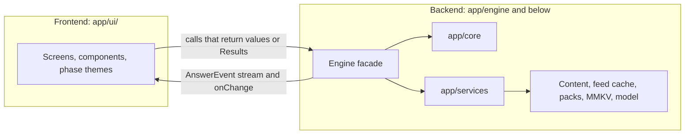

# API layer

The exact contracts between Bagyo Buddy's modules, its data files, its signed feed and packs, and its servers; the reasons behind them live in system-design.md. Feature scope and release tags come from [features.md](features.md), which wins where this file disagrees.

Related: [README.md](README.md) · [features.md](features.md) · [system-design.md](system-design.md) · [solution.md](solution.md)

**Who reads what.** Both people, and the coding agents they run, start with [section 3](#3-frontendbackend-handoff). [Section 3.10](#310-current-code-vs-this-contract) says what the code in `app/` already does and what must change, [section 3.11](#311-parallel-start-and-ground-rules) gives each person's first tasks and the rules for agents, and [section 3.12](#312-open-items) lists the placeholders both sides build around. The frontend person needs nothing beyond section 3 and the types it links to (sections 2 and 4, `AnswerEvent` in section 6, and the record types in section 9). The backend person owns everything else.

## 1. Overview

| Layer | What it covers | Release |
| :-- | :-- | :-- |
| A. On-device module API | TypeScript inside the app: the `Engine` facade (`app/engine/`), the pure core (`app/core/`), the `ask()` orchestrator and the services (`app/services/`) | MVP; online services MVP stretch |
| B. Data contracts | Bundled JSON in `content/`; the signed bulletin feed; signed packs and deltas | MVP (bundled), MVP stretch (feed, province evacuation-center bundles, offline pack import, Smart Update), Pilot (LGU packs) |
| C. Network API | Static files on our one pinned host (keys, feed, packs, model manifest), written by the scheduled scraper and the pack pipeline; Bantay LGU portal REST API; opt-in topic-report endpoint | MVP stretch (feed and Smart Update), Pilot (portal, topic reports) |

The offline core never waits on the network. Until the online stretch lands, the release build has no INTERNET permission. After that, only the modules below may ever open a connection, always to the one pinned host (our server), only while the app is open, and every request goes into `networkLog`:

| Module | MVP (core) and MVP | MVP stretch | Pilot | Later |
| :-- | :-- | :-- | :-- | :-- |
| `UpdateClient` | Not shipped. The APK has no INTERNET permission | GET only. The feed is checked on app open and on pull to refresh (Settings `feedEnabled`); packs and the model manifest wait for a tap, Wi-Fi by default | Same; LGU packs added | Same |
| `TopicReporter` | Not shipped | Not shipped | One POST per completed week, only after opt-in | Same |
| `DamageReporter` | Not shipped | Not shipped | One POST per report, only after opt-in and only on the user's send tap | Same |
| `AccountSync` | Not shipped: the account screens are static | Not shipped | Not shipped | Sign-up, sign-in, reset and the profile backup after sign-in |
| Everything else: `app/core/*`, `ask()`, `ModelManager`, `PowerPolicy`, `Store`, `PackManager`, `PhotoService`, `LocationService`, `ShareService`, `FilePicker`, `ScreenService` | Never | Never | Never | Never |

No background fetch, no push. The phone never contacts PAGASA or any other site; the server-side scraper does ([section 10](#scraper-output)). `LocationService` asks the OS for one coarse reading and opens no connection itself. `ShareService` only hands a member card image to the Android share sheet when the user taps share.

**Two-person handoff.** [Section 3](#3-frontendbackend-handoff) is the whole contract between the frontend person (the screens) and the backend person (the engine behind the screens and, from the MVP stretch on, the server side). The frontend person needs only section 3 and the types it links to. Sections 5 to 12 are the backend's internals and wire formats.

## 2. Conventions

- TypeScript with `strict: true`. Modules in `app/core/` import nothing from React Native, so they run unchanged in Node for tests and evaluation.
- IDs are kebab-case strings, unique within their file, never reused: `during-flood-river-01`.
- Times are ISO 8601 with the Manila offset: `2026-10-09T14:15:00+08:00`. Dates are `YYYY-MM-DD`. Weeks are ISO weeks: `2026-W41`.
- Places are PSGC codes from the Philippine Statistics Authority, always stored as strings. Coordinates are WGS 84 decimal degrees (`lat`, `lon`).
- Language codes: `tl` (Tagalog and Taglish), `en`.
- Every content file, feed file, pack payload and HTTP body carries an integer `schema_version`.
- Casing: on-device runtime and storage types use camelCase. JSON content files, feed files, packs and HTTP bodies use snake_case.
- Content records (`Passage`, `Hotline`, `EvacuationCenter`, `WarningEntry`, `Source`) keep their file shape, snake_case, when they cross the facade. Views the engine builds for the UI (`PassageDetail`, `ChecklistView`, `BulletinCardView`, `EvacuationView` and the rest of section 3.2) are camelCase.
- Expected failures cross module boundaries as `Result` values, never as exceptions. Throwing is for bugs only.
- Phase thresholds (distance bands, the evacuation-center threshold) live only in `content/phase_rules.json`. No number for them appears in code, tests or these docs ([AGENTS.md](../AGENTS.md) rule 10).

```ts
export type Result<T, E extends string> =
  | { ok: true; value: T }
  | { ok: false; error: { code: E; message: string } };
```

- UI copy is referenced by key. The fixed Tagalog copy from [README.md](README.md#shared-names); `{name}`-style slots are filled through `copy(key, { vars })`:

```ts
export type CopyKey =
  | 'closing'          // "Sundin ang utos ng barangay at ng mga awtoridad."
  | 'refusal'          // "Wala ito sa gabay."
  | 'source_link'      // "Saan galing ito?"
  | 'no_live_data'     // "Walang live na balita ang app tungkol sa bagyo. Makinig sa PAGASA sa radyo o magtanong sa barangay."
  | 'stale_warning'    // "Makinig muli sa radyo. Baka nagbago na ang signal."
  | 'medical_dose'     // draft: "Hindi nagbibigay ng dosis ng gamot ang app. Magtanong sa Health Center o sa doktor."
  | 'phase_before' | 'phase_during' | 'phase_after' // "Bago ang bagyo", "Habang may bagyo", "Pagkatapos ng bagyo"
  | 'phase_switched'   // draft: "Lumipat sa {phase}." (button "Ibalik")
  | 'bulletin_age'     // draft: "Inilabas ng PAGASA: {issuedAt}. Na-download: {fetchedAt}. Makinig pa rin sa radyo."
  | 'barangay_decides' // draft: "Ang barangay ang magsasabi kung kailan lilikas."
  | 'photo_consent'    // draft: "Siguraduhing pumayag ang tao bago kunan ng litrato."
  | 'photo_required'   // draft: "Kailangan ang litrato ng mukha para makilala kung sakaling mawalay. Puwedeng mamaya na."
  | 'photo_pending'    // draft: "Kulang pa ang litrato ni {name}."
  | 'location_button'  // draft: "Gamitin ang lokasyon ng telepono"
  | 'aid_notice';      // draft: "Gabay sa paghahanda ang Bagyo Buddy. Hindi ito serbisyong pang-emergency at hindi ito forecast."
```

English translations exist for display under the Tagalog original and are pending review.

## 3. Frontend–backend handoff

This section is the full contract between the two people who build the app. The frontend person needs only this section and the types it links to. The backend person implements it using sections 5 to 12.

In the MVP there is no server. Everything a server would normally do, such as search, the model, the safety rules, phase switching and storage, runs on the phone behind one facade, the `Engine`. That facade is the boundary. From the MVP stretch on, the backend also owns the server side (scraper, feed, packs); the Pilot's Bantay portal adds a second boundary ([section 3.9](#39-pilot-the-second-boundary)).

### 3.1 Who owns what

| | Frontend | Backend |
| :-- | :-- | :-- |
| Builds | Screens, navigation, components, the three phase themes (each with a dark variant and large text, plus a reserved mascot slot), animations, accessibility, UI copy, the static Account screens, the SOS screen (MVP stretch) | The `Engine` facade and everything behind it: core logic (including `decidePhase`), services, content files, the model, storage, packs, evaluation, build plugins. MVP stretch: scraper, feed and CDN. Pilot: the portal API |
| Folders | `app/ui/` (screens, components, `context/`, `navigation/`, `strings/`, `i18n/`, `theme/`); the ESLint config | `app/engine/` (with `fixtures/`), `app/core/`, `app/services/`, `app/types/`, `app/content/`; `content/`, `scripts/`, `eval/`, `plugins/`, `app.config.ts` |
| May import | `app/engine` (types, `createEngine`, `createMockEngine`), UI primitives, navigation, React Native views | Anything it needs |
| Must not import | `app/core/*`, `app/services/*`, `app/types/*` directly (go through `app/engine`), native modules | `app/ui/` |
| Writes the text for | Labels, buttons, status lines and error messages ([section 3.5](#35-codes-the-ui-must-handle)) | Safety copy and guide content, delivered inside events or through `engine.copy()` |
| Pilot | The Bantay portal web UI | The portal REST API, topic ingestion and damage-report ingestion |

An ESLint `no-restricted-imports` rule in `app/ui/` enforces the import rows (it does not exist yet; [section 3.10](#310-current-code-vs-this-contract), F1). The engine owns every native and system module, so the frontend never deals with the model, storage, battery, files, the file picker, the camera, the photo picker, face detection, location, the network, the share sheet, the dialer, screen brightness or the wake lock. The UI only shows the preview images and face boxes the engine hands it, and passes a ref of the rendered "Hinahanap" card when the user taps share.

The phase picks the theme. The UI reads `context.get().phase` and swaps the whole theme (colors, Home layout and order, illustrations, icons) when `onChange('phase')` fires. Theme art and the mascot are frontend work; the mascot slot stays empty until the character is designed.



### 3.2 The Engine facade

```ts
// app/types/engine.ts mirrors this section. Change both in the same commit.
export const ENGINE_API_VERSION = 2; // v3: phases, feed, evacuation, location, required photos

export interface Engine {
  init(): Promise<Result<EngineInfo, 'content_invalid' | 'storage_failed'>>; // once, behind the splash screen
  info(): EngineInfo;
  status(): EngineStatus;
  copy(key: CopyKey, opts?: { lang?: UiLanguage; vars?: Record<string, string> }): string; // 'tl' default
  onChange(listener: (change: EngineChange) => void): () => void; // returns unsubscribe

  profiles: ProfilesApi;
  family: FamilyApi;         // members, required photos, pending list, location, "Hinahanap" card
  context: ContextApi;       // phase (with automatic switching) and warnings
  checklist: ChecklistApi;
  ask: AskApi;
  guide: GuideApi;
  emergency: EmergencyApi;
  plan: PlanApi;             // the Hotlines screen
  feed: FeedApi;             // MVP stretch: cached PAGASA bulletins
  evacuation: EvacuationApi; // household center (MVP core); bulletin card, track and ranked centers (MVP stretch)
  account: AccountApi;       // MVP: static screens make no calls; Later: sign-in and profile sync
  model: ModelApi;           // MVP: install the GGUF from a file, remove it
  screen: ScreenApi;         // MVP stretch: the SOS light
  damage: DamageApi;         // Pilot: damage reports to the LGU
  settings: SettingsApi;
  history: HistoryApi;
  evaluation: EvaluationApi;
  packs: PacksApi;           // MVP stretch
  updates: UpdatesApi;       // MVP stretch
}

// The real engine. Tests pass overrides (fake model, in-memory store, fixed clock, fixture content); the app passes none.
export function createEngine(overrides?: EngineOverrides): Engine;
// The same interface with scripted data and answers (section 3.6).
export function createMockEngine(opts?: MockOptions): MockEngine;

export interface EngineOverrides { // tests and the Node evaluation only
  model?: ModelManager;       // a fake that scripts generate()
  power?: PowerPolicy;        // a fixed battery state and tier
  store?: Store;              // in-memory instead of MMKV
  now?: () => Date;           // a fixed clock
  content?: Partial<Record<ContentFileName, unknown>>; // fixture files instead of the bundled ones
  updates?: UpdateClient;     // a fake that serves fixture feed and packs
  location?: LocationService; // a fake that returns a fixed reading or an error
  photos?: PhotoService;      // a fake picker and detector
  share?: ShareService;       // a fake share sheet
  files?: FilePicker;         // a fake document picker that returns fixture files
  screen?: ScreenService;     // a no-op wake lock and brightness
}
```

Rules for every method:

- Call `init()` once at startup and wait for it. Nothing else may be called before it resolves. On failure, show the fatal error screen ([section 3.5](#35-codes-the-ui-must-handle)). After `init()` the engine re-runs `decidePhase` with the stored inputs and, when the feed is on and the build has the online stretch, starts one feed refresh in the background of the open app (never a background task).
- Getters are synchronous and cheap: content and the feed cache sit in memory and MMKV reads are synchronous. Call them while rendering or inside a hook.
- Mutations are synchronous and return the new value, except the ones that return a `Promise`.
- Expected failures return a `Result` ([section 2](#2-conventions)). The facade never throws on user input; a throw is a bug to report.
- After every change, whether the UI caused it or the engine did (battery drop, model unloaded, warning gone stale, phase switched, feed refreshed, update found), the engine calls each `onChange` listener with what changed. The UI re-reads the matching getter.
- **Access from React** (frontend-owned, already in `app/ui/context/`). `<EngineProvider>` creates the mock when `EXPO_PUBLIC_ENGINE=mock` and the real engine otherwise, awaits `init()`, and shows the splash or the fatal screen. `useEngine()` returns the engine. `useEngineChange(kinds)` subscribes to `onChange` and returns a revision number that changes whenever one of `kinds` fires; components read getters during render and list the kinds they depend on (the "Re-reads on" column in [section 3.3](#33-screen-map)).

```ts
export type EngineChange =
  | 'profiles'  // household, plan fields, location
  | 'family'    // members, photos, pending list
  | 'phase'     // phase, phaseSource, reason, recommended, lastSwitch: re-theme and show the banner
  | 'context'   // warnings
  | 'checklist' | 'settings' | 'status' | 'history'
  | 'feed'      // MVP stretch: feed state or cached bulletins changed
  | 'packs' | 'updates'
  | 'account'   // Later: sign-in state or sync changed
  | 'damage';   // Pilot: a damage report was saved, changed or sent

export interface EngineInfo {
  appVersion: string;
  engineApiVersion: number;
  guideDate: string; // YYYY-MM-DD, shown on About
  passagesCount: number;
  sourcesCount: number;
  packs: InstalledPack[];
  online: boolean;   // false until the build ships the online stretch (no INTERNET permission)
  model: { fileName: string; sizeBytes: number; present: boolean; attribution: 'Built with Llama' };
}

export interface EngineStatus {
  tier: DeviceTier;
  model: ModelState;
  ai: AiDecision; // allowed, or the reason it is not
  battery: { level: number; charging: boolean; saver: boolean } | null; // null until the first reading
  stale?: { kind: WarningKind; hoursSinceSet: number };
  updateAvailable?: { totalBytes: number; guideDate?: string }; // MVP stretch
}
```

The domain APIs, grouped by the screens that use them:

```ts
// Profiles: family setup, Profile screen and the Hotlines screen's plan fields.
// One household per phone. It is created together with its main person; other members go through engine.family.
// No account is required: the household exists only on this phone. The optional account (Later) only backs it up.
export interface NewHouseholdInput {
  name: string;       // "Bahay namin"
  owner: MemberInput; // the main person; relation is forced to 'self'
}
export interface ProfileInput { // household-level fields only; location goes through family.location
  id: string;
  name: string;
  petsCount: number; // 0 to 20
  home: HomeTag[];
  plan: Profile['plan'];
}
export type ProfileErrorCode =
  | 'name_required' | 'too_long' | 'pets_range' | 'too_many_contacts' | 'contact_phone_invalid';
export type SaveProfileResult =
  | { ok: true; value: Profile }
  | { ok: false; errors: { code: ProfileErrorCode | MemberErrorCode; field: string }[] }; // field path, e.g. "owner.name"

export interface ProfilesApi {
  active(): Profile | null; // null before setup
  create(input: NewHouseholdInput): SaveProfileResult; // first step of setup
  save(input: ProfileInput): SaveProfileResult;
  remove(id: string): Result<void, 'not_found'>; // deletes the household, its members' photos and ticks; setup starts again
}

// Family: member editor, photo screens, the pending reminder, location and "Hinahanap". Always the active household.
export interface MemberInput {
  id?: string;   // omit to add
  name: string;  // name or nickname, 1 to 40 chars
  relation: Relation;
  ageGroup: AgeGroup;
  needs: NeedTag[];
  note?: string; // ≤ 80 chars
  phone?: string;
}
export type MemberErrorCode =
  | 'name_required' | 'too_long' | 'phone_invalid' | 'too_many_members' | 'owner_relation';
export type SaveMemberResult =
  | { ok: true; value: Member } // a new member starts with photoStatus 'pending'
  | { ok: false; errors: { code: MemberErrorCode; field: string }[] };

export interface MemberCardView { // "Hinahanap": shown full screen, offline
  member: Member;     // includes photo (or photoStatus 'pending') and note
  ownerName: string;
  ownerPhone?: string;
  evacuationCenter?: string;
  meetingPlace?: string;
}
export type ShareableView = unknown; // a React ref (RefObject<View>) of the rendered "Hinahanap" card; the engine captures it

export interface FamilyApi {
  members(): Member[];  // main person first
  pending(): Member[];  // members with photoStatus 'pending', main person first; Home shows copy('photo_pending') per member
  saveMember(input: MemberInput): SaveMemberResult; // re-derives tags and headcount; fires 'family' and 'checklist'
  removeMember(memberId: string): Result<void, 'not_found' | 'owner_required'>; // also deletes the photo file
  photos: PhotosApi;
  location: LocationApi;
  card(memberId: string): MemberCardView | null;                                       // MVP
  // User tap only; the only way a member photo leaves the phone. The engine captures cardView to a PNG
  // and opens the Android share sheet (section 7, ShareService).
  shareCard(memberId: string, cardView: ShareableView): Promise<Result<void, 'not_found' | 'cancelled' | 'failed'>>;
}

// Photos (MVP core: capture, gallery and manual crop; MVP: the one-face check).
// Every member needs one. There is no skip: "Mamaya na" closes the photo screen (call discard) and the member stays 'pending'.
// Face detection only finds boxes to crop; it never identifies anyone. Boxes are discarded after cropping.
export interface FaceBox { x: number; y: number; width: number; height: number } // 0 to 1, relative to the preview
export type CropRect = FaceBox; // square crop the user approved
export interface PhotoDraft {
  draftId: string;
  memberId: string;
  previewUri: string;          // temp downscaled copy; deleted on discard, expiry or app restart
  detection: FaceDetection;    // 'one_face' suggests the crop; anything else sends the user to manual crop
  faces: FaceBox[];            // left to right, at most 15; [] when none found or detection unavailable
  suggestedCrop: CropRect;     // around the one face, or centered otherwise
  expiresAt: string;           // 30 minutes
}
export type PhotoError =
  | 'permission_denied' | 'no_camera' | 'unreadable' | 'draft_expired' | 'not_found' | 'io';

export interface PhotosApi {
  // Shows copy('photo_consent') first (UI), then opens the system camera (asks CAMERA permission on this tap only)
  // or the system photo picker. null: the user backed out.
  start(target: { memberId: string }, source: 'camera' | 'gallery'): Promise<Result<PhotoDraft | null, PhotoError>>;
  // Crops to 512 × 512 JPEG without EXIF, attaches it to the member (replacing any old photo) and sets photoStatus 'done'.
  // faceCheck is 'one_face' when detection was 'one_face' and the crop holds that box; otherwise 'manual'
  // (the UI asks the user to confirm it is the right person before calling save).
  save(draftId: string, crop: CropRect): Promise<Result<MemberPhoto, PhotoError>>;
  discard(draftId: string): void; // call when the photo screen closes, including "Mamaya na"
  remove(memberId: string): Result<void, 'not_found'>; // the member goes back to 'pending'
  removeAll(): void;              // "Burahin ang lahat ng litrato"; every member goes back to 'pending'
}

// Location: setup, Profile and Settings. Stored in the profile; never leaves the phone.
export interface PlaceOption { psgc: string; name: string; level: PlaceLevel; hasChildren: boolean }
export type LocationError =
  | 'permission_denied' // the user refused the location permission
  | 'services_off'      // the phone's location is switched off
  | 'unavailable'       // no fix in time, or the build has no location stretch yet
  | 'unknown_place';    // the PSGC code is not a barangay in places.json
export interface LocationApi {
  get(): HouseholdLocation | null; // null until set
  places(parentPsgc?: string): PlaceOption[];  // provinces when omitted, then municipalities and cities, then barangays
  setArea(psgc: string): Result<HouseholdLocation, 'unknown_place'>; // MVP core; a barangay code; clears coords
  // MVP stretch. One coarse reading, asked only on the "Gamitin ang lokasyon ng telepono" tap; never in the background.
  // Sets coords and sets psgc to the barangay with the nearest places.json centroid; the UI shows it so the user can change it.
  useGps(): Promise<Result<HouseholdLocation, LocationError>>;
}

// Context: the Home screen's phase selector, the switch banner and the "Ano ang narinig mo?" picker
export type WarningInput =
  | { kind: 'tcws'; level: TcwsLevel }
  | { kind: 'rainfall' | 'surge'; level: ColorLevel }
  | { kind: 'gale' | 'barangay_order' }; // on/off kinds

export interface ContextApi {
  get(): Context; // phase, phaseSource, reason, recommended, lastSwitch, warnings
  options(): WarningEntry[]; // every picker choice, in display order
  cards(): WarningCard[];    // the active warnings for the Home chips: label, hours since set, stale flag; picker order
  // Manual pick (phaseSource 'manual'). Every input present now is suppressed, so it never switches the phase again.
  // 'after' clears all warnings.
  setPhase(phase: Phase): Context;
  // "Ibalik": restores the phase, source and warnings from before the last phase change (automatic or manual),
  // and suppresses the input that caused an automatic switch. Covers "Ibalik ang mga babala" after 'after'.
  undoPhase(): Result<Context, 'nothing_to_undo'>;
  setWarning(input: WarningInput): Context;     // replaces the same kind; setAt = now; runs decidePhase
  clearWarning(kind: WarningKind): Context;     // also drops its suppression, so setting it again is a new input
  reconfirmWarning(kind: WarningKind): Context; // "Pareho pa rin": resets setAt and clears the stale banner; not a new input
}

// Checklist screen
export interface ChecklistApi {
  view(): ChecklistView; // for the active household and context; groups ordered by phase first
  tick(itemId: string, ticked: boolean): Result<ChecklistView, 'unknown_item'>;
  reset(): ChecklistView; // clears the household's ticks for a new season
}

// Ask screen
export interface AskApi {
  run(question: string, opts?: AskOptions): AsyncIterable<AnswerEvent>; // event order: section 6
  cancel(): void; // ends the current stream with done { outcome: 'cancelled' }
  warm(): void;   // call when the Ask screen gains focus; does nothing if AI is not allowed
  readonly maxLength: 200;
}

// Guide topics screen and "Saan galing ito?"
export interface PassageCard { id: string; title: string; summary: string; topic: TopicGroup; critical: boolean }
export interface PassageDetail extends PassageCard {
  text: string; source: SourceRef; reviewedBy: string; reviewedAt: string; version: number;
}
export interface GuideApi {
  topics(): { topic: TopicGroup; count: number }[]; // the UI maps each topic to its label; filtered by the current phase
  byTopic(topic: TopicGroup): PassageCard[];
  passage(id: string): PassageDetail | null;
  sources(): Source[]; // About screen
  reviewers(): { name: string; passages: number }[]; // About screen, from reviewed_by
}

// Emergency card: opened from Home, or delivered by an emergency_card event
export interface EmergencyCardView { id: string; title: string; steps: string[]; hotlines: Hotline[]; source: SourceRef }
export interface EmergencyApi {
  card(id?: string): EmergencyCardView; // the default card when id is omitted
}

// Hotlines screen: national hotlines (data), family contacts, meeting place, evacuation center
export interface PlanApi {
  hotlines(): Hotline[]; // national, with reviewed feed updates (MVP stretch); the Pilot adds the LGU's
  call(hotlineIdOrPhone: string): Promise<Result<void, 'not_found' | 'no_dialer'>>; // opens the dialer; a contact's number or a hotline ID
}

// Feed (MVP stretch): Home bulletin chip, Evacuation and bagyo screen, About
export type FeedStatus =
  | 'off'        // feedEnabled is false, or the build has no online stretch
  | 'empty'      // never fetched, or no active bagyo in the feed
  | 'fresh'      // a cached bulletin issued less than staleWarningHours ago
  | 'stale';     // older than that, or the server marked the feed stale (scraper failure)
export interface FeedState {
  status: FeedStatus;
  refreshing: boolean;
  latest: BulletinCardView | null; // newest cached bulletin, rendered from data
  fetchedAt?: string;              // last successful fetch
  checkedAt?: string;              // last attempt, successful or not
  serverStale: boolean;            // the feed manifest says the last scrape failed
}
export type FeedError =
  | 'disabled' | 'offline' | 'http'                                       // no request made, or it failed
  | 'unknown_key' | 'key_expired' | 'bad_signature' | 'app_too_old'      // the manifest failed verification
  | 'rollback' | 'hash_mismatch' | 'schema';                              // the blob failed verification
export interface FeedApi {
  get(): FeedState;
  refresh(): Promise<Result<FeedState, FeedError>>; // pull to refresh; on failure the cache stays as it was
}

// Evacuation and bagyo screen; the household center also shows on Home in 'during'
export interface EvacuationView {
  householdCenter?: string;          // typed in at setup (MVP core)
  bulletin: BulletinCardView | null; // MVP stretch, same card as feed.get().latest
  storm: StormMeasure | null;        // MVP stretch: home → bagyo now and along the forecast; null without bulletin or location
  centers: RankedCenter[];           // MVP stretch: from the province bundle, nearest first; [] without location or bundle
  centersFirst: boolean;             // the phase_rules.json threshold is crossed (never while it is a placeholder)
  barangayCopyKey: 'barangay_decides'; // always shown above the list
  needsLocation: boolean;            // true when no location is set: show the location picker instead of distances
}
export interface EvacuationApi {
  view(): EvacuationView; // never contains an arrival time
}

// Settings screen
export interface SettingsApi {
  get(): Settings;
  update(patch: Partial<Settings>): Result<Settings, 'out_of_range'>; // lowBatteryThreshold 5–50, staleWarningHours 1–12 (proposals)
}

// Question history, cleared from Settings
export interface HistoryApi {
  list(limit?: number): QuestionLogEntry[]; // newest first
  clear(): void;
}

// Evaluation screen
export interface EvalSummary {
  generatedAt: string;
  retrieval: { hitAt2: number; correctRefusal: number; emergencyTrigger: number; liveDataReply: number };
  answers: { faithfulness: number | null; numberCheckPass: number }; // faithfulness comes from the two-person review
  phase: { casesPassed: number; casesTotal: number; wrongDirection: number }; // decidePhase cases; wrongDirection must be 0
  device: { summaryP50Ms?: number; firstWordsP50Ms?: number; fullAnswerP50Ms?: number; peakRamMb?: number };
}
export interface EvaluationApi {
  summary(): EvalSummary | null; // the laptop report bundled at build time, plus on-device timings
}

// Packs (MVP stretch): Settings and About
export interface PacksApi {
  installed(): InstalledPack[];
  importFromPicker(): Promise<Result<ImportPreview | null, PackError>>; // null when the user closes the picker
  importFile(uri: string): Promise<Result<ImportPreview, PackError>>;   // a file shared into the app
  apply(previewId: string): Promise<Result<ApplyResult, PackError | 'io'>>;
  rollback(packId: string): Promise<Result<void, 'io' | 'nothing_to_roll_back'>>;
}

// Updates (MVP stretch): Home banner, Settings and About
export interface UpdatesApi {
  pending(): UpdatePlan | null; // set by the auto-check; drives "May bagong gabay. I-download?"
  check(): Promise<Result<UpdatePlan | null, UpdateError>>; // user-triggered
  download(planId: string, onProgress: (bytes: number, total: number) => void, signal?: AbortSignal):
    Promise<Result<ImportPreview, UpdateError>>; // then packs.apply(previewId)
  networkLog(): NetworkLogEntry[]; // every request, feed included
}

// Account (MVP static screens; Later real). In the MVP the sign-up, login and forgot-password
// screens are pure UI: they render the forms, store nothing and call nothing. Until Later, both engines
// return { signedIn: false } from state(), 'demo_only' from signUp, signIn and sendReset, and
// 'not_signed_in' from signOut and setSync, so a screen that calls them by mistake still behaves.
export type AccountState =
  | { signedIn: false }
  | { signedIn: true; email: string; lastSyncAt: string | null; syncEnabled: boolean };

export interface AccountApi {
  state(): AccountState; // { signedIn: false } until a real sign-in (Later)
  signUp(input: { email: string; password: string }): Promise<Result<AccountState, AccountError>>;
  signIn(input: { email: string; password: string }): Promise<Result<AccountState, AccountError>>;
  signOut(): Result<void, 'not_signed_in'>;
  sendReset(email: string): Promise<Result<'sent', AccountError>>; // forgot password
  setSync(enabled: boolean): Result<AccountState, 'not_signed_in'>; // profile backup toggle; photos and location never sync
}
export type AccountError = 'invalid_email' | 'weak_password' | 'offline' | 'http' | 'demo_only';

// Model (MVP): Settings "I-install ang AI model" and the AI badge. The GGUF comes from a file already on the phone
// (sideloaded for the hackathon); the Google Play AI pack replaces this in the Pilot. No network.
export type ModelInstallError =
  | 'tier'          // the phone is in tier 'none'; checked before copying
  | 'no_space'      // not enough free storage for the copy
  | 'wrong_file'    // the file name or size differs from the bundled model entry
  | 'hash_mismatch' // the SHA-256 differs; the copy is deleted
  | 'cancelled'     // the user stopped the copy
  | 'io';
export interface ModelApi {
  // Opens the system file picker, copies the file into app-private storage while hashing it, then checks it.
  // null: the user closed the picker. On success info().model.present is true and onChange('status') fires.
  installFromPicker(onProgress: (bytes: number, total: number) => void, signal?: AbortSignal):
    Promise<Result<'installed' | null, ModelInstallError>>;
  remove(): Promise<void>; // unloads and deletes the file; AI falls back to summaries with reason 'no_model'
}

// SOS screen (MVP stretch): a full-screen white light and a large "TULONG". Screen only: no camera, flash or permission.
export interface ScreenApi {
  sosOn(): Promise<void>;  // keeps the screen awake and raises this window's brightness to the maximum
  sosOff(): Promise<void>; // restores both; the engine also calls it when the app goes to the background
}

// Damage report (Pilot): structured fields plus up to 5 damage photos, separate from member photos.
// Needs settings.damageReportsOptIn; sends only on the user's tap and only while the app is open.
export interface DamageInput {
  damageType: DamageType;
  severity: DamageSeverity;
  affectedMembers: number; // a count, never names
  notes?: string;          // ≤ 300 chars
}
export interface DamageApi {
  list(): DamageDraft[]; // the unsent draft first, then sent reports, newest first
  save(input: DamageInput & { id?: string }): Result<DamageDraft, 'invalid' | 'io'>; // omit id to start a draft
  addPhoto(id: string, source: 'camera' | 'gallery'):
    Promise<Result<DamageDraft | null, PhotoError | 'too_many_photos'>>; // null: the user backed out
  removePhoto(id: string, index: number): Result<DamageDraft, 'not_found'>;
  send(id: string): Promise<Result<'sent', 'offline' | 'not_opted_in' | 'http' | 'not_found'>>; // on failure the draft stays
  remove(id: string): void; // deletes the record and its damage photo files
}
```

### 3.3 Screen map

Every screen, what it reads, what it calls and which `onChange` values make it re-read. Every screen also takes its theme from `context.get().phase` and re-themes on `phase`.

| Screen | Reads | Calls | Re-reads on |
| :-- | :-- | :-- | :-- |
| Splash | — | `init()` | — |
| Family setup and Profile | `profiles.active()`, `family.members()`, `family.location.get()`, `family.location.places()` | `profiles.create()` (main person first), `profiles.save()`, `profiles.remove()`, `family.location.setArea()`, `family.location.useGps()` (MVP stretch) | `profiles`, `family` |
| Member editor | `family.members()` | `family.saveMember()`, `family.removeMember()`, `family.photos.remove()` | `family` |
| Photo and crop (MVP core; face check MVP) | `copy('photo_consent')`, `copy('photo_required')`, the `PhotoDraft` (preview, detection, face boxes, suggested crop) | `family.photos.start({ memberId }, source)`, `family.photos.save()`, `family.photos.discard()` ("Mamaya na" too) | `family` |
| "Hinahanap" card (MVP) | `family.card()` | `family.shareCard(memberId, cardRef)` with the ref of the rendered card, `plan.call()` | `family` |
| Home | `context.get()` (phase, reason, recommended, `lastSwitch` for the "Lumipat sa {phase}." banner), `context.options()`, `context.cards()` (warning chips with their age, "Signal No. 3 · 2 oras na"), `family.pending()`, `status()`, `settings.get().lowBatteryMode`, `evacuation.view()` (household center in `during`), `feed.get()` (MVP stretch), `updates.pending()` (MVP stretch) | `context.setPhase()`, `context.undoPhase()` ("Ibalik"), `context.setWarning()`, `context.clearWarning()`, `context.reconfirmWarning()`, `emergency.card()`, `settings.update({ lowBatteryMode })`, `feed.refresh()` (pull to refresh) | `phase`, `context`, `family`, `profiles`, `status`, `settings`, `feed`, `updates` |
| Checklist | `checklist.view()` | `checklist.tick()`, `checklist.reset()` | `checklist`, `phase`, `context`, `profiles`, `family` |
| Ask | `status()` (AI badge), `context.get()` | `ask.warm()` on focus, `ask.run()`, `ask.cancel()`, `guide.passage()` for "Saan galing ito?", `plan.call()` on hotline buttons, `context.undoPhase()` on a switched `phase_change`, `context.setPhase()` on a recommended one | `status`, `phase` |
| Emergency card | the card from `emergency.card()` or from an `emergency_card` event | `plan.call()` | — |
| Hotlines | `plan.hotlines()`, `profiles.active()` (contacts, meeting place, evacuation center) | `profiles.save()` for plan fields, `plan.call()` | `profiles`, `packs`, `feed` |
| Evacuation and bagyo (MVP stretch) | `evacuation.view()`, `feed.get()` | `feed.refresh()`, `family.location.setArea()` or `family.location.useGps()` when `needsLocation`, `profiles.save()` with `plan.evacuationCenterId` and `plan.evacuationCenter` (the center's name) when the user picks a recommended center | `feed`, `profiles`, `packs`, `phase` |
| Guide topics | `guide.topics()`, `guide.byTopic()`, `guide.passage()` | — | `packs`, `phase` |
| About | `info()`, `guide.sources()`, `guide.reviewers()`, `copy('aid_notice')`, `packs.installed()`, `feed.get()` (fetched time), `updates.networkLog()` (MVP stretch) | — | `packs`, `feed`, `updates` |
| Settings | `settings.get()`, `status()`, `info().model`, `family.location.get()`, `packs.installed()` | `settings.update()` (AI, `lowBatteryMode`, low-battery threshold, `feedEnabled`, update settings; Pilot: `topicReportsOptIn`, `damageReportsOptIn`), `model.installFromPicker()`, `model.remove()`, `family.location.setArea()`, `family.location.useGps()`, `history.clear()`, `family.photos.removeAll()`, `packs.importFromPicker()`, `packs.apply()`, `packs.rollback()`, `updates.check()`, `updates.download()` (MVP stretch) | `settings`, `status`, `profiles`, `packs`, `updates` |
| Account (MVP static; sync Later) | `account.state()` (Later) | In the MVP the sign-up, login and forgot-password forms are pure UI: no reads, no calls, nothing stored. Later: `account.signUp()`, `account.signIn()`, `account.sendReset()`, `account.setSync()` | `account` (Later) |
| Evaluation | `evaluation.summary()`, `history.list()` | — | `history` |
| SOS (MVP stretch) | — | `screen.sosOn()` on open, `screen.sosOff()` on close | — |
| Damage report (Pilot) | `damage.list()`, `settings.get().damageReportsOptIn` | `damage.save()`, `damage.addPhoto()`, `damage.removePhoto()`, `damage.send()`, `damage.remove()` | `damage`, `settings` |

App-wide elements read `status()`: the AI badge (`ai`, `model`), the low-battery badge (`battery`, and `settings.get().lowBatteryMode` for the manual switch), the stale-warning banner (`stale`, text from `engine.copy('stale_warning')`) and, from the MVP stretch, the update banner (`updateAvailable`). The phase banner reads `context.get().lastSwitch`; the UI shows it once per `lastSwitch.at`. An Android "share to Bagyo Buddy" intent passes its file URI to `packs.importFile()`.

### 3.4 Rendering the answer stream

`ask.run()` yields `AnswerEvent`s in the order fixed in [section 6](#6-orchestrator-ask-mvp). The Ask screen stacks them top to bottom: the emergency card if any, then one main card, then the AI block, then the phase line, then the closing line.

| Event | What the screen shows |
| :-- | :-- |
| `emergency_card` | The card at the top in the emergency style: `card.title`, `card.steps`, a call button per hotline (`plan.call(id)`). It stays while the rest arrives |
| `fixed_reply` | A plain card with `text`; no source link |
| `bulletin_card` | The cached PAGASA bulletin rendered from `card.bulletin`: name, category, position, movement, signal areas, the `card.ageText` line ("Inilabas ng PAGASA: … Na-download: … Makinig pa rin sa radyo.") and the source link. When `card.stale` is true, the stale line (`copy('stale_warning')`) above it. Never an arrival time |
| `plan_answer` | The family's center, meeting place, contacts or hotlines as a card with call buttons. When `empty` is true, a prompt to fill in the plan and a button to the Hotlines screen |
| `refusal` | `text` plus up to three topic buttons from `suggestions`; each opens Guide topics at that topic |
| `summary` | `title` and `text` with a "Saan galing ito?" link that opens `guide.passage(passageId)`. When `pinned`, show it in bold with a "Mula sa gabay" label, and keep it above any AI text |
| `ai_status`: `loading_model`, `thinking` | A small progress line under the summary |
| `ai_status`: `skipped` | A muted note with the reason ([section 3.5](#35-codes-the-ui-must-handle)). The summary is the answer |
| `ai_partial` | Replace the AI block with `text` in the "being checked" style (lighter, no source links yet) |
| `ai_final` | The AI text in the normal style, with a "Saan galing ito?" link per ID in `used` |
| `ai_rejected` | Remove the AI text and show the rejected note. The summary stays |
| `phase_change`, `kind: 'switched'` | `text` ("Lumipat sa {phase}.") with an "Ibalik" button that calls `context.undoPhase()`. The theme has already changed through `onChange('phase')` |
| `phase_change`, `kind: 'recommended'` | `text` with a button for `to` that calls `context.setPhase(to)`; nothing changes until the user taps. Always the case for `after` |
| `closing` | `text` as the last line, always visible |
| `done` | Re-enable the input. Nothing visible |

Input rules: 1 to 200 characters (`ask.maxLength`); Send is disabled while the box is empty; a "Ihinto" (stop) button calls `ask.cancel()` while the AI block is streaming; sending a new question cancels the one in flight. If the UI meets an event type or a code it does not know, it shows nothing for the event and the generic message for the code, and never crashes. If the stream itself throws, which is a backend bug, the UI keeps whatever is already on screen, shows the generic message and re-enables the input.

### 3.5 Codes the UI must handle

Every code the frontend can receive, where it comes from, and draft Tagalog for the message. The messages are frontend copy; a native speaker on the team edits them. Safety copy is not in this table: it always comes from the engine.

| Code | Comes from | Draft message |
| :-- | :-- | :-- |
| `content_invalid`, `storage_failed` | `init()` | Fatal screen: "May problema sa app. Isara at buksan muli." |
| `low_battery` | `ai_status` skipped, `status().ai` | "Naka-off ang AI para makatipid sa baterya." |
| `battery_saver` | same | "Naka-on ang battery saver, kaya buod lang ang ipinapakita." |
| `ai_off` | same | "Naka-off ang AI sa Settings." |
| `tier` | same | "Hindi kaya ng phone na ito ang AI. Buod mula sa gabay ang ipinapakita." |
| `no_model` | same | "Wala pang AI model sa phone na ito." |
| `absent`, `unloaded`, `ready` | `status().model` | No message; the AI badge shows its idle state |
| `loading`, `generating`, `error` | `status().model`; `ai_status` loading_model, thinking | "Inihahanda ang AI…", "Sumusulat ng sagot…", "Hindi gumana ang AI. Buod lang muna." |
| `schema`, `not_in_guide`, `bad_citation`, `unknown_number`, `phone_number`, `too_long`, `wrong_language` (every `VerifierFailure`) | `ai_rejected` | One note for all codes: "Hindi ipinakita ang sagot ng AI dahil hindi ito tugma sa gabay." The code goes to the log, not the screen |
| `manual`, `warning`, `ask`, `bulletin` (`PhaseSource`) | `context.get().phaseSource`, `reason.source` | No message of their own; the selector shows `reason.text` under the phase |
| `nothing_to_undo` | `context.undoPhase()` | Hide the "Ibalik" button; no message |
| `name_required` | `profiles.save()`, `profiles.create()`, `family.saveMember()` | "Lagyan ng pangalan." |
| `too_long` | same | "Masyadong mahaba." |
| `pets_range` | `profiles.save()` | "Ilagay ang bilang ng alaga (0 hanggang 20)." |
| `phone_invalid` | `family.saveMember()`, `profiles.create()` | "Tingnan muli ang numero." |
| `too_many_members` | `family.saveMember()` | "Hanggang 30 miyembro lang." |
| `owner_relation` | `family.saveMember()` | "Isa lang ang puwedeng maging pangunahing tao." |
| `owner_required` | `family.removeMember()` | "Hindi puwedeng burahin ang pangunahing tao." |
| `pending` (`Member.photoStatus`) | `family.pending()` | `copy('photo_pending', { vars: { name } })` per member on Home: "Kulang pa ang litrato ni {name}." |
| `permission_denied` | `family.photos.start()` | "Walang pahintulot sa camera. Puwedeng pumili sa gallery, o pindutin ang 'Mamaya na'." |
| `no_camera` | `family.photos.start()` | "Walang camera ang phone na ito. Pumili sa gallery, o pindutin ang 'Mamaya na'." |
| `unreadable` | `family.photos.start()` | "Hindi mabuksan ang litrato. Pumili ng iba." |
| `draft_expired` | `family.photos.save()` | "Nag-expire na ang litrato. Kunan muli." |
| `one_face` (`FaceDetection`) | `PhotoDraft.detection` | No message; the suggested crop is ready |
| `no_face`, `many_faces`, `unavailable` (`FaceDetection`) | `PhotoDraft.detection` | Open manual crop: "Walang nakitang mukha. I-crop ang mukha nang mano-mano." / "Maraming mukha. I-crop ang tamang tao." / "I-crop ang mukha nang mano-mano." Then "Siya ba ito?" before `save()` |
| `one_face`, `manual` (`FaceCheck`) | `MemberPhoto.faceCheck` | No message; recorded only |
| `io` | `family.photos.save()` | "Hindi na-save ang litrato. Tingnan kung may espasyo pa ang phone." |
| `permission_denied` | `family.location.useGps()` | "Walang pahintulot sa lokasyon. Pumili na lang ng barangay sa listahan." |
| `services_off` | `family.location.useGps()` | "Naka-off ang location ng phone. Buksan ito, o pumili ng barangay sa listahan." |
| `unavailable` | `family.location.useGps()` | "Hindi makuha ang lokasyon ngayon. Pumili ng barangay sa listahan." |
| `unknown_place` | `family.location.setArea()` | "Wala sa listahan ang lugar na ito. Pumili muli." |
| `too_many_contacts` | `profiles.save()` | "Hanggang 5 contact lang." |
| `contact_phone_invalid` | `profiles.save()` | "Tingnan muli ang numero." |
| `not_found` | `profiles.remove()` | Re-read `profiles.active()`; generic message |
| `unknown_item` | `checklist.tick()` | Re-read the view; no message |
| `out_of_range` | `settings.update()` | "Wala sa pinapayagang saklaw." |
| `not_found` | `plan.call()` | Re-read `plan.hotlines()`; generic message |
| `not_found` | `family.*`, `family.photos.*` | Re-read `family.members()`; generic message |
| `no_dialer` | `plan.call()` | "Hindi makatawag mula sa phone na ito." |
| `cancelled`, `failed` | `family.shareCard()`, `updates.download()`, `model.installFromPicker()` | No message for `cancelled`; "Hindi nagawa. Subukan muli." for `failed` |
| `off`, `empty`, `fresh`, `stale` (`FeedStatus`) | `feed.get().status` | `off`: no bulletin UI. `empty`: "Wala pang balita mula sa PAGASA na naka-save." `fresh`: the card. `stale`: the card with `copy('stale_warning')` |
| `disabled` | `feed.refresh()` | "Naka-off ang balita sa Settings." |
| `offline` | `feed.refresh()`, `updates.check()`, `updates.download()` | "Walang internet. Ipinapakita ang huling na-download." (feed) / "Walang internet." (updates) |
| `http` | `feed.refresh()`, `updates.*` | "Hindi maabot ang server. Subukan muli mamaya." |
| `not_allowed` | `updates.check()`, `updates.download()` | "Wi-Fi lang ang nakatakda para sa update. Kumonekta sa Wi-Fi o baguhin ito sa Settings." |
| `bad_archive` | `packs.import*()` | "Hindi mabasa ang file." |
| `unknown_key`, `bad_signature`, `key_expired` | `packs.import*()`, `feed.refresh()`, `updates.*` | "Hindi galing sa Bagyo Buddy ang file na ito. Hindi ito ii-install." (packs) / "Hindi ma-verify ang balita. Ipinapakita ang huling na-download." (feed) |
| `app_too_old` | `packs.import*()`, `feed.refresh()`, `updates.*` | "I-update muna ang app." |
| `rollback` | `packs.import*()`, `feed.refresh()` | "Mas luma ang file na ito kaysa sa nasa phone." (packs) / no message (feed keeps its cache) |
| `hash_mismatch`, `schema` | `packs.import*()`, `feed.refresh()`, `updates.*` | "Sira ang file. Humingi ng bagong kopya." (packs) / generic message (feed) |
| `io`, `nothing_to_roll_back` | `packs.apply()`, `packs.rollback()` | "Hindi na-save. Tingnan kung may espasyo pa ang phone.", "Walang naunang bersyon." |
| `tier` | `model.installFromPicker()` | "Hindi kaya ng phone na ito ang AI. Gagana pa rin ang app gamit ang buod mula sa gabay." |
| `no_space` | `model.installFromPicker()` | "Kulang ang espasyo sa phone para sa AI model." |
| `wrong_file`, `hash_mismatch` | `model.installFromPicker()` | "Hindi ito ang tamang AI model file." |
| `io` | `model.installFromPicker()`, `damage.*` | "Hindi na-save. Tingnan kung may espasyo pa ang phone." |
| `demo_only` | `account.signUp()`, `account.signIn()`, `account.sendReset()` | Not reached in the MVP (the screens make no calls). If reached: "Demo pa lang ito. Gumagana ang app kahit walang account." |
| `not_signed_in` | `account.signOut()`, `account.setSync()` | Re-read `account.state()`; no message |
| `invalid_email`, `weak_password` | `account.*` (Later) | "Tingnan muli ang email.", "Masyadong mahina ang password." |
| `invalid` | `damage.save()` (Pilot) | "Kulang o mali ang laman ng ulat." |
| `too_many_photos` | `damage.addPhoto()` (Pilot) | "Hanggang 5 litrato lang." |
| `not_opted_in` | `damage.send()` (Pilot) | "Buksan muna ang pagpapadala ng ulat sa Settings." |
| `offline`, `http` | `damage.send()` (Pilot) | "Walang internet. Naka-save ang ulat; ipadala ulit kapag may signal." |
| anything else | — | Generic: "May hindi gumana. Subukan muli." |

### 3.6 The mock engine

The backend person ships `createMockEngine()` before any real logic. The version-1 mock already exists in `app/engine/mock.ts`; its first job is to match this contract ([section 3.10](#310-current-code-vs-this-contract), B2). It returns the full `Engine`, every namespace included, with fixture data from `app/engine/fixtures/` (`households.ts`, `content.ts`, `feed.ts`, `eval.ts`):

- about 5 placeholder passages, 12 checklist items (covering every phase's groups), every warning entry (the barangay order included) and 2 placeholder hotlines;
- one household of 4 members: the main person and two others with placeholder photos, and **one member with `photoStatus: 'pending'`**, so the Home reminder and the photo flow are exercised;
- a household location (a placeholder barangay from a fixture `places.json`);
- a `phase_rules.json` fixture with `placeholder: true` on every band and threshold;
- **one sample bulletin labelled as placeholder data** (title "SAMPLE – hindi totoong bulletin", made-up name, `source.url` pointing at a fixture page), never real PAGASA content;
- 3 sample evacuation centers with made-up names, marked placeholder, at fixture coordinates;
- one unsent damage draft (Pilot) and `account.state()` returning `{ signedIn: false }`.

`family.photos.start()` returns a fixture draft instead of opening the camera; `family.location.useGps()` returns a fixture reading; `feed.refresh()` returns the fixture feed; `model.installFromPicker()` reports progress over about 3 seconds and then succeeds; `family.shareCard()` and `screen.*` resolve without doing anything. The frontend builds every screen against it.

```ts
export type MockScenario =
  | 'guide_full' | 'guide_critical' | 'emergency_then_guide' | 'refusal'
  | 'live_data' | 'live_data_bulletin' | 'medical_dose'
  | 'plan_center' | 'plan_empty' | 'ai_rejected' | 'low_battery' | 'no_model'
  | 'phase_cue_during' | 'phase_cue_after';

export interface MockOptions {
  scenario?: MockScenario;      // force one scenario for every question
  speed?: 'realistic' | 'fast'; // 'fast' removes all delays, for tests
}

export interface MockEngine extends Engine {
  debug: {
    setScenario(s: MockScenario | null): void;     // null goes back to picking by keyword
    setStatus(patch: Partial<EngineStatus>): void; // e.g. battery 10%, tier 'lite'; fires onChange('status')
    emit(change: EngineChange): void;
    // the next family.photos.start() result: a draft with that detection, or an error
    setPhotoResult(r: FaceDetection | PhotoError): void;
    // the next family.location.useGps() result
    setLocationResult(r: 'ok' | LocationError): void;
    // the feed state; 'near', 'signal_here', 'track_approach' and 'left' swap in a variant of the sample bulletin
    // and run the phase rules as if bands were sourced, so the automatic switch and banner can be seen
    setFeed(f: 'off' | 'empty' | 'fresh' | 'stale' | 'near' | 'signal_here' | 'track_approach' | 'left' | FeedError): void;
    // the next model.installFromPicker() result
    setModelInstallResult(r: 'installed' | ModelInstallError): void;
    reset(): void;                                 // restore the fixtures
  };
}
```

Without a forced scenario, the mock picks one from a keyword in the question:

| Scenario | Keyword | Events |
| :-- | :-- | :-- |
| `emergency_then_guide` | lumulubog | `emergency_card`, then the `guide_full` sequence |
| `live_data_bulletin` | nasaan | `bulletin_card` (the sample bulletin), `closing`, `done(bulletin_card)` |
| `live_data` | pasok | `fixed_reply` (`no_live_data`), `closing`, `done(fixed_reply)` |
| `medical_dose` | dosis | `fixed_reply` (`medical_dose`), `closing`, `done(fixed_reply)` |
| `plan_center` | evacuation center | `plan_answer` (`evacuation_center`), `closing`, `done(plan_answer)` |
| `plan_empty` | magkikita | `plan_answer` (`meeting_place`, `empty: true`), `closing`, `done(plan_answer)` |
| `refusal` | bigas | `refusal` with 3 suggestions, `closing`, `done(refused)` |
| `guide_critical` | lumikas | `summary` (`pinned: true`), then the AI events of `guide_full` |
| `phase_cue_during` | na dito | the `guide_full` events, then `phase_change` (`switched`, to `during`, source `ask`) before `closing`; fires `onChange('phase')` |
| `phase_cue_after` | humupa | the `guide_full` events, then `phase_change` (`recommended`, to `after`) before `closing`; the phase does not change |
| `ai_rejected` | litro | `summary`, `ai_status` ×2, `ai_partial` ×n, `ai_rejected` (`unknown_number`), `closing`, `done(answered_summary)` |
| `low_battery` | baterya | `summary`, `ai_status(skipped, low_battery)`, `closing`, `done(answered_summary)` |
| `no_model` | model | `summary`, `ai_status(skipped, no_model)`, `closing`, `done(answered_summary)` |
| `guide_full` | anything else | `summary`, `ai_status(loading_model)`, `ai_status(thinking)`, `ai_partial` ×n, `ai_final`, `closing`, `done(answered_ai)` |

The mock's `context` follows the real switching rules on its own fixtures: `setWarning()` in `before` switches to `during` with a banner, `undoPhase()` reverts it, `setPhase('after')` clears the warnings, and `setWarning({ kind: 'barangay_order' })` reorders the checklist as in [section 5](#buildchecklist). `settings.update({ lowBatteryMode: true })` makes `status().ai` `{ allowed: false, reason: 'low_battery' }` and the next answer `ai_status(skipped, low_battery)`.

With `speed: 'realistic'`, `summary` arrives at 0.3 s, `loading_model` at 0.4 s, `thinking` at 1.5 s, the first `ai_partial` at 3 s and one every 0.12 s after that, and `ai_final` at about 7 s. That is close to the README budgets, so loading states get exercised. `ask.cancel()` works in every scenario and ends the stream with `done(cancelled)`.

### 3.7 Contract tests, integration and changes

**Contract tests.** `app/engine/contract.test.ts` (new) runs the same assertions in Node against `createMockEngine({ speed: 'fast' })` and against `createEngine()` with a fake model, an in-memory store, a fake `UpdateClient`, `LocationService`, `PhotoService`, `ShareService`, `FilePicker` and `ScreenService`, a fixed clock and fixture content:

- every scenario's event sequence obeys the order rules in [section 6](#6-orchestrator-ask-mvp);
- every method returns the documented `Result` shape;
- `onChange` fires after each mutation with the right value (`phase` on every phase change, `feed` on every refresh);
- `profiles.create()`, `profiles.save()` and `family.saveMember()` return each documented error code for bad input;
- members derive the right household tags and headcount, and `buildChecklist` names them on matching items;
- a new member is `pending` and appears in `family.pending()` until `family.photos.save()`; `photos.remove()` and `removeAll()` make members `pending` again; nothing else is blocked by a pending member;
- `family.removeMember()` deletes the photo file, and the main person cannot be removed;
- no member name, note, photo path or location appears in a prompt, a pack, a network request or `questionLog`; no bulletin text appears in a prompt.
- `setWarning({ kind: 'barangay_order' })` puts `evacuate` right after `now` and fills `now` from `evacuate` items first; clearing it restores the phase order.
- `context.cards()` reports `hoursSinceSet` and `stale` from the fixed clock and `staleWarningHours`; `reconfirmWarning()` resets both.
- With `lowBatteryMode` on, `status().ai` is `{ allowed: false, reason: 'low_battery' }` whatever the battery level.
- `model.installFromPicker()` with a fixture file of the wrong size returns `wrong_file`, with the wrong hash returns `hash_mismatch` and leaves no file behind; tier `none` returns `tier` before copying.
- The account calls return the documented demo results, and no engine call makes a network request in a build without the online stretch.

Phase cases (the same table also runs as `decidePhase` unit tests, [section 5](#decidephase)):

- In `before`, `setWarning()` switches to `during` with `phaseSource: 'warning'` and a `lastSwitch`; `undoPhase()` goes back to `before` and suppresses that warning, so `init()` and the next question do not switch again; a different warning (another kind or level) switches again.
- `setPhase('before')` while a warning is active suppresses it; clearing and setting it again is a new input and switches.
- A strong "storm is here" cue in Ask switches to `during` with `phase_change(switched)`; a weak cue switches only with a matching, accepted `phase_hint`; a `phase_hint` with no backing is dropped.
- Nothing ever switches to `after` automatically: "humupa na" and a final bulletin only set `recommended: 'after'` and emit `phase_change(recommended)`.
- `setPhase('after')` clears the warnings; `undoPhase()` restores them.
- With bands marked `placeholder`, a bulletin's distance never switches the phase; a signal raised for the household's area still switches to `during`.
- With a test-only `phase_rules.json` whose bands are derived from the fixture bulletin's own measured distances (so no real-world number appears in tests), a bagyo inside `near` switches to `during`, and a new bulletin whose track enters `approach` switches `after` to `before`; the same bulletin after an undo does not.
- When inputs disagree, the more cautious phase wins.

`ask.cancel()` ends the stream with `done(cancelled)` and no `phase_change`.

When both engines pass, swapping the mock for the real engine cannot break the screens.

**Integration over the 10-hour build** (hours match [solution.md](solution.md); the code already has the version-1 engine, mock and six screens, so hour 0 starts with the migration in [section 3.10](#310-current-code-vs-this-contract)):

| When | Frontend | Backend |
| :-- | :-- | :-- |
| Hour 0 to 1 | F1 lint rule; the three phase themes as tokens (light, dark, large text); presentational components that take props only. No new engine calls until B1 to B3 land | B1 to B3 in one commit: `app/types/` at version 2, the mock and fixtures at version 2, the version-1 leftovers removed |
| Hour 1 to 4 | F2 to F6: every MVP (core) screen against the mock; every scenario renders; the phase banner and re-theme | The real engine in Node: content loading, `route` (with `phaseCue`), `search`, `gate`, `buildChecklist`, `decidePhase`; the model running on the phone |
| Hour 4 sync | Run with `EXPO_PUBLIC_ENGINE` unset (the real engine); run the demo path end to end; list mismatches | Fix mismatches; contract tests green on both engines |
| Hour 4 to 7 | Photo and crop, "Hinahanap", Emergency, Hotlines, About, Settings (model install, low-battery switch) and Evaluation screens; polish | Verifier, critical pinning, `PowerPolicy`, tiers, model install, `PhotoService` and the face check, `ShareService`, performance |
| Hour 7 | The contract is frozen; bug fixes only | Same |
| Hour 9 | The release build uses the real engine; the mock stays for UI tests | The release build has no INTERNET permission and has FLAG_SECURE |

The MVP stretch (feed, Evacuation and bagyo screen, GPS, Smart Update, SOS screen) is built only after hour 7's freeze holds, against the mock's `setFeed()` and `setLocationResult()`.

**Changing the contract.**

- The backend person owns `app/types/engine.ts`, the code copy of this section. Any change needs the frontend person's OK, bumps `ENGINE_API_VERSION`, and updates this section in the same commit.
- After hour 4, changes are additive only: new optional fields and new methods. Renames and removals wait until after the demo.
- A new event type or code ships only with its row in [section 3.4](#34-rendering-the-answer-stream) or [section 3.5](#35-codes-the-ui-must-handle), so the UI never meets an unhandled case.

### 3.8 Definition of done

Frontend:

- [ ] Every screen in [section 3.3](#33-screen-map) works against the mock, and every scenario in [section 3.6](#36-the-mock-engine) renders as [section 3.4](#34-rendering-the-answer-stream) describes.
- [ ] Each phase has its full theme (colors, Home layout and order, illustrations, icons) with a dark variant and large text, and an empty mascot slot; the theme changes on `onChange('phase')`; the "Lumipat sa {phase}." banner and "Ibalik" work; the selector highlights `recommended` with its reason.
- [ ] The photo step has no skip; "Mamaya na" leaves the member pending, and Home shows "Kulang pa ang litrato ni {name}" until done.
- [ ] Every code in [section 3.5](#35-codes-the-ui-must-handle) has a message.
- [ ] Lint passes the import rule; no native module is imported in `app/ui/`.
- [ ] Home shows the warning chips from `context.cards()` with their age and stale prompt, and the manual low-battery switch.
- [ ] Settings installs the model from a file with a progress bar and a stop button, and handles every model install code.
- [ ] No version-1 leftovers remain in `app/ui/` (SMS and plan export, roll call, livelihood tags, group photo, pack sharing, household list, quantities).
- [ ] Large text and the dark variants are checked on the reference phone.

Backend:

- [ ] `createEngine()` implements every method in [section 3.2](#32-the-engine-facade); the contract tests, including the phase cases, pass on both engines.
- [ ] Core unit tests and the Node evaluation pass; `evaluation.summary()` returns the latest report, phase cases included.
- [ ] `content/phase_rules.json` ships with every unsourced band and threshold marked `placeholder: true`; no threshold number appears in code.
- [ ] Performance budgets are measured on the reference phone ([system-design.md](system-design.md)).
- [ ] The MVP release build has no INTERNET permission. With the online stretch: only `UpdateClient` opens connections, to the one pinned host, and every request shows in the network log.
- [ ] Every item in [section 3.10](#310-current-code-vs-this-contract) under "Backend migration" is done; `ENGINE_API_VERSION` is 2 in `app/types/engine.ts`.
- [ ] `model.installFromPicker()` checks tier, space, name, size and SHA-256 against `BUNDLED_MODEL`, which holds the values in [section 7](#modelmanager-mvp); installing `models/Llama-3.2-1B-Instruct-Q4_K_M.gguf` on the reference phone succeeds.
- [ ] The release build has FLAG_SECURE; the debug build does not.
- [ ] `npm test`, `npm run typecheck` and `npm run validate:content` pass with `phase_rules.json` and `places.json` in the required list.

### 3.9 Pilot: the second boundary

From the MVP stretch the backend person also owns the server side (scraper, feed, packs, CDN). In the Pilot the frontend person also builds the Bantay portal web UI. The connections:

| Boundary | Frontend side | Backend side | Contract |
| :-- | :-- | :-- | :-- |
| Phone screens ↔ engine | Screens | `Engine` | This section; the MVP stretch fills in `feed`, `evacuation`, `family.location.useGps`, `screen`, `packs` and `updates`; the Pilot adds `damage` and the LGU parts of `plan`; Later adds the real `account` |
| Engine ↔ CDN (MVP stretch) | — | `UpdateClient` ↔ scraper, feed builder and pack pipeline | [Section 10](#10-feed-and-packs-mvp-stretch) and [section 11.a](#a-feed-and-smart-update-cdn); backend-internal |
| Portal web UI ↔ portal API (Pilot) | The Bantay portal web app | REST API, database, auth | [Section 11.b](#b-bantay-lgu-portal-rest-api), published as `contracts/portal.openapi.yaml` |
| Engine ↔ topic ingestion (Pilot) | — | `TopicReporter` ↔ ingestion function | [Section 11.c](#c-topic-reports); backend-internal |
| Engine ↔ damage-report ingestion (Pilot) | — | `DamageReporter` ↔ ingestion function; reports shown in the portal | [Section 11.d](#d-account-and-damage-reports-later-pilot); backend-internal |

If the team splits by device instead, with one person on the phone (screens and engine) and one on the server side, the boundaries become sections 10 and 11: the feed and pack formats, the CDN paths, the topic-report POST and the portal API.

### 3.10 Current code vs this contract

Snapshot of `app/` on 2026-10-10 (last commit `6d624ed`, plus uncommitted work). The code implements `ENGINE_API_VERSION = 1`; this file specifies 2. This section does not change the contract: it lists the work that brings the code to it, so neither person rebuilds what exists or keeps what was dropped.

**Keep (already matches, or the base to extend)**

| Area | Where | Notes |
| :-- | :-- | :-- |
| Engine access from React | `app/ui/context/EngineProvider.tsx`, `useEngine.ts`, `engineKind.ts` | `EXPO_PUBLIC_ENGINE=mock` selects the mock; anything else selects the real engine. `useEngineChange(kinds)` returns a revision number |
| Pure core | `app/core/normalize.ts`, `search.ts` (`createIndex`, `search`), `gate.ts`, `deriveHousehold.ts` | Match sections 5 and 9 |
| Partial core | `app/core/route.ts`, `checklist.ts`, `prompt.ts`, `verify.ts`, `validateContent.ts` | Extend as in B4 and B7 |
| Services | `app/services/model.ts`, `power.ts`, `store.ts` (MMKV and in-memory), `packs.ts` | Extend as in B5 |
| Ask pipeline | `app/engine/askPipeline.ts` | Extend as in B6 |
| Content | 7 of the 9 bundled files in `content/`, loaded by `app/content/index.ts`; `scripts/validate-content.ts` (`npm run validate:content`) | `phase_rules.json` and `places.json` are missing (B7) |
| Build plugins | `plugins/withReleaseNoInternet.js`, `plugins/withSecureScreen.js` | Release builds: no INTERNET permission, FLAG_SECURE. Debug builds keep both off |
| Tests | Vitest in Node (`npm test`, `app/**/*.test.ts`, `plugins/**/*.test.ts`), `npm run typecheck` | No lint yet (F1) |
| Screens | `HomeScreen`, `AskScreen`, `GuideScreen`, `HotlinesScreen`, `ProfileScreen`, `AccountScreen` (static) | Tabs today: Home, Ask, Guide, Hotlines, Family, Account |
| UI copy | `app/ui/strings/*.ts` (`defineStrings({ tl, en })`), `app/ui/i18n/` (`useT`, reads `settings.language`) | The legacy table in `app/ui/strings.ts` folds into these (F3) |

**Backend migration, in this order.** B1 to B3 are one commit, the first of the build ([section 3.11](#311-parallel-start-and-ground-rules)).

| # | Change |
| :-- | :-- |
| B1 | **Types.** `app/types/` matches sections 2, 3.2, 4, 6 and 9 exactly. Set `ENGINE_API_VERSION = 2` and fix the header comment (it names `src/engine/types.ts`). Add or change: `CopyKey` (phase, photo, location, bulletin, `barangay_decides`, `aid_notice`); `copy(key, { lang, vars })`; `EngineChange` (`phase`, `feed`, `account`, `damage`); `EngineInfo.online`; `EngineOverrides` (replaces `EngineDeps`); the phase types with `Context extends PhaseState`; `PhotoStatus`, `FaceCheck` (`one_face`, `manual`), `FaceDetection`; `Member.photoStatus`; `Profile.location` (drop `area` and `livelihood`); the location, bulletin, storm and center types; `WarningKind` `barangay_order`; `Settings.feedEnabled` and `lowBatteryMode`; `Outcome` `bulletin_card`; `AnswerEvent` `bulletin_card`, `phase_change` and `plan_answer.center: string`; `AskOptions` with only `signal`; `ModelOutput.phase_hint`; `VerifyResult` without `text`; the phase fields of `QuestionLogEntry`; `EvacuationCenter` (`psgc`, `coords`, `origin`, source and reviewer); `HazardNote.psgc`; `PhaseRules`, `Place`, `PlacesFile`; `StoreSchema` (`feed`, `damageReports`, `account`); the new namespaces `feed`, `evacuation`, `account`, `model`, `screen`, `damage`. `TopicGroup` and `HazardTag` in code already match |
| B2 | **Mock.** `app/engine/mock.ts` and `app/engine/fixtures/` match [section 3.6](#36-the-mock-engine): every namespace, the new scenarios and debug setters, one pending member, the placeholder bulletin and centers |
| B3 | **Remove the version-1 leftovers** that break product rules: the "Bilangan" roll call (`RollCallView`, `family.rollCall`, `markPresent`, `resetRollCall`, the `rollcall:*` store key); SMS texts and plan export (`plan.evacuationCenters`, `textPreview`, `composeText`, `exportPlan`, `app/engine/exportText.ts` and its test, the old `ShareService`); livelihood tags (types, search and checklist boosts); checklist quantities (`ChecklistItem.quantity`, `quantityText`); multiple households (`profiles.list`, `setActive`, `last_profile`); pack sharing (`packs.share`); group photos and `FaceCheck` `skipped`; `PackKind` `language`; `Passage.lang` `en`. The same commit makes the smallest edits in `app/ui/` that keep `npm run typecheck` green (deleting calls to removed methods), and the frontend person reviews them |
| B4 | **Core.** `route` adds `phaseCue` from `intents.json` `phase_cues`. `buildChecklist` follows `PHASE_GROUPS`, fills `now`, sets `recommended`, handles `barangay_order` and computes no amounts. `buildPrompt` and `verify` handle `phase_hint` (schema key order, enum, examples); the closing line moves out of `verify` into `ask`. New: `decidePhase` with the phase cases, then (MVP stretch) `measureStorm`, `rankCenters`, `verifyPack`. Unit tests for each |
| B5 | **Services.** `PowerPolicy` checks `no_model` before `tier` (the code has them the other way), adds `lowBatteryMode`, and is the only policy (the engine has a second copy today). `ModelManager` adds the cached instruction prefix, the 2-minute idle and background unload, one retry per session, `install` and `remove`. `Store` takes the new schema. New: `PhotoService`, `ShareService` (member card), `FilePicker`; MVP stretch: `ScreenService`, `LocationService`, `UpdateClient`. `PackManager` goes through `verifyPack` (today it accepts plain JSON) |
| B6 | **Engine** (`app/engine/engine.ts`, `askPipeline.ts`). `createEngine(overrides)` returns exactly `Engine` (move the extra `exports` to a test helper). `context` runs `decidePhase`, fires `phase`, and adds `undoPhase` and `cards`. `family` adds `pending`, `location`, real photos and the member card share. `guide.topics()` is filtered by phase; `guide.reviewers()` is new. `plan.call()` accepts a phone number. The ask pipeline emits `bulletin_card` and `phase_change` and runs `decidePhase`. `account` returns the demo results; `model` installs from a file. MVP stretch: `feed`, `evacuation`, `screen` |
| B7 | **Content and validation.** Add `phase_rules.json` in its shipped placeholder state ([section 9](#phaserules-phase_rulesjson)), `places.json` (PSGC names and parents; centroids once the source is confirmed), `phase_cues` in `intents.json`, and the `barangay-order` entry in `warnings.json`. `validateContent` requires both new files and checks the new fields (the placeholder rule, `approach.max_km` above `near.max_km`, reviewers on centers) |
| B8 | **Dependencies and config.** Stay on Expo SDK 57 (`expo` 57.0.x, React Native 0.86.3, React 19.2.3), the current stable SDK as of 2026-10-10; SDK 58 is still a pre-release and is not used before the demo. Add native modules only with `npx expo install <name>` so they resolve to the SDK 57 versions: expo-image-picker ~57.0.20, expo-image-manipulator ~57.0.21, expo-document-picker ~57.0.3, expo-file-system ~57.0.7, expo-sharing ~57.0.22, react-native-view-shot 5.1.0, and a native streaming SHA-256 for the model file. Not in Expo's list, so test in a development build first: `@react-native-ml-kit/face-detection` 2.0.1 (bundled model; its React Native 0.86 and New Architecture support is unverified; if it fails, the face check falls back to `unavailable` and manual crop). MVP stretch: expo-location ~57.0.20 (coarse only), expo-keep-awake ~57.0.2, expo-brightness ~57.0.2. `npx expo install --check` currently flags two dev dependencies: `@types/react` (wants ~19.2.4) and `typescript` (wants ~6.0.3); align them in their own commit and run `npm run typecheck`. Declare the CAMERA permission in `app.config.ts`; coarse location only with the stretch; never background location |

**Frontend migration**

| # | Change |
| :-- | :-- |
| F1 | **Lint.** Add ESLint with `no-restricted-imports` for `app/ui/**`: block `app/core/*`, `app/services/*`, `app/types/*`, `react-native-mmkv`, `llama.rn`, `expo-battery`, `expo-device` and every module in B8. Add `npm run lint` |
| F2 | **Drop the UI for the B3 leftovers**: SMS and plan export on Hotlines (and their strings in `app/ui/strings/hotlines.ts`), roll call, the livelihood picker, group photo, pack sharing, the household list, quantity text |
| F3 | **Copy.** Fold `app/ui/strings.ts` into the per-screen tables in `app/ui/strings/`; every `TopicGroup` and `WarningEntry.id` has a label; safety copy comes only from `engine.copy()` or event `text` |
| F4 | **Themes.** The three phase themes from the tokens in `design/` (`DESIGN.md`, `design-tokens.md`), each with a dark variant and large text, plus the empty mascot slot; switched by `context.get().phase` |
| F5 | **Screens.** Add the member editor, photo and crop, "Hinahanap", Checklist, Emergency card, Settings, About and Evaluation screens; MVP stretch: Evacuation and bagyo, SOS; Pilot: Damage report. Tabs versus stack is the frontend's call; the screen list and what each calls are fixed by [section 3.3](#33-screen-map) |
| F6 | **Home.** Phase selector with the recommended phase and its reason, the switch banner with "Ibalik", warning chips from `context.cards()`, the stale prompt with "Pareho pa rin", the pending-photo reminder, the low-battery switch, the household center in `during` |

### 3.11 Parallel start and ground rules

Both people start at hour 0 and nobody waits:

| | Backend | Frontend |
| :-- | :-- | :-- |
| First (about 1 hour) | B1 to B3 as one commit, so the version-2 types and mock exist | F1, F4, and presentational components that take props only (phase selector, warning chip, answer cards, crop frame). No new engine calls yet |
| Then | B4 to B8, with the contract tests ([section 3.7](#37-contract-tests-integration-and-changes)) as the target | F2, F3, F5, F6 against the mock; switch to the real engine at the hour 4 sync |

**Ground rules for both people and their coding agents**

1. **Order of authority.** The product rules in [AGENTS.md](../AGENTS.md), then [features.md](features.md) for scope, then this file for the contract, then [system-design.md](system-design.md) for how. When code disagrees with this file, change the code; the contract itself changes only by the rules in [section 3.7](#37-contract-tests-integration-and-changes).
2. **Ownership.** Frontend agents edit only `app/ui/**` and the ESLint config. Backend agents edit everything else; `app/types/engine.ts` is the backend's alone. Shared files: `package.json` and the lockfile take one dependency change per commit, after pulling; B3 is the one planned backend edit inside `app/ui/`.
3. **Frontend agents** import only from `app/engine` and `app/ui/**`; put no phase, threshold, distance or time logic in screens (read `context.get()`, `context.cards()`, `BulletinCardView`, `EvacuationView`); never type a hotline, number or safety sentence into the UI (safety copy comes from `engine.copy()` and event `text`); give every code in [section 3.5](#35-codes-the-ui-must-handle) a message; show nothing for an unknown event type.
4. **Backend agents** keep `app/core/` pure (no React Native imports, the time passed in); add a row to [section 3.4](#34-rendering-the-answer-stream) or [3.5](#35-codes-the-ui-must-handle) with every new event or code; keep the contract tests green on both engines; never write an official number, hotline, threshold or dose from memory: use the placeholders in [section 3.12](#312-open-items).
5. **Checks before every commit:** `npm test` and `npm run typecheck`; the backend also runs `npm run validate:content`; both run `npm run lint` once F1 lands.
6. **Commits** go out under the person's own name only: no `Co-Authored-By` trailer and no AI attribution in commits, pull requests or comments.

### 3.12 Open items

Facts nobody has yet. Each has a placeholder both sides build around; none blocks the MVP (core).

| Item | Placeholder until filled | Who fills it | What waits on it |
| :-- | :-- | :-- | :-- |
| The pinned host | `extra.updateHost` unset in `app.config.ts`, so `info().online` is false and online calls return `disabled` | Backend | MVP stretch only |
| ~~The model file's size and SHA-256~~ Resolved 2026-10-10 | — | — | Values in [section 7](#modelmanager-mvp), from the team's copy in `models/` |
| Distance bands and the evacuation threshold | `null` with `placeholder: true` in `phase_rules.json` | A content reviewer with a cited source | Distance-based switching and centers-first (both stay off) |
| `places.json` centroids | `centroids_source_id: null`; names and parents only | Backend (source and license to confirm) | Distances from a picked area; GPS still works |
| Barangay-order wording | `warnings.json` entry with `"(fill in)"` meaning and actions, `confirmed: false` | Content, from a reviewed source | Nothing; the label shows |
| Warning meanings, hotlines, emergency card steps | `"(fill in)"` in `warnings.json`, `hotlines.json`, `intents.json` | Content | The demo needs them by hour 7 |
| Draft Tagalog copy (every "draft" `CopyKey`, every [section 3.5](#35-codes-the-ui-must-handle) message) | The drafts in this file | A native speaker on the team | Nothing |
| PAGASA bulletin URLs and the `final` wording | Listed as "to confirm" in [section 10](#scraper-output) | Backend | Scraper (MVP stretch) |
| Mascot art | The empty slot in each theme | Frontend, once designed | Nothing |

## 4. Shared types (MVP)

The on-device runtime types every section uses. File and wire shapes (snake_case) are in sections 9 and 10.

```ts
// Phases: the app's mode and the UI theme key
export type Phase = 'before' | 'during' | 'after'; // caution order: during > before > after
export type PhaseSource = 'manual' | 'warning' | 'ask' | 'bulletin';

// One input that can move the phase. Stable keys, so a suppressed input never switches the phase again.
export type PhaseInputKey =
  | `warning:${string}`   // WarningEntry.id, e.g. "warning:tcws-3"; clearing the warning drops its suppression
  | `ask:${string}`       // QuestionLogEntry.id
  | `bulletin:${string}`  // Bulletin.id: one bulletin's distance or signal areas
  | `storm:${string}`;    // Bulletin.stormId: a bagyo's forecast track (the 'after' → 'before' rule)

export interface PhaseReason {
  source: PhaseSource;
  input?: PhaseInputKey; // absent for 'manual'
  text: string;          // draft Tagalog built from data, e.g. "Signal No. 2 ang aktibo"; shown under the selector
}
export interface PhaseRecommendation { phase: Phase; reason: PhaseReason }
export interface PhaseSwitch { // an automatic switch; drives the "Lumipat sa {phase}." banner
  from: Phase;
  to: Exclude<Phase, 'after'>; // never 'after': that is always the user's tap
  source: Exclude<PhaseSource, 'manual'>;
  input: PhaseInputKey;
  at: string;
}
export interface PhaseUndo { // the state before the last phase change, for "Ibalik"
  phase: Phase;
  phaseSource: PhaseSource;
  reason: PhaseReason;
  warnings: ActiveWarnings;      // restored too, so undoing 'after' brings the warnings back
  cause?: PhaseInputKey;         // suppressed on undo when the change was automatic
}

export interface PhaseState {
  phase: Phase;
  phaseSource: PhaseSource;
  reason: PhaseReason;
  changedAt: string;
  recommended: PhaseRecommendation | null; // highlighted on the selector; may equal phase; null when no input points anywhere
  lastSwitch?: PhaseSwitch;
  undo?: PhaseUndo;                        // cleared after an undo
  suppressed: PhaseInputKey[];             // inputs that may not switch the phase again; pruned when the input goes away
}

// Warnings: the "Ano ang narinig mo?" picker
export type WarningKind = 'tcws' | 'rainfall' | 'surge' | 'gale' | 'barangay_order';
export type TcwsLevel = 1 | 2 | 3 | 4 | 5;
export type ColorLevel = 'yellow' | 'orange' | 'red'; // ordered: yellow < orange < red

export interface ActiveWarnings {
  tcws?: { level: TcwsLevel; setAt: string };
  rainfall?: { level: ColorLevel; setAt: string };
  surge?: { level: ColorLevel; setAt: string };
  gale?: { setAt: string }; // present means on
  barangay_order?: { setAt: string }; // "Pinapalikas na kami ng barangay"; present means on
}

// MMKV `context`: phase, phaseSource, warnings and suppressed inputs
export interface Context extends PhaseState {
  warnings: ActiveWarnings; // cleared when the user picks 'after'
}

export type MemberTag = 'infant' | 'child' | 'pregnant' | 'senior' | 'pwd' | 'maintenance_meds' | 'pets';
export type HomeTag =
  | 'near_river' | 'near_sea' | 'slope' | 'low_lying' | 'light_materials' | 'concrete' | 'upper_floor';
export type ProfileTag = MemberTag | HomeTag;
export type HazardTag = 'wind' | 'flood' | 'surge' | 'landslide' | 'electrical' | 'water' | 'health' | 'fire' | 'gas';

export type TopicGroup =
  | 'signals' | 'go_bag' | 'home_prep' | 'evacuation' | 'flood' | 'surge' | 'landslide'
  | 'infant' | 'senior' | 'pregnancy' | 'disability' | 'pets' | 'water_food' | 'electrical'
  | 'generator_fire' | 'gas_safety' | 'cleanup' | 'health_after_flood' | 'first_aid'
  | 'psychosocial' | 'damage_report' | 'assistance' | 'out_of_guide';

export interface Contact {
  name: string;      // ≤ 60 chars
  phone: string;     // as typed by the user
  relation?: string; // ≤ 60 chars
}

// Family members (README H1 to H6)
export type AgeGroup = 'infant' | 'child' | 'teen' | 'adult' | 'senior'; // <1, 1–12, 13–17, 18–59, 60+
export type Relation =
  | 'self' | 'spouse' | 'child' | 'parent' | 'grandparent' | 'grandchild' | 'sibling' | 'relative' | 'other';
export type NeedTag = 'pregnant' | 'pwd' | 'maintenance_meds';

export type PhotoStatus = 'done' | 'pending';         // pending: saved with "Mamaya na", or the photo was removed
export type FaceCheck = 'one_face' | 'manual';        // saved with the photo
export type FaceDetection =                           // detector result on a draft; never saved
  | 'one_face'     // exactly one face: suggest a crop around it
  | 'no_face'      // → manual crop
  | 'many_faces'   // → manual crop
  | 'unavailable'; // detector missing or failed → manual crop

export interface MemberPhoto {
  uri: string;          // app-private file, 512 × 512 JPEG, no EXIF, excluded from cloud backup
  bytes: number;        // target ≤ 150 KB
  source: 'camera' | 'gallery';
  faceCheck: FaceCheck;
  takenAt: string;
  version: number;      // goes up when the photo is replaced
}

export interface Member {
  id: string;
  name: string;         // name or nickname, 1 to 40 chars
  relation: Relation;   // exactly one member per household is 'self', the main person
  ageGroup: AgeGroup;
  needs: NeedTag[];
  note?: string;        // ≤ 80 chars, e.g. medicine names or allergies; on the phone only
  phone?: string;
  photoStatus: PhotoStatus; // 'done' exactly when photo is present
  photo?: MemberPhoto;
  updatedAt: string;
}

// Household location (MVP core: PSGC barangay; MVP stretch: one coarse GPS reading). Never leaves the phone.
export interface LatLon { lat: number; lon: number }
export interface HouseholdLocation {
  psgc: string; // barangay code from places.json; always set once a location exists
  coords?: LatLon & { accuracyM: number; at: string }; // from useGps(); cleared by setArea()
}
export type PlaceLevel = 'region' | 'province' | 'city' | 'municipality' | 'barangay';
export interface HomePoint { // what measureStorm and rankCenters get; built by the engine
  point: LatLon;          // coords when present, else the barangay's places.json centroid
  from: 'gps' | 'area';
  areaCodes: string[];    // the barangay and its ancestors from places.json (municipality or city, province, region)
}

export interface Profile {
  id: string;
  name: string;               // "Bahay namin", "Bahay nina Lola"; ≤ 60 chars
  ownerId: string;            // Member.id of the main person
  people: Member[];           // main person first; 1 to 30
  petsCount: number;          // 0 to 20
  headcount: number;          // derived: people.length; read-only
  members: MemberTag[];       // derived by deriveHousehold from people and petsCount; read-only
  home: HomeTag[];
  location: HouseholdLocation | null; // null until the user picks an area or uses GPS
  plan: {
    evacuationCenter?: string;   // typed name, ≤ 60 chars (MVP core)
    evacuationCenterId?: string; // EvacuationCenter.id when the user picks a recommended center (MVP stretch)
    meetingPlace?: string;       // ≤ 60 chars
    contacts: Contact[];         // at most 5
  };
  updatedAt: string;
}

// Bulletins (MVP stretch): parsed by the server-side scraper, rendered from data, never in the model prompt
export type StormCategory = 'TD' | 'TS' | 'STS' | 'TY' | 'STY'; // PAGASA: depression, storm, severe storm, typhoon, super typhoon
export interface Bulletin { // runtime form of a bulletins.json record (section 10), plus fetchedAt
  id: string;                // stable per PAGASA bulletin
  stormId: string;           // stable per bagyo across its bulletins; set by the scraper
  source: { agency: 'PAGASA'; title: string; url: string };
  issuedAt: string;          // as stated by PAGASA
  scrapedAt: string;         // when our job read it
  fetchedAt: string;         // when this phone downloaded it
  storm: { name: string; internationalName?: string; category: StormCategory };
  position: LatLon & { at: string; text: string };  // text: the position as worded in the bulletin
  movement?: { text: string };                      // as worded, e.g. direction and speed; never computed
  forecast: (LatLon & { at: string })[];            // forecast positions, oldest first
  signalAreas: { level: TcwsLevel; psgc: string[] }[]; // areas under each wind signal, as PSGC codes
  final: boolean;            // true only when the bulletin says it is the last one for this bagyo
  text: string;              // verbatim
}
export interface BulletinCardView {
  bulletin: Bulletin;
  issuedHoursAgo: number;
  fetchedHoursAgo: number;
  stale: boolean;   // ≥ staleWarningHours since issuedAt, or the feed is marked stale: show copy('stale_warning')
  ageText: string;  // copy('bulletin_age') filled with issuedAt and fetchedAt
}

// Distance math (MVP stretch), computed on the phone by measureStorm
export type CompassPoint = 'N' | 'NE' | 'E' | 'SE' | 'S' | 'SW' | 'W' | 'NW';
export interface StormFix { at: string; distanceKm: number; bearingDeg: number; direction: CompassPoint } // home → bagyo
export interface StormMeasure {
  bulletinId: string;
  from: HomePoint['from'];
  now: StormFix;                        // the bulletin's current position
  forecast: StormFix[];                 // each forecast position
  closestKm: number;                    // smallest of now and forecast
  signalHere: TcwsLevel | null;         // highest signal whose PSGC list covers one of home.areaCodes
}
export type DistanceBand = 'near' | 'approach' | 'outside';

// Evacuation centers (MVP stretch, from the province bundle; Pilot: the LGU pack)
export interface RankedCenter {
  center: EvacuationCenter;
  distanceKm: number;
  direction: CompassPoint;
}

export type DeviceTier = 'full' | 'lite' | 'none';
export type UiLanguage = 'tl' | 'en';

export interface Settings {
  language: UiLanguage;        // default 'tl'
  lowBatteryThreshold: number; // percent, default 15
  aiEnabled: boolean;          // default true
  lowBatteryMode: boolean;     // default false: the manual switch on Home and Settings; turns AI off right away
  staleWarningHours: number;   // default 3; also the bulletin stale prompt
  feedEnabled: boolean;        // MVP stretch, default true: fetch the feed on app open and pull to refresh
  autoCheckUpdates: boolean;   // MVP stretch, default true: check pack manifests (never downloads)
  wifiOnly: boolean;           // MVP stretch, default true: packs and the model only on Wi-Fi
  topicReportsOptIn: boolean;  // Pilot, default false
  damageReportsOptIn: boolean; // Pilot, default false
}
```

## 5. Core functions (`app/core/`, pure, MVP)

Backend-internal: the UI never calls these; it uses the `Engine` facade ([section 3](#3-frontendbackend-handoff)). One file per function, named after it. All are deterministic for the same inputs and take the time as a parameter, which keeps the Node evaluation identical to the phone.

### deriveHousehold

```ts
export function deriveHousehold(people: Member[], petsCount: number): { members: MemberTag[]; headcount: number };
```

`infant`, `child` and `senior` come from age groups; `pregnant`, `pwd` and `maintenance_meds` from needs; `pets` from `petsCount > 0`. Tags are unique and in `MemberTag` order; `headcount` is `people.length`. The engine calls it on every member or pet change and stores the result in `Profile.members` and `Profile.headcount`.

### normalize

```ts
export interface NormalizedQuery {
  raw: string;        // as typed, trimmed, at most 200 chars
  text: string;       // lowercased, punctuation and filler words removed
  tokens: string[];
  expanded: string[]; // canonical tokens added from synonyms.json
}
export function normalize(text: string, synonyms: SynonymEntry[]): NormalizedQuery;
```

Never fails. Input longer than 200 characters is cut at 200.

### route

```ts
export type PlanField = 'evacuation_center' | 'meeting_place' | 'contacts' | 'hotlines';

export interface PhaseCue {
  phase: Phase;     // the most cautious phase whose cue list matched
  strong: boolean;  // a strong phrase matched (may switch on its own); weak phrases need a matching phase_hint
  matched: string[];
}

export interface RouteResult {
  emergency: boolean;       // show the emergency card first, then continue with `primary`
  phaseCue: PhaseCue | null; // a second flag, like `emergency`; combines with any primary route
  primary: 'live_data' | 'plan' | 'medical_dose' | 'guide';
  matched: string[];        // phrases that fired, for the question log
  planField?: PlanField;    // set when primary is 'plan'
}
export function route(query: NormalizedQuery, rules: IntentRules): RouteResult;
```

`emergency` and `phaseCue` are checked on their own, from `rules.emergency` and `rules.phase_cues`. `primary` is the first match in this order: `live_data`, `medical_dose`, `plan`; otherwise `guide`.

### search and gate

```ts
export interface GuideIndex {} // opaque; wraps a MiniSearch instance built at startup
export function createIndex(passages: Passage[]): GuideIndex;

export interface SearchConfig {
  threshold: number;          // calibrated on the evaluation set
  secondPassageRatio: number; // add a 2nd passage only if its score ≥ ratio × top; proposal 0.6
  maxPassages: 1 | 2;         // 2 for tier 'full', 1 for 'lite' and 'none'
  boosts: { phase: number; warning: number; profileTag: number; cap: number }; // proposal 1.2, 1.2, 1.2, cap 1.5
}

export interface SearchHit {
  id: string;
  score: number;        // MiniSearch BM25+ score
  boostedScore: number; // after tag boosts
  terms: string[];      // query terms that matched
  topic: TopicGroup;
  critical: boolean;
}

export interface GateResult {
  passed: boolean;
  topScore: number;  // raw BM25+ score of the top hit: rank by boosted score, gate on raw
  threshold: number;
}

export interface SearchResult {
  query: NormalizedQuery;
  hits: SearchHit[];         // top 5, sorted by boostedScore
  selected: string[];        // 1 or 2 passage IDs; [] when the gate fails
  gate: GateResult;
  suggestions: TopicGroup[]; // up to 3, for the refusal buttons
}

export function search(
  query: NormalizedQuery, ctx: Context, profile: Profile | null, index: GuideIndex, config: SearchConfig, // null: no tag boost
): SearchResult;
export function gate(hits: SearchHit[], config: SearchConfig): GateResult;
```

Tag boosts go through MiniSearch's `boostDocument`. Fuzzy and prefix settings are in [system-design.md](system-design.md). Passage `warnings` only boost a passage; they never hide it.

### buildChecklist

```ts
export type ChecklistGroupId = 'now' | 'go_bag' | 'home' | 'evacuate' | 'after';
export interface ChecklistTick { ticked: boolean; updatedAt: string }

// Recommended groups per phase, in display order. "Gawin ngayon" (now) leads in every phase.
export const PHASE_GROUPS: Record<Phase, ChecklistGroupId[]> = {
  before: ['now', 'go_bag', 'home'],
  during: ['now', 'evacuate'],
  after: ['now', 'after'],
};

export interface WarningCard {
  warningId: string; // WarningEntry.id
  kind: WarningKind;
  label: string;
  meaning: string;
  leadTimeH?: number;
  setAt: string;
  hoursSinceSet: number; // whole hours, from the engine's clock
  stale: boolean;        // hoursSinceSet ≥ staleWarningHours: show copy('stale_warning') with "Pareho pa rin"
  confirmed: boolean;    // false shows "(i-check sa PAGASA)"
}

export interface ChecklistItemView {
  id: string;
  text: string;
  forMembers?: { id: string; name: string; note?: string }[]; // who the item is for, e.g. "gamot ni Lolo Ben"
  priority: 1 | 2 | 3;
  critical: boolean;
  ticked: boolean;
  sourceId: string;
}

export interface ChecklistView {
  phase: Phase;
  warningCards: WarningCard[];
  groups: { id: ChecklistGroupId; recommended: boolean; items: ChecklistItemView[] }[]; // PHASE_GROUPS[phase] first, then any other group with items
  progress: { done: number; total: number }; // ticks over the shown items
  stale?: { kind: WarningKind; hoursSinceSet: number; copyKey: 'stale_warning' };
}

export function buildChecklist(
  profile: Profile, context: Context, items: ChecklistItem[], warnings: WarningEntry[],
  ticks: Record<string, ChecklistTick>, now: Date, staleWarningHours: number,
): ChecklistView;
```

Order of work: the phase picks the groups and their order (`PHASE_GROUPS`), then items are filtered by phase, active warnings and household tags, then sorted by priority. `now` holds the top items of the recommended groups for this household and these warnings. While `barangay_order` is active, `evacuate` moves to directly after `now` (in `during` it already is) and `now` is filled from `evacuate` items first, so it leads with leaving. Selection rules are in [section 9](#checklistitem). The function never computes an arrival time or an amount.

### decidePhase

The only place the phase changes on its own. The engine calls it after `init()`, after `setWarning()` and `clearWarning()`, after a feed refresh or a location change, and at the end of every `ask()` that was not cancelled.

```ts
export interface PhaseInputs {
  context: Context;                 // current phase state, warnings and suppressed inputs
  ask?: {                           // present only at the end of an ask() call
    questionId: string;
    cue: PhaseCue | null;           // from route()
    hint: Phase | null;             // the model's phase_hint, only from an answer that passed verify; else null
  };
  storm?: { bulletin: Bulletin; measure: StormMeasure } | null; // latest cached bulletin; null without feed or location
  rules: PhaseRules;
  now: string;
}

export interface PhaseCandidate {
  key: PhaseInputKey;
  phase: Phase;
  source: Exclude<PhaseSource, 'manual'>;
  effect: 'switch' | 'recommend';
  reason: PhaseReason;
}

export interface PhaseDecision {
  state: PhaseState;                // the next state; equal to the input when nothing changed
  switched: PhaseSwitch | null;     // set when the phase changed automatically
  hint: 'none' | 'accepted' | 'dropped';
  candidates: PhaseCandidate[];     // for the question log and the evaluation
}

export function decidePhase(inputs: PhaseInputs): PhaseDecision;
```

Rules, applied in order:

1. **Collect candidates.** Each input that is present and whose key is not in `context.suppressed` becomes a candidate:

   | Input | Key | Candidate | Effect |
   | :-- | :-- | :-- | :-- |
   | Any active warning | `warning:{WarningEntry.id}` | `rules.warning_to_phase` (`during`; our product rule, not an official threshold) | switch |
   | Strong cue in the question (`cue.strong`) | `ask:{questionId}` | `cue.phase` | switch for `during`; recommend for `before` and `after` |
   | Weak cue with `hint === cue.phase` | `ask:{questionId}` | `cue.phase` | as for a strong cue |
   | Household area under a wind signal in the bulletin (`measure.signalHere`) | `bulletin:{Bulletin.id}` | `during` | switch |
   | Bagyo now inside the `near` band (only when `rules.bands.near` is not a placeholder) | `bulletin:{Bulletin.id}` | `during` | switch |
   | Forecast track entering the `approach` band, `measure.closestKm` (only when `rules.bands.approach` is not a placeholder) | `storm:{Bulletin.stormId}` | `before` | switch, only while the phase is `after` |
   | Bulletin marked `final` | `bulletin:{Bulletin.id}` | `after` | recommend |

2. **Check the hint.** A `phase_hint` is accepted only when the user's words, the warnings or the bulletin back it: a cue for the same phase in the same question, or (for `during`) an active warning or a `during` bulletin candidate, or (for `after`) a `final` bulletin, or (for `before`) a track candidate. An accepted hint upgrades a weak cue of the same phase (row 3); otherwise it adds no candidate of its own. A hint with no backing is dropped. With AI off there is no hint, and strong cues and warnings still work.
3. **Pick the most cautious.** When candidates disagree, the more cautious phase wins: `during` over `before` over `after`. Ties go to the source order `warning`, `bulletin`, `ask`, then the key, so the result is deterministic.
4. **Switch only toward caution.** The phase switches automatically only to `during` (from `before` or `after`) or to `before` (from `after`, by the track rule). Nothing ever switches to `after`: that is always the user's tap. A switch sets `phaseSource` to the candidate's source, `reason`, `changedAt`, `lastSwitch` and `undo` (the previous phase, source, reason and warnings, with `cause` = the candidate's key).
5. **Recommend.** `recommended` is the most cautious candidate of any effect, by rule 3, or `null` when there is none. `after` is recommended only when no `during` candidate remains; the reason names what is still active, so the user knows which warning to clear.
6. **Prune suppression.** Keys whose input is gone (warning cleared, bulletin no longer cached, any `ask:` key) leave `suppressed`.

Suppression is added outside `decidePhase`, by the engine: `setPhase()` (a manual pick) adds every current candidate's key; `undoPhase()` adds `undo.cause`. That is how the same input never switches the phase again while a new warning, cue or bulletin can.

When `rules.bands` are placeholders (the shipped state until a source and reviewer exist), only warnings, the user's words and signal areas drive the phase.

### measureStorm

```ts
export function measureStorm(bulletin: Bulletin, home: HomePoint): StormMeasure;
```

- Distance is the great-circle (haversine) distance on a sphere of mean Earth radius 6,371 km, rounded to whole kilometres for display. Bearing is the initial great-circle bearing from home to the bagyo, mapped to the nearest of 8 compass points.
- `now` uses `bulletin.position`; `forecast` uses each `bulletin.forecast` point in order; `closestKm` is the smallest of them.
- `signalHere` is the highest `level` in `bulletin.signalAreas` whose PSGC list contains any of `home.areaCodes` (barangay, municipality or city, province), so a signal raised for the whole province counts.
- It never computes speed, time or an arrival time. It does not classify bands; `decidePhase` and `rankCenters` read `phase_rules.json` for that.

### rankCenters

```ts
export interface RankedCenters {
  items: RankedCenter[];  // nearest first
  centersFirst: boolean;  // the evacuation threshold is crossed: show the list first on the Evacuation screen and on Home in 'during'
}

export function rankCenters(
  centers: EvacuationCenter[], home: HomePoint,
  opts: { bulletin: Bulletin | null; storm: StormMeasure | null; rules: PhaseRules; limit: number }, // limit: proposal 5
): RankedCenters;
```

- Ranks by the same haversine distance, then by name, then by ID. Centers without `reviewed_by` and `reviewed_at` are skipped (the bundle build should already have refused them).
- `centersFirst` is true only when `rules.evacuation_threshold` is not a placeholder and either the bulletin's category is at or above `category_min` or `storm.signalHere` is at or above `tcws_min`. While it is a placeholder, the list shows in its normal place and is never promoted.
- The list always shows under `copy('barangay_decides')`: the app recommends where, never when.

### buildPrompt

```ts
export interface ChatMessage { role: 'system' | 'user' | 'assistant'; content: string }

export interface PromptInput {
  question: string;    // NormalizedQuery.raw
  profile: Profile | null; // null before household setup: no tag boost, summary "hindi pa naka-setup"
  context: Context;
  passages: Passage[]; // the 1 or 2 selected, in rank order
}

export interface BuiltPrompt {
  messages: ChatMessage[];
  responseFormat: { type: 'json_schema'; json_schema: { schema: object } };
  allowedIds: string[]; // same IDs as the schema enum
}
export function buildPrompt(input: PromptInput): BuiltPrompt;
```

The layout and the schema are in [section 8](#8-llm-contract-mvp).

### verify

```ts
export type VerifierFailure =
  | 'schema' | 'not_in_guide' | 'bad_citation' | 'unknown_number'
  | 'phone_number' | 'too_long' | 'wrong_language';

export interface ModelOutput { used: string[]; in_guide: boolean; phase_hint: Phase | null; answer: string }

export interface VerifyResult {
  ok: boolean;
  output?: ModelOutput; // present when the JSON parsed
  failures: { code: VerifierFailure; detail?: string }[];
}
export function verify(raw: string, passages: Passage[]): VerifyResult;
```

| Code | Fails when |
| :-- | :-- |
| `schema` | The text is not valid JSON, a required key is missing, or `phase_hint` is not one of `before`, `during`, `after`, `null` |
| `not_in_guide` | `in_guide` is false |
| `bad_citation` | `used` is empty or names an ID that was not given |
| `unknown_number` | A digit, or a Tagalog or Spanish number word with a unit, is not in the cited passages |
| `phone_number` | A phone-like digit string is not in the cited passages |
| `too_long` | More than 4 sentences or 400 characters |
| `wrong_language` | The answer is not mostly Tagalog or Taglish |

`phase_hint` never makes an answer fail on its own beyond `schema`; whether it is used is `decidePhase`'s call. A hint from a failed answer is discarded. How numbers and number words are normalized: [system-design.md](system-design.md).

### verifyPack (MVP stretch)

```ts
export type PackError =
  | 'bad_archive' | 'unknown_key' | 'key_expired' | 'bad_signature'
  | 'app_too_old' | 'rollback' | 'hash_mismatch' | 'schema';

export interface TrustStore {
  rootKeys: PinnedKey[];             // compiled into the app
  keySet?: KeySet;                   // last verified keys.json
  installed: Record<string, number>; // pack_id → installed version
}

export interface VerifiedPack {
  manifest: PackManifest;
  blobs: Map<string, Uint8Array>; // sha256 → gzip bytes
  keySet?: KeySet;                // newer keys.json, if the pack carried one
}

export function verifyPack(
  files: Map<string, Uint8Array>, trust: TrustStore, appVersion: string,
): Result<VerifiedPack, PackError>;
```

`files` are the entries of a `.bagyopack` archive or of a directory with the same layout. The steps are in [section 10](#verification-steps).

## 6. Orchestrator: `ask()` (MVP)

The UI reaches this through `engine.ask.run()`. The `AnswerEvent` types and the event order rules below are part of the frontend contract; `createAsk` and `AskDeps` are backend-internal.

```ts
export type AiSkipReason = 'low_battery' | 'battery_saver' | 'ai_off' | 'tier' | 'no_model';

export interface SourceRef {
  sourceId: string; agency: string; title: string; date: string; url: string; locator?: string;
}

export interface Timings {
  routeMs: number;
  searchMs: number;
  loadMs?: number;
  promptTokens?: number;
  promptMs?: number;
  firstTokenMs?: number;
  predictedTokens?: number;
  totalMs: number;
}

export type Outcome =
  | 'answered_ai' | 'answered_summary' | 'refused' | 'fixed_reply' | 'bulletin_card' | 'plan_answer' | 'cancelled';

export type AnswerEvent =
  | { type: 'emergency_card'; card: EmergencyCardView; matched: string[] } // card resolved with hotlines (section 3.2)
  | { type: 'fixed_reply'; route: 'live_data' | 'medical_dose'; copyKey: CopyKey; text: string }
  | { type: 'bulletin_card'; card: BulletinCardView } // live-data route with a cached bulletin (MVP stretch)
  | { type: 'plan_answer'; field: PlanField; empty: boolean;
      text?: string; center?: string; contacts?: Contact[]; hotlines?: Hotline[] }
  | { type: 'refusal'; copyKey: 'refusal'; text: string; suggestions: TopicGroup[] }
  | { type: 'summary'; passageId: string; title: string; text: string; pinned: boolean; source: SourceRef }
  | { type: 'ai_status'; status: 'loading_model' | 'thinking' | 'skipped'; reason?: AiSkipReason }
  | { type: 'ai_partial'; text: string } // the answer so far; replaces the previous partial
  | { type: 'ai_final'; text: string; used: string[]; timings: Timings }
  | { type: 'ai_rejected'; code: VerifierFailure; fallbackPassageId: string }
  | { type: 'phase_change'; kind: 'switched' | 'recommended'; from: Phase; to: Phase;
      source: 'ask'; copyKey: 'phase_switched' | 'phase_before' | 'phase_during' | 'phase_after'; text: string }
  | { type: 'closing'; copyKey: 'closing'; text: string }
  | { type: 'done'; logId: string; outcome: Outcome };

export interface AskOptions {
  signal?: AbortSignal; // cancels generation
}

export interface AskDeps {
  store: Store;
  index: GuideIndex;
  passages: Map<string, Passage>;
  sources: Map<string, Source>;
  rules: IntentRules;
  phaseRules: PhaseRules;
  synonyms: SynonymEntry[];
  config: SearchConfig;
  model: ModelManager;
  power: PowerPolicy;
  latestBulletin: () => BulletinCardView | null; // from the feed cache; null without the online stretch
  storm: () => { bulletin: Bulletin; measure: StormMeasure } | null;
  now: () => Date;
}

export function createAsk(deps: AskDeps): (question: string, opts?: AskOptions) => AsyncIterable<AnswerEvent>;
```

The app builds `ask` once with `createAsk`. Tests and the Node evaluation pass fakes for `model`, `power` and the feed.

**Flow.** `normalize` → `route` (with `emergency` and `phaseCue`) → the primary route:

- `live_data`: the model is never called. With a cached bulletin, `bulletin_card` from data (issued and fetched age, "Makinig pa rin sa radyo", the stale line 3 hours after `issuedAt`); without one, `fixed_reply` with `no_live_data`.
- `medical_dose`: `fixed_reply` with `medical_dose`. `plan`: `plan_answer` from the profile. `guide`: `search` and `gate`, then `refusal` or `summary` and the AI part.

Then, when the call was not cancelled, `decidePhase` runs with the question's `phaseCue` and the verified `phase_hint` (if any) and saves the new context. Bulletin text, location, member names and notes never reach the prompt.

**Event order rules**

1. `emergency_card` comes first whenever `route().emergency` is true. The flow then continues with the primary route.
2. Exactly one of `fixed_reply`, `bulletin_card`, `plan_answer`, `refusal` or `summary` follows. `bulletin_card` takes the `fixed_reply` slot on the live-data route when a bulletin is cached.
3. `ai_*` events appear only after `summary`. `ai_status: 'skipped'`, `ai_final` and `ai_rejected` each end the AI part; at most one of them appears.
4. `summary.pinned` is true when the passage is `critical`. The UI keeps a pinned summary above any AI text.
5. On `ai_rejected` the UI drops the partial AI text. The summary stays, and the model's `phase_hint` is discarded.
6. `phase_change` appears at most once, after the main card and any AI part, right before `closing`, and only when `decidePhase` switched the phase (`kind: 'switched'`, text `copy('phase_switched')`) or newly recommends a different phase from this question (`kind: 'recommended'`, text the phase's label). A move to `after` is always `recommended`. It can follow any route, since `phaseCue` combines with any route.
7. `closing` comes right before `done` on every path except cancellation.
8. `done` is always last. A cancelled call ends with `done { outcome: 'cancelled' }`, no `phase_change` and no `closing`; `decidePhase` does not run.
9. Calling `ask` again cancels the call in flight.

**Typical sequences**

| Case | Events |
| :-- | :-- |
| Guide answer, tier `full` | `summary`, `ai_status(loading_model)`, `ai_status(thinking)`, `ai_partial`…, `ai_final`, `closing`, `done(answered_ai)` |
| Low battery | `summary`, `ai_status(skipped, low_battery)`, `closing`, `done(answered_summary)` |
| "Lumulubog na ang bahay namin" | `emergency_card`, then the guide sequence or `refusal` |
| Out of guide | `refusal`, `closing`, `done(refused)` |
| "Nasaan na ang bagyo?", bulletin cached | `bulletin_card`, `closing`, `done(bulletin_card)` |
| "Nasaan na ang bagyo?", nothing cached | `fixed_reply(no_live_data)`, `closing`, `done(fixed_reply)` |
| "Signal 3 na dito, ano ang gagawin namin?" in `before` | `summary`, AI events, `phase_change(switched, before → during)`, `closing`, `done(answered_ai)` |
| "Humupa na ang bagyo" in `during` | `summary` or `refusal`, AI events if any, `phase_change(recommended, during → after)`, `closing`, `done(…)` |

Every call appends one `QuestionLogEntry` to `questionLog`.

## 7. Services (`app/services/`)

Backend-internal: the `Engine` facade wraps every service ([section 3.2](#32-the-engine-facade)). The UI sees only the types it re-exports, such as `ModelState`, `AiDecision`, `InstalledPack`, `ImportPreview`, `UpdatePlan`, `FeedState` and `HouseholdLocation`.

### ModelManager (MVP)

```ts
export type ModelState = 'absent' | 'unloaded' | 'loading' | 'ready' | 'generating' | 'error';
export type ModelError = 'no_model' | 'tier' | 'not_allowed' | 'load_failed' | 'busy' | 'cancelled' | 'native';

export interface CompletionSettings {
  nPredict: number; // 110 for 'full', 80 for 'lite'
  temperature: number;
  topP: number;
  stop: string[];
  seed?: number;
}

export interface GenerateRequest { prompt: BuiltPrompt; settings: CompletionSettings }
export interface GenerateResult {
  raw: string; // the full JSON text
  timings: Pick<Timings, 'loadMs' | 'promptTokens' | 'promptMs' | 'firstTokenMs' | 'predictedTokens'>;
}

export interface ModelManager {
  state(): ModelState;
  tier(): Promise<DeviceTier>;
  warm(): Promise<Result<void, ModelError>>;
  generate(
    req: GenerateRequest, onAnswerText: (textSoFar: string) => void, signal?: AbortSignal,
  ): Promise<Result<GenerateResult, ModelError>>;
  stop(): Promise<void>;
  unload(): Promise<void>;
  onStateChange(listener: (s: ModelState) => void): () => void; // returns unsubscribe
  // Copies a picked GGUF into app-private storage (files/models/, excluded from backup) while hashing it.
  install(file: PickedFile, onProgress: (bytes: number, total: number) => void, signal?: AbortSignal):
    Promise<Result<void, ModelInstallError>>;
  remove(): Promise<void>; // unload, then delete the file
}
```

- `tier()` applies the README tier rules to total RAM and free storage, once per launch.
- `warm()` loads only when `PowerPolicy.aiAllowed()` says yes. It calls llama.rn `initLlama({ model, n_ctx: 1024, n_threads, use_mmap: true, use_mlock: false })`, then restores the cached instruction prefix with `loadSession`, or creates it with `saveSession` on first run.
- `generate()` calls `context.completion(params, callback)`. The token callback feeds a partial-JSON reader that passes the `answer` value so far to `onAnswerText`. One generation at a time; a second call gets `busy`.
- `stop()` calls `stopCompletion()`. `unload()` calls `release()`. The manager unloads itself after 2 minutes idle and when the app goes to the background.
- Errors: no model file gives `no_model`; tier `none` gives `tier`; a policy refusal gives `not_allowed`; a failed native init, usually memory, gives `load_failed`. A failed load moves to `error`; the next `warm()` in the same app session retries once, then the state stays `error` and answers use summaries until the app restarts.
- `install` checks, in order: tier `none` (`tier`), free space for the file plus a margin (`no_space`), the file name and size against `BUNDLED_MODEL` (`wrong_file`), then copies with a native streaming SHA-256 and compares the hash (`hash_mismatch`; the partial copy is deleted, as on `cancelled`). `BUNDLED_MODEL` is a `Pick<ModelEntry, 'file_name' | 'size' | 'sha256'>` ([section 10](#pack-format)) compiled into `app/services/modelEntry.ts`; the signed model manifest replaces it once Smart Update ships.

  ```ts
  // app/services/modelEntry.ts. Verified 2026-10-10: the team's copy in models/ (git-ignored) matches the upstream file
  // byte for byte: https://huggingface.co/bartowski/Llama-3.2-1B-Instruct-GGUF (Llama-3.2-1B-Instruct-Q4_K_M.gguf).
  export const BUNDLED_MODEL = {
    file_name: 'Llama-3.2-1B-Instruct-Q4_K_M.gguf',
    size: 807694464, // bytes
    sha256: '6f85a640a97cf2bf5b8e764087b1e83da0fdb51d7c9fab7d0fece9385611df83',
  } as const;
  ```

  The team's copy lives in `models/`, which `.gitignore` excludes. Copy it to the phone (USB or sideload) before using "I-install ang AI model"; the app never downloads it in the MVP.

### PowerPolicy (MVP)

```ts
export type AiDecision = { allowed: true } | { allowed: false; reason: AiSkipReason };

export interface PowerPolicy {
  aiAllowed(): Promise<AiDecision>;
  onChange(listener: (d: AiDecision) => void): () => void;
}
```

Checks run in this order and the first failure is the reason: `ai_off` (setting), `no_model`, `tier` (`none`), `battery_saver` (the phone's own battery saver is on), `low_battery` (the manual `lowBatteryMode` switch is on, or the level is below `lowBatteryThreshold` and not charging). [system-design.md](system-design.md) draws the same order as a flowchart. `PowerPolicy` is the only place this decision is made; the engine reads it for `status().ai` and `ask()`.

### Store (MVP; MVP stretch and Pilot keys marked)

```ts
export type PackKind = 'core' | 'area' | 'model';

export interface InstalledPack {
  packId: string;
  kind: PackKind;
  version: number;
  guideDate?: string;
  installedAt: string;
  previousVersion?: number; // kept for rollback
}

export interface NetworkLogEntry { // MVP stretch
  at: string; method: 'GET' | 'POST'; host: string; path: string; bytes: number; status: number | 'error';
}

export interface FeedCache { // MVP stretch
  sequence: number;          // FeedManifest.sequence of the cached feed
  issuedAt: string;          // FeedManifest.issued_at
  serverStale: boolean;      // FeedManifest.stale
  bulletins: Bulletin[];     // newest first, with fetchedAt
  hotlines?: Hotline[];      // reviewed national hotline updates, if the feed carried them
  fetchedAt: string;
  checkedAt: string;
}

export type TopicCounts = Record<string, Partial<Record<TopicGroup, number>>>; // ISO week → counts (Pilot)

export interface StoreSchema {
  profiles: Profile[];             // one household; members and location included
  activeProfileId: string | null;
  context: Context;                // phase, phaseSource, reason, recommended, warnings, suppressed inputs
  questionLog: QuestionLogEntry[]; // newest last, capped (proposal: 200)
  settings: Settings;
  packs: InstalledPack[];
  feed: FeedCache;                 // MVP stretch
  networkLog: NetworkLogEntry[];   // MVP stretch, capped (proposal: 200)
  topicCounts: TopicCounts;        // Pilot
  damageReports: DamageDraft[];    // Pilot: the unsent draft and sent reports; photo files in files/damage/
  account: AccountState;           // Later: sign-in state and sync metadata; never the password
  [key: `checklist:${string}`]: Record<string, ChecklistTick>; // one key per profile ID
}

export type StoreKey = keyof StoreSchema;

export interface Store {
  get<K extends StoreKey>(key: K): StoreSchema[K] | undefined;
  set<K extends StoreKey>(key: K, value: StoreSchema[K]): void;
  delete(key: StoreKey): void;
}
```

Values are stored as JSON strings in MMKV and read synchronously. Clearing the history deletes `questionLog`. Turning `feedEnabled` off keeps the cache readable and stops fetching.

### PackManager (MVP stretch)

```ts
export interface ImportPreview {
  previewId: string;
  signedBy: string; // kid of the pack key
  packs: {
    packId: string; kind: PackKind; fromVersion?: number; toVersion: number;
    sizeBytes: number; guideDate?: string; upserts: number; deletes: number;
  }[];
}

export interface ApplyResult { applied: { packId: string; version: number }[]; guideDate?: string }

export interface PackManager {
  installed(): InstalledPack[];
  importFile(uri: string): Promise<Result<ImportPreview, PackError>>;
  apply(previewId: string): Promise<Result<ApplyResult, PackError | 'io'>>;
  rollback(packId: string): Promise<Result<void, 'io' | 'nothing_to_roll_back'>>;
}
```

- `importFile` accepts a `.bagyopack` file received from outside the app (Bluetooth, Quick Share or USB, for example from a barangay laptop) or an unpacked directory with the same layout. `UpdateClient` uses the directory form, so both channels go through one verification path. The app never sends packs to other phones.
- `apply` stages the new files, rebuilds the search index, then swaps them in one step. On any error nothing changes. The previous version stays for `rollback`.

### PhotoService (MVP core; face check MVP)

```ts
export interface PickedPhoto { uri: string; width: number; height: number } // temp file

export interface PhotoService {
  // expo-image-picker. 'camera' asks CAMERA permission on this call only; 'gallery' uses the system photo picker
  // (no storage permission). null when the user backs out.
  pick(source: 'camera' | 'gallery'): Promise<Result<PickedPhoto | null, 'permission_denied' | 'no_camera' | 'unreadable'>>;
  // Google ML Kit face detection, bundled model, offline. Returns boxes only; never landmarks, embeddings or identity.
  // 'unavailable' when the native module is missing or throws.
  detect(uri: string): Promise<{ detection: FaceDetection; faces: FaceBox[] }>;
  // expo-image-manipulator: crop, resize to 512 × 512, re-encode as JPEG (drops EXIF, including location),
  // write to app-private storage excluded from Android cloud backup, delete the temp file.
  saveCrop(uri: string, crop: CropRect, memberId: string): Promise<Result<{ uri: string; bytes: number }, 'io'>>;
  remove(photoUri: string): Promise<void>;
}
```

The required flow: the consent line, then `pick`, then `detect`; on `one_face` the suggested crop is shown; on anything else the user crops by hand and confirms the person ("Siya ba ito?"). The engine then calls `saveCrop`, sets `faceCheck` (`one_face` or `manual`) and `photoStatus: 'done'`. "Mamaya na" at any step deletes the temp files and leaves the member `pending`. Face boxes live only in the draft and are discarded with it.

### LocationService (MVP stretch)

```ts
export interface LocationService {
  // expo-location: requestForegroundPermissionsAsync, then one getCurrentPositionAsync at low accuracy.
  // Only coarse location is declared in the Android manifest; never background location.
  readOnce(): Promise<Result<LatLon & { accuracyM: number; at: string }, 'permission_denied' | 'services_off' | 'unavailable'>>;
}
```

- Called only from `family.location.useGps()`, which runs only on the "Gamitin ang lokasyon ng telepono" tap. No watch, no geofence, no background task.
- The engine maps the reading to the barangay with the nearest `places.json` centroid and stores both in the profile. The reading never leaves the phone, never enters a prompt, a log or a request. A timeout (proposal: 20 s) gives `unavailable`.
- Check the exact permission and accuracy options against the installed expo-location version.

### ShareService (MVP)

```ts
export interface ShareService {
  // Captures the rendered "Hinahanap" card (the view ref the UI passed to family.shareCard) to a PNG in the app cache
  // with react-native-view-shot, then opens the Android share sheet with expo-sharing. The user picks the app.
  shareMemberCard(cardView: ShareableView): Promise<Result<void, 'cancelled' | 'failed'>>;
}
```

The member card is the only thing the app shares, and only on the user's tap; it is the only way a member photo leaves the phone. The temp image is deleted after the share sheet closes. The app holds no SMS permission and sends no texts. Check on the reference phone that FLAG_SECURE does not blank the captured view (*Reasoning:* view capture draws the view tree, not the screen, so it should not; unverified).

### FilePicker (MVP)

```ts
export interface PickedFile { uri: string; name: string; size: number }

export interface FilePicker {
  // expo-document-picker; no storage permission. 'model' does not copy the 0.81 GB file to the cache
  // (ModelManager.install streams from the URI); 'pack' copies the small .bagyopack. null: the user closed the picker.
  pick(kind: 'model' | 'pack'): Promise<Result<PickedFile | null, 'io'>>;
}
```

Used by `model.installFromPicker()` and `packs.importFromPicker()`. Check the copy option and content-URI reading against the installed expo-document-picker and expo-file-system versions.

### ScreenService (MVP stretch)

```ts
export interface ScreenService {
  // expo-keep-awake and expo-brightness. Only this window's brightness changes, so no system-settings permission.
  sosOn(): Promise<void>;
  sosOff(): Promise<void>; // restores the previous brightness and releases the wake lock
}
```

The engine also calls `sosOff()` when the app goes to the background, so nothing stays on after the user leaves.

### UpdateClient (MVP stretch)

```ts
export type UpdateError = 'disabled' | 'offline' | 'not_allowed' | 'http' | 'cancelled' | PackError;

export interface UpdatePlan {
  planId: string;
  provinceCode?: string;
  items: {
    packId: string; kind: PackKind; fromVersion?: number; toVersion: number; blob: BlobRef; delta: boolean;
  }[];
  totalBytes: number;
  guideDate?: string;
}

export interface UpdateClient {
  // Feed: on app open and pull to refresh, only while the app is open; never in the background.
  fetchFeed(opts: { trigger: 'open' | 'pull' }): Promise<Result<FeedCache | 'unchanged', FeedError>>;
  // Province evacuation-center bundle for the household's province, fetched with the feed (small; reviewed data).
  fetchCenters(provinceCode: string): Promise<Result<ImportPreview | 'unchanged', UpdateError>>;
  // Guide packs and the model manifest: check fetches manifests only; download waits for a tap.
  check(opts: { trigger: 'auto' | 'user' }): Promise<Result<UpdatePlan | null, UpdateError>>;
  download(
    plan: UpdatePlan, onProgress: (bytes: number, total: number) => void, signal?: AbortSignal,
  ): Promise<Result<ImportPreview, UpdateError>>;
}
```

- Nothing here exists in a build without the online stretch; the engine reports `FeedStatus 'off'` and `disabled`.
- `fetchFeed` returns `disabled` when `feedEnabled` is off. It works on mobile data because the files are small. It verifies the feed as in [section 10](#feed-verification-and-staleness) and replaces the cache in one step; any failure keeps the old cache. The engine then re-runs `decidePhase` and fires `feed` and, if it changed, `phase`.
- `fetchCenters` runs after a successful `fetchFeed` when the household has a location, at most once a day (proposal). The bundle is a signed area pack (`centers-{provinceCode}`), verified and applied through `PackManager` without a prompt because it holds only reviewed center records. *Reasoning:* centers are needed right when a storm is near, and the file is small.
- `check({ trigger: 'auto' })` runs only when `autoCheckUpdates` is on, at most once every 24 hours, on app open, and on Wi-Fi when `wifiOnly` is on. Otherwise it returns `not_allowed`. It never downloads blobs. A non-null plan shows "May bagong gabay. I-download? ({size})".
- `download` runs only after the user taps. Model packs never appear in an auto plan.
- One pinned host. Every request is appended to `networkLog`.

### TopicReporter (Pilot)

```ts
export interface TopicReporter {
  enabled(): boolean;                  // settings.topicReportsOptIn
  record(topic: TopicGroup): void;     // no-op when disabled; counts per ISO week in topicCounts
  flushIfDue(): Promise<Result<'sent' | 'not_due' | 'disabled', 'offline' | 'http'>>;
}
```

- `ask()` records the top hit's topic when the gate passes and `out_of_guide` when it fails. Emergency, live-data, plan and dose questions are not recorded.
- `flushIfDue` runs only while the app is open. It sends each completed week once, then deletes it locally. It never sends the current week, question text, profile data, location beyond the municipality code, or any device ID. No report is sent unless the household's location has a municipality or city ancestor in `places.json`.

### DamageReporter (Pilot)

```ts
export type DamageType = 'flood' | 'wind' | 'surge' | 'landslide' | 'other';
export type DamageSeverity = 'light' | 'moderate' | 'severe';

export interface DamageDraft { // runtime form; DamageReport (section 9) is the wire form
  id: string;
  createdAt: string;
  damageType: DamageType;  // structured; no free-form medical data
  severity: DamageSeverity;
  affectedMembers: number; // a count, never names
  notes?: string;          // ≤ 300 chars, user-written
  photoPaths: string[];    // files/damage/*.jpg, separate from member photos; ≤ 5
  sentAt: string | null;   // null until the server accepted it
}

export interface DamageReporter {
  list(): DamageDraft[];
  save(input: DamageInput & { id?: string }): Result<DamageDraft, 'invalid' | 'io'>;
  addPhoto(id: string, photo: PickedPhoto): Promise<Result<DamageDraft, 'too_many_photos' | 'io'>>; // re-encoded without EXIF
  removePhoto(id: string, index: number): Result<DamageDraft, 'not_found'>;
  send(id: string): Promise<Result<'sent', 'offline' | 'not_opted_in' | 'http' | 'not_found'>>; // only on the user's tap
  remove(id: string): void; // deletes the record and its photo files
}
```

- Sends only after `settings.damageReportsOptIn`, only on the user's send tap, and only while the app is open; the draft waits in `damageReports` until signal returns. `send` maps the draft to `DamageReport` (section 9), uploads the photos and POSTs to [section 11.d](#d-account-and-damage-reports-later-pilot). Damage photos are separate from member photos, are picked through `PhotoService.pick` and re-encoded without EXIF like member photos, and leave the phone only inside a report the user sent.

### AccountSync (Later)

- `AccountSync` is the one network caller behind `AccountApi`: sign-up, sign-in, password reset and the profile backup. It uses the same pinned host, the same wrapper and `networkLog` as `UpdateClient`. The payload is the profile minus photos and location (which never sync) and minus free-form health notes; the server stores it against the account. Sync runs after sign-in while online, and stops when the user turns it off in Settings or signs out. Passwords are never stored on the phone; the server keeps only salted hashes.

### EvalRunner (dev builds and Node only)

```ts
export interface EvalQuestion {
  id: string;
  text: string;
  kind: 'in_scope' | 'out_of_scope' | 'emergency' | 'phase';
  expect: {
    passageIds?: string[]; route?: RouteResult['primary']; emergency?: boolean; refuse?: boolean;
    phaseCue?: Phase | null; // what route() should flag
  };
  profileFixture?: string; // ID of a test profile
  outsider?: boolean;      // rephrased by someone outside the team
}

export interface PhaseCase { // decidePhase table; also runs in the contract tests
  id: string;
  inputs: PhaseInputs;
  expect: { phase: Phase; switched: boolean; recommended: Phase | null; hint?: 'accepted' | 'dropped' };
}

export interface RetrievalReport {
  hitAt2: number; correctRefusal: number; emergencyTrigger: number; routeAccuracy: number; phaseCueAccuracy: number;
  failures: { id: string; got: string[] }[];
}

export interface AnswerReport {
  numberCheckPass: number;
  rejectedByCode: Partial<Record<VerifierFailure, number>>;
  phaseHint: { emitted: number; accepted: number; dropped: number };
  latencyMs: { p50: number; p90: number };
  samples: { id: string; answer: string; used: string[]; phase_hint: Phase | null }[]; // for the two-person faithfulness review
}

export interface PhaseReport { passed: number; total: number; wrongDirection: number; failures: string[] } // wrongDirection: any automatic move to 'after' or away from caution

export interface EvalRunner {
  runRetrieval(set: EvalQuestion[]): RetrievalReport;
  runAnswers(set: EvalQuestion[], model: Pick<ModelManager, 'generate'>): Promise<AnswerReport>;
  runPhase(cases: PhaseCase[]): PhaseReport;
}
```

Targets and the question mix are in [solution.md](solution.md).

## 8. LLM contract (MVP)

Backend-internal. The frontend sees only the resulting `ai_*` events and, through `decidePhase`, any `phase_change`. The model is Llama 3.2 1B on the phone; there is no cloud model.

**Message layout.** The fixed part comes first so it can be cached as a session prefix. The two worked examples are written from real guide passages before the build. The refusal example comes first and the answered example last: measured with the bundled 1B GGUF, the model copied the nearest example, and with the refusal last it marked guide-backed answers `"in_guide": false`.

```ts
const messages: ChatMessage[] = [
  { role: 'system', content: SYSTEM_TL },
  { role: 'user', content: EXAMPLE_2_USER },      // a question the passage does not answer
  { role: 'assistant', content: EXAMPLE_2_JSON }, // shows "in_guide": false
  { role: 'user', content: EXAMPLE_1_USER },      // (fill in from the guide)
  { role: 'assistant', content: EXAMPLE_1_JSON },
  { role: 'user', content: userTurn },            // the only variable part
];
```

Both example outputs carry `"phase_hint": null` unless the example question itself states the phase, so the model learns that null is the default.

`SYSTEM_TL`, adapted from v1. This is the canonical text; [system-design.md](system-design.md) quotes the same lines. The `phase_hint` line is a draft pending native-speaker review.

```text
Ikaw si Bagyo Buddy, gabay sa paghahanda sa bagyo para sa isang sambahayan.
Sumagot LAMANG mula sa mga talatang ibinigay. Huwag gumamit ng sariling kaalaman.
Sumagot sa 2 hanggang 4 na maiikling pangungusap sa simpleng Tagalog.
Huwag magdagdag ng numero, oras, lugar o pangalan na wala sa mga talata.
Huwag magbigay ng numero ng telepono, hotline o dosis ng gamot.
Kung hindi sinasagot ng mga talata ang tanong, ilagay ang "in_guide": false.
Ilagay sa "used" ang ID ng talatang pinagkunan mo.
Ilagay sa "phase_hint" ang yugto ng bagyo kung sinabi ito ng tanong; kung hindi, null.
```

`userTurn`:

```text
Sambahayan: {profile_summary}
Yugto at babala: {phase_label}; {warnings_summary}

Talata [{id_1}]: {text_1}
Talata [{id_2}]: {text_2}

Tanong: {question}
```

- `{profile_summary}` is built by code from the tags, about 20 tokens: "5 tao; may sanggol at senior na may maintenance na gamot; malapit sa ilog". No names, notes or location.
- `{phase_label}` is the short label of the current phase, `context.phase`, before this question's `decidePhase` runs (`before`, `during`, `after` map to "Bago", "Habang", "Pagkatapos"; see [README.md](README.md)).
- `{warnings_summary}` lists the active warnings, for example "Signal No. 2; orange na babala sa ulan", or "wala".
- The second `Talata` line is left out when only one passage is selected.
- Bulletin text and numbers are never in the prompt; the live-data route never calls the model.
- The closing line is never in the prompt. Code appends it.

**Output schema, built per question.** The IDs are injected each time, so the model can only cite passages it was given.

```ts
export function answerSchema(ids: string[]) {
  return {
    type: 'object',
    properties: {
      used: { type: 'array', items: { enum: ids }, minItems: 1, maxItems: ids.length },
      in_guide: { type: 'boolean' },
      phase_hint: { enum: ['before', 'during', 'after', null] },
      answer: { type: 'string', maxLength: 240 }, // fits n_predict 110; at 400 long answers ran past the cap mid-string
    },
    required: ['used', 'in_guide', 'phase_hint', 'answer'],
    additionalProperties: false,
  };
}
```

The key order is part of the contract: `used`, `in_guide`, `phase_hint`, then `answer`, so the citation and the hint are known before the answer streams last. llama.rn converts a `response_format` JSON Schema into a GBNF grammar. Confirm that the installed version keeps this key order, accepts `null` inside `enum`, and honors `maxLength`; `verify()` enforces the enum and the length either way. *Reasoning:* `"phase_hint": null` costs a handful of tokens before the answer; measure that it still fits `n_predict`.

`phase_hint` is only a suggestion. `decidePhase` accepts it only when the user's words, the warnings or the bulletin back it ([section 5](#decidephase)), and a hint from an answer that failed `verify` is discarded.

**Completion parameters**

```ts
const params = {
  messages: prompt.messages,
  response_format: prompt.responseFormat,
  n_predict: tier === 'lite' ? 80 : 110,
  temperature: 0.2,
  top_p: 0.9,
  stop: ['<|eot_id|>'], // Llama 3 end of turn; check against the GGUF chat template
  seed: 7,              // fixed in evaluation runs so results repeat
};
```

Check the exact option shapes against the llama.rn version you install.

## 9. Data contracts

Content files are bundled in `content/` (MVP) and replaced by packs later. List files share one envelope:

```ts
export type ContentFileName =
  | 'guide.tl.json' | 'checklist.json' | 'warnings.json' | 'synonyms.json' | 'intents.json'
  | 'sources.json' | 'hotlines.json' | 'phase_rules.json' | 'places.json' // bundled, MVP core
  | 'evacuation_centers.json'                                           // province bundles (MVP stretch); LGU packs (Pilot)
  | 'advisories.json' | 'hazard_notes.json';                            // LGU packs, Pilot

export interface ContentFile<T> {
  schema_version: number;
  content_version: number; // the pack version that produced this file
  generated_at: string;
  items: T[];
}
```

`intents.json` and `phase_rules.json` are the exceptions: they hold `{ schema_version, content_version, generated_at, rules }` with `IntentRules` and `PhaseRules`. `places.json` adds two source fields to the envelope. Feed files (`bulletins.json`, feed `hotlines.json`) are in [section 10](#feed-manifest-and-bulletins).

### Passage

```ts
export interface Passage {
  id: string;
  lang: 'tl';
  title: string;
  topic: TopicGroup;
  phase: Phase[];
  warnings: { tcws: TcwsLevel[]; rainfall: ColorLevel[]; surge: ColorLevel[]; gale: boolean; barangay_order: boolean }; // [] = any level
  profile_tags: ProfileTag[];
  hazards: HazardTag[];
  critical: boolean;
  text: string;        // 60 to 120 words, one topic, plain Tagalog
  summary: string;     // one human-written sentence; shown first and used as the fallback
  source_id: string;   // Source.id
  locator: string;     // page or section in the source
  reviewed_by: string;
  reviewed_at: string; // YYYY-MM-DD
  version: number;     // goes up on every edit
}
```

```json
{
  "id": "during-flood-river-01",
  "lang": "tl",
  "title": "Kung malapit sa ilog o sapa",
  "topic": "evacuation",
  "phase": ["during"],
  "warnings": { "tcws": [2, 3, 4, 5], "rainfall": ["orange", "red"], "surge": [], "gale": false, "barangay_order": true },
  "profile_tags": ["near_river", "low_lying"],
  "hazards": ["flood"],
  "critical": true,
  "text": "Kung malapit ang bahay sa ilog o sapa, bantayan ang pagtaas ng tubig... Sundin agad ang utos ng barangay na lumikas... (placeholder: write from the official source)",
  "summary": "Kung malapit sa ilog, maghanda nang lumikas at sumunod agad sa utos ng barangay.",
  "source_id": "(fill in)",
  "locator": "(fill in)",
  "reviewed_by": "(fill in)",
  "reviewed_at": "2026-10-09",
  "version": 1
}
```

The content build fails when `source_id`, `reviewed_by` or `reviewed_at` is missing.

### ChecklistItem

```ts
export interface ChecklistItem {
  id: string;
  text: string;
  group: ChecklistGroupId;
  phase: Phase[];
  when?: { tcws_min?: TcwsLevel; rainfall_min?: ColorLevel; surge_min?: ColorLevel; gale?: true; barangay_order?: true };
  requires_any?: ProfileTag[];
  excludes?: ProfileTag[];
  priority: 1 | 2 | 3; // 1 = life safety
  critical: boolean;
  source_id: string;
}
```

Selection rules:

- The phase comes first: the view shows the groups in `PHASE_GROUPS[phase]` first ([section 5](#buildchecklist)), and the item's `phase` must include the current phase.
- No `when` means the item shows in every warning state of its phases. Otherwise it shows when at least one listed condition holds.
- `requires_any` needs at least one matching profile tag. Any match with `excludes` hides the item.
- Items name the members they are for ("gamot ni Lolo Ben") from member needs and age groups. Items carry no amounts.

```json
{
  "id": "gobag-water",
  "text": "Inuming tubig para sa buong pamilya",
  "group": "go_bag",
  "phase": ["before", "during"],
  "priority": 1,
  "critical": false,
  "source_id": "(fill in)"
}
```

### WarningEntry (`warnings.json`)

```ts
export interface WarningEntry {
  id: string; // "tcws-3", "rainfall-orange", "surge-red", "gale", "barangay-order"
  kind: WarningKind;
  level: TcwsLevel | ColorLevel | 'on'; // 'on' for gale and barangay_order
  label: string; // shown on the "Ano ang narinig mo?" picker
  thresholds?: {
    wind_kmh?: [number, number | null];        // null = no upper bound
    rain_mm_per_hour?: [number, number | null];
    surge_m?: [number, number | null];
  };
  lead_time_h?: number; // tcws only
  meaning: string;      // Tagalog, from the source
  actions: string[];    // short Tagalog actions, from the source
  source_id: string;
  confirmed: boolean;   // false until checked against PAGASA's current page
}
```

```json
[
  {
    "id": "tcws-3", "kind": "tcws", "level": 3, "label": "Signal No. 3",
    "thresholds": { "wind_kmh": [89, 117] }, "lead_time_h": 18,
    "meaning": "(fill in: Tagalog, from the PAGASA page)", "actions": ["(fill in)"],
    "source_id": "pagasa-tcws", "confirmed": true
  },
  {
    "id": "rainfall-orange", "kind": "rainfall", "level": "orange", "label": "Orange na babala sa ulan",
    "thresholds": { "rain_mm_per_hour": [15, 30] },
    "meaning": "(fill in)", "actions": ["(fill in)"],
    "source_id": "(fill in)", "confirmed": false
  }
]
```

The wind ranges and lead times come from [PAGASA](https://bagong.pagasa.dost.gov.ph/learning-tools/tropical-cyclone-wind-signal). The rainfall bands come from secondary sources ([Varsitarian](https://varsitarian.net/sci-tech/20250724/explainer-how-do-pagasas-rainfall-warnings-and-weather-advisories-work)). The storm surge bands (about 1 to 2 m yellow, 2.1 to 3 m orange, above 3 m red, per [ABS-CBN](https://www.abs-cbn.com/news/2024/11/15/storm-surge-warning-up-in-areas-on-typhoon-pepito-s-path-2110)) are **Unverified**. Entries ship with `confirmed: false` until someone checks PAGASA's current page.

The `barangay-order` entry is ours, not a PAGASA warning: label "Pinapalikas na kami ng barangay", no `thresholds`, no `lead_time_h`. Its `meaning` and `actions` come only from a reviewed source and stay `"(fill in)"` with `confirmed: false` until then. Like any active warning it switches the phase to `during`.

### SynonymEntry (`synonyms.json`)

```ts
export interface SynonymEntry {
  canonical: string; // token added to the query
  forms: string[];   // inflections, Taglish, English
  lang: 'tl' | 'en';
  topic?: TopicGroup; // hint for refusal suggestions
}
```

```json
{
  "canonical": "lumikas",
  "forms": ["lumikas", "lilikas", "lumilikas", "paglikas", "inilikas", "evacuate", "mag-evacuate", "nag-evacuate", "bakwit"],
  "lang": "tl",
  "topic": "evacuation"
}
```

### IntentRules (`intents.json`)

```ts
export interface EmergencyCard {
  id: string;
  title: string;
  steps: string[];       // Tagalog, from the source
  hotline_ids: string[]; // rendered from hotlines.json, never typed into steps
  source_id: string;
}

export interface PhaseCueList {
  strong: string[]; // may move the phase on their own (during) or recommend it (before, after)
  weak: string[];   // count only when the model's phase_hint names the same phase
}

export interface IntentRules {
  emergency: { phrases: string[]; card_id: string };
  live_data: { phrases: string[]; reply_key: 'no_live_data' }; // the reply when no bulletin is cached
  medical_dose: { phrases: string[]; reply_key: 'medical_dose' };
  plan: Record<PlanField, string[]>;
  phase_cues: Record<Phase, PhaseCueList>;
  emergency_cards: EmergencyCard[];
}
```

```json
{
  "emergency": { "phrases": ["lumulubog", "may naipit", "hindi makahinga"], "card_id": "emergency-default" },
  "live_data": { "phrases": ["nasaan na ang bagyo", "saan na ang bagyo", "may pasok ba", "kailan babalik ang kuryente"], "reply_key": "no_live_data" },
  "medical_dose": { "phrases": ["ilang tableta", "dosis", "ilang mg"], "reply_key": "medical_dose" },
  "plan": {
    "evacuation_center": ["evacuation center namin", "saan kami lilikas"],
    "meeting_place": ["saan kami magkikita"],
    "contacts": ["numero ni", "contact namin"],
    "hotlines": ["hotline", "numero ng barangay"]
  },
  "phase_cues": {
    "during": { "strong": ["signal # na dito", "nandito na ang bagyo"], "weak": ["lumalakas na ang hangin", "tumataas na ang tubig"] },
    "after": { "strong": ["humupa na ang bagyo", "wala na ang bagyo"], "weak": ["tumigil na ang ulan"] },
    "before": { "strong": ["may paparating na bagyo"], "weak": [] }
  },
  "emergency_cards": [
    { "id": "emergency-default", "title": "(fill in)", "steps": ["(fill in)"], "hotline_ids": ["(fill in)"], "source_id": "(fill in)" }
  ]
}
```

Phrases are stored already normalized and match the normalized question on word boundaries. In `phase_cues`, `#` matches any one number token, so "signal # na dito" matches "Signal 3 na dito". The phase cue lists are drafts to tune on the evaluation's phase questions.

### Source, Hotline, EvacuationCenter, Advisory, HazardNote

```ts
export interface Source {
  id: string; agency: string; title: string; date: string; url: string; retrieved_at: string; notes?: string;
}

export interface Hotline {
  id: string;
  name: string;
  number: string; // digits, optional leading +
  scope: 'national' | 'lgu';
  psgc?: string;  // required when scope is 'lgu'
  hours?: string;
  source_id: string;
  verified_at: string;
}

export interface EvacuationCenter { // province bundles (MVP stretch, scraped then reviewed); LGU packs (Pilot)
  id: string;
  name: string;
  psgc: string;                    // barangay code
  coords: { lat: number; lon: number };
  landmark?: string;
  capacity?: number; accessible?: boolean; accepts_pets?: boolean; // only when the source states them
  origin: 'scraped' | 'lgu';
  source_id: string;               // Source.id of the public list it came from, or the LGU
  reviewed_by: string;
  reviewed_at: string;             // YYYY-MM-DD
  updated_at: string;
}

export interface Advisory { // Pilot, LGU packs
  id: string;
  psgc: string;
  kind: 'standing' | 'time_bound';
  title: string;
  text: string;
  issued_at: string;
  expires_at?: string; // required when kind is 'time_bound'; the app hides expired advisories
  issued_by: string;
}

export interface HazardNote { // Pilot, LGU packs
  id: string; psgc: string; hazards: HazardTag[]; text: string; updated_at: string; // psgc: barangay code
}
```

```json
{
  "id": "pagasa-tcws",
  "agency": "PAGASA",
  "title": "Tropical Cyclone Wind Signal",
  "date": "(fill in)",
  "url": "https://bagong.pagasa.dost.gov.ph/learning-tools/tropical-cyclone-wind-signal",
  "retrieved_at": "2026-10-09"
}
```

```json
{ "id": "(fill in)", "name": "(fill in)", "number": "(fill in)", "scope": "national", "source_id": "(fill in)", "verified_at": "(fill in)" }
```

```json
{
  "id": "(fill in)", "name": "(fill in)", "psgc": "(barangay PSGC)", "coords": { "lat": 0, "lon": 0 },
  "origin": "scraped", "source_id": "(fill in)", "reviewed_by": "(fill in)", "reviewed_at": "(fill in)",
  "updated_at": "(fill in)"
}
```

No hotline ships without `source_id` and `verified_at`, and no evacuation center without `source_id`, `reviewed_by` and `reviewed_at`; the bundle build fails otherwise, and coordinates of `0, 0` mark a placeholder the validator rejects. Numbers and centers reach the screen only from these records, never from the model.

### PhaseRules (`phase_rules.json`)

```ts
export interface SourcedRule {
  placeholder: boolean;       // true until source_id and reviewed_by are set; the rule is then ignored
  source_id: string | null;   // Source.id that states the value
  reviewed_by: string | null;
  reviewed_at: string | null;
}

export interface PhaseRules {
  warning_to_phase: { any_active_warning: 'during'; basis: 'product_rule' }; // our rule, not an official threshold
  bands: {
    near: SourcedRule & { max_km: number | null };     // bagyo this close: switch to 'during'
    approach: SourcedRule & { max_km: number | null }; // track this close, while in 'after': switch to 'before'; wider than near
  };
  evacuation_threshold: SourcedRule & {                // show recommended centers first
    category_min: StormCategory | null;
    tcws_min: TcwsLevel | null;
  };
}
```

```json
{
  "schema_version": 1,
  "content_version": 1,
  "generated_at": "2026-10-09T09:00:00+08:00",
  "rules": {
    "warning_to_phase": { "any_active_warning": "during", "basis": "product_rule" },
    "bands": {
      "near": { "max_km": null, "placeholder": true, "source_id": null, "reviewed_by": null, "reviewed_at": null },
      "approach": { "max_km": null, "placeholder": true, "source_id": null, "reviewed_by": null, "reviewed_at": null }
    },
    "evacuation_threshold": {
      "category_min": null, "tcws_min": null,
      "placeholder": true, "source_id": null, "reviewed_by": null, "reviewed_at": null
    }
  }
}
```

This is the shipped state: no source for the bands or the threshold exists yet, so every value is `null` and marked a placeholder. The validator fails the build when a rule has `placeholder: false` without a value, a `source_id` and a reviewer, or when `approach.max_km` is not larger than `near.max_km`. Code never holds these numbers.

### Place (`places.json`)

```ts
export interface Place {
  psgc: string;
  name: string;
  level: PlaceLevel;
  parent: string | null;     // PSGC of the parent; null for regions
  centroid?: { lat: number; lon: number }; // required for barangays; distance math uses it when there is no GPS reading
}

export interface PlacesFile extends ContentFile<Place> {
  names_source_id: string;            // the PSA PSGC release used
  centroids_source_id: string | null; // candidate: OCHA/HDX Philippines administrative boundaries (COD-AB); source and license to confirm
}
```

Centroids are computed by the content build from the boundary data, not typed by hand. Until the centroid source is confirmed, `centroids_source_id` is `null`, `places.json` carries names and parents only, and distance features fall back to GPS coordinates. The PSGC picker and `setArea()` work either way.

### QuestionLogEntry (on device only)

```ts
export interface QuestionLogEntry {
  id: string;
  at: string;
  question: string;
  route: RouteResult['primary'];
  emergency: boolean;
  phaseCue: Phase | null;
  phaseHint: Phase | null;           // from a verified answer only
  hint: PhaseDecision['hint'];
  phaseChange?: { kind: 'switched' | 'recommended'; from: Phase; to: Phase };
  topIds: string[];
  topScore: number;
  gatePassed: boolean;
  outcome: Outcome;
  failures: VerifierFailure[];
  aiSkipReason?: AiSkipReason;
  timings: Timings;
}
```

It never leaves the phone and never goes into packs or topic reports.

### TopicReport (Pilot)

```ts
export interface TopicReport {
  schema_version: 1;
  week: string;        // completed ISO week, "2026-W41"
  area: string;        // municipality PSGC code
  app_version: string;
  counts: Partial<Record<TopicGroup, number>>;
}
```

### DamageReport (Pilot)

```ts
export interface DamageReport {
  schema_version: 1;
  report_id: string;       // the app's DamageDraft.id
  area: string;            // municipality PSGC code from the household's location
  damage_type: 'flood' | 'wind' | 'surge' | 'landslide' | 'other';
  severity: 'light' | 'moderate' | 'severe';
  affected_members: number;
  notes?: string;          // ≤ 300 chars
  app_version: string;
  sent_at: string;         // ISO 8601 +08:00
  photos: { id: string; bytes: number; sha256: string }[]; // uploaded separately, ≤ 5
}
```

No names, no member photos, no contact numbers and no exact location: the area is the municipality code the report page shows before sending.

## 10. Feed and packs (MVP stretch)

Two kinds of signed files come from our one host, or (packs only) from a file:

| | Feed | Packs |
| :-- | :-- | :-- |
| Holds | Scraped PAGASA bulletins (`bulletins.json`); reviewed national hotline updates (`hotlines.json`) | Guide content (core), province evacuation-center bundles and LGU data (area), the model manifest |
| Built by | The scheduled scraper job in `scripts/scrape/` | The content build and pack pipeline |
| Signed with | The **feed key**, held by the job | The **pack key**, kept offline |
| Reaches the phone | `UpdateClient.fetchFeed`, on app open and pull to refresh | Smart Update after a tap (centers bundle with the feed), or a file import |
| Release | MVP stretch | MVP stretch (import, Smart Update); Pilot (LGU packs) |

Both use Ed25519 over RFC 8785 canonical JSON, the same `keys.json` and the same blob store.

```ts
export interface BlobRef { sha256: string; size: number; path: string } // path: /v1/blobs/{sha256}.json.gz
export interface Signature { kid: string; alg: 'Ed25519'; sig: string } // base64url, no padding
export interface PinnedKey { kid: string; public_key: string }          // base64url raw Ed25519 key

export interface KeySet { // /v1/keys.json
  schema_version: 1;
  version: number; // strictly increasing
  keys: {
    kid: string; alg: 'Ed25519'; public_key: string;
    purpose: 'pack' | 'feed';  // a feed key never verifies a pack, and a pack key never verifies the feed
    scope?: PackKind[];        // pack keys only
    not_before: string; not_after: string;
  }[];
  signature: Signature; // made with a pinned root key (compiled into the app)
}
```

### Feed manifest and bulletins

```ts
export type FeedFileName = 'bulletins.json' | 'hotlines.json';

export interface FeedManifest { // /v1/feed/manifest.json
  schema_version: 1;
  manifest_id: 'feed';
  sequence: number;           // strictly increasing per publish; the phone rejects a lower one
  issued_at: string;          // when the job published this manifest
  min_app_version: string;    // semver
  stale: boolean;             // true when the last scrape failed and these are the previous files
  last_attempt_at: string;    // the last scraper run, successful or not
  last_success_at: string;    // the run that produced these files
  files: { 'bulletins.json': BlobRef; 'hotlines.json'?: BlobRef };
  signature: Signature;       // feed key
}

export interface BulletinRecord { // one item of bulletins.json (ContentFile<BulletinRecord>)
  id: string;                    // stable per PAGASA bulletin
  storm_id: string;              // stable per bagyo across its bulletins
  source: { agency: 'PAGASA'; title: string; url: string }; // the bulletin page it was read from
  issued_at: string;             // as stated in the bulletin
  scraped_at: string;
  storm: { name: string; international_name?: string; category: StormCategory };
  position: { lat: number; lon: number; at: string; text: string };
  movement?: { text: string };
  forecast: { lat: number; lon: number; at: string }[];
  signal_areas: { level: TcwsLevel; psgc: string[] }[];
  final: boolean;                // true only when the bulletin states it is the last one; the wording to match is to be confirmed on PAGASA samples
  text: string;                  // verbatim bulletin text
}
```

- `bulletins.json` holds the latest bulletin of each active bagyo, newest first; it is empty when there is none. The feed is the same file for everyone.
- The phone maps each record to `Bulletin` (camelCase) and adds `fetchedAt`. Records are live data, not passages: auto-published, shown verbatim and rendered from data, never put in the model prompt and never reviewed one by one.
- `hotlines.json` in the feed carries only national `Hotline` records a reviewer approved (`source_id`, `verified_at`); it overrides the bundled file by `id`.

```json
{
  "schema_version": 1,
  "manifest_id": "feed",
  "sequence": 1532,
  "issued_at": "2026-10-09T11:05:00+08:00",
  "min_app_version": "1.1.0",
  "stale": false,
  "last_attempt_at": "2026-10-09T11:04:40+08:00",
  "last_success_at": "2026-10-09T11:04:40+08:00",
  "files": { "bulletins.json": { "sha256": "(hex)", "size": 3120, "path": "/v1/blobs/(hex).json.gz" } },
  "signature": { "kid": "feed-2026a", "alg": "Ed25519", "sig": "(base64url)" }
}
```

Sizes and sequence numbers are illustrative.

### Feed verification and staleness

On the phone, each `fetchFeed`:

1. GET `/v1/keys.json` when the cached key set is older than a day (proposal), and verify it as in step 2 of the [pack verification steps](#verification-steps).
2. GET `/v1/feed/manifest.json`. Its `kid` must be a key with `purpose: 'feed'`, valid at `issued_at` (else `unknown_key` or `key_expired`). Verify the signature over the RFC 8785 canonical manifest without `signature` (else `bad_signature`).
3. `min_app_version` above the app version gives `app_too_old`. A `sequence` lower than the cached one gives `rollback`; an equal one is `'unchanged'` and only `checkedAt` moves.
4. GET each listed blob, check `sha256` and `size` (`hash_mismatch`), gunzip, parse and validate (`schema`): required fields, `issued_at` not in the future, coordinates in range, every signal area a known PSGC code, hotline records with `source_id` and `verified_at`.
5. Replace the cache in one step. On any failure the old cache stays, and the error is returned.

Staleness, three separate signals:

| Signal | Set by | The phone shows |
| :-- | :-- | :-- |
| Bulletin age | `staleWarningHours` (default 3) after a bulletin's `issuedAt` | The card with `copy('stale_warning')` |
| Server stale | `FeedManifest.stale` (the last scrape failed; files are the previous ones) | The card marked stale, same line |
| Not refreshed | No successful fetch; the phone is offline | The cached card with its fetched time; `refresh()` returns `offline` |

The phone never computes an arrival time and never fills a missing field.

### Scraper output

`scripts/scrape/` runs as a scheduled server-side job (for example a GitHub Actions cron). Its cadence is a placeholder until PAGASA's bulletin intervals are sourced. It reads PAGASA's public tropical cyclone bulletins and warnings (exact URLs to confirm and list in `sources.json`), parses only the fields `BulletinRecord` holds, keeps the verbatim text, source URL, `issued_at` and `scraped_at`, validates, signs with the feed key and publishes. Get PAGASA's terms and permission before the Pilot.

Each run writes:

| Output | Public | Contents |
| :-- | :-- | :-- |
| `/v1/blobs/{sha256}.json.gz` | yes | `bulletins.json` (and `hotlines.json` when reviewed changes exist), as `ContentFile` envelopes |
| `/v1/feed/manifest.json` | yes | `FeedManifest`, signed with the feed key, uploaded last so phones never see a manifest whose blobs are missing |
| `review/queue.json` | no | Scraped hotline and evacuation-center candidates waiting for a reviewer |
| `runs/{run_at}.json` | no | `ScrapeRun`, for maintainers |

```ts
export type ScrapeFailure =
  | 'fetch'              // the page did not load
  | 'layout_changed'     // an expected section was not found
  | 'missing_field'      // a required field is absent
  | 'bad_time'           // issued_at missing, unparseable or in the future
  | 'bad_position'       // coordinates missing or out of range
  | 'unknown_area'       // a signal area name with no PSGC match
  | 'older_than_current' // issued_at older than the published bulletin
  | 'schema';            // the built file failed validation

export interface ScrapeRun {
  run_at: string;
  status: 'published' | 'unchanged' | 'failed';
  failures: { source_url: string; code: ScrapeFailure; detail: string }[];
}

export interface ReviewQueueItem { // hotlines and evacuation centers; never bulletins
  id: string;
  kind: 'hotline' | 'evacuation_center';
  record: Partial<Hotline> | Partial<EvacuationCenter>;
  source_url: string;
  scraped_at: string;
  status: 'pending' | 'approved' | 'rejected';
  reviewed_by?: string;
  reviewed_at?: string;
}
```

- **Parse failure:** keep the previous files, republish the manifest with `stale: true` and a new `last_attempt_at` (and a higher `sequence`), and fail the job visibly for maintainers. Never guess a field.
- **Review queue:** nothing from it reaches phones until a reviewer approves it with a name and date. Approved hotlines go into the feed's `hotlines.json`; approved centers go into the province bundle `centers-{provinceCode}` (an area pack signed with the pack key) under `/v1/areas/{provinceCode}/`. LGU packs replace scraped centers in the Pilot.
- **Pilot:** the scraper also flags new or changed official documents for guide writers. A flagged document never becomes a passage until a person writes and reviews it.

### Pack format

```ts
export interface PackEntry {
  pack_id: string; // "core-tl", "centers-{provinceCode}" (MVP stretch), "lgu-{psgc}", "hazard-{hazard}-{provinceCode}" (Pilot)
  kind: PackKind;
  version: number; // integer, strictly increasing per pack_id
  guide_date?: string;
  applies_to?: { psgc?: string[]; profile_tags?: ProfileTag[] }; // the phone filters locally
  full: BlobRef;
  deltas?: (BlobRef & { from_version: number })[];
}

export interface ModelEntry {
  pack_id: string; // "model-llama32-1b-q4km"
  file_name: 'Llama-3.2-1B-Instruct-Q4_K_M.gguf';
  size: number;
  sha256: string;
  sources: string[]; // pinned mirror URLs, e.g. the Hugging Face file above; Play AI pack name in the Pilot: (fill in)
  min_tier: DeviceTier; // 'lite'
  license: { name: 'Llama 3.2 Community License'; attribution: 'Built with Llama' };
}

export interface PackManifest {
  schema_version: 1;
  manifest_id: string; // "core", "area-{provinceCode}", "model"
  issued_at: string;
  min_app_version: string; // semver
  packs?: PackEntry[];
  models?: ModelEntry[];   // model manifest only
  signature?: Signature;   // pack key; embedded in CDN manifests; detached (manifests/{manifest_id}.sig) in .bagyopack
}

export interface PackPayload { // a full blob, after gunzip
  schema_version: 1;
  pack_id: string;
  version: number;
  files: Partial<Record<ContentFileName, unknown>>;
}

export interface Delta { // a delta blob, after gunzip
  schema_version: 1;
  pack_id: string;
  base_version: number;
  target_version: number;
  changes: Partial<Record<ContentFileName, { upserts: { id: string }[]; deletes: string[] }>>;
}
```

**`.bagyopack` layout** (a zip archive; the same layout unpacked is a valid import directory):

```text
example.bagyopack
├── keys.json                    optional; lets an offline phone learn a rotated pack key
├── manifests/
│   ├── {manifest_id}.json       PackManifest without the signature member (e.g. core, area-{provinceCode})
│   └── {manifest_id}.sig        its Signature object as JSON
└── blobs/
    └── {sha256}.json.gz         full packs and deltas listed in the manifests
```

A file usually carries the core manifest and one area manifest. A manifest may list blobs the archive does not carry (for example other provinces' bundles); those packs are skipped, not errors.

Model files never go into a `.bagyopack`, and the feed never does. Model files are checked against the `sha256` in the signed model manifest.

### Verification steps

Steps 3 to 8 run once per manifest.

1. Read the archive or directory. Reject unknown top-level entries or a total size above the guide-pack limit with `bad_archive`.
2. If `keys.json` is present, verify its `signature` against a pinned root key. Accept it only if its `version` is at least the stored one. Otherwise ignore it.
3. Look up the manifest's `kid` in the trusted key set. Unknown kid gives `unknown_key`. A key outside `not_before`/`not_after` at `issued_at`, with `purpose` other than `pack`, or without the manifest's kind in `scope`, gives `key_expired`.
4. Remove the `signature` member, canonicalize the manifest with RFC 8785, and verify the Ed25519 signature over those bytes. Failure gives `bad_signature`.
5. If `min_app_version` is above the app version, return `app_too_old`.
6. For each pack whose blob is present: a lower version than installed gives `rollback`; an equal version is skipped. Use the delta whose `from_version` equals the installed version, else the full blob.
7. Hash each blob's gzip bytes with SHA-256 and compare `sha256` and `size`. Any mismatch gives `hash_mismatch`.
8. Gunzip, parse and validate each payload: supported `schema_version`, required fields, every passage with a source and a reviewer, every evacuation center with a source, reviewer and coordinates. Failure gives `schema`.
9. Return `VerifiedPack`. `PackManager.apply` then stages, rebuilds the index and swaps in one step.

The same steps run for an imported file and for a Smart Update download.

## 11. Network API (MVP stretch, Pilot)

In the recommended split ([section 3.9](#39-pilot-the-second-boundary)), parts a and c are backend-internal: the engine and the server side both belong to the backend person. Part b is the Pilot's frontend–backend boundary.

### a. Feed and Smart Update CDN

MVP stretch. Static files on S3 and CloudFront behind one pinned host, `https://(fill in)`, set in `app.config.ts` as `extra.updateHost`. While it is unset, `info().online` is false and every online call returns `disabled`. GET only. The scraper job writes the feed; the pack pipeline writes keys, manifests and blobs.

| Method | Path | Returns | Cache-Control |
| :-- | :-- | :-- | :-- |
| GET | `/v1/keys.json` | `KeySet` | `max-age=300` |
| GET | `/v1/feed/manifest.json` | `FeedManifest` (feed key) | `max-age=60` (proposal) |
| GET | `/v1/core/manifest.json` | `PackManifest` for the national guide | `max-age=300` |
| GET | `/v1/areas/{provinceCode}/manifest.json` | `PackManifest` listing the province's evacuation-center bundle and, in the Pilot, every LGU and hazard pack in the province | `max-age=300` |
| GET | `/v1/blobs/{sha256}.json.gz` | A feed file, a full pack or a delta | `public, max-age=31536000, immutable` |
| GET | `/v1/model/manifest.json` | `PackManifest` with `models` | `max-age=3600` |

```json
{
  "schema_version": 1,
  "manifest_id": "area-(provinceCode)",
  "issued_at": "2026-10-09T09:00:00+08:00",
  "min_app_version": "1.1.0",
  "packs": [
    {
      "pack_id": "centers-(provinceCode)",
      "kind": "area",
      "version": 4,
      "applies_to": { "psgc": ["(provinceCode)"] },
      "full": { "sha256": "(hex)", "size": 18234, "path": "/v1/blobs/(hex).json.gz" },
      "deltas": [{ "from_version": 3, "sha256": "(hex)", "size": 2210, "path": "/v1/blobs/(hex).json.gz" }]
    }
  ],
  "signature": { "kid": "pack-2026a", "alg": "Ed25519", "sig": "(base64url)" }
}
```

Sizes are illustrative.

**Feed algorithm** (`fetchFeed`, on app open and pull to refresh): the steps in [section 10](#feed-verification-and-staleness). Then, when the household has a location, the province's area manifest and its `centers-{provinceCode}` bundle (`fetchCenters`).

**Smart Update algorithm** (`check`, then `download` after a tap):

1. `check`: confirm the trigger rules ([section 7](#updateclient-mvp-stretch)), then GET `keys.json`, the core manifest, the model manifest and, if the household has a location, its province's area manifest (the province is found through `places.json` parents).
2. Verify each manifest with steps 2 to 5 of the [verification steps](#verification-steps).
3. Build an `UpdatePlan` from every guide pack newer than installed, preferring deltas. All packs in the province go into the plan, not only the household's, so the request pattern reveals nothing about the profile.
4. Empty plan: return `null`. Otherwise show the size and wait for a tap.
5. `download`: GET each blob, write an import directory in the `.bagyopack` layout, then call `PackManager.importFile` on it.

**Errors.** A 404 on the area manifest means the province has no area data yet; it is not an error. Timeouts and 5xx get one retry, then `http`. No connection gives `offline`. Any verification failure stops the whole plan or feed refresh and applies nothing.

**Privacy.** Requests carry no cookies, no auth headers, no device ID, no location and no profile data. The feed path is the same for everyone; the province code in an area path is the only household-derived input, so a request reveals at most the province. The User-Agent is a fixed `BagyoBuddy/{version}`. Requests run only while the app is open; there is no background fetch and no push. Every request appears in the on-screen network log.

### b. Bantay LGU portal REST API

Pilot. This is the Pilot's frontend–backend boundary: the portal web UI (frontend) calls it, and the backend owns it. In the first Pilot week the backend publishes this part as `contracts/portal.openapi.yaml`, plus a mock server built from that file (for example Stoplight Prism), so the portal UI can start before the API exists.

Base URL `https://(fill in)/api/v1`. The portal web UI is served from the same origin, so session cookies stay `SameSite=Strict` and no CORS setup is needed. JSON bodies are snake_case; times use +08:00.

- **Auth.** Email and password, then a 6-digit code from an authenticator app. Sessions use Secure, HttpOnly, SameSite=Strict cookies. Every write sends the session's `csrf_token` in an `X-CSRF-Token` header.
- **Roles.** `editor` edits the LGU's draft; `approver` approves or rejects a draft, but never one they submitted; `viewer` only reads. Every role can read. Each user belongs to one LGU, identified by its PSGC code (`lguId`).
- **Drafts.** All edits go into the LGU's one open draft, created on the first edit. Lists show the published records merged with the draft's changes, each marked with `draft_state`. A submitted draft is locked until it is approved or rejected; a rejection reopens it with `reject_reason` set.
- **Concurrency.** Every record carries an `etag`. PATCH and DELETE need `If-Match: {etag}`. A stale etag returns 409 `conflict` with the current record in `details`.
- **Publishing.** Approval queues a publication. Platform checks, the build, signing and the CDN upload run outside the portal, which never holds a signing key. The UI polls the publication every 5 seconds while it is `queued` or `checking`.

```ts
// Portal API types (Pilot). Records reuse the section 9 types.
export type Role = 'editor' | 'approver' | 'viewer';

export interface LoginRequest { email: string; password: string }
export interface LoginResponse { mfa_required: true; mfa_token: string } // short-lived
export interface MfaRequest { mfa_token: string; code: string }          // 6 digits
export interface Session {
  user: { id: string; email: string; name: string; role: Role };
  lgu: { id: string; name: string }; // id is the LGU's PSGC code
  csrf_token: string;
}

export type DraftState = 'unchanged' | 'added' | 'changed' | 'deleted';
export type Editable<T> = T & { draft_state: DraftState; etag: string };
export interface ListResponse<T> { items: T[] } // an LGU has dozens of records, so v1 has no paging

export type EvacuationCenterInput = Omit<EvacuationCenter, 'id' | 'origin' | 'source_id' | 'reviewed_by' | 'reviewed_at' | 'updated_at'>; // the server sets origin 'lgu', source_id, and the reviewer from the approval
export type HotlineInput = Pick<Hotline, 'name' | 'number' | 'hours' | 'verified_at'>; // the server sets scope, psgc and source_id
export type AdvisoryInput = Omit<Advisory, 'id' | 'issued_by'>;   // the server sets issued_by
export type HazardNoteInput = Omit<HazardNote, 'id' | 'updated_at'>;

export type DraftStatus = 'open' | 'submitted' | 'approved' | 'published' | 'failed';
export interface Draft {
  id: string;
  status: DraftStatus;
  changes: number;
  created_by: string; created_at: string;
  submitted_by?: string; submitted_at?: string;
  decided_by?: string; decided_at?: string;
  reject_reason?: string; // set by a rejection, which reopens the draft
  publication_id?: string;
}

export type PublicationStatus = 'queued' | 'checking' | 'published' | 'failed';
export interface Publication {
  id: string; draft_id: string; pack_id: string; version: number;
  status: PublicationStatus;
  failure?: { code: string; message: string };
  created_at: string; published_at?: string;
}

export interface DashboardTopics {
  area: string; from: string; to: string; // ISO weeks
  weeks: (
    | { week: string; reports: number; counts: Partial<Record<TopicGroup, number>> }
    | { week: string; suppressed: true } // fewer than 10 reports that week
  )[];
  approximate: true; // reports carry no device ID, so duplicates are possible
}
```

| Method | Path | Role | Request | Success response |
| :-- | :-- | :-- | :-- | :-- |
| POST | `/auth/login` | none | `LoginRequest` | 200 `LoginResponse` |
| POST | `/auth/mfa` | none | `MfaRequest` | 200 `Session`; sets the session cookie |
| GET | `/auth/me` | any | — | 200 `Session` |
| POST | `/auth/logout` | any | — | 204 |
| GET | `/lgus/{lguId}/evacuation-centers` | any | — | 200 `ListResponse<Editable<EvacuationCenter>>` |
| POST | `/lgus/{lguId}/evacuation-centers` | editor | `EvacuationCenterInput` | 201 `Editable<EvacuationCenter>` |
| PATCH | `/lgus/{lguId}/evacuation-centers/{id}` | editor | `Partial<EvacuationCenterInput>` with `If-Match` | 200 `Editable<EvacuationCenter>` |
| DELETE | `/lgus/{lguId}/evacuation-centers/{id}` | editor | `If-Match` | 200 `Editable<EvacuationCenter>` with `draft_state: 'deleted'` |
| GET, POST, PATCH, DELETE | `/lgus/{lguId}/hotlines[/{id}]` | as above | `HotlineInput` | `Editable<Hotline>` |
| GET, POST, PATCH, DELETE | `/lgus/{lguId}/advisories[/{id}]` | as above | `AdvisoryInput` | `Editable<Advisory>` |
| GET, POST, PATCH, DELETE | `/lgus/{lguId}/hazard-notes[/{id}]` | as above | `HazardNoteInput` | `Editable<HazardNote>` |
| GET | `/lgus/{lguId}/drafts/current` | any | — | 200 `Draft`; 404 when nothing has changed |
| POST | `/lgus/{lguId}/drafts/{draftId}/submit` | editor | — | 200 `Draft` with `status: 'submitted'` |
| POST | `/lgus/{lguId}/drafts/{draftId}/approve` | approver, not the submitter | — | 200 `Draft` with `status: 'approved'` and a `publication_id` |
| POST | `/lgus/{lguId}/drafts/{draftId}/reject` | approver | `{ "reason": string }` | 200 `Draft` with `status: 'open'` and `reject_reason` |
| GET | `/lgus/{lguId}/publications` | any | — | 200 `ListResponse<Publication>`, newest first |
| GET | `/lgus/{lguId}/publications/{id}` | any | — | 200 `Publication` |
| GET | `/lgus/{lguId}/dashboard/topics?from=2026-W30&to=2026-W40` | any | — | 200 `DashboardTopics` |

Portal screens and the calls they make:

| Portal screen | Calls |
| :-- | :-- |
| Sign-in | `POST /auth/login`, then `POST /auth/mfa`; `GET /auth/me` on reload |
| Evacuation centers, hotlines, advisories, hazard notes | `GET` the list; `POST`, `PATCH` and `DELETE` into the draft |
| Review and publish | `GET /drafts/current`; `submit` (editor); `approve` or `reject` (approver); then poll `GET /publications/{id}` |
| Publication history | `GET /publications` |
| Dashboard | `GET /dashboard/topics` |

```http
POST /api/v1/lgus/(lguId)/evacuation-centers
Content-Type: application/json
X-CSRF-Token: (from Session)

{ "name": "(fill in)", "psgc": "(barangay PSGC)", "coords": { "lat": 0, "lon": 0 }, "landmark": "(fill in)", "capacity": 300, "accessible": true, "accepts_pets": false }
```

```json
{
  "id": "ec-0001", "name": "(fill in)", "psgc": "(barangay PSGC)", "coords": { "lat": 0, "lon": 0 },
  "landmark": "(fill in)", "capacity": 300, "accessible": true, "accepts_pets": false,
  "origin": "lgu", "source_id": "lgu-(lguId)", "reviewed_by": "(set on approval)", "reviewed_at": "(set on approval)",
  "updated_at": "2026-10-09T10:12:00+08:00", "draft_state": "added", "etag": "\"1\""
}
```

```json
{
  "area": "(PSGC)",
  "from": "2026-W38",
  "to": "2026-W39",
  "weeks": [
    { "week": "2026-W38", "reports": 42, "counts": { "evacuation": 31, "flood": 18 } },
    { "week": "2026-W39", "suppressed": true }
  ],
  "approximate": true
}
```

**Validation rules**

- Required fields as in the section 9 types. Names at most 80 characters, landmarks at most 120.
- `number` is digits with an optional leading `+`, at most 15 digits.
- Free text (advisories, hazard notes, landmarks) must not contain phone numbers. Numbers go in `Hotline` records so the app renders them from data.
- `time_bound` advisories need `expires_at` later than `issued_at`.
- Barangay codes must belong to the caller's LGU.

**Errors** use one shape:

```json
{ "error": { "code": "validation_failed", "message": "landmark is too long", "details": [{ "field": "landmark", "issue": "too_long" }] } }
```

| Code | HTTP | What the portal UI does |
| :-- | :-- | :-- |
| `unauthenticated` | 401 | Go to sign-in |
| `forbidden` | 403 | Show "not allowed for your role" |
| `not_found` | 404 | Reload the list |
| `validation_failed` | 422 | Show each `details` entry next to its field |
| `conflict` | 409 | Someone else changed the record: show the current one from `details` and let the user redo the edit |
| `draft_locked` | 409 | The draft is submitted: wait for approval or rejection |
| `rate_limited` | 429 | Wait for `Retry-After`, then retry |
| `server_error` | 500 | Show a retry message |

**Rate limits** (proposal): 60 writes per minute per user, 30 dashboard reads per minute per user. Over the limit returns 429 with `Retry-After`.

### c. Topic reports

| Method | Path | Auth | Body | Response |
| :-- | :-- | :-- | :-- | :-- |
| POST | `/v1/topic-reports` on the same pinned host as the CDN | none | `TopicReport` | `202` empty; `400` on schema error; `429` over the limit |

- CloudFront routes this one path to a small ingestion function, so the app still talks to a single pinned host.
- The server keeps no IP address. It uses the IP only in memory, for rate limiting. *Reasoning:* mobile carriers put many phones behind one IP, so the limit must be generous (proposal: 100 reports per hour per IP).
- Reports are summed per area and week. The dashboard shows an area-week only when at least 10 reports arrived. Each phone sends at most one report per week, so 10 reports stand for about 10 households; without device IDs, duplicates are possible, and the dashboard labels counts as approximate.
- The server never stores individual reports after summing them.

### d. Account and damage reports (Later, Pilot)

| Method | Path | Auth | Body | Response |
| :-- | :-- | :-- | :-- | :-- |
| POST | `/v1/account/signup` (Later) | none | `{ email, password }` | `201` empty; `409` on an existing email |
| POST | `/v1/account/login` (Later) | none | `{ email, password }` | `200` session token; `401` on a wrong password |
| POST | `/v1/account/reset-request` (Later) | none | `{ email }` | `202` empty always (no account enumeration) |
| PUT | `/v1/account/profile` (Later) | session | the profile minus photos, location and health notes | `200` empty |
| POST | `/v1/damage-reports` (Pilot) | none | `DamageReport`; photos as multipart or signed-upload blobs | `202` empty; `400` on schema error; `429` over the limit |

- All paths sit on the same pinned host. The account endpoints store only salted password hashes; the profile payload never contains photos, location, or free-form health notes. The MVP ships none of these: the static sign-up, login and forgot-password screens make no request at all (the offline build has no INTERNET permission).
- Damage reports are held for the household's LGU and visible in the Bantay portal under the portal's own access rules.

## 12. Versioning and compatibility

- Each file and payload has an integer `schema_version`. The app lists the versions it reads. It rejects a newer file without crashing and keeps the installed one or the cached feed.
- Manifests carry `min_app_version`. An older app keeps its current guide and feed cache and asks the user to update the app.
- Readers ignore unknown fields.
- Within one `schema_version`, changes are additive only: new optional fields. New enum values need a version bump, except `TopicGroup` and `HazardTag`, where readers ignore values they don't know.
- IDs are never reused. A deleted ID stays deleted.
- Pack versions are integers that only go up per `pack_id`. The feed `sequence` only goes up. Key set versions only go up.
- `phase_rules.json` changes (a sourced band or threshold replacing a placeholder) ship as a core pack version, never as a code change.
- The portal API is versioned in the path (`/api/v1`). Breaking changes go to `/api/v2`. `contracts/portal.openapi.yaml` changes in the same commit as section 11.b.
- `ENGINE_API_VERSION` versions the facade in section 3. The contract is version 2; the code is at 1 until B1 in [section 3.10](#310-current-code-vs-this-contract) lands. Its change rules are in [section 3.7](#37-contract-tests-integration-and-changes).

## Sources

- [llama.rn (GitHub)](https://github.com/mybigday/llama.rn)
- [MiniSearch documentation](https://lucaong.github.io/minisearch/)
- [PAGASA: Tropical Cyclone Wind Signals](https://bagong.pagasa.dost.gov.ph/learning-tools/tropical-cyclone-wind-signal)
- [Varsitarian: how PAGASA's rainfall warnings work (secondary)](https://varsitarian.net/sci-tech/20250724/explainer-how-do-pagasas-rainfall-warnings-and-weather-advisories-work)
- [ABS-CBN: storm surge warning levels during Pepito, Nov 2024 (secondary)](https://www.abs-cbn.com/news/2024/11/15/storm-surge-warning-up-in-areas-on-typhoon-pepito-s-path-2110)
- [RFC 8785: JSON Canonicalization Scheme](https://www.rfc-editor.org/rfc/rfc8785)
- [Android: INTERNET permission](https://developer.android.com/reference/android/Manifest.permission#INTERNET)
- [ML Kit face detection on Android](https://developers.google.com/ml-kit/vision/face-detection/android)
- [Expo Location](https://docs.expo.dev/versions/latest/sdk/location/)
- [Expo ImagePicker](https://docs.expo.dev/versions/latest/sdk/imagepicker/)
- [Google Play for On-device AI](https://developer.android.com/google/play/on-device-ai)
