# System design

Sipat runs a pure-TypeScript core on the phone that routes, searches and checks every question and decides which bagyo phase the app is in. An optional on-device model only rephrases vetted passages. The design is hybrid: the offline core never waits on the network, and the online features (MVP stretch) fetch a signed PAGASA bulletin feed and signed guide packs from one pinned host, only while the app is open.

Related: [README.md](README.md) (v3 decisions and shared names) · [features.md](features.md) (feature list, decisions D1 to D8, release tags) · [problem.md](problem.md) · [solution.md](solution.md) (journey, features, evaluation set) · [api-layer.md](api-layer.md) (exact types, schemas, endpoints) · [BMC.md](BMC.md)

**How to read this doc.** It covers behavior and the reasons for it. Exact contracts live in [api-layer.md](api-layer.md). Linked figures are sourced. *Reasoning:* marks our own analysis. **Unverified** marks secondary figures. Every number without a link is a proposal to measure, not a result. Scope tags: **MVP (core)**, **MVP**, **MVP stretch** (every online feature), **Pilot**, **Later**.

## 1. Goals and constraints

| Area | Requirement | Target (proposal to measure) |
| :-- | :-- | :-- |
| Offline | Every MVP (core) and MVP feature works in airplane mode from the first launch; no offline feature waits on the network | The release APK keeps the INTERNET permission; no request happens without a user action (the Settings model download, or the MVP stretch feed and packs) |
| Online (MVP; MVP stretch) | MVP: the one-time model download in Settings. MVP stretch: bulletin feed, track view, recommended evacuation centers, hotline updates, Smart Update, network log, optional GPS | Only `ModelManager.download` (Hugging Face, on the Settings tap; owner-approved exception, verified by size and SHA-256), `UpdateClient` (feed and packs, one pinned host) and the opt-in `TopicReporter` (Pilot, pinned host) touch the network: only while the app is open, no background fetch, no push, every request in `networkLog` |
| Device | Runs on a budget Android phone | Reference phone: sold as 4 GB RAM, arm64. Other phones fall into the [device tiers](README.md#shared-names) |
| Memory | Peak RAM with the model loaded | ≤ 1.2 GB |
| Speed | Checklist on screen | < 0.5 s |
| | Vetted summary on screen | ≤ 1 s |
| | First AI words | ≤ 5 s median |
| | Full AI answer | ≤ 10 s median; stretch goal 6 s |
| | Phase theme switch | Never blocks input; measure |
| Battery | Model energy per answer | Well under 0.1% of a 5,000 mAh battery (section 9) |
| | Low-battery mode | Below 15%, or whenever the phone's battery saver is on |
| Privacy | The household profile, photos and location never leave the phone | No analytics SDK; location optional, coarse and one-shot; no background services |
| Safety | The model never answers from memory; code enforces every safety rule, including phase switching | 100% of shown AI answers pass the number and phone checks |
| Size | Bundled content | About 1 MB plus `places.json` (measure) |
| | App without the model | Measure the first release build, then set a ceiling |
| | Face detector (MVP) | About 6.9 MB, bundled so it works offline |
| | Member photos (required) | ≤ 150 KB each; a family of 10 stays under 2 MB |
| | Model | 0.81 GB, downloaded once from Hugging Face in Settings, or imported from a file ([bartowski](https://huggingface.co/bartowski/Llama-3.2-1B-Instruct-GGUF)) |

Three facts shape every choice below.

- **Most budget phones run the model on the CPU.** llama.rn's GPU path (OpenCL) supports only Qualcomm Adreno GPUs, so the MediaTek and Unisoc chips common in budget phones run on the CPU ([llama.rn](https://github.com/mybigday/llama.rn)). Prompt length is the main cost we control.
- **Tagalog is not an official Llama 3.2 language** ([Meta model card](https://huggingface.co/meta-llama/Llama-3.2-1B-Instruct)). The model condenses Tagalog passages it is given and never writes from scratch. Code checks what it writes, including its `phase_hint`.
- **The build takes 10 hours.** Fewer moving parts beat clever ones: no second language model, no cloud model, no prebuilt index. The only server pieces are static files on one host and a scheduled scraper job, and the app works without both.

## 2. Architecture

```mermaid
flowchart TB
  subgraph Phone["Client & Backend - offline core"]
    UI["UI screens - app/ui, phase themes"]
    ENG["Engine facade - app/engine"]
    ASK["ask orchestrator"]
    CL["buildChecklist"]
    subgraph Core["app/core - pure TypeScript"]
      NORM["normalize"]
      ROUTE["route - routes, emergency and phaseCue flags"]
      SEARCH["search"]
      GATE["gate"]
      PROMPT["buildPrompt"]
      VERIFY["verify"]
      VPACK["verifyPack"]
      DPH["decidePhase"]
      MS["measureStorm"]
      RC["rankCenters"]
    end
    subgraph Services["app/services"]
      MODEL["ModelManager - llama.rn"]
      POWER["PowerPolicy"]
      STORE["Store - MMKV"]
      PACKS["PackManager"]
      SHARE["ShareService - member card only"]
      PHOTO["PhotoService - capture, crop, ML Kit face check"]
      LOC["LocationService - MVP stretch"]
      UPD["UpdateClient - MVP stretch, feed and packs"]
      TOPIC["TopicReporter - Pilot"]
    end
    subgraph Data["Data"]
      BUNDLE["Bundled content JSON incl. phase_rules and places"]
      INST["Installed packs"]
      FEEDC["Cached feed and province evacuation centers"]
      KV["MMKV stores"]
      GGUF["GGUF model - optional pack"]
    end
  end
  subgraph Cloud["Our pinned host - MVP stretch, Pilot hardens"]
    SCR["Scraper job - scripts/scrape, signs with the feed key"]
    RQ["Review queue - scraped hotlines and centers"]
    REPO["Content repo and CI - validate, build"]
    SIGN["Pack key - offline signing"]
    CDN["Static host and CDN"]
    PORTAL["Bantay LGU portal - Pilot"]
    TEP["Topic-report endpoint - Pilot"]
  end
  PAG["PAGASA public bulletins and warnings"]
  UI --> ENG
  ENG --> ASK
  ENG --> CL
  ENG --> DPH
  ENG --> RC
  ENG --> STORE
  ENG --> PACKS
  ENG --> SHARE
  ENG --> PHOTO
  ENG --> LOC
  ENG --> UPD
  ASK --> ROUTE
  ASK --> SEARCH
  ASK --> GATE
  ASK --> PROMPT
  ASK --> VERIFY
  ASK --> POWER
  ASK --> MODEL
  ASK --> DPH
  ROUTE --> NORM
  SEARCH --> NORM
  SEARCH --> BUNDLE
  SEARCH --> INST
  CL --> BUNDLE
  CL --> STORE
  DPH --> MS
  DPH --> BUNDLE
  MS --> FEEDC
  RC --> MS
  RC --> FEEDC
  STORE --> KV
  MODEL --> GGUF
  PACKS --> VPACK
  PACKS --> INST
  UPD --> PACKS
  UPD --> FEEDC
  UPD -.-> CDN
  TOPIC -.-> TEP
  SCR -.-> PAG
  SCR --> CDN
  SCR --> RQ
  RQ --> REPO
  PORTAL --> REPO
  REPO --> SIGN
  SIGN --> CDN
```

Four rules hold the design together.

1. **One door for the UI.** Screens import only `app/engine`. The `Engine` facade wraps the core and every service and owns every native module. It is the line between the frontend and backend people; its full contract, screen map and mock are in [api-layer.md, section 3](api-layer.md#3-frontendbackend-handoff).
2. **Pure core.** Everything in `app/core/` is plain TypeScript with no React Native imports, no file or network access and no clock; callers pass the time in. That includes `decidePhase`, `measureStorm` and `rankCenters`, so phase switching and distance math are code, not prompt. The same code runs on the phone and in Node. Unit tests, the phase-switch cases and the 120-question evaluation therefore run on a laptop in seconds, and their numbers carry over to the phone.
3. **One door to the model.** Only `ask()` calls `ModelManager`, and only after `route` and `gate` have passed the question and `PowerPolicy` has allowed it. `ask()` takes its services as parameters, so the evaluation harness runs the same orchestrator in Node against a laptop copy of the model.
4. **One door to the network.** Only `UpdateClient`, the opt-in `TopicReporter` (Pilot), the opt-in `DamageReporter` (Pilot) and, from Later, the signed-in `AccountSync` make requests, through one fetch wrapper pinned to our host. The phone never contacts PAGASA; the server-side scraper does.

| Component | Where | Responsibility | Model | Network |
| :-- | :-- | :-- | :-- | :-- |
| UI screens | `app/ui/` | Home, Checklist, Ask, Plan, Hotlines, Guide, About, Settings, Eval. Render state and events in the current phase theme; hold no rules; call only the `Engine` | No | No |
| `Engine` facade | `app/engine/` | The only API the screens call: getters, mutations, the ask stream and `onChange`. Wraps the core and services; owns native modules. A mock with the same interface lets the UI start first | Through `ask()` | MVP stretch: through `UpdateClient` |
| `ask()` | Orchestrator called by the Ask screen | Runs Path B and emits `AnswerEvent`s in order | Through `ModelManager` | No |
| `buildChecklist` | `app/core/` | Recommends items by phase first, then household tags and active warnings; flags stale warnings | No | No |
| `normalize` | `app/core/` | Turns text into search terms (section 5) | No | No |
| `route` | `app/core/` | Sets the `emergency` and `phaseCue` flags; picks `live_data`, `plan`, `medical_dose` or `guide` using `intents.json` | No | No |
| `search` | `app/core/` | MiniSearch BM25+ with phase, warning and profile tag boosts | No | No |
| `gate` | `app/core/` | Refuses when the best raw score is below the threshold; picks 1 or 2 passages | No | No |
| `buildPrompt` | `app/core/` | Builds the messages and the per-question JSON schema | No | No |
| `verify` | `app/core/` | Checks model output against the given passages | No | No |
| `verifyPack` | `app/core/` | Checks a pack's or the feed's signatures, versions, hashes and schemas | No | No |
| `decidePhase` | `app/core/` | Picks the phase and its `PhaseSource` from warnings, `phaseCue`, a backed `phase_hint` and a `StormMeasure`, using `phase_rules.json` (section 18) | No | No |
| `measureStorm` | `app/core/` | Distance and direction from the household to the bulletin's current and forecast positions; returns a `StormMeasure` | No | No |
| `rankCenters` | `app/core/` | Ranks province evacuation centers by distance from the household (MVP stretch) | No | No |
| `ModelManager` | `app/services/` | Loads, warms, streams, stops and unloads the model through llama.rn | Yes | No |
| `PowerPolicy` | `app/services/` | Decides whether AI may run now (section 9) | No | No |
| `Store` | `app/services/` | MMKV reads and writes (section 4) | No | No |
| `PackManager` | `app/services/` | Imports, stages, applies and rolls back packs; triggers the index rebuild | No | No |
| `ShareService` | `app/services/` | Shares one member's "Hinahanap" card image through the share sheet; nothing else | No | No |
| `PhotoService` | `app/services/`; capture and manual crop MVP (core), ML Kit face check MVP | Camera and gallery, face boxes, crop, re-encode, photo files and their deletion | No (separate face detector) | No |
| `LocationService` | `app/services/`, MVP stretch | One coarse `expo-location` reading, only on tap; never in the background | No | No |
| `UpdateClient` | `app/services/`, MVP stretch | Fetches and verifies the signed feed on app open and pull to refresh; checks and downloads signed packs after a tap | No | Yes |
| `TopicReporter` | `app/services/`, Pilot | Sends opt-in weekly topic counts | No | Yes |
| `DamageReporter` | `app/services/`, Pilot | Sends opt-in damage reports (structured fields and damage photos) to the LGU, cached until signal returns | No | Yes |
| `AccountSync` | `app/services/`, Later | Backs up the profile after sign-in while online; the sync can be turned off in Settings | No | Yes |
| Scraper job | `scripts/scrape/`, server-side, MVP stretch | Reads PAGASA bulletins, parses, validates, signs with the feed key, publishes the feed; queues scraped hotlines and centers for review (section 19) | No | Yes (server only) |
| Feed key | Held by the scraper job only | Signs `/v1/feed/manifest.json`; listed in `/v1/keys.json` with its purpose. The pack key stays offline | No | No |

## 3. Key flows

### 3.1 Path A: tap to checklist (no model)

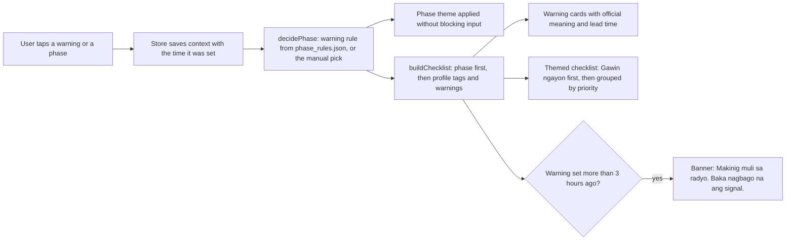

Tapping a warning lets `decidePhase` move the phase automatically (source `warning`), always toward caution; tapping a phase button sets it directly (source `manual`). An item shows when its phase matches, its warning conditions hold for at least one active warning, and the profile has at least one of its required tags (or it requires none). Each phase recommends its own lists first: `before` the go-bag and home preparation, `during` what to do now and evacuation, `after` the post-storm list. Go-bag ticks show progress and can be reset. This path never touches the model, so it works in every tier and battery state. Tapping **Pagkatapos** is always the user's choice; it clears the active warnings.

### 3.2 Path B: question to answer

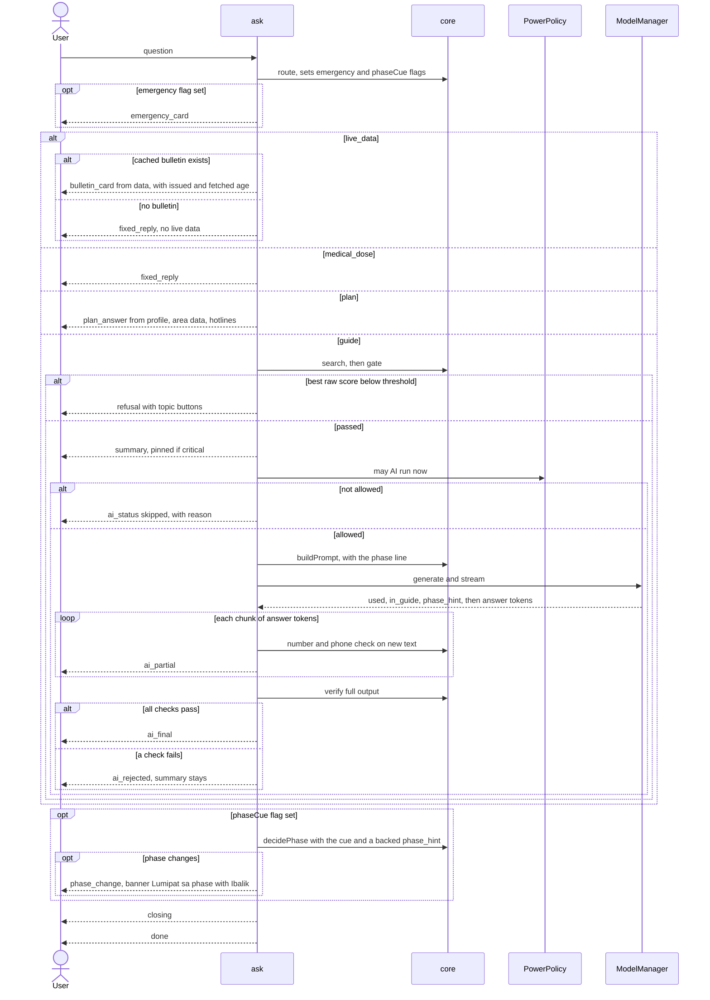

The emergency card comes first whenever the flag is set, then the question continues on its route. The vetted summary reaches the screen before the model starts. If anything fails afterwards, the user still has an answer that a person wrote and reviewed. A phase cue ("Signal 3 na dito", "humupa na") works on every route, with or without the model: `route` raises `phaseCue` from the cue word lists in `intents.json`, and the model's `phase_hint` only adds weight when the user's words, a warning or the bulletin back it (section 8). The live-data route never calls the model; the bulletin card is rendered from the cached feed.

### 3.3 May AI run now?

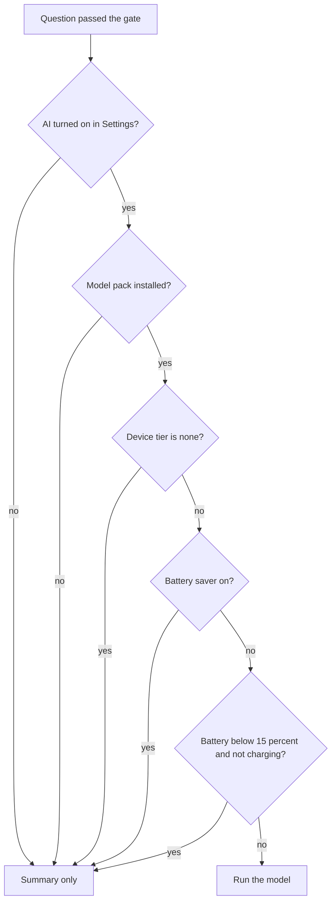

The first check that fails becomes the reason in `ai_status` (`ai_off`, `no_model`, `tier`, `battery_saver`, `low_battery`, in that order). The same check runs when the Ask screen opens (to decide whether to pre-warm) and whenever battery state changes while the model is loaded.

### 3.4 Offline pack import (MVP stretch)

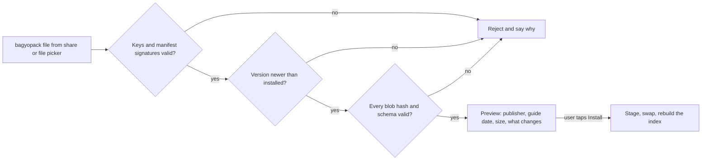

The channel does not matter. A pack file from Bluetooth, Quick Share, Messenger or a barangay laptop goes through the same checks as one from the CDN.

### 3.5 Smart Update and feed (MVP stretch)

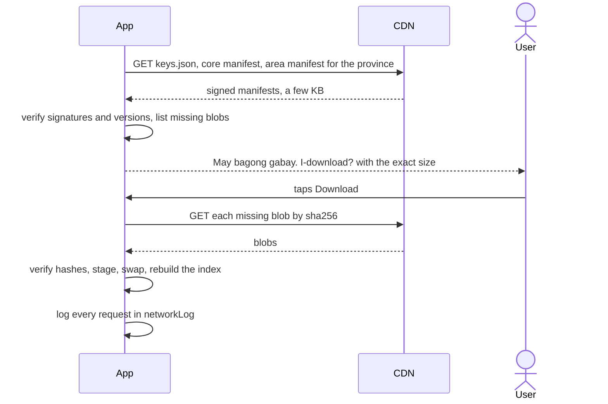

Smart Update ships alongside the bulletin feed (section 3.8) in MVP stretch, through the same `UpdateClient`, pinned host and `networkLog`; Pilot hardens it. Pack manifests are checked only while the app is open; downloads always wait for a tap and default to Wi-Fi. The province area manifest also carries the province's `evacuation_centers.json`. The LGU publish flow (Pilot) is in section 14.

### 3.6 Adding a member photo (required)

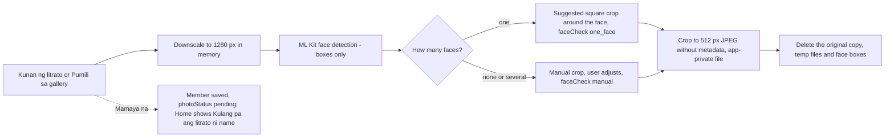

Every member needs a face photo, the main person included. There is no skip button. "Mamaya na" saves the member with `photoStatus: 'pending'`; Home shows "Kulang pa ang litrato ni {name}." until the photo is added, and nothing else is blocked. Camera capture, gallery pick and manual crop are MVP (core); the ML Kit one-face check is MVP. Details are in section 4, under "Family members and photos".

### 3.7 Phase decision

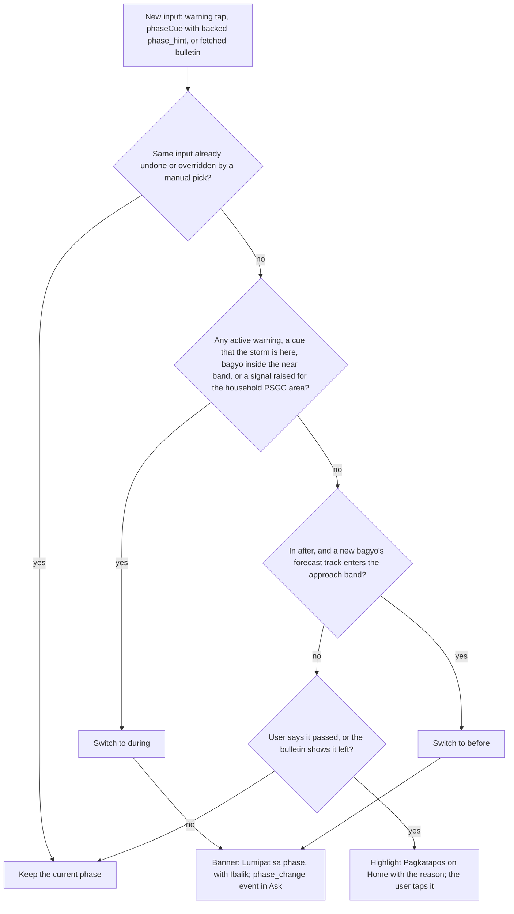

`decidePhase` is pure and lives in `app/core/`. Its inputs are the active warnings, the `phaseCue` flag, the model's `phase_hint` (accepted only when backed), and a `StormMeasure` from `measureStorm(bulletin, home)`. Automatic switches only move toward caution; `after` is always the user's tap. When inputs disagree, the more cautious phase wins. Distance switching (the `near` and `approach` bands) stays off while those bands are `placeholder: true` in `phase_rules.json`. The result is saved in `context` with its `PhaseSource` (`manual`, `warning`, `ask` or `bulletin`) and the inputs the user suppressed. Rules and themes are in section 18.

### 3.8 Feed fetch (MVP stretch)

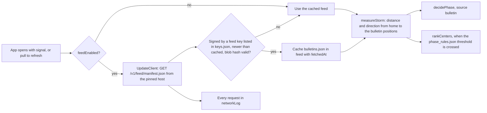

The feed is fetched only while the app is open: on app open and on pull to refresh, never in the background, never by push. A failed or invalid fetch keeps the cached feed; the bulletin card shows its age and the stale prompt 3 hours after `issuedAt`. `measureStorm` uses `location.coords` when the user took a GPS reading, else the centroid of the profile's PSGC barangay from `places.json`. The feed and scraper are in section 19.

## 4. Data model

### Bundled content

Sizes are estimates; v1 sized the first five files.

| File | Contents | Approx. size | Owner |
| :-- | :-- | :-- | :-- |
| `guide.tl.json` | About 300 passages (MVP ships about 120): text, hand-written summary, tags (phase included), `critical` flag, source reference, reviewer and date | ~600 KB | Content |
| `checklist.json` | About 150 items: phase, warning conditions, required profile tags, priority | ~60 KB | Content |
| `warnings.json` | `tcws` 1 to 5, `rainfall`, `surge`, `gale`, and the `barangay-order` choice: meaning, thresholds, lead time, source, and a "confirm with PAGASA" flag | ~5 to 10 KB | Content |
| `synonyms.json` | Taglish words and Tagalog verb forms mapped to canonical terms | ~20 KB | Search |
| `sources.json` | Every source document: agency, title, date, URL; also the PAGASA pages the scraper reads (URLs to confirm) | ~20 KB | Content |
| `intents.json` | Router phrases for emergency, `live_data`, `plan` and `medical_dose`, the phase cue word lists for `phaseCue`, plus fixed-reply keys | ~10 KB | Search and safety |
| `hotlines.json` | National hotlines, always rendered by code | ~2 KB | Content |
| `phase_rules.json` | The warning-to-phase rule (our product rule), the `approach` and `near` distance bands and the evacuation-center recommendation threshold (by PAGASA category or signal). Each entry has a cited source and reviewer, or `placeholder: true`; while a band is a placeholder, distance switching is off. No default numbers | ~1 KB | Content and safety |
| `places.json` | PSGC regions, provinces, cities, municipalities and barangays for the area picker, with centroid coordinates for distance math (MVP core). Centroid source to confirm; candidate: OCHA/HDX Philippines administrative boundaries (COD-AB), license to confirm | Measure | Content |
| `Llama-3.2-1B-Instruct-Q4_K_M.gguf` | The model, installed as an optional pack | 0.81 GB | AI |

There is no `index.bin`. MiniSearch indexes the passages at startup (section 5).

Warning thresholds come from PAGASA. The wind signals are confirmed: Signal 1 is 39 to 61 km/h with a 36-hour lead time, Signal 2 is 62 to 88 km/h with 24 hours, Signal 3 is 89 to 117 km/h with 18 hours, Signal 4 is 118 to 184 km/h with 12 hours, and Signal 5 is 185 km/h or more with 12 hours ([PAGASA](https://bagong.pagasa.dost.gov.ph/learning-tools/tropical-cyclone-wind-signal)). The rainfall colors (yellow 7.5 to 15, orange 15 to 30, red above 30 mm per hour, observed) come from a secondary explainer ([Varsitarian](https://varsitarian.net/sci-tech/20250724/explainer-how-do-pagasas-rainfall-warnings-and-weather-advisories-work)). The storm surge bands (yellow about 1 to 2 m, orange about 2.1 to 3 m, red above 3 m) are **Unverified** and have changed since 2015 ([ABS-CBN](https://www.abs-cbn.com/news/2024/11/15/storm-surge-warning-up-in-areas-on-typhoon-pepito-s-path-2110)). Those entries keep the confirm flag until a teammate checks them against PAGASA's current pages. The validate script warns about the flag in MVP and fails the build in Pilot.

### Feed and province data (MVP stretch)

| File | Where it comes from | Contents | Cached in |
| :-- | :-- | :-- | :-- |
| `bulletins.json` | The feed: `/v1/feed/manifest.json` → `/v1/blobs/{sha256}.json.gz`, built by the scraper | Each `Bulletin`: `id`, `source` (agency, title, URL), `issuedAt`, `scrapedAt`, the parsed fields the app shows (name, category, position, movement, forecast positions, signal areas as PSGC codes) and verbatim `text`. The phone adds `fetchedAt` | MMKV `feed` |
| `evacuation_centers.json` | Province bundle under `/v1/areas/{provinceCode}/`; scraped, then reviewed (reviewer and date) before publishing; LGU packs replace it (Pilot) | Name, barangay (PSGC), location for distance, source, reviewer and date | Installed packs |
| Hotline updates | Feed, reviewed before publishing | National hotline changes with reviewer and date | MMKV `feed` |

Bulletins are live data, not passages: never indexed, never in a prompt, shown verbatim and rendered from data.

### On-device stores (MMKV)

| Key | Holds | Retention |
| :-- | :-- | :-- |
| `profiles` | The household: the main person's ID, the members (name, relation, age group, needs, note, phone, photo reference, `photoStatus`, `faceCheck`), pet count, home tags, `location: { psgc, coords? }`, plan (evacuation center, meeting place, up to 5 contacts). Member tags and headcount are derived on every save | Until the user deletes them |
| Photo files (not MMKV) | `files/photos/{memberId}-{version}.jpg` in app-private storage, about 150 KB each | Replaced on retake; deleted with the member, from Settings, or with the household |
| `activeProfileId` | Which profile is in use | Always |
| `context` | Phase, `phaseSource`, active warnings (each with the time it was set), and the suppressed inputs (warning IDs, bulletin IDs, questions the user undid or overrode) | Warnings clear when the user taps **Pagkatapos** or resets |
| `checklist:{profileId}` | Ticked item IDs with times | Per profile; the user can reset it for a new season |
| `questionLog` | The last 200 questions: text, route, flags, matched IDs, scores, outcome, per-stage timings, failure code | Ring buffer; local only; one-tap clear; never uploaded |
| `settings` | Low-battery threshold, AI on or off, `feedEnabled`, pack auto-check, Wi-Fi only, topic sharing, stale-warning hours | Always |
| `packs` | Installed packs: ID, version, hashes, key ID, install time, and the previous version for rollback | Always |
| `feed` (MVP stretch) | The last verified `bulletins.json` with `fetchedAt`, its manifest version and key ID, and reviewed hotline updates | Replaced by the next verified feed; kept when a fetch fails |
| `networkLog` (MVP stretch) | Each request: time, host, path, bytes, result | Last 100; shown on the About screen |
| `topicCounts` (Pilot) | Weekly counts per topic group, only after opt-in | Deleted after upload, or after 8 weeks |
| `damageReports` (Pilot) | Draft and sent damage reports: structured fields and photo references. Damage photo files live in `files/damage/`, separate from member photos | Kept until the user deletes them or the report is confirmed sent |
| `account` (Later) | Signed-in state, email, sync metadata and the last sync time. Never the password | Until sign-out |

*Reasoning:* `questionLog` holds free text that may name people or illnesses. It stays on the phone, has a clear button, and feeds only the on-device Eval screen.

### Family members and photos

**Members (MVP).** A household has one main person (`relation: self`) and up to 30 members. A pure `deriveHousehold` function in `app/core/` turns members into the household's tags (`infant`, `child`, `senior` from age groups; `pregnant`, `pwd`, `maintenance_meds` from needs; `pets` from the pet count) and its headcount. Search boosts, the checklist and the prompt's profile line use only these derived tags. `buildChecklist` adds the names of the members an item applies to ("gamot ni Lolo Ben") and shows a member's note under medicine items. Names and notes come from the profile, never from the model, and never enter the prompt.

**Photos (required; capture and manual crop MVP (core), face check MVP).** Every member, the main person included, needs a face photo. `photoStatus` is `pending` until a photo is saved; "Mamaya na" saves the member as `pending` and Home reminds ("Kulang pa ang litrato ni {name}.") without blocking anything else. A `PhotoService` in `app/services/` runs the pipeline in section 3.6:

1. **Source.** The camera through the system camera screen (the CAMERA permission is requested the first time the user taps "Kunan ng litrato", never at launch), or the system photo picker, which on recent Android versions needs no storage permission (check expo-image-picker for the target Android versions).
2. **Downscale** the longest side to 1,280 px in memory, so detection is fast and memory stays small.
3. **Detect** with Google ML Kit face detection, bundled model, fast mode, with landmarks, contours and classification turned off. The output is face boxes only. The bundled model adds about 6.9 MB and works offline; the unbundled one downloads through Google Play services and returns nothing until that download finishes, so it is not used ([ML Kit](https://developers.google.com/ml-kit/vision/face-detection/android)).
4. **Decide.** One face: a suggested square crop with about 40% margin around the box, saved as `faceCheck: 'one_face'`. No face or several faces (detector results `no_face` and `many_faces`, never saved): the user crops by hand, saved as `faceCheck: 'manual'`; a dark or blurry photo usually lands here, and the screen suggests retaking it. Detection only assists; the user can always keep a hand-cropped photo.
5. **Save.** Crop, resize to 512 × 512, and encode as JPEG at about 0.8 quality (target ≤ 150 KB). Writing a new JPEG drops the original's EXIF metadata, including GPS location; a test checks this. The file goes to app-private storage and `photoStatus` becomes `done`. The temp copy, the original and the face boxes are deleted.

**What the detector never does.** No recognition (who is this?), no face embeddings or descriptors, no comparing faces across photos, no age, gender or emotion estimates, and nothing stored except the cropped picture the user approved. Llama 3.2 1B is text-only and never receives a photo.

**"Hinahanap" card (MVP).** Built from the member (photo, name, age group, needs), the main person's number and the evacuation center. It is shown full screen on demand. Only when the user taps share does `ShareService` render it to an image and hand it to the share sheet; this is the only way a photo leaves the phone.

### Content lifecycle

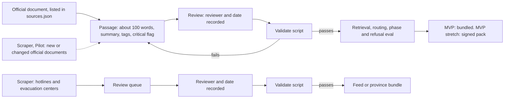

Scraped hotlines and evacuation centers never reach phones without a reviewer and date. Bulletins skip the queue (speed) because they are shown verbatim as live data, never as guide text. From the Pilot the scraper also flags new or changed official documents for guide writers; nothing it finds becomes a passage on its own.

The validate script checks that:

- required fields are present and IDs are unique;
- passages are 60 to 120 words, near 100 where possible (v1 allowed 150; the lower ceiling keeps prompts short);
- every source reference exists in `sources.json` with agency, title, date and URL;
- the reviewer and review date are present;
- every number in a summary also appears in its passage text;
- tags come only from the [shared names](README.md#shared-names);
- every `phase_rules.json` band and threshold has a source and reviewer or is `placeholder: true`;
- every evacuation center and hotline update has a reviewer and date.

## 5. Retrieval

Search decides what the model may read.

### 5.1 Normalize

`normalize` runs on passages at index time (through MiniSearch's `processTerm` and `tokenize`) and on questions at query time, so both sides match.

1. Lowercase, then strip accents.
2. Replace punctuation with spaces; keep digits.
3. Look up hyphenated words whole first ("tubig-baha"), then split them.
4. Collapse letters repeated three or more times ("tulonggg" becomes "tulong").
5. Drop fillers such as po, opo, ba, naman, lang, yung, kasi, nga, din, rin. Keep negations (huwag, hindi, wala).
6. Expand synonyms at query time only, appending canonical terms so the user's own word still counts. `synonyms.json` lists Tagalog verb forms explicitly, for example lumikas, lilikas, lumilikas, paglikas, inilikas, mag-evacuate, nag-evacuate and bakwit for the evacuate concept, and baha, tubig-baha and lumubog for flood.
7. MVP stretch: light affix stripping (mag-, nag-, pag-, i-, ma-, na-; -um-, -in-; a repeated first syllable). It runs only when a word has no synonym hit and is not in the index vocabulary, and the eval decides whether it stays.

### 5.2 Index and query

| Setting | Value | Why |
| :-- | :-- | :-- |
| Index time | At app start, and again after a pack is applied | *Reasoning:* 120 to 300 short passages should index well under a second; measure it |
| Fields and boosts | title ×2, keywords ×2, summary ×1.5, text ×1 | Hand-written titles and keywords are the strongest signal |
| `storeFields` | ID, phase, warnings, profile tags, hazards, topic, critical flag | Needed for boosts, the gate and the UI |
| `combineWith` | OR (the library default) | Short Taglish questions rarely share every word with a passage |
| `prefix` | Terms of 4 or more letters | Catches partial words |
| `fuzzy` | Terms of 5 or more letters, about 0.2 of term length | Catches typos without matching every short word |
| `boostTerm` | Generic words (bagyo, signal, ulan) at about 0.5 | Stops generic words from matching everything |

MiniSearch ranks with BM25+ and exposes these options in its search API ([MiniSearch](https://lucaong.github.io/minisearch/)).

### 5.3 Tag boosts

`boostDocument(documentId, term, storedFields)` multiplies a matching passage's score:

- ×1.2 when the passage's phase tag matches the current phase from `decidePhase`, so a "during" question surfaces "during" passages first;
- ×1.2 when the passage lists an active warning, for example `tcws` 3 or `rainfall` orange;
- ×1.2 for each matching profile tag (v1's "+20% for river when the profile says near river");
- capped at ×1.5 in total.

Boosts never add a passage that matched no terms. A falsy return value skips a passage in MiniSearch, so "no boost" returns 1, not 0. The multiplier is a pure function of the stored fields and the context, so `gate` can divide it back out.

### 5.4 Gate and passage count

- **Rank by the boosted score, gate on the raw score.** Tags may reorder good matches. They must not lift a weak match over the threshold.
- **Threshold.** Calibrate it on the evaluation set: pick the value that keeps out-of-scope questions refused while keeping in-scope recall high (targets in [solution.md](solution.md)). Recalibrate in the content build whenever the guide changes, because BM25 scores depend on the corpus.
- **Refusal.** Show "Wala ito sa gabay." with up to three topic-group buttons drawn from the closest passages, or from `signals`, `go_bag` and `evacuation` if nothing is close. A button opens the Guide screen at that topic.
- **Adaptive k.** Send two passages on the `full` tier, but only one when the second's boosted score is under 60% of the first. The `lite` tier always sends one. *Reasoning:* each passage costs about 125 to 225 prompt tokens, the largest cost we control on a CPU.

## 6. Generation

The model writes in a shape the grammar fixes, from passages search chose.

### 6.1 Messages

System message, the fixed instructions (the canonical text is `SYSTEM_TL` in [api-layer.md](api-layer.md#8-llm-contract-mvp)):

```text
Ikaw si Sipat, gabay sa paghahanda sa bagyo para sa isang sambahayan.
Sumagot LAMANG mula sa mga talatang ibinigay. Huwag gumamit ng sariling kaalaman.
Sumagot sa 2 hanggang 4 na maiikling pangungusap sa simpleng Tagalog.
Huwag magdagdag ng numero, oras, lugar o pangalan na wala sa mga talata.
Huwag magbigay ng numero ng telepono, hotline o dosis ng gamot.
Kung hindi sinasagot ng mga talata ang tanong, ilagay ang "in_guide": false.
Ilagay sa "used" ang ID ng talatang pinagkunan mo.
Ilagay sa "phase_hint" ang yugto ng bagyo kung sinabi ito ng tanong; kung hindi, null.
```

The `phase_hint` line is a draft; keep it in sync with `SYSTEM_TL`. Two few-shot pairs follow as earlier turns: one answered from a passage, one with `in_guide: false`. Each stays under about 90 tokens. They are placeholders until the real passages exist, and must then be copied from reviewed guide text.

User message, built per question:

```text
Sambahayan: {profile_summary}
Yugto at babala: {phase_label}; {warnings_summary}

Talata [{id_1}]: {text_1}
Talata [{id_2}]: {text_2}

Tanong: {question}
```

Code writes `profile_summary` from tags, for example "5 tao; may sanggol at senior na may maintenance na gamot; malapit sa ilog". It writes `phase_label` from the current phase that `decidePhase` set ("Bago", "Habang" or "Pagkatapos") and `warnings_summary` from the context, for example "Signal No. 3; orange na babala sa ulan". The prompt never contains names, member notes, photos, contact numbers, addresses, location, the evacuation center or bulletin text. The model cannot repeat what it never sees; the `plan` route answers those questions from data. Use llama.rn `messages` so the chat template stored in the GGUF formats the turns (check current library docs).

| Part | Tokens |
| :-- | :-- |
| Instructions and two examples (fixed) | ~180, plus a few for the `phase_hint` line |
| Profile and warnings lines | ~30 |
| One or two passages | ~125 to 450 |
| Question | ~10 to 40 |
| **Total input** | **~350 to 700** |
| Output | ≤ 110 (`lite`: ~80), of which `phase_hint` takes a few tokens |

### 6.2 Output schema and its order

```json
{
  "type": "object",
  "properties": {
    "used": {"type": "array", "items": {"enum": ["{id_1}", "{id_2}"]}, "minItems": 1, "maxItems": 2},
    "in_guide": {"type": "boolean"},
    "phase_hint": {"enum": ["before", "during", "after", null]},
    "answer": {"type": "string", "maxLength": 400}
  },
  "required": ["used", "in_guide", "phase_hint", "answer"]
}
```

llama.rn turns a `response_format` JSON schema into a GBNF grammar ([llama.rn](https://github.com/mybigday/llama.rn)). `buildPrompt` fills in the allowed IDs per question, so the model can cite only passages it was given; with one passage the enum holds one ID and `maxItems` is 1. The order matters:

- `used`, `in_guide` and `phase_hint` are known after a dozen or so tokens (`phase_hint` adds a few). `ask()` passes `phase_hint` to `decidePhase` only when the question also raised `phaseCue` or a warning or bulletin backs it. Everything after `"answer": "` is the answer itself and streams straight to the screen.
- When the parser sees `"in_guide": false`, `ask()` calls `stopCompletion` and shows the refusal. This saves time and battery.

Check that the installed llama.rn keeps property order and whether it enforces `maxLength`. `verify` enforces length either way. The exact contract is in [api-layer.md](api-layer.md).

### 6.3 Sampling and context

| Setting | Value | Why |
| :-- | :-- | :-- |
| `n_ctx` | 1,024 | Input up to ~700 plus output up to 110; recheck the budget with the `phase_hint` line on real passages |
| `n_predict` | ≤ 110 (`full`), ~80 (`lite`) | Caps time and battery |
| `temperature`, `top_p` | 0.2, 0.9 | Condense, don't create |
| `seed` | Fixed in evaluation runs | Repeatable results |
| `n_threads` | Number of fast cores; measure 2 against 4 | *Reasoning:* many budget chips pair a few fast cores with slow ones, and slow cores can drag decoding down |
| `use_mmap`, `use_mlock` | true, false | mmap pages weights in from storage; locking 0.8 GB on a 4 GB phone invites the OS to kill the app |
| `n_gpu_layers` | 0 on MediaTek and Unisoc; test on Adreno | OpenCL runs only on Adreno |

*Reasoning:* Llama 3.2 1B has 16 layers, 8 KV heads and a head size of 64. An f16 KV cache therefore costs 16 × 2 × 8 × 64 × 2 bytes, about 32 KB per token, or about 32 MB at 1,024 tokens. With 0.81 GB of mmapped weights plus compute buffers (measure them), the ≤ 1.2 GB peak is reachable.

### 6.4 Prefix cache, pre-warm, streaming

- **Prefix cache.** The instructions and examples are identical for every question. After a load, evaluate them once and store the state with `saveSession`; restore it with `loadSession` after later reloads. While the model stays loaded, first check whether llama.rn already reuses the shared prefix between calls. Keep the session file only if it beats recomputing ~180 tokens on the reference phone.
- **Pre-warm.** When the Ask screen opens and AI is allowed, load the model and the prefix in the background while the user types.
- **Streaming.** The token callback appends to a buffer. A small incremental parser finds the `answer` string and unescapes it (`\"`, `\n`), holding back a dangling backslash. Before any new text goes out as `ai_partial`, the number and phone checks (section 7) run on it, up to the last whitespace. A failure stops generation at once with `stopCompletion` and emits `ai_rejected`, so no unchecked number reaches the screen. Streamed text appears in a "being checked" style until `ai_final`.

## 7. Verification

`verify` runs these checks in order and stops at the first failure. The [failure codes](README.md#shared-names) are shared with the UI and the log.

| Order | Code | Check | On failure |
| :-- | :-- | :-- | :-- |
| 1 | `schema` | The output parses and matches the schema. This also catches output cut off at the token cap | `ai_rejected` |
| 2 | `not_in_guide` | `in_guide` is true | Refusal, same as the gate |
| 3 | `bad_citation` | `used` is non-empty, has no duplicates, and contains only given IDs | `ai_rejected` |
| 4 | `unknown_number` | Every number in the answer is in the allowed set | `ai_rejected`; also checked while streaming |
| 5 | `phone_number` | Every phone-like string appears verbatim in a cited passage | `ai_rejected`; also checked while streaming |
| 6 | `too_long` | At most 4 sentences and 400 characters | `ai_rejected` |
| 7 | `wrong_language` | Mostly Latin letters, with Tagalog function words (ang, ng, sa, mga, ay, kung, para) present at a reasonable rate | `ai_rejected` |

**The allowed number set** is every number in the cited passages, plus the numbers in the prompt's profile and warning lines (the headcount, the signal level). Normalization runs on both sides and recognizes:

- digits, decimals, thousands separators ("5,000"), and both ends of ranges ("89-117", "89 hanggang 117");
- Tagalog cardinals from isa to sampu, the teens (labing-isa, labindalawa, labinlima), the tens (dalawampu, tatlumpu, limampu), hundreds and thousands (daan, libo), compounds ("dalawampu't apat"), and linker forms ("dalawang", "limang", "apat na");
- Spanish-derived numbers common in Taglish (uno to dose, kinse, beinte) and clock times ("alas-tres" counts as 3);
- English number words ("two hours");
- ordinals ("ika-3", "ikatlo"), which map to their cardinals.

"isa" and "isang" count as 1 only when a unit word follows within two words (oras, araw, linggo, litro, galon, piraso, tao, beses, metro, km). Otherwise they are the article "a" ("isang bag").

**Known limit.** A number that appears in the passage but sits next to the wrong unit still passes. The faithfulness review in the evaluation catches that class of error ([solution.md](solution.md)).

**Phone-like strings** are runs of 7 or more digits that may include spaces, dashes, dots, parentheses and a leading +63 or 0, plus short codes, which the number check already covers. The test suite in [api-layer.md](api-layer.md) fixes the exact patterns.

**After the checks:**

- **Critical pinning.** If the top hit or any cited passage is `critical`, the `summary` event is pinned: the UI shows it first, in bold, and the AI text sits below it as an explanation, even after `ai_final`.
- **Fallback.** On `ai_rejected` the summary already on screen remains the answer, with a short note that the AI answer was not shown. The failure code goes to `questionLog`.
- **Phase hint.** `verify` does not reject an answer over `phase_hint`. `decidePhase` ignores it unless the user's words, an active warning or the cached bulletin back it (section 8).
- **Closing line.** Code appends "Sundin ang utos ng barangay at ng mga awtoridad." to every outcome, including refusals and fixed replies. The model never writes it.

## 8. Safety policy

Every rule is enforced by code, never by the prompt alone.

| # | Trigger | Action | Enforced in |
| :-- | :-- | :-- | :-- |
| 1 | An emergency phrase from `intents.json` ("lumulubog", "may naipit", "hindi makahinga") | Emergency card first: get to higher ground, call 911, the national emergency hotline since [EO 56 (2018)](https://newsinfo.inquirer.net/996682/eo-makes-911-countrys-emergency-hotline-number), or the barangay (numbers from `hotlines.json` or the LGU pack). Then the normal route | `route`, UI |
| 2 | A live-data question: storm position, track or timing, class suspensions ("may pasok ba bukas?"), power restoration | If a cached bulletin exists, the `bulletin_card` rendered from data with its issued and fetched age and "Makinig pa rin sa radyo"; else the fixed "Walang live na balita..." reply. No search, no model | `route`, `ask()` |
| 3 | A plan question: evacuation center, meeting place, contacts, hotlines | Answered from the profile, reviewed area data or `hotlines.json`; no model | `route`, `plan_answer` |
| 4 | A medicine-dose question | The fixed reply pointing to the health center or 911; no model | `route` |
| 5 | The best raw score is below the threshold | "Wala ito sa gabay." plus topic buttons; no model | `gate` |
| 6 | The model returns `in_guide: false` | Generation stops; the same refusal as rule 5 | `ask()`, `verify` |
| 7 | A number outside the allowed set | Generation stops; `ai_rejected`; the summary stays | `verify`, also while streaming |
| 8 | A phone-like string not in a cited passage | Same as rule 7 | `verify`, also while streaming |
| 9 | A bad citation, a long answer or the wrong language | `ai_rejected`; the summary stays | `verify` |
| 10 | The top hit or a cited passage is `critical` | Summary pinned above the AI text | `ask()`, UI |
| 11 | AI not allowed (tier, battery, battery saver, setting, no model) | Summary only; `ai_status` gives the reason | `PowerPolicy` |
| 12 | An active warning set, or a cached bulletin issued, more than 3 hours ago | The stale prompt; the checklist and the bulletin still show | `buildChecklist`, UI |
| 13 | Any outcome | The closing line, appended by code | `ask()` |
| 14 | Any prompt | Contains only passages, the tag-based profile summary, the phase and warnings line and the question; never bulletin text, location or names | `buildPrompt` |
| 15 | Guide older than 30 days while online (MVP stretch) | Suggest an update on the Home and About screens | `UpdateClient`, UI |
| 16 | An automatic phase switch | Only toward caution: to `during` or, from `after`, to `before`. `after` is only ever the user's tap; Home may highlight it with a reason | `decidePhase` |
| 17 | The user undid a switch ("Ibalik") or picked a phase by hand | The same input (warning ID, bulletin ID, question) never re-triggers; a new input can | `decidePhase`, `context` |
| 18 | Inputs disagree | The more cautious phase wins | `decidePhase` |
| 19 | The model's `phase_hint` | Used only when the user's words, an active warning or the cached bulletin back it; alone it changes nothing | `ask()`, `decidePhase` |
| 20 | A distance band or the evacuation-center threshold is `placeholder: true` | Distance-based switching and center recommendation stay off; no number is assumed | `decidePhase`, `rankCenters` |
| 21 | Recommended evacuation centers | Only reviewed centers; "Ang barangay ang magsasabi kung kailan lilikas." above the list; no arrival time is ever computed | `rankCenters`, UI |
| 22 | A bulletin field the scraper could not parse | The field is left out, never guessed; the previous feed stays and is marked stale | Scraper, `verifyPack`, UI |

The emergency card, fixed replies and refusal text are reviewed static content. Bulletin cards are rendered from the verified feed, verbatim. None of them is generated.

## 9. Model lifecycle and power

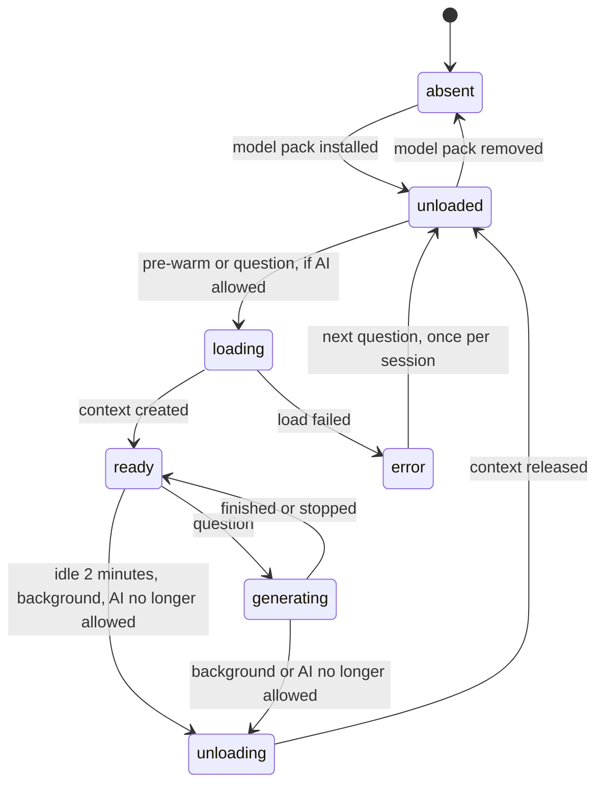

| Event | Effect |
| :-- | :-- |
| The Ask screen opens and AI is allowed | Load and evaluate the prefix in the background |
| A question passes the gate | Generate, loading first if needed |
| 2 minutes without a question | `release()` frees roughly 1 GB |
| The app goes to the background | `stopCompletion`, then `release()` |
| Battery falls below the threshold while not charging, or battery saver turns on | Stop and release; summaries only |
| The user turns AI off | Release |
| A load fails (out of memory, bad file) | `error` state, summaries only, one retry per session; the reason shows in Settings |

**`PowerPolicy` inputs:** battery level and charging state, the OS battery saver (check that expo-battery reports Android's power-saver mode), the user's AI setting, the device tier, and whether the model pack is present. AI may run only when the tier is not `none`, the model is present, AI is on, battery saver is off, and the battery is at or above the threshold (default 15%) or charging. Reason codes are in [api-layer.md](api-layer.md).

**Tier detection** runs at first launch and before a model install. It reads total RAM as Android reports it (expo-device) and free storage (expo-file-system), then applies the [tier table](README.md#shared-names). "Extended RAM" is swap space sold as memory; it does not appear in reported RAM, so it never lifts a phone into a higher tier.

**Battery** (*Reasoning*, v1's estimate updated for slower answers):

- A 5,000 mAh battery at about 3.85 V holds roughly 19 Wh.
- A 1B model draws about 2 to 3 W while generating (Ertas, **Unverified** vendor figure, linked in [idea-sipat.md](idea-sipat.md)).
- An answer of 6 to 15 seconds therefore costs about 12 to 45 J, or 0.003 to 0.013 Wh: roughly 0.02 to 0.07% of the battery, well under 0.1%.
- Network and location add little by design: the feed is fetched only while the app is open (on open and pull to refresh, a few KB), and location is a single coarse reading on tap. Neither runs in the background.
- Fifty questions during a storm cost about 1 to 3%. A few minutes of screen-on time cost more, which is why the dark theme and short screens matter. Confirm with the Android Studio profiler on the reference phone.

## 10. Performance budgets

Medians on the reference phone, all proposals to measure.

| Stage | Budget | How measured |
| :-- | :-- | :-- |
| Cold start to Home | ≤ 3 s | Launch to first render |
| Search index build | ≤ 0.5 s | Timer around indexing |
| Checklist on screen | < 0.5 s | Tap to render |
| `route` + `search` + `gate` | ≤ 0.1 s | `questionLog` timings |
| Summary on screen | ≤ 1 s | Send to `summary` event |
| Model load, cold | Measure; mostly hidden by pre-warm | llama.rn timings |
| Prompt processing | Measure tokens per second; it sets the first-word time | llama.rn timings |
| First AI words | ≤ 5 s | Send to first `ai_partial` |
| Full AI answer | ≤ 10 s; stretch 6 s | Send to `ai_final` |
| `verify` | ≤ 10 ms | Timer |
| Face detection on one 1,280 px photo | ≤ 1 s | Timer around detection (MVP) |
| Phase theme switch | Never blocks input; measure | Tap to themed render |
| Feed fetch and verify (MVP stretch) | Measure; never blocks the offline screens | `networkLog` timings |
| Photo saved after "Gamitin" | ≤ 1 s, ≤ 150 KB | Timer, file size |
| Peak RAM, AI on | ≤ 1.2 GB | Android Studio profiler |
| Peak RAM, AI off | Measure | Android Studio profiler |
| Storage | ~1 MB content, 0.81 GB model, KB-size packs | APK Analyzer, file sizes |
| Battery per answer | < 0.1% | Section 9 estimate, then the profiler |
| Background work | None while closed | The manifest declares no services, receivers or jobs |

## 11. Network policy

- **Offline core (MVP (core), MVP).** Until the MVP stretch online features land, the release APK removes INTERNET with Expo's `android.blockedPermissions`, the "list of permissions to block in the final AndroidManifest.xml" ([Expo app config](https://docs.expo.dev/versions/latest/config/app/)). Android grants INTERNET at install as a normal permission ([Android](https://developer.android.com/reference/android/Manifest.permission#INTERNET)), so its absence from the merged manifest is the proof that the app is offline. Debug builds keep network access only for the development server. The offline core never waits on the network, in this build or later ones.
- **Online features (MVP stretch; Pilot hardens).** The build adds INTERNET for a few modules only: `UpdateClient` (feed and packs), and from the Pilot the opt-in `TopicReporter` and the opt-in `DamageReporter`; from Later, the signed-in `AccountSync`. All go through one fetch wrapper that allows a single pinned host (our server) over HTTPS with certificate or public-key pinning; a lint rule bans any other network call. The phone never contacts PAGASA directly. No analytics or crash SDK phones home. Every request is added to `networkLog` and listed on the About screen.
- **Only while open.** No background fetch, no push, no scheduled jobs on the phone. The feed is fetched on app open with signal and on pull to refresh, and can be turned off (`feedEnabled`). Pack manifests are checked on app open when auto-check is on, on Wi-Fi, and more than 24 hours after the last check. Pack downloads always wait for a tap, Wi-Fi by default; on mobile data the user sees the exact size first. Knowing whether the phone is on Wi-Fi needs ACCESS_NETWORK_STATE, another normal permission.
- **No identifiers.** Requests carry no device ID, no profile, no location and no cookies. The feed is the same file for everyone; area data is fetched per province, so the province code in the path is the most the host learns. Keep CDN access logs off or short-lived.
- **Location (MVP stretch).** `LocationService` asks for coarse location only when the user taps "Gamitin ang lokasyon ng telepono", takes one reading, and stores it in the profile as `location.coords`. It never runs in the background and the reading never leaves the phone. The PSGC barangay from `places.json` is always set, so everything works without GPS.
- **Camera and photos.** CAMERA is requested only when the user taps "Kunan ng litrato"; coarse location is the only other runtime permission, and only on tap. The bundled face model needs no network. If the face-detection library's own manifest declares INTERNET, `android.blockedPermissions` still removes it in the offline build; confirm detection works in airplane mode.
- **No cloud backup.** Android Auto Backup can copy app data, including the profile and photos, to the user's Google Drive. Turn it off (Expo `android.allowBackup: false`, or backup rules that exclude MMKV and `files/photos/`) and check on a test phone.

## 12. Update and pack system

Offline import, the CDN and the bulletin feed are MVP stretch; the Pilot hardens them and adds LGU packs. The feed itself is described in section 19.

### Pack types

| Pack | Contents | Source |
| :-- | :-- | :-- |
| Core | Guide, checklist, warnings, synonyms, intents, sources, national hotlines | National content repo |
| Area (province bundle) | MVP stretch: `evacuation_centers.json`, scraped and reviewed. Pilot: LGU packs replace it and add local hotlines, `advisories.json` and `hazard_notes.json`; one per municipality, published per province. The same province manifest also lists hazard packs (coastal, upland) | Scraper review queue (section 19); Bantay portal (section 14, Pilot); hazard packs from the content repo |
| Model | The GGUF file, verified by size and SHA-256 against `BUNDLED_MODEL` in the app | MVP: downloaded once from Hugging Face on the Settings tap "I-download ang AI" (owner-approved exception to the one pinned host, logged in `networkLog`), or imported from a file on the phone. Pilot: the Google Play AI pack may replace it |

Google Play for On-device AI delivers models in AI packs (install-time, fast-follow or on-demand) and allows app versions up to 4 GB ([Android](https://developer.android.com/google/play/on-device-ai)). It is in beta; check the per-pack limits before relying on it.

### CDN layout

| Path | Contents | Caching |
| :-- | :-- | :-- |
| `/v1/keys.json` | Signing public keys with their purpose (`pack` or `feed`) and validity windows, signed by the root key | Short TTL |
| `/v1/feed/manifest.json` | Feed version, `issuedAt` of the newest bulletin, blob list for `bulletins.json` and hotline updates; signed by the feed key (MVP stretch) | Short TTL |
| `/v1/core/manifest.json` | Core pack version, guide date, blob list (SHA-256, size), deltas | Short TTL |
| `/v1/areas/{provinceCode}/manifest.json` | Every area pack in the province | Short TTL |
| `/v1/blobs/{sha256}.json.gz` | Content-addressed pack files and deltas | Immutable, cache forever |

### Trust chain

- One or two **root public keys** are pinned in the app binary. The root private key stays offline and is used only to sign `keys.json`.
- **Two signing keys, two purposes**, both listed in `keys.json` with validity windows. The **pack key** signs core and area manifests; it stays offline and signing is a manual step. The **feed key** signs only `/v1/feed/manifest.json`; it is held by the scraper job (CI secret) so bulletins publish without a person in the loop. The app accepts a manifest only when its key's purpose matches the manifest type, so a stolen feed key cannot sign a guide pack. Rotation means publishing a new `keys.json`. The model is not on the CDN: the MVP downloads it from Hugging Face and checks it against the size and SHA-256 compiled into the app.
- A manifest's signature is Ed25519 over the RFC 8785 canonical JSON of the manifest without its signature field ([RFC 8785](https://www.rfc-editor.org/rfc/rfc8785)).
- Manifests list blobs by SHA-256 and size, so blobs need no signature of their own.
- **Monotonic versions.** A manifest must be newer than the installed version of that pack. An equal version is a no-op; an older one is rejected, which blocks rollback attacks. `min_app_version` keeps old apps from installing packs they cannot read. Field names are in [api-layer.md](api-layer.md).

### Deltas, apply, rollback

- **Deltas** work at passage level: upserts and deletes against a base version. The app applies a delta only when its installed version equals that base; otherwise it fetches the full blob. *Reasoning:* the whole guide is about 600 KB before compression, so full blobs are an acceptable fallback.
- **Atomic apply.** Download to a staging folder, verify every hash and schema, and check cross-references (every source reference exists). Then write the new version folder, switch one pointer in `packs`, and rebuild the MiniSearch index. The previous version is kept for one-tap rollback. If any step fails, the old version stays active.
- **Province bundles for privacy (F4).** The app downloads every area blob for its province (tens of KB), keeps the chosen municipality, and filters by profile on the phone. The CDN learns the province and an IP address, never who lives in the house.
- **`.bagyopack`.** A single file holding `keys.json`, the manifests and the blobs, built by our CI. Import uses the file picker or Android's share-to-app. The app does not export packs.
- **Stale guide (MVP stretch).** The About screen always shows the guide date. When the guide is older than 30 days and the phone is online, the app suggests an update.

## 13. Security and privacy

| Threat | Impact | Mitigation |
| :-- | :-- | :-- |
| Tampered or fake pack (CDN compromise, a malicious `.bagyopack`) | Wrong life-safety advice | Root-pinned signature chain, hash-checked blobs, schema checks, monotonic versions; the publisher is shown before install |
| Compromised LGU portal account | Fake evacuation center or hotline | MFA; separate editor and approver; structured fields only; validators and platform review; signing key outside the portal; fix by publishing a newer version |
| Stolen pack key | Malicious guide packs everywhere | Pack key kept offline, signing is a manual step; root key offline; short validity windows; rotation through `keys.json` |
| Stolen feed key (held by the scraper job) | Fake bulletins, wrong phase switch toward caution | Feed key in CI secrets only, purpose-limited to the feed manifest (cannot sign packs); short validity window; rotation through `keys.json`; bulletins always show source, `issuedAt` and "Makinig pa rin sa radyo"; automatic switches only move toward caution |
| Scraper misparses a PAGASA bulletin | Wrong position or signal area shown | Parse only the fields the app shows; validate; on failure keep the previous feed and mark it stale; never guess a field; verbatim text and source URL always shown |
| Scraped hotline or evacuation center is wrong | Wrong number or center | Review queue: nothing reaches phones without a reviewer and date |
| Man-in-the-middle on update or feed | Tampered content, or the phone talking to another host | HTTPS to one pinned host, with the signature as the real check; every request in `networkLog` on the About screen |
| Lost or shared phone | Household vulnerabilities and question history exposed | Minimal data, no names required, one-tap clear; MMKV encryption with its key in Android Keystore (Pilot) |
| Dashboard re-identification | One household's questions revealed | Opt-in; topic-group counts only; weekly; no device ID; IP not stored; cells under 10 households hidden; municipality level |
| Clone or fake apps | Malware posing as a safety app | Official channels only; publish the signing-certificate fingerprint on partner LGU pages |
| Lost or shared phone shows family photos and notes | Faces of children and elders, medicine names exposed | Notes are optional; photos are required but stay in app-private storage; one tap deletes a photo or all photos; app-private storage; Pilot: encryption with a Keystore key and an optional app PIN |
| Cloud backup copies the profile and photos | Data leaves the phone without the user knowing | Auto Backup off or excluded (section 11) |
| Location metadata inside a photo | Reveals where the family lives | Re-encoding drops EXIF; a test checks the saved file |
| Household location (MVP stretch) | Reveals where the family lives | Optional, coarse, one-shot on tap; stored only in the profile; never sent; the feed is the same file for everyone and area data is fetched per province |
| Face data reused for identification | Biometric-like data | The detector returns boxes only and they are discarded; no recognition, no embeddings, no comparisons |
| Screenshots or screen recording of member photos and cards | Photos shared without the user's share tap | Android FLAG_SECURE on release builds: screenshots, screen recording and the recents preview are blacked out app-wide, like streaming apps (D12). Debug builds leave it off so the mirrored demo works |
| Damage report exposes household data (Pilot) | Household damage details shared beyond the LGU | Opt-in; sent only on the user's send tap; structured fields plus the photos the user chose; TLS to the pinned host; the LGU sees it through the Bantay portal's own access rules |
| Account credentials or profile backup abused (Later) | Household data leaked or an account taken over | The MVP has no backend at all. Later: hashed passwords on the server, rate-limited reset with email verification, sync over TLS to the pinned host, an off switch in Settings, and photos and location never sync |
| Prompt injection through the user's own question | The user bends their own answer | Low risk: only that user sees it, and the grammar, checks and signed passages still apply |
| Wrong or careless content from an insider | Wrong advice | Reviewer fields, two-person review in Pilot, evaluation in CI, sources one tap away |

**Data Privacy Act.** Health information is sensitive personal information under RA 10173, Sec. 3(l) ([NPC](https://privacy.gov.ph/data-privacy-act/)), and the profile's tags (pregnant, maintenance medicine, disability) fall in that class. The design keeps them on the phone, so we never collect or process them. Topic reports are aggregate counts without identifiers. Member names, notes and photos of identifiable people, many of them children, are personal information. They also stay on the phone and are never collected. The optional account (Later) changes this for names and notes only: they sync to our server after sign-in, which needs its own privacy notice and consent text before it ships; photos, location and notes about health never sync. Damage reports (Pilot) carry what the household chose to share and need the same notice. The member screen shows the consent line before a photo of another person ("Siguraduhing pumayag ang tao bago kunan ng litrato."), and a photo can wait ("Mamaya na") but is required for every member. The Bantay portal holds LGU staff accounts, which are personal data and need a privacy notice. *Reasoning:* this is not legal advice; confirm with a privacy lawyer or NPC guidance before the Pilot.

**Topic reports (Pilot, opt-in, off by default).**

- `TopicReporter` counts topic groups locally: the top passage's topic for answered questions, `out_of_guide` for refusals.
- At most once per ISO week, after the week ends and only when the phone is online anyway, it sends the week, the municipality code, the app version and the counts. There is no device ID, no question text and no profile.
- The server keeps counts only and drops IP addresses after rate limiting. The dashboard hides any cell under 10 reports.
- *Reasoning:* without IDs, duplicate reports are possible. That noise is acceptable for trends; the dashboard says so.

## 14. LGU pack pipeline (Pilot)

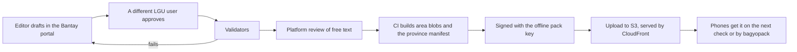

- **Structured fields only.** Evacuation centers (name, barangay, landmark, capacity, accessibility, whether pets are allowed), hotlines (name, number, hours), advisories (standing, or time-bound with an expiry; old ones show their date and "maaaring luma na"), and barangay hazard notes. LGU packs carry no free-form medical advice.
- **Validators.** They check required fields, Philippine phone formats, lengths, duplicate centers, valid PSGC barangay codes, and an expiry on every time-bound advisory.
- **Keys stay out of the portal.** The portal never holds signing keys. CI builds; the offline pack key signs; CI publishes and invalidates only the province manifest path. LGU packs replace the scraped, reviewed `evacuation_centers.json` for their province.
- **Contracts.** Roles and endpoints are in [api-layer.md](api-layer.md).

## 15. Tech stack

| Layer | Choice | Why | Check |
| :-- | :-- | :-- | :-- |
| App | Expo (development build), React Native New Architecture, TypeScript, Hermes | Expo modules cover battery, device, files and sharing; llama.rn ships an Expo config plugin (needs expo-build-properties) and v0.10+ requires the New Architecture | Expo SDK and llama.rn versions together |
| Inference | llama.rn | llama.cpp on Android: streaming, JSON schema to grammar, sessions, `bench`; arm64-v8a and x86_64 only | Property order, `maxLength`, session reuse |
| Model | Llama-3.2-1B-Instruct Q4_K_M (0.81 GB); benchmark Q4_0 | Fits a 4 GB phone; Q4_0 may decode faster on ARM CPUs | Tagalog quality in the blind test. If it fails and the hackathon rules allow, benchmark Qwen3 0.6B or 1.7B (Apache 2.0, lists Tagalog, [Qwen](https://qwenlm.github.io/blog/qwen3/)) |
| Search | MiniSearch 7 | BM25+, `boostDocument`, fuzzy and prefix matching; tiny; no second model | None |
| Storage | react-native-mmkv | Fast synchronous key-value store with an encryption option | None |
| Device and power | expo-battery, expo-device | Battery level, charging, power saver, total RAM | Android power-saver support |
| Files | expo-file-system, expo-document-picker | Pack import, free storage | None |
| Location | expo-location, coarse, one-shot (MVP stretch) | One reading on tap; no background mode | Coarse accuracy is enough for the distance bands |
| Member card sharing | expo-sharing with a rendered image | Shares one "Hinahanap" card | None |
| Camera and gallery | expo-image-picker (system camera and system photo picker) | Permission only on tap; no storage permission with the photo picker | Behavior on the target Android versions |
| Crop and re-encode | expo-image-manipulator | Crop, resize and JPEG encode in one step | That the output carries no EXIF |
| Screen capture protection | A small Expo config plugin (`plugins/withSecureScreen.js`) that adds `FLAG_SECURE` to the main activity in release builds | Blocks screenshots, screen recording and the recents preview, like streaming apps; debug builds stay mirrorable for demos | That the flag is set in the release manifest build and unset in debug |
| Face detection | Google ML Kit face detection, bundled model, through a React Native wrapper for still images (for example `@react-native-ml-kit/face-detection`) | Offline, about 6.9 MB, boxes only. expo-face-detector is not available from Expo SDK 51 ([Expo](https://docs.expo.dev/versions/latest/sdk/facedetector)) | That the wrapper uses the bundled dependency, not the Play services one; Expo SDK compatibility |
| Hashing and signatures | A vetted JS Ed25519 and SHA-256 library for manifests and KB blobs; native streaming SHA-256 for the 0.81 GB model | JS is fine for KB; too slow for the model | Native hash option; Hermes compatibility |
| Content tools | Node scripts: validate, build packs, sign, evaluate | Reuse the pure core | None |
| Scraper | Node script in `scripts/scrape/`, run on a schedule (for example GitHub Actions cron; MVP stretch) | No server to run; reuses the feed schema and validators | PAGASA terms or permission; source URLs; cadence |
| Laptop evaluation | llama.cpp (`llama-server` with a JSON schema, or node-llama-cpp) with the same GGUF, prompt and schema | Fast iteration; the phone is for latency, RAM and battery | Output parity on a sample |
| Model delivery | MVP: expo-file-system `File.downloadFileAsync` from Hugging Face on the Settings tap, then a chunked SHA-256; file import as the offline path. Pilot: Google Play for On-device AI pack | No server to run for an 0.81 GB file; Play delivery is free with app versions up to 4 GB | Hugging Face URL and hash stay valid; Play beta limits |
| Pack and feed hosting | S3 and CloudFront, static files on one pinned host (MVP stretch) | No servers to run | Pinning setup |

## 16. Testing strategy

- **Core unit tests (Node).**
  - `normalize`: fillers, verb forms, hyphens, repeated letters.
  - `route`: fixed phrase lists for each route and for the `phaseCue` flag.
  - `search` and `gate`: fixture passages.
  - `buildPrompt`: the token budget, including the `phase_hint` line and key order `used`, `in_guide`, `phase_hint`, `answer`.
  - `verify`: number words, ranges, linker forms, phone patterns, critical pinning.
  - `buildChecklist`: 10 test profiles, each with the items its tags require.
  - `verifyPack`: bad signature, wrong hash, older version, unknown key, expired key, a feed key used on a pack manifest.
  - `decidePhase`: only moves toward caution; never switches to `after`; a suppressed input does not re-trigger; a new one does; disagreement picks the more cautious phase; an unbacked `phase_hint` changes nothing; placeholder bands turn distance switching off.
  - `measureStorm` and `rankCenters`: fixture bulletins and homes, with GPS coords and with a PSGC centroid only.
- **Evaluation harness (Node).** Retrieval hit rate, correct refusals and routing accuracy on the 120-question set. Generation runs through the laptop model; two teammates review faithfulness. The set and its targets are in [solution.md](solution.md).
- **On-device benchmarks.** Per-stage timings from `questionLog`, peak RAM and battery from the Android Studio profiler, all on the reference phone. Repeat on a 3 GB phone for the `lite` tier.
- **Safety tests.**
  - The 15 emergency phrasings, live-data (with and without a cached bulletin) and dose questions.
  - No bulletin text appears in any prompt.
  - Asks for a hotline the guide lacks, or a number not in the guide.
  - Questions in English, nonsense, and very long input.
- **Family and photo tests.**
  - `deriveHousehold`: age groups and needs map to the right tags and headcount.
  - The 8 test photos from [solution.md](solution.md) give the expected `faceCheck`. The GPS-tagged one has no EXIF after saving.
  - Deleting a member removes the photo file. "Burahin ang lahat ng litrato" leaves `files/photos/` empty.
  - "Mamaya na" saves the member as `pending` and Home shows the reminder; nothing else is blocked.
  - Detection works in airplane mode; denying camera permission still leaves the gallery and manual crop.
  - No photo path, name or note appears in a prompt, a pack, a topic report or `questionLog`.
- **Offline proof.**
  - Run the full demo script in airplane mode.
  - Confirm with APK Analyzer that the release manifest has no services, receivers or jobs. It keeps the INTERNET permission; confirm that with no tap on the model download (and no feed or pack action) the network log stays empty.
- **Screen protection.** On the release build: a screenshot and a screen recording are blacked out and the recents preview is blank; on a debug build they work, so the mirrored demo stays viewable.
- **Static account screens.** Sign-up, login and forgot-password render their forms, store nothing and make no request, and the app stays fully usable without logging in.
- **Feed and network tests (MVP stretch).** Scraper parse fixtures, including a malformed bulletin that must keep the previous feed; a feed signed by an unknown key is rejected; no request leaves the pinned host; every request shows in `networkLog`; the app never fetches in the background.
- **Damage report tests (Pilot).** A report with photos persists offline and sends only on the user's tap; damage photos live in `files/damage/`, never in the member photo folder; nothing sends without opt-in.
- **CI (MVP stretch; Pilot hardens).** Every content change runs validate, the core tests and the retrieval evaluation before a pack can be signed.

## 17. Open questions

1. Does llama.rn's schema conversion keep property order and enforce `maxLength`?
2. On the reference phone, is restoring a saved session faster than recomputing ~180 prefix tokens? Does llama.rn already reuse the prefix while the model stays loaded?
3. Q4_K_M or Q4_0: which gives better speed and Tagalog quality on the reference phone?
4. Do outsiders prefer the AI answer to the summary alone in the blind test? If not, is Qwen3 allowed under the hackathon rules?
5. Does one gate threshold hold as the guide grows, or do topics need their own?
6. Does Expo `android.blockedPermissions` remove INTERNET cleanly with llama.rn and the other modules installed?
7. Which native streaming SHA-256 works for the 0.81 GB model file?
8. Does expo-battery detect Android's power-saver mode on the phones we target?
9. What are PAGASA's current rainfall and storm surge thresholds? (The `warnings.json` confirm flag tracks this.)
10. Is the duplicate-report noise in topic counts acceptable to LGU DRRM offices?
11. What are the current per-pack size limits for Play AI packs?
12. Which React Native face-detection wrapper bundles the ML Kit model and works with our Expo SDK and the New Architecture?
13. How long does detection take on the reference phone, and does it misjudge darker or blurry photos often enough to change the advice text?
14. Does `android.allowBackup: false` exclude everything we need, or are explicit backup rules required?
15. Which PAGASA pages does the scraper read (exact URLs for `sources.json`), and do PAGASA's terms allow it? Permission is needed before the Pilot.
16. How often does PAGASA issue tropical cyclone bulletins, so we can set the scraper cadence?
17. Which source and license do we use for barangay centroids in `places.json` (candidate: OCHA/HDX COD-AB)?
18. Which cited sources and reviewers set the `approach` and `near` bands and the evacuation-center threshold in `phase_rules.json`?
19. Does a full phase theme switch on the reference phone stay smooth enough that it never blocks input?
20. Does FLAG_SECURE blacken the HDMI/cast output on the demo phone, or only screenshots and recording? (Decides whether the demo mirrors a debug build.)

## 18. Phases and themes

The phase (`before`, `during`, `after`) is the app's mode. Each phase key is also a UI theme key.

| Theme part | What changes per phase | Rule |
| :-- | :-- | :-- |
| Theme tokens | Colors, Home layout and card order, illustrations, icons, and a dark variant of each | Defined as tokens per phase; screens read tokens, never phase-specific code paths |
| Home | Which cards come first: `before` go-bag and home preparation; `during` Gawin ngayon and evacuation; `after` the post-storm list | Same data, different order |
| Checklist | Recommended lists by phase first, then household tags and warnings | `buildChecklist` |
| Mascot | A reserved slot in every theme | The character is still in development; no art decisions here |
| Accessibility | Large text, icons and sufficient contrast in every theme and its dark variant | Elders, low light, low literacy |

**Switching.** `decidePhase` (section 3.7) sets the phase; the UI applies the new theme without blocking input, and a banner says "Lumipat sa {phase}." with "Ibalik". The Home phase selector highlights the recommended phase with its reason. A switch never hides the emergency card, warnings, the bulletin card or the stale prompt.

**Rules, all in code:**

- Automatic switches only move toward caution: to `during` on any active warning (our product rule in `phase_rules.json`), a user cue that the storm is here, the bagyo inside the `near` band, or a signal raised for the household's PSGC area in the bulletin; to `before` when a new bagyo's forecast track enters the `approach` band while in `after`.
- `after` is always the user's tap. Home recommends it when the user says the storm passed or the bulletin shows it left.
- After an undo or a manual pick, the same input never re-triggers; a new input can. Suppressed inputs are saved in `context`.
- The model's `phase_hint` counts only when the user's words, a warning or the bulletin back it.
- Bands and the evacuation-center threshold come only from `phase_rules.json`, with a cited source and reviewer. Until then they are `placeholder: true` and distance switching is off. No numbers in code or docs.

## 19. Bulletin feed and scraper (MVP stretch)

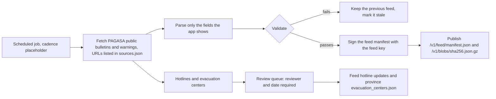

- **Sources.** PAGASA's public tropical cyclone bulletins and warnings. The exact URLs are still to confirm and will be listed in `sources.json`. The phone never contacts PAGASA; only the job does.
- **Parse, validate, sign, publish.** The job keeps the verbatim text, the source URL, `issuedAt` and `scrapedAt`, plus only the parsed fields the app shows (name, category, position, movement, forecast positions, signal areas as PSGC codes). It validates the result, signs `/v1/feed/manifest.json` with the feed key, and publishes `bulletins.json` as a content-addressed blob.
- **Failure keeps the previous feed.** A fetch or parse failure publishes nothing new; the previous feed stays and is marked stale. A field the parser cannot read is left out, never guessed.
- **Cadence.** Placeholder until PAGASA's bulletin intervals are sourced (for example a GitHub Actions cron).
- **Feed key handling.** The feed key lives only in the job's secrets, is listed in `/v1/keys.json` with purpose `feed`, and can sign only the feed manifest. The pack key stays offline (section 12).
- **Bulletins publish automatically; data for action is reviewed.** Bulletins are live data shown verbatim, never passages and never in a prompt, so they skip per-item review for speed. Scraped hotlines and evacuation centers go to a review queue and reach phones only with a reviewer and date.
- **Pilot.** The job also flags new or changed official documents for guide writers; nothing becomes a passage on its own.
- **Risk: PAGASA permission.** Scraping a government site without agreement may break or be refused. Get PAGASA's terms or permission before the Pilot. If refused, the online features are dropped and the offline core is unaffected.

## Sources

- [PAGASA: Tropical Cyclone Wind Signals](https://bagong.pagasa.dost.gov.ph/learning-tools/tropical-cyclone-wind-signal)
- [Varsitarian: how PAGASA's rainfall warnings and weather advisories work (secondary)](https://varsitarian.net/sci-tech/20250724/explainer-how-do-pagasas-rainfall-warnings-and-weather-advisories-work)
- [ABS-CBN: storm surge warnings for Typhoon Pepito, Nov 2024 (secondary)](https://www.abs-cbn.com/news/2024/11/15/storm-surge-warning-up-in-areas-on-typhoon-pepito-s-path-2110)
- [llama.rn on GitHub](https://github.com/mybigday/llama.rn)
- [MiniSearch documentation](https://lucaong.github.io/minisearch/)
- [Meta Llama 3.2 1B Instruct model card](https://huggingface.co/meta-llama/Llama-3.2-1B-Instruct)
- [bartowski/Llama-3.2-1B-Instruct-GGUF](https://huggingface.co/bartowski/Llama-3.2-1B-Instruct-GGUF)
- [Qwen3 announcement and language list](https://qwenlm.github.io/blog/qwen3/)
- [Android: Play for On-device AI (beta)](https://developer.android.com/google/play/on-device-ai)
- [Android: Manifest.permission.INTERNET](https://developer.android.com/reference/android/Manifest.permission#INTERNET)
- [Expo: app config, android.blockedPermissions](https://docs.expo.dev/versions/latest/config/app/)
- [Google ML Kit: face detection on Android (bundled and unbundled models)](https://developers.google.com/ml-kit/vision/face-detection/android)
- [Expo: FaceDetector, not available from SDK 51](https://docs.expo.dev/versions/latest/sdk/facedetector)
- [Inquirer: EO 56 makes 911 the national emergency hotline (2018)](https://newsinfo.inquirer.net/996682/eo-makes-911-countrys-emergency-hotline-number)
- [National Privacy Commission: Data Privacy Act of 2012](https://privacy.gov.ph/data-privacy-act/)
- [RFC 8785: JSON Canonicalization Scheme](https://www.rfc-editor.org/rfc/rfc8785)
- Ertas, LLM benchmarks on Android (vendor blog, **Unverified**), linked in [idea-sipat.md](idea-sipat.md)
