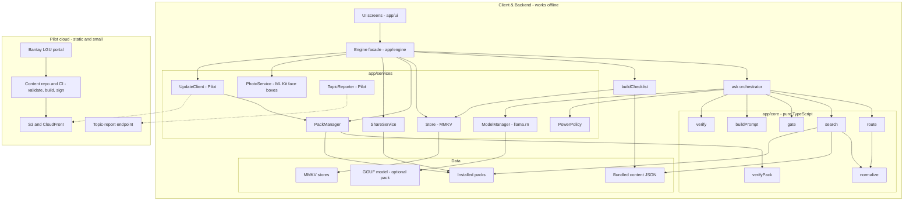
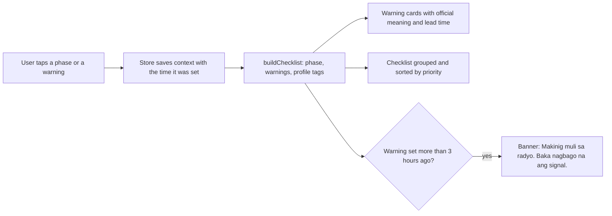
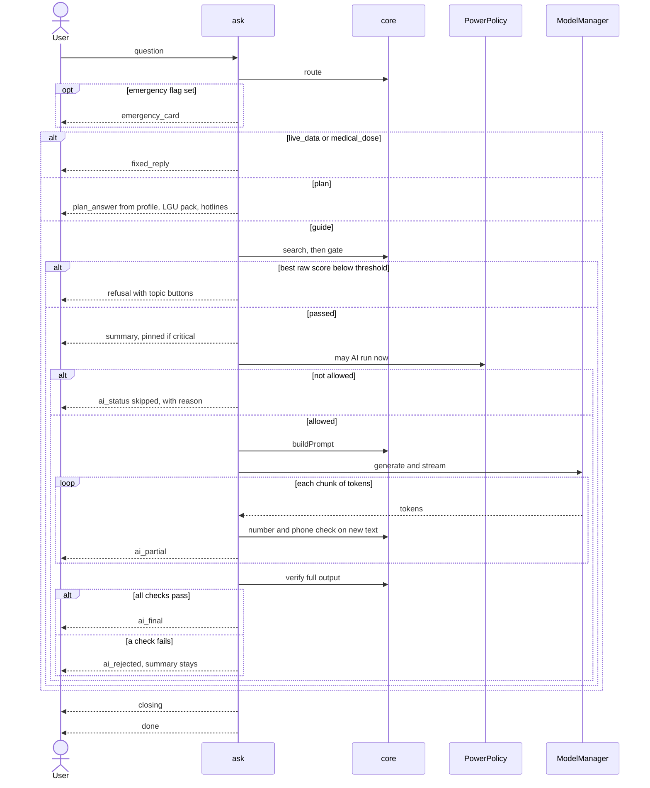
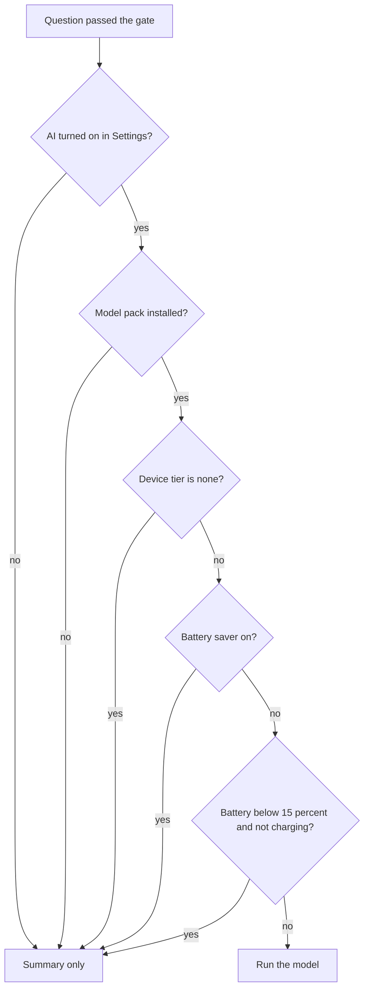
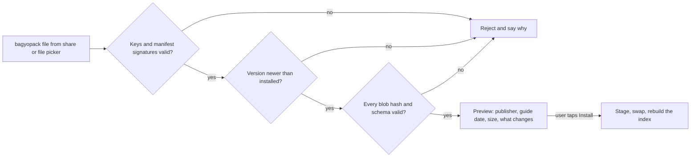
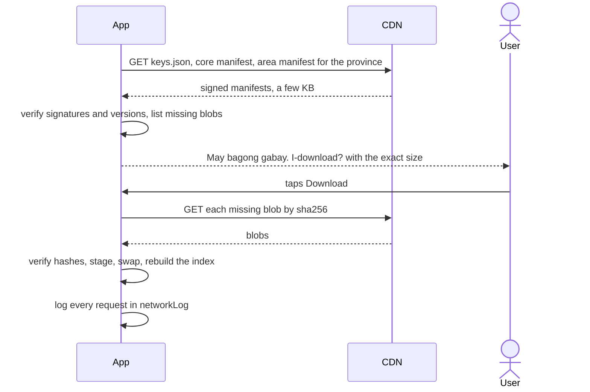
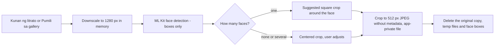
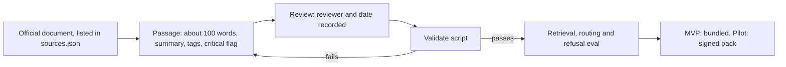
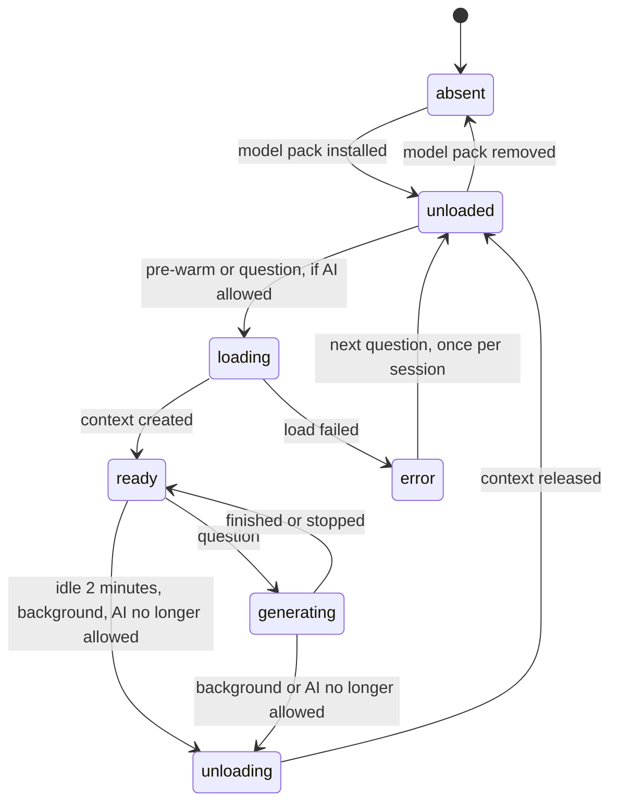
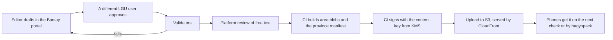

# System design

Bagyo Buddy runs a pure-TypeScript core on the phone that routes, searches and checks every question. An optional on-device model only rephrases vetted passages. From the Pilot on, signed packs keep the guide current.

Related: [README.md](README.md) (v2 decisions and shared names) · [problem.md](problem.md) · [solution.md](solution.md) (journey, features, evaluation set) · [api-layer.md](api-layer.md) (exact types, schemas, endpoints) · [BMC.md](BMC.md)

**How to read this doc.** It covers behavior and the reasons for it. Exact contracts live in [api-layer.md](api-layer.md). Linked figures are sourced. *Reasoning:* marks our own analysis. Every number without a link is a proposal to measure, not a result. Scope tags: **MVP**, **MVP stretch**, **Pilot**, **Later**.

## 1. Goals and constraints

| Area | Requirement | Target (proposal to measure) |
| :-- | :-- | :-- |
| Offline | Every MVP feature works in airplane mode from the first launch | The MVP release APK has no INTERNET permission |
| Device | Runs on a budget Android phone | Reference phone: sold as 4 GB RAM, arm64. Other phones fall into the [device tiers](README.md#shared-names) |
| Memory | Peak RAM with the model loaded | ≤ 1.2 GB |
| Speed | Checklist on screen | < 0.5 s |
| | Vetted summary on screen | ≤ 1 s |
| | First AI words | ≤ 5 s median |
| | Full AI answer | ≤ 10 s median; stretch goal 6 s |
| Battery | Model energy per answer | Well under 0.1% of a 5,000 mAh battery (section 9) |
| | Low-battery mode | Below 15%, or whenever the phone's battery saver is on |
| Privacy | The household profile never leaves the phone | No analytics SDK, no location, no background services |
| Safety | The model never answers from memory; code enforces every safety rule | 100% of shown AI answers pass the number and phone checks |
| Size | Bundled content | About 1 MB |
| | App without the model | Measure the first release build, then set a ceiling |
| | Face detector (MVP stretch) | About 6.9 MB, bundled so it works offline |
| | Member photos | ≤ 150 KB each; a family of 10 stays under 2 MB |
| | Model | 0.81 GB, shipped as an optional pack ([bartowski](https://huggingface.co/bartowski/Llama-3.2-1B-Instruct-GGUF)) |

Three facts shape every choice below.

- **Most budget phones run the model on the CPU.** llama.rn's GPU path (OpenCL) supports only Qualcomm Adreno GPUs, so the MediaTek and Unisoc chips common in budget phones run on the CPU ([llama.rn](https://github.com/mybigday/llama.rn)). Prompt length is the main cost we control.
- **Tagalog is not an official Llama 3.2 language** ([Meta model card](https://huggingface.co/meta-llama/Llama-3.2-1B-Instruct)). The model condenses Tagalog passages it is given and never writes from scratch. Code checks what it writes.
- **The build takes 10 hours.** Fewer moving parts beat clever ones: no second model, no server, no prebuilt index.

## 2. Architecture



Three rules hold the design together.

1. **One door for the UI.** Screens import only `src/engine`. The `Engine` facade wraps the core and every service and owns every native module. It is the line between the frontend and backend people; its full contract, screen map and mock are in [api-layer.md, section 3](api-layer.md#3-frontendbackend-handoff).
2. **Pure core.** Everything in `src/core/` is plain TypeScript with no React Native imports, no file or network access and no clock; callers pass the time in. The same code runs on the phone and in Node. Unit tests and the 120-question evaluation therefore run on a laptop in seconds, and their numbers carry over to the phone.
3. **One door to the model.** Only `ask()` calls `ModelManager`, and only after `route` and `gate` have passed the question and `PowerPolicy` has allowed it. `ask()` takes its services as parameters, so the evaluation harness runs the same orchestrator in Node against a laptop copy of the model.

| Component | Where | Responsibility | Model | Network |
| :-- | :-- | :-- | :-- | :-- |
| UI screens | `app/`, `src/ui/` | Home, Checklist, Ask, Plan, Guide, About, Settings, Eval. Render state and events; hold no rules; call only the `Engine` | No | No |
| `Engine` facade | `src/engine/` | The only API the screens call: getters, mutations, the ask stream and `onChange`. Wraps the core and services; owns native modules. A mock with the same interface lets the UI start first | Through `ask()` | Pilot: through `UpdateClient` |
| `ask()` | Orchestrator called by the Ask screen | Runs Path B and emits `AnswerEvent`s in order | Through `ModelManager` | No |
| `buildChecklist` | `src/core/` | Filters items by phase, active warnings and profile tags; flags stale warnings | No | No |
| `normalize` | `src/core/` | Turns text into search terms (section 5) | No | No |
| `route` | `src/core/` | Sets the emergency flag; picks `live_data`, `plan`, `medical_dose` or `guide` using `intents.json` | No | No |
| `search` | `src/core/` | MiniSearch BM25+ with tag boosts | No | No |
| `gate` | `src/core/` | Refuses when the best raw score is below the threshold; picks 1 or 2 passages | No | No |
| `buildPrompt` | `src/core/` | Builds the messages and the per-question JSON schema | No | No |
| `verify` | `src/core/` | Checks model output against the given passages | No | No |
| `verifyPack` | `src/core/` | Checks a pack's signatures, versions, hashes and schemas | No | No |
| `ModelManager` | `src/services/` | Loads, warms, streams, stops and unloads the model through llama.rn | Yes | No |
| `PowerPolicy` | `src/services/` | Decides whether AI may run now (section 9) | No | No |
| `Store` | `src/services/` | MMKV reads and writes (section 4) | No | No |
| `PackManager` | `src/services/` | Imports, stages, applies and rolls back packs; triggers the index rebuild | No | No |
| `ShareService` | `src/services/` | SMS composer, pack export, member card sharing, printable plan (Pilot) | No | No |
| `PhotoService` | `src/services/`, MVP stretch | Camera and gallery, ML Kit face boxes, crop, re-encode, photo files and their deletion | No (separate face detector) | No |
| `UpdateClient` | `src/services/`, Pilot | Checks and downloads signed packs from the one pinned host | No | Yes |
| `TopicReporter` | `src/services/`, Pilot | Sends opt-in weekly topic counts | No | Yes |

## 3. Key flows

### 3.1 Path A: tap to checklist (no model)



An item shows when its phase matches, its warning conditions hold for at least one active warning, and the profile has at least one of its required tags (or it requires none). Household-size quantities multiply official per-person figures (MVP stretch). This path never touches the model, so it works in every tier and battery state. Tapping **Pagkatapos** clears the active warnings.

### 3.2 Path B: question to answer



The emergency card comes first whenever the flag is set, then the question continues on its route. The vetted summary reaches the screen before the model starts. If anything fails afterwards, the user still has an answer that a person wrote and reviewed.

### 3.3 May AI run now?



The first check that fails becomes the reason in `ai_status` (`ai_off`, `no_model`, `tier`, `battery_saver`, `low_battery`, in that order). The same check runs when the Ask screen opens (to decide whether to pre-warm) and whenever battery state changes while the model is loaded.

### 3.4 Offline pack import (MVP stretch)



The channel does not matter. A pack from Bluetooth, Quick Share, Messenger or a barangay laptop goes through the same checks as one from the CDN.

### 3.5 Smart Update (Pilot)



The LGU publish flow is in section 14.

### 3.6 Adding a member photo (MVP stretch)



The user can tap "Laktawan" at any step, and nothing is saved. Details are in section 4, under "Family members and photos".

## 4. Data model

### Bundled content

Sizes are estimates; v1 sized the first five files.

| File | Contents | Approx. size | Owner |
| :-- | :-- | :-- | :-- |
| `guide.tl.json` | About 300 passages (MVP ships about 120): text, hand-written summary, tags, `critical` flag, source reference, reviewer and date | ~600 KB | Content |
| `checklist.json` | About 150 items: phase, warning conditions, required profile tags, priority, optional per-person quantity | ~60 KB | Content |
| `warnings.json` | `tcws` 1 to 5, `rainfall`, `surge`, `gale`: meaning, thresholds, lead time, source, and a "confirm with PAGASA" flag | ~5 to 10 KB | Content |
| `synonyms.json` | Taglish words and Tagalog verb forms mapped to canonical terms; Bisaya terms in MVP stretch | ~20 KB | Search |
| `sources.json` | Every source document: agency, title, date, URL | ~20 KB | Content |
| `intents.json` | Router phrases for emergency, `live_data`, `plan` and `medical_dose`, plus fixed-reply keys | ~10 KB | Search and safety |
| `hotlines.json` | National hotlines, always rendered by code | ~2 KB | Content |
| `places.json` | PSGC provinces, cities and municipalities for the area picker (Pilot) | Measure | Content |
| `Llama-3.2-1B-Instruct-Q4_K_M.gguf` | The model, installed as an optional pack | 0.81 GB | AI |

There is no `index.bin`. MiniSearch indexes the passages at startup (section 5).

Warning thresholds come from PAGASA. The wind signals are confirmed: Signal 1 is 39 to 61 km/h with a 36-hour lead time, Signal 2 is 62 to 88 km/h with 24 hours, Signal 3 is 89 to 117 km/h with 18 hours, Signal 4 is 118 to 184 km/h with 12 hours, and Signal 5 is 185 km/h or more with 12 hours ([PAGASA](https://bagong.pagasa.dost.gov.ph/learning-tools/tropical-cyclone-wind-signal)). The rainfall colors (yellow 7.5 to 15, orange 15 to 30, red above 30 mm per hour, observed) come from a secondary explainer ([Varsitarian](https://varsitarian.net/sci-tech/20250724/explainer-how-do-pagasas-rainfall-warnings-and-weather-advisories-work)). The storm surge bands (yellow about 1 to 2 m, orange about 2.1 to 3 m, red above 3 m) are **Unverified** and have changed since 2015 ([ABS-CBN](https://www.abs-cbn.com/news/2024/11/15/storm-surge-warning-up-in-areas-on-typhoon-pepito-s-path-2110)). Those entries keep the confirm flag until a teammate checks them against PAGASA's current pages. The validate script warns about the flag in MVP and fails the build in Pilot.

### On-device stores (MMKV)

| Key | Holds | Retention |
| :-- | :-- | :-- |
| `profiles` | Households: the main person's ID, the members (name, relation, age group, needs, note, phone, photo reference), pet count, home and livelihood tags, area (PSGC), plan (evacuation center, meeting place, contacts). Member tags and headcount are derived on every save | Until the user deletes them |
| `rollcall:{profileId}` | "Bilangan": which members were ticked present, with times (MVP stretch) | Until the user resets it |
| Photo files (not MMKV) | `files/photos/{memberId}-{version}.jpg` in app-private storage, about 150 KB each (MVP stretch) | Deleted with the member, from Settings, or with the household |
| `activeProfileId` | Which profile is in use | Always |
| `context` | Phase and active warnings, each with the time it was set | Warnings clear when the user taps **Pagkatapos** or resets |
| `checklist:{profileId}` | Ticked item IDs with times | Per profile; the user can reset it for a new season |
| `questionLog` | The last 200 questions: text, route, matched IDs, scores, outcome, per-stage timings, failure code | Ring buffer; local only; one-tap clear; never uploaded |
| `settings` | Low-battery threshold, AI on or off, auto-check, Wi-Fi only, topic sharing, stale-warning hours | Always |
| `packs` | Installed packs: ID, version, hashes, key ID, install time, and the previous version for rollback | Always |
| `networkLog` (Pilot) | Each request: time, host, path, bytes, result | Last 100; shown on the About screen |
| `topicCounts` (Pilot) | Weekly counts per topic group, only after opt-in | Deleted after upload, or after 8 weeks |

*Reasoning:* `questionLog` holds free text that may name people or illnesses. It stays on the phone, has a clear button, and feeds only the on-device Eval screen.

### Family members and photos

**Members (MVP).** A household has one main person (`relation: self`) and up to 30 members. A pure `deriveHousehold` function in `src/core/` turns members into the household's tags (`infant`, `child`, `senior` from age groups; `pregnant`, `pwd`, `maintenance_meds` from needs; `pets` from the pet count) and its headcount. Search boosts, the checklist and the prompt's profile line use only these derived tags, so nothing else changes. `buildChecklist` adds the names of the members an item applies to ("gamot ni Lolo Ben") and shows a member's note under medicine items. Names and notes come from the profile, never from the model, and never enter the prompt.

**Photos (MVP stretch).** A `PhotoService` in `src/services/` runs the pipeline in section 3.6:

1. **Source.** The camera through the system camera screen (the CAMERA permission is requested the first time the user taps "Kunan ng litrato", never at launch), or the system photo picker, which on recent Android versions needs no storage permission (check expo-image-picker for the target Android versions).
2. **Downscale** the longest side to 1,280 px in memory, so detection is fast and memory stays small.
3. **Detect** with Google ML Kit face detection, bundled model, fast mode, with landmarks, contours and classification turned off. The output is face boxes only. The bundled model adds about 6.9 MB and works offline; the unbundled one downloads through Google Play services and returns nothing until that download finishes, so it is not used ([ML Kit](https://developers.google.com/ml-kit/vision/face-detection/android)).
4. **Decide.** One face: a suggested square crop with about 40% margin around the box (`faceCheck: one_face`). No face: a centered crop the user can move (`no_face`); a dark or blurry photo usually lands here, and the screen suggests retaking it. Several faces in a single-member photo: the largest is preselected (`many_faces`). Detection only assists; the user can always keep the photo.
5. **Save.** Crop, resize to 512 × 512, and encode as JPEG at about 0.8 quality (target ≤ 150 KB). Writing a new JPEG drops the original's EXIF metadata, including GPS location; a test checks this. The file goes to app-private storage. The temp copy, the original and the face boxes are deleted.

**Group photo (MVP stretch).** Steps 1 to 3 run on one picture. Up to 15 faces are shown left to right as crops; the user taps a member name under each. Assigned crops go through step 5. Unassigned crops and the original are deleted when the screen closes. Drafts live in a temp folder and expire after 30 minutes or at the next app start.

**What the detector never does.** No recognition (who is this?), no face embeddings or descriptors, no comparing faces across photos, no age, gender or emotion estimates, and nothing stored except the cropped picture the user approved. Llama 3.2 1B is text-only and never receives a photo.

**"Bilangan" and "Hinahanap" (MVP stretch).** The roll call reads members and photos and writes only `rollcall:{profileId}`. A "Hinahanap" card is built from the member, the main person's number and the plan. It is shown full screen on demand. Only when the user taps share is it rendered to an image and handed to the share sheet (Pilot: printable).

### Content lifecycle



The validate script checks that:

- required fields are present and IDs are unique;
- passages are 60 to 120 words, near 100 where possible (v1 allowed 150; the lower ceiling keeps prompts short);
- every source reference exists in `sources.json` with agency, title, date and URL;
- the reviewer and review date are present;
- every number in a summary also appears in its passage text;
- tags come only from the [shared names](README.md#shared-names).

## 5. Retrieval

Search decides what the model may read.

### 5.1 Normalize

`normalize` runs on passages at index time (through MiniSearch's `processTerm` and `tokenize`) and on questions at query time, so both sides match.

1. Lowercase, then strip accents.
2. Replace punctuation with spaces; keep digits.
3. Look up hyphenated words whole first ("tubig-baha"), then split them.
4. Collapse letters repeated three or more times ("tulonggg" becomes "tulong").
5. Drop fillers such as po, opo, ba, naman, lang, yung, kasi, nga, din, rin. Keep negations (huwag, hindi, wala).
6. Expand synonyms at query time only, appending canonical terms so the user's own word still counts. `synonyms.json` lists Tagalog verb forms explicitly, for example lumikas, lilikas, lumilikas, paglikas, inilikas, mag-evacuate, nag-evacuate and bakwit for the evacuate concept, and baha, tubig-baha and lumubog for flood.
7. MVP stretch: Bisaya terms, collected from evaluation misses and barangay health worker input, not guessed. Also MVP stretch: light affix stripping (mag-, nag-, pag-, i-, ma-, na-; -um-, -in-; a repeated first syllable). It runs only when a word has no synonym hit and is not in the index vocabulary, and the eval decides whether it stays.

### 5.2 Index and query

| Setting | Value | Why |
| :-- | :-- | :-- |
| Index time | At app start, and again after a pack is applied | *Reasoning:* 120 to 300 short passages should index well under a second; measure it |
| Fields and boosts | title ×2, keywords ×2, summary ×1.5, text ×1 | Hand-written titles and keywords are the strongest signal |
| `storeFields` | ID, phase, warnings, profile tags, hazards, topic, critical flag | Needed for boosts, the gate and the UI |
| `combineWith` | OR (the library default) | Short Taglish questions rarely share every word with a passage |
| `prefix` | Terms of 4 or more letters | Catches partial words |
| `fuzzy` | Terms of 5 or more letters, about 0.2 of term length | Catches typos without matching every short word |
| `boostTerm` | Generic words (bagyo, signal, ulan) at about 0.5 | Stops generic words from matching everything |
| `filter` | Passages in the active language only | Ready for a Cebuano pack (Later) |

MiniSearch ranks with BM25+ and exposes these options in its search API ([MiniSearch](https://lucaong.github.io/minisearch/)).

### 5.3 Tag boosts

`boostDocument(documentId, term, storedFields)` multiplies a matching passage's score:

- ×1.2 when the passage's phase matches the current phase;
- ×1.2 when the passage lists an active warning, for example `tcws` 3 or `rainfall` orange;
- ×1.2 for each matching profile tag (v1's "+20% for river when the profile says near river");
- capped at ×1.5 in total.

Boosts never add a passage that matched no terms. A falsy return value skips a passage in MiniSearch, so "no boost" returns 1, not 0. The multiplier is a pure function of the stored fields and the context, so `gate` can divide it back out.

### 5.4 Gate and passage count

- **Rank by the boosted score, gate on the raw score.** Tags may reorder good matches. They must not lift a weak match over the threshold.
- **Threshold.** Calibrate it on the evaluation set: pick the value that keeps out-of-scope questions refused while keeping in-scope recall high (targets in [solution.md](solution.md)). Recalibrate in the content build whenever the guide changes, because BM25 scores depend on the corpus.
- **Refusal.** Show "Wala ito sa gabay." with up to three topic-group buttons drawn from the closest passages, or from `signals`, `go_bag` and `evacuation` if nothing is close. A button opens the Guide screen at that topic.
- **Adaptive k.** Send two passages on the `full` tier, but only one when the second's boosted score is under 60% of the first. The `lite` tier always sends one. *Reasoning:* each passage costs about 125 to 225 prompt tokens, the largest cost we control on a CPU.

## 6. Generation

The model writes in a shape the grammar fixes, from passages search chose.

### 6.1 Messages

System message, the fixed instructions (the canonical text is `SYSTEM_TL` in [api-layer.md](api-layer.md#8-llm-contract-mvp)):

```text
Ikaw si Bagyo Buddy, gabay sa paghahanda sa bagyo para sa isang sambahayan.
Sumagot LAMANG mula sa mga talatang ibinigay. Huwag gumamit ng sariling kaalaman.
Sumagot sa 2 hanggang 4 na maiikling pangungusap sa simpleng Tagalog.
Huwag magdagdag ng numero, oras, lugar o pangalan na wala sa mga talata.
Huwag magbigay ng numero ng telepono, hotline o dosis ng gamot.
Kung hindi sinasagot ng mga talata ang tanong, ilagay ang "in_guide": false.
Ilagay sa "used" ang ID ng talatang pinagkunan mo.
```

Two few-shot pairs follow as earlier turns: one answered from a passage, one with `in_guide: false`. Each stays under about 90 tokens. They are placeholders until the real passages exist, and must then be copied from reviewed guide text.

User message, built per question:

```text
Sambahayan: {profile_summary}
Yugto at babala: {phase_label}; {warnings_summary}

Talata [{id_1}]: {text_1}
Talata [{id_2}]: {text_2}

Tanong: {question}
```

Code writes `profile_summary` from tags, for example "5 tao; may sanggol at senior na may maintenance na gamot; malapit sa ilog". It writes `phase_label` from the context's phase ("Bago", "Habang" or "Pagkatapos") and `warnings_summary` from the context, for example "Signal No. 3; orange na babala sa ulan". The prompt never contains names, member notes, photos, contact numbers, addresses or the evacuation center. The model cannot repeat what it never sees; the `plan` route answers those questions from data. Use llama.rn `messages` so the chat template stored in the GGUF formats the turns (check current library docs).

| Part | Tokens |
| :-- | :-- |
| Instructions and two examples (fixed) | ~180 |
| Profile and warnings lines | ~30 |
| One or two passages | ~125 to 450 |
| Question | ~10 to 40 |
| **Total input** | **~350 to 700** |
| Output | ≤ 110 (`lite`: ~80) |

### 6.2 Output schema and its order

```json
{
  "type": "object",
  "properties": {
    "used": {"type": "array", "items": {"enum": ["{id_1}", "{id_2}"]}, "minItems": 1, "maxItems": 2},
    "in_guide": {"type": "boolean"},
    "answer": {"type": "string", "maxLength": 400}
  },
  "required": ["used", "in_guide", "answer"]
}
```

llama.rn turns a `response_format` JSON schema into a GBNF grammar ([llama.rn](https://github.com/mybigday/llama.rn)). `buildPrompt` fills in the allowed IDs per question, so the model can cite only passages it was given; with one passage the enum holds one ID and `maxItems` is 1. The order matters:

- `used` and `in_guide` are known after a dozen or so tokens. Everything after `"answer": "` is the answer itself and streams straight to the screen.
- When the parser sees `"in_guide": false`, `ask()` calls `stopCompletion` and shows the refusal. This saves time and battery.

Check that the installed llama.rn keeps property order and whether it enforces `maxLength`. `verify` enforces length either way. The exact contract is in [api-layer.md](api-layer.md).

### 6.3 Sampling and context

| Setting | Value | Why |
| :-- | :-- | :-- |
| `n_ctx` | 1,024 | Input up to ~700 plus output up to 110 |
| `n_predict` | ≤ 110 (`full`), ~80 (`lite`) | Caps time and battery |
| `temperature`, `top_p` | 0.2, 0.9 | Condense, don't create |
| `seed` | Fixed in evaluation runs | Repeatable results |
| `n_threads` | Number of fast cores; measure 2 against 4 | *Reasoning:* many budget chips pair a few fast cores with slow ones, and slow cores can drag decoding down |
| `use_mmap`, `use_mlock` | true, false | mmap pages weights in from storage; locking 0.8 GB on a 4 GB phone invites the OS to kill the app |
| `n_gpu_layers` | 0 on MediaTek and Unisoc; test on Adreno | OpenCL runs only on Adreno |

*Reasoning:* Llama 3.2 1B has 16 layers, 8 KV heads and a head size of 64. An f16 KV cache therefore costs 16 × 2 × 8 × 64 × 2 bytes, about 32 KB per token, or about 32 MB at 1,024 tokens. With 0.81 GB of mmapped weights plus compute buffers (measure them), the ≤ 1.2 GB peak is reachable.

### 6.4 Prefix cache, pre-warm, streaming

- **Prefix cache.** The instructions and examples are identical for every question. After a load, evaluate them once and store the state with `saveSession`; restore it with `loadSession` after later reloads. While the model stays loaded, first check whether llama.rn already reuses the shared prefix between calls. Keep the session file only if it beats recomputing ~180 tokens on the reference phone.
- **Pre-warm.** When the Ask screen opens and AI is allowed, load the model and the prefix in the background while the user types.
- **Streaming.** The token callback appends to a buffer. A small incremental parser finds the `answer` string and unescapes it (`\"`, `\n`), holding back a dangling backslash. Before any new text goes out as `ai_partial`, the number and phone checks (section 7) run on it, up to the last whitespace. A failure stops generation at once with `stopCompletion` and emits `ai_rejected`, so no unchecked number reaches the screen. Streamed text appears in a "being checked" style until `ai_final`.

## 7. Verification

`verify` runs these checks in order and stops at the first failure. The [failure codes](README.md#shared-names) are shared with the UI and the log.

| Order | Code | Check | On failure |
| :-- | :-- | :-- | :-- |
| 1 | `schema` | The output parses and matches the schema. This also catches output cut off at the token cap | `ai_rejected` |
| 2 | `not_in_guide` | `in_guide` is true | Refusal, same as the gate |
| 3 | `bad_citation` | `used` is non-empty, has no duplicates, and contains only given IDs | `ai_rejected` |
| 4 | `unknown_number` | Every number in the answer is in the allowed set | `ai_rejected`; also checked while streaming |
| 5 | `phone_number` | Every phone-like string appears verbatim in a cited passage | `ai_rejected`; also checked while streaming |
| 6 | `too_long` | At most 4 sentences and 400 characters | `ai_rejected` |
| 7 | `wrong_language` | Mostly Latin letters, with Tagalog function words (ang, ng, sa, mga, ay, kung, para) present at a reasonable rate | `ai_rejected` |

**The allowed number set** is every number in the cited passages, plus the numbers in the prompt's profile and warning lines (the headcount, the signal level). Normalization runs on both sides and recognizes:

- digits, decimals, thousands separators ("5,000"), and both ends of ranges ("89-117", "89 hanggang 117");
- Tagalog cardinals from isa to sampu, the teens (labing-isa, labindalawa, labinlima), the tens (dalawampu, tatlumpu, limampu), hundreds and thousands (daan, libo), compounds ("dalawampu't apat"), and linker forms ("dalawang", "limang", "apat na");
- Spanish-derived numbers common in Taglish (uno to dose, kinse, beinte) and clock times ("alas-tres" counts as 3);
- English number words ("two hours");
- ordinals ("ika-3", "ikatlo"), which map to their cardinals.

"isa" and "isang" count as 1 only when a unit word follows within two words (oras, araw, linggo, litro, galon, piraso, tao, beses, metro, km). Otherwise they are the article "a" ("isang bag").

**Known limit.** A number that appears in the passage but sits next to the wrong unit still passes. The faithfulness review in the evaluation catches that class of error ([solution.md](solution.md)).

**Phone-like strings** are runs of 7 or more digits that may include spaces, dashes, dots, parentheses and a leading +63 or 0, plus short codes, which the number check already covers. The test suite in [api-layer.md](api-layer.md) fixes the exact patterns.

**After the checks:**

- **Critical pinning.** If the top hit or any cited passage is `critical`, the `summary` event is pinned: the UI shows it first, in bold, and the AI text sits below it as an explanation, even after `ai_final`.
- **Fallback.** On `ai_rejected` the summary already on screen remains the answer, with a short note that the AI answer was not shown. The failure code goes to `questionLog`.
- **Closing line.** Code appends "Sundin ang utos ng barangay at ng mga awtoridad." to every outcome, including refusals and fixed replies. The model never writes it.

## 8. Safety policy

Every rule is enforced by code, never by the prompt alone.

| # | Trigger | Action | Enforced in |
| :-- | :-- | :-- | :-- |
| 1 | An emergency phrase from `intents.json` ("lumulubog", "may naipit", "hindi makahinga") | Emergency card first: get to higher ground, call 911, the national emergency hotline since [EO 56 (2018)](https://newsinfo.inquirer.net/996682/eo-makes-911-countrys-emergency-hotline-number), or the barangay (numbers from `hotlines.json` or the LGU pack). Then the normal route | `route`, UI |
| 2 | A live-data question: storm position, track or timing, class suspensions ("may pasok ba bukas?"), power restoration | The fixed "no live data" reply; no search, no model | `route` |
| 3 | A plan question: evacuation center, meeting place, contacts, hotlines | Answered from the profile, the LGU pack or `hotlines.json`; no model | `route`, `plan_answer` |
| 4 | A medicine-dose question | The fixed reply pointing to the health center or 911; no model | `route` |
| 5 | The best raw score is below the threshold | "Wala ito sa gabay." plus topic buttons; no model | `gate` |
| 6 | The model returns `in_guide: false` | Generation stops; the same refusal as rule 5 | `ask()`, `verify` |
| 7 | A number outside the allowed set | Generation stops; `ai_rejected`; the summary stays | `verify`, also while streaming |
| 8 | A phone-like string not in a cited passage | Same as rule 7 | `verify`, also while streaming |
| 9 | A bad citation, a long answer or the wrong language | `ai_rejected`; the summary stays | `verify` |
| 10 | The top hit or a cited passage is `critical` | Summary pinned above the AI text | `ask()`, UI |
| 11 | AI not allowed (tier, battery, battery saver, setting, no model) | Summary only; `ai_status` gives the reason | `PowerPolicy` |
| 12 | An active warning set more than 3 hours ago | The stale-warning banner; the checklist still shows | `buildChecklist`, UI |
| 13 | Any outcome | The closing line, appended by code | `ask()` |
| 14 | Any prompt | Contains only passages, the tag-based profile summary, the phase and warnings line and the question | `buildPrompt` |
| 15 | Guide older than 30 days while online (Pilot) | Suggest an update on the Home and About screens | `UpdateClient`, UI |

The emergency card, fixed replies and refusal text are reviewed static content. None of them is generated.

## 9. Model lifecycle and power



| Event | Effect |
| :-- | :-- |
| The Ask screen opens and AI is allowed | Load and evaluate the prefix in the background |
| A question passes the gate | Generate, loading first if needed |
| 2 minutes without a question | `release()` frees roughly 1 GB |
| The app goes to the background | `stopCompletion`, then `release()` |
| Battery falls below the threshold while not charging, or battery saver turns on | Stop and release; summaries only |
| The user turns AI off | Release |
| A load fails (out of memory, bad file) | `error` state, summaries only, one retry per session; the reason shows in Settings |

**`PowerPolicy` inputs:** battery level and charging state, the OS battery saver (check that expo-battery reports Android's power-saver mode), the user's AI setting, the device tier, and whether the model pack is present. AI may run only when the tier is not `none`, the model is present, AI is on, battery saver is off, and the battery is at or above the threshold (default 15%) or charging. Reason codes are in [api-layer.md](api-layer.md).

**Tier detection** runs at first launch and before a model install. It reads total RAM as Android reports it (expo-device) and free storage (expo-file-system), then applies the [tier table](README.md#shared-names). "Extended RAM" is swap space sold as memory; it does not appear in reported RAM, so it never lifts a phone into a higher tier.

**Battery** (*Reasoning*, v1's estimate updated for slower answers):

- A 5,000 mAh battery at about 3.85 V holds roughly 19 Wh.
- A 1B model draws about 2 to 3 W while generating (Ertas, **Unverified** vendor figure, linked in [idea-bagyo-buddy.md](idea-bagyo-buddy.md)).
- An answer of 6 to 15 seconds therefore costs about 12 to 45 J, or 0.003 to 0.013 Wh: roughly 0.02 to 0.07% of the battery, well under 0.1%.
- Fifty questions during a storm cost about 1 to 3%. A few minutes of screen-on time cost more, which is why the dark theme and short screens matter. Confirm with the Android Studio profiler on the reference phone.

## 10. Performance budgets

Medians on the reference phone, all proposals to measure.

| Stage | Budget | How measured |
| :-- | :-- | :-- |
| Cold start to Home | ≤ 3 s | Launch to first render |
| Search index build | ≤ 0.5 s | Timer around indexing |
| Checklist on screen | < 0.5 s | Tap to render |
| `route` + `search` + `gate` | ≤ 0.1 s | `questionLog` timings |
| Summary on screen | ≤ 1 s | Send to `summary` event |
| Model load, cold | Measure; mostly hidden by pre-warm | llama.rn timings |
| Prompt processing | Measure tokens per second; it sets the first-word time | llama.rn timings |
| First AI words | ≤ 5 s | Send to first `ai_partial` |
| Full AI answer | ≤ 10 s; stretch 6 s | Send to `ai_final` |
| `verify` | ≤ 10 ms | Timer |
| Face detection on one 1,280 px photo | ≤ 1 s | Timer around detection (MVP stretch) |
| Photo saved after "Gamitin" | ≤ 1 s, ≤ 150 KB | Timer, file size |
| Peak RAM, AI on | ≤ 1.2 GB | Android Studio profiler |
| Peak RAM, AI off | Measure | Android Studio profiler |
| Storage | ~1 MB content, 0.81 GB model, KB-size packs | APK Analyzer, file sizes |
| Battery per answer | < 0.1% | Section 9 estimate, then the profiler |
| Background work | None while closed | The manifest declares no services, receivers or jobs |

## 11. Network policy

- **MVP.** The release APK removes INTERNET with Expo's `android.blockedPermissions`, the "list of permissions to block in the final AndroidManifest.xml" ([Expo app config](https://docs.expo.dev/versions/latest/config/app/)). Android grants INTERNET at install as a normal permission ([Android](https://developer.android.com/reference/android/Manifest.permission#INTERNET)), so its absence from the merged manifest is the proof that the app is offline. Debug builds keep network access only for the development server.
- **Pilot.** The Pilot build adds INTERNET for two modules only: `UpdateClient` and the opt-in `TopicReporter`. Both go through one fetch wrapper that allows a single pinned host over HTTPS; a lint rule bans any other network call. No analytics or crash SDK phones home. Every request is added to `networkLog` and listed on the About screen.
- **Auto-check (F2).** When the app opens with auto-check on, on Wi-Fi, and more than 24 hours after the last check, `UpdateClient` fetches the three manifests (a few KB). Downloads always wait for a tap. On mobile data, the user taps "check" and sees the exact size first. Knowing whether the phone is on Wi-Fi needs ACCESS_NETWORK_STATE, another normal permission.
- **No identifiers.** Requests carry no device ID, no profile and no cookies. The province code sits in the path. Keep CloudFront access logs off or short-lived.
- **Camera and photos.** CAMERA is the only runtime permission the app may ask for, and only when the user taps "Kunan ng litrato". The bundled face model needs no network. If the face-detection library's own manifest declares INTERNET, `android.blockedPermissions` still removes it; confirm detection works in airplane mode.
- **No cloud backup.** Android Auto Backup can copy app data, including the profile and photos, to the user's Google Drive. Turn it off (Expo `android.allowBackup: false`, or backup rules that exclude MMKV and `files/photos/`) and check on a test phone.
- **SMS composer.** The composer (MVP stretch) uses the system compose intent, which needs no SMS permission ([Android](https://developer.android.com/guide/components/intents-common#Messaging)). The user's own SMS app sends the message. A one-minute call uses the bandwidth of about 800 short texts ([NC DPS](https://www.ncdps.gov/press-release/governor-mccrory-and-first-lady-encourage-texting-first-communication-between-loved)).

## 12. Update and pack system

Offline import is MVP stretch; the CDN is Pilot.

### Pack types

| Pack | Contents | Source |
| :-- | :-- | :-- |
| Core | Guide, checklist, warnings, synonyms, intents, sources, national hotlines | National content repo |
| Area (LGU) | Evacuation centers, local hotlines, advisories, barangay hazard notes; one per municipality, published per province. The same province manifest also lists hazard packs (coastal, upland) | Bantay portal (section 14); hazard packs from the content repo |
| Language (Later) | A guide in another language, starting with Cebuano | Content repo |
| Model | The GGUF file, verified by SHA-256 from the signed model manifest | Google Play AI pack in production; sideload or USB for the hackathon; a pinned public mirror for direct-APK rollouts |

Google Play for On-device AI delivers models in AI packs (install-time, fast-follow or on-demand) and allows app versions up to 4 GB ([Android](https://developer.android.com/google/play/on-device-ai)). It is in beta; check the per-pack limits before relying on it.

### CDN layout

| Path | Contents | Caching |
| :-- | :-- | :-- |
| `/v1/keys.json` | Content-signing public keys with validity windows, signed by the root key | Short TTL |
| `/v1/core/manifest.json` | Core pack version, guide date, blob list (SHA-256, size), deltas | Short TTL |
| `/v1/areas/{provinceCode}/manifest.json` | Every area pack in the province | Short TTL |
| `/v1/blobs/{sha256}.json.gz` | Content-addressed pack files and deltas | Immutable, cache forever |
| `/v1/model/manifest.json` | Model options: file name, size, SHA-256, sources | Short TTL |

### Trust chain

- One or two **root public keys** are pinned in the app binary. The root private key stays offline and is used only to sign `keys.json`.
- **Content keys**, listed in `keys.json` with validity windows, sign the manifests. Rotation means publishing a new `keys.json`.
- A manifest's signature is Ed25519 over the RFC 8785 canonical JSON of the manifest without its signature field ([RFC 8785](https://www.rfc-editor.org/rfc/rfc8785)).
- Manifests list blobs by SHA-256 and size, so blobs need no signature of their own.
- **Monotonic versions.** A manifest must be newer than the installed version of that pack. An equal version is a no-op; an older one is rejected, which blocks rollback attacks. `min_app_version` keeps old apps from installing packs they cannot read. Field names are in [api-layer.md](api-layer.md).

### Deltas, apply, rollback

- **Deltas** work at passage level: upserts and deletes against a base version. The app applies a delta only when its installed version equals that base; otherwise it fetches the full blob. *Reasoning:* the whole guide is about 600 KB before compression, so full blobs are an acceptable fallback.
- **Atomic apply.** Download to a staging folder, verify every hash and schema, and check cross-references (every source reference exists). Then write the new version folder, switch one pointer in `packs`, and rebuild the MiniSearch index. The previous version is kept for one-tap rollback. If any step fails, the old version stays active.
- **Province bundles for privacy (F4).** The app downloads every area blob for its province (tens of KB), keeps the chosen municipality, and filters by profile on the phone. The CDN learns the province and an IP address, never who lives in the house.
- **`.bagyopack`.** A single file holding `keys.json`, the manifests and the blobs. Import uses the file picker or Android's share-to-app; export ("Ibahagi ang gabay") writes the installed packs, never profile data, so neighbors can pass it on.
- **Stale guide (Pilot).** The About screen always shows the guide date. When the guide is older than 30 days and the phone is online, the app suggests an update.

## 13. Security and privacy

| Threat | Impact | Mitigation |
| :-- | :-- | :-- |
| Tampered or fake pack (CDN compromise, a malicious `.bagyopack`) | Wrong life-safety advice | Root-pinned signature chain, hash-checked blobs, schema checks, monotonic versions; the publisher is shown before install |
| Compromised LGU portal account | Fake evacuation center or hotline | MFA; separate editor and approver; structured fields only; validators and platform review; signing key outside the portal; fix by publishing a newer version |
| Stolen signing key | Malicious packs everywhere | Content key in a KMS or offline; root key offline; short validity windows; rotation through `keys.json` |
| Man-in-the-middle on update | Tampered content | HTTPS, with the signature as the real check |
| Lost or shared phone | Household vulnerabilities and question history exposed | Minimal data, no names required, one-tap clear; MMKV encryption with its key in Android Keystore (Pilot) |
| Dashboard re-identification | One household's questions revealed | Opt-in; topic-group counts only; weekly; no device ID; IP not stored; cells under 10 households hidden; municipality level |
| Clone or fake apps | Malware posing as a safety app | Official channels only; publish the signing-certificate fingerprint on partner LGU pages |
| Lost or shared phone shows family photos and notes | Faces of children and elders, medicine names exposed | Photos and notes are optional; one tap deletes a photo or all photos; app-private storage; Pilot: encryption with a Keystore key and an optional app PIN |
| Cloud backup copies the profile and photos | Data leaves the phone without the user knowing | Auto Backup off or excluded (section 11) |
| Location metadata inside a photo | Reveals where the family lives | Re-encoding drops EXIF; a test checks the saved file |
| Face data reused for identification | Biometric-like data | The detector returns boxes only and they are discarded; no recognition, no embeddings, no comparisons |
| Prompt injection through the user's own question | The user bends their own answer | Low risk: only that user sees it, and the grammar, checks and signed passages still apply |
| Wrong or careless content from an insider | Wrong advice | Reviewer fields, two-person review in Pilot, evaluation in CI, sources one tap away |

**Data Privacy Act.** Health information is sensitive personal information under RA 10173, Sec. 3(l) ([NPC](https://privacy.gov.ph/data-privacy-act/)), and the profile's tags (pregnant, maintenance medicine, disability) fall in that class. The design keeps them on the phone, so we never collect or process them. Topic reports are aggregate counts without identifiers. Member names, notes and photos of identifiable people, many of them children, are personal information. They also stay on the phone and are never collected. The member screen shows the consent line before a photo of another person ("Siguraduhing pumayag ang tao bago kunan ng litrato."), and every photo is optional. The Bantay portal holds LGU staff accounts, which are personal data and need a privacy notice. *Reasoning:* this is not legal advice; confirm with a privacy lawyer or NPC guidance before the Pilot.

**Topic reports (Pilot, opt-in, off by default).**

- `TopicReporter` counts topic groups locally: the top passage's topic for answered questions, `out_of_guide` for refusals.
- At most once per ISO week, after the week ends and only when the phone is online anyway, it sends the week, the municipality code, the app version and the counts. There is no device ID, no question text and no profile.
- The server keeps counts only and drops IP addresses after rate limiting. The dashboard hides any cell under 10 reports.
- *Reasoning:* without IDs, duplicate reports are possible. That noise is acceptable for trends; the dashboard says so.

## 14. LGU pack pipeline (Pilot)



- **Structured fields only.** Evacuation centers (name, barangay, landmark, capacity, accessibility, whether pets are allowed), hotlines (name, number, hours), advisories (standing, or time-bound with an expiry; old ones show their date and "maaaring luma na"), and barangay hazard notes. LGU packs carry no free-form medical advice.
- **Validators.** They check required fields, Philippine phone formats, lengths, duplicate centers, valid PSGC barangay codes, and an expiry on every time-bound advisory.
- **Keys stay out of the portal.** The portal never holds signing keys. CI signs and publishes, and invalidates only the province manifest path.
- **Contracts.** Roles and endpoints are in [api-layer.md](api-layer.md).

## 15. Tech stack

| Layer | Choice | Why | Check |
| :-- | :-- | :-- | :-- |
| App | Expo (development build), React Native New Architecture, TypeScript, Hermes | Expo modules cover battery, device, files and sharing; llama.rn ships an Expo config plugin (needs expo-build-properties) and v0.10+ requires the New Architecture | Expo SDK and llama.rn versions together |
| Inference | llama.rn | llama.cpp on Android: streaming, JSON schema to grammar, sessions, `bench`; arm64-v8a and x86_64 only | Property order, `maxLength`, session reuse |
| Model | Llama-3.2-1B-Instruct Q4_K_M (0.81 GB); benchmark Q4_0 | Fits a 4 GB phone; Q4_0 may decode faster on ARM CPUs | Tagalog quality in the blind test. If it fails and the hackathon rules allow, benchmark Qwen3 0.6B or 1.7B (Apache 2.0, lists Tagalog and Cebuano, [Qwen](https://qwenlm.github.io/blog/qwen3/)) |
| Search | MiniSearch 7 | BM25+, `boostDocument`, fuzzy and prefix matching; tiny; no second model | None |
| Storage | react-native-mmkv | Fast synchronous key-value store with an encryption option | None |
| Device and power | expo-battery, expo-device | Battery level, charging, power saver, total RAM | Android power-saver support |
| Files and sharing | expo-file-system, expo-document-picker, expo-sharing | Pack import and export, free storage | None |
| SMS composer | React Native `Linking` with an `sms:` URL | System intent; no SMS permission | None |
| Printable plan | expo-print (Pilot) | Family plan and "Hinahanap" cards as a PDF | None |
| Camera and gallery | expo-image-picker (system camera and system photo picker) | Permission only on tap; no storage permission with the photo picker | Behavior on the target Android versions |
| Crop and re-encode | expo-image-manipulator | Crop, resize and JPEG encode in one step | That the output carries no EXIF |
| Face detection | Google ML Kit face detection, bundled model, through a React Native wrapper for still images (for example `@react-native-ml-kit/face-detection`) | Offline, about 6.9 MB, boxes only. expo-face-detector is not available from Expo SDK 51 ([Expo](https://docs.expo.dev/versions/latest/sdk/facedetector)) | That the wrapper uses the bundled dependency, not the Play services one; Expo SDK compatibility |
| Hashing and signatures | A vetted JS Ed25519 and SHA-256 library for manifests and KB blobs; native streaming SHA-256 for the 0.81 GB model | JS is fine for KB; too slow for the model | Native hash option; Hermes compatibility |
| Content tools | Node scripts: validate, build packs, sign, evaluate | Reuse the pure core | None |
| Laptop evaluation | llama.cpp (`llama-server` with a JSON schema, or node-llama-cpp) with the same GGUF, prompt and schema | Fast iteration; the phone is for latency, RAM and battery | Output parity on a sample |
| Model delivery | Google Play for On-device AI pack (production); sideload for the hackathon | Free delivery; app versions up to 4 GB | Beta limits |
| Pack hosting | S3 and CloudFront, static files (Pilot) | No servers to run | None |

## 16. Testing strategy

- **Core unit tests (Node).**
  - `normalize`: fillers, verb forms, hyphens, repeated letters.
  - `route`: fixed phrase lists for each route.
  - `search` and `gate`: fixture passages.
  - `buildPrompt`: the token budget.
  - `verify`: number words, ranges, linker forms, phone patterns, critical pinning.
  - `buildChecklist`: 10 test profiles, each with the items its tags require.
  - `verifyPack`: bad signature, wrong hash, older version, unknown key, expired key.
- **Evaluation harness (Node).** Retrieval hit rate, correct refusals and routing accuracy on the 120-question set. Generation runs through the laptop model; two teammates review faithfulness. The set and its targets are in [solution.md](solution.md).
- **On-device benchmarks.** Per-stage timings from `questionLog`, peak RAM and battery from the Android Studio profiler, all on the reference phone. Repeat on a 3 GB phone for the `lite` tier.
- **Safety tests.**
  - The 15 emergency phrasings, live-data and dose questions.
  - Asks for a hotline the guide lacks, or a number not in the guide.
  - Questions in English, nonsense, and very long input.
- **Family and photo tests (MVP stretch for photos).**
  - `deriveHousehold`: age groups and needs map to the right tags and headcount.
  - The 8 test photos from [solution.md](solution.md) give the expected `faceCheck`. The GPS-tagged one has no EXIF after saving.
  - Deleting a member removes the photo file. "Burahin ang lahat ng litrato" leaves `files/photos/` empty.
  - A group photo assigns the right crop to each member and deletes the rest.
  - Detection works in airplane mode; denying camera permission still leaves the gallery and "Laktawan".
  - No photo path, name or note appears in a prompt, a pack, a topic report or `questionLog`.
- **Offline proof.**
  - Run the full demo script in airplane mode.
  - Confirm with APK Analyzer that the release manifest has no INTERNET permission and no services, receivers or jobs.
- **CI (Pilot).** Every content change runs validate, the core tests and the retrieval evaluation before a pack can be signed.

## 17. Open questions

1. Does llama.rn's schema conversion keep property order and enforce `maxLength`?
2. On the reference phone, is restoring a saved session faster than recomputing ~180 prefix tokens? Does llama.rn already reuse the prefix while the model stays loaded?
3. Q4_K_M or Q4_0: which gives better speed and Tagalog quality on the reference phone?
4. Do outsiders prefer the AI answer to the summary alone in the blind test? If not, is Qwen3 allowed under the hackathon rules?
5. Does one gate threshold hold as the guide grows, or do topics need their own?
6. Does Expo `android.blockedPermissions` remove INTERNET cleanly with llama.rn and the other modules installed?
7. Which native streaming SHA-256 works for the 0.81 GB model file?
8. Does expo-battery detect Android's power-saver mode on the phones we target?
9. What are PAGASA's current rainfall and storm surge thresholds? (The `warnings.json` confirm flag tracks this.)
10. Is the duplicate-report noise in topic counts acceptable to LGU DRRM offices?
11. What are the current per-pack size limits for Play AI packs?
12. Which React Native face-detection wrapper bundles the ML Kit model and works with our Expo SDK and the New Architecture?
13. How long does detection take on the reference phone, and does it misjudge darker or blurry photos often enough to change the advice text?
14. Does `android.allowBackup: false` exclude everything we need, or are explicit backup rules required?

## Sources

- [PAGASA: Tropical Cyclone Wind Signals](https://bagong.pagasa.dost.gov.ph/learning-tools/tropical-cyclone-wind-signal)
- [Varsitarian: how PAGASA's rainfall warnings and weather advisories work (secondary)](https://varsitarian.net/sci-tech/20250724/explainer-how-do-pagasas-rainfall-warnings-and-weather-advisories-work)
- [ABS-CBN: storm surge warnings for Typhoon Pepito, Nov 2024 (secondary)](https://www.abs-cbn.com/news/2024/11/15/storm-surge-warning-up-in-areas-on-typhoon-pepito-s-path-2110)
- [llama.rn on GitHub](https://github.com/mybigday/llama.rn)
- [MiniSearch documentation](https://lucaong.github.io/minisearch/)
- [Meta Llama 3.2 1B Instruct model card](https://huggingface.co/meta-llama/Llama-3.2-1B-Instruct)
- [bartowski/Llama-3.2-1B-Instruct-GGUF](https://huggingface.co/bartowski/Llama-3.2-1B-Instruct-GGUF)
- [Qwen3 announcement and language list](https://qwenlm.github.io/blog/qwen3/)
- [Android: Play for On-device AI (beta)](https://developer.android.com/google/play/on-device-ai)
- [Android: Manifest.permission.INTERNET](https://developer.android.com/reference/android/Manifest.permission#INTERNET)
- [Expo: app config, android.blockedPermissions](https://docs.expo.dev/versions/latest/config/app/)
- [Google ML Kit: face detection on Android (bundled and unbundled models)](https://developers.google.com/ml-kit/vision/face-detection/android)
- [Expo: FaceDetector, not available from SDK 51](https://docs.expo.dev/versions/latest/sdk/facedetector)
- [Inquirer: EO 56 makes 911 the national emergency hotline (2018)](https://newsinfo.inquirer.net/996682/eo-makes-911-countrys-emergency-hotline-number)
- [Android: common intents, messaging](https://developer.android.com/guide/components/intents-common#Messaging)
- [National Privacy Commission: Data Privacy Act of 2012](https://privacy.gov.ph/data-privacy-act/)
- [RFC 8785: JSON Canonicalization Scheme](https://www.rfc-editor.org/rfc/rfc8785)
- [NC DPS: texting first during Hurricane Matthew, Oct 2016](https://www.ncdps.gov/press-release/governor-mccrory-and-first-lady-encourage-texting-first-communication-between-loved)
- Ertas, LLM benchmarks on Android (vendor blog, **Unverified**), linked in [idea-bagyo-buddy.md](idea-bagyo-buddy.md)
